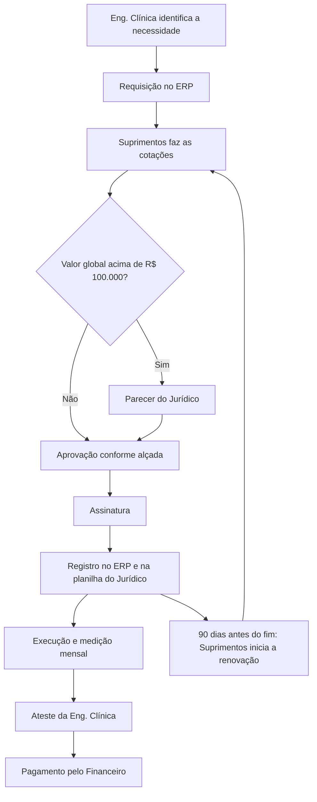
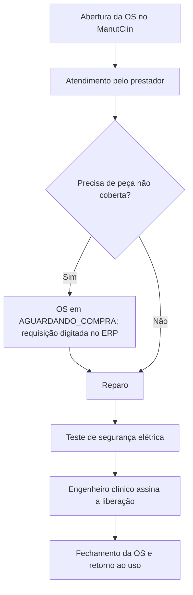

# Fluxo de contratação e manutenção de equipamentos

Rede Hospitalar Aurora do Vale (organização fictícia). Engenharia Clínica e Suprimentos. Revisão de junho de 2025.

## Contratação e renovação

## Manutenção corretiva

Regra da etapa F e G: nenhum equipamento volta ao uso assistencial sem teste aprovado e liberação assinada.
