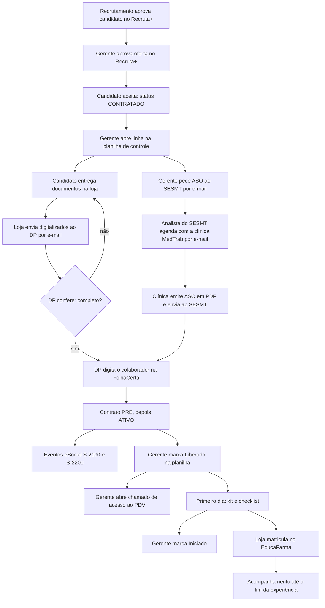

# Fluxo de admissão como é hoje

Desenhado por Cláudia Reis e Rogério Tavares em oficina de 09/2026.

Aprendizes seguem por fora da FolhaCerta: o DP envia os dados à Contábil Alfa a partir da etapa J.
