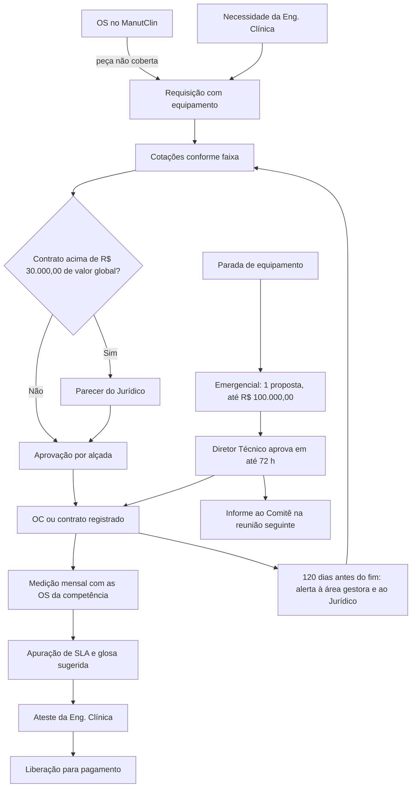

# 02. Documentação de negócio

Sistema único de compras e contratos de manutenção de equipamentos. Rede Hospitalar Aurora do Vale. Primeira fase, com entrada em operação até 30/06/2027.

**Como ler a origem das informações**

- **Fonte:** documento ou sistema em `fontes/`. Os requisitos citam a origem em `07-rastreabilidade.md`.
- **R*n*:** resposta do stakeholder à pergunta *n* (`respostas.md`).
- **D-*n*:** decisão minha sobre algo que os stakeholders não souberam responder. Vale como premissa até ser validada (seção 9). Não é fato nem decisão da Rede.

## 1. Problema

A contratação de manutenção passa por três bases que não conversam: SupriMax (ERP), ManutClin e a planilha do Jurídico. Nenhuma tem o contrato completo, e os sistemas não aplicam a Política vigente. Os efeitos medidos são:

| Sintoma | Medida atual | Fonte |
|---|---|---|
| Ciclo de contratação | 38 dias, dos quais 23 aguardando parecer | Indicadores 2025 |
| OS corretiva em AGUARDANDO_COMPRA | 21 dias em média | Indicadores 2025 |
| Conferência manual de medições | 2 analistas, cerca de 6 dias úteis por mês; raramente termina antes do pagamento | Ata, item 4 |
| Vencimentos alterados à mão | Cerca de 140 títulos por mês; causa não confirmada | Ata, item 6 |
| Glosas aplicadas | R$ 0,00 em 2025 | Indicadores 2025 |
| Gasto de manutenção em 2025 | R$ 3.025.880,00, dos quais R$ 1.550.440,00 em contratos | Indicadores 2025, R13 |

## 2. Objetivos da primeira fase

Na ordem definida pela Diretora Geral (R2):

1. Cadastro único de contratos, com vigência, valor, SLA e alertas de renovação.
2. Aprovações conforme a Política, com trilha de auditoria.
3. Ligação entre OS, requisição e medição, com ateste no sistema.
4. Cálculo de glosa por SLA.
5. Custo por equipamento: desejável, pode ficar para a segunda fase.

**Critério de sucesso:** não definido (R2). A seção 8 propõe indicadores com a linha de base atual; as metas dependem da patrocinadora.

## 3. Escopo

### Dentro da primeira fase

- Requisição, cotação, aprovação, contrato, aditivo, renovação, medição e liberação para pagamento de serviços de manutenção de equipamentos (escopo).
- Relação com OS e inventário da Engenharia Clínica (escopo).
- Visão consolidada da rede por contrato, fornecedor, equipamento e unidade (escopo).
- Unidades: Aurora Central, Aurora Norte, Aurora Litoral e CDI Aurora Sul. O **Hospital Aurora Serra** é tratado na seção 3.1.

### Fora da primeira fase

| Item | Origem |
|---|---|
| Medicamentos (inclusive validade de lotes em estoque, pedido da Farmácia em M-01), OPME, obras prediais e prontuário eletrônico | Escopo, POL 1.2 |
| Portal do prestador | R14 |
| Custo por equipamento (segunda fase, se confirmado) | R2 |
| Condução de evento adverso (só é sinalizado) | D-07 |

### 3.1 Mudança de escopo a formalizar: Hospital Aurora Serra

A Rede vai incorporar o Hospital Aurora Serra em janeiro de 2027, com **dois contratos de manutenção próprios, que precisam entrar no sistema único** (R15, M-01). **Isso amplia o escopo original, a POL 1.1 e todas as bases, que têm quatro unidades.** Os dados dos dois contratos, os equipamentos, os volumes e os sistemas do hospital não estão em nenhuma fonte.

Decisão D-02: o hospital entra como unidade por cadastro e seus dois contratos fazem parte da primeira fase. Inventário, OS e demais processos dependem de confirmação de volume e de uma revisão formal do escopo pela patrocinadora, pois afetam prazo e migração. A POL 1.1 precisa ser revista. Como a incorporação ocorre antes do go-live, de janeiro a junho de 2027 esses contratos precisam ser controlados no processo atual, e registrados no ERP antes do primeiro pagamento (POL 4.1).

## 4. Partes interessadas

| Papel | Pessoa | Interesse ou decisão confirmada |
|---|---|---|
| Patrocinadora, Diretora Geral | Renata Gaspar | Prioridades (R2); alçada acima de R$ 250.000,00 |
| Diretor Financeiro | Luís Mota | Alçada até R$ 250.000,00; câmbio de referência (R13) |
| Gerente de Suprimentos | Cláudia Freitas | Requisição, cotação e OC; alçada até R$ 50.000,00 |
| Gerente de Engenharia Clínica | Beatriz Tavares | Decide o ateste (R8); criticidade (R11) |
| Jurídico | Marta Quintela | Parecer, contratos, renovação |
| Diretor Técnico | Dr. Hélio Sampaio | Compra emergencial; liberação após reparo (R10) |
| Qualidade e Segurança do Paciente | Dra. Ana Prado | Fluxo de evento adverso (indicada em R10; ainda não ouvida) |
| Encarregado de dados | Gustavo Leme | Dados de paciente em OS (indicado em R14; ainda não ouvido) |
| Coordenador de TI | Rafael Couto | APIs e integração (indicado em R15; ainda não ouvido) |
| Controladoria | Não identificada | Indicadores |
| Fornecedores | | Sem acesso ao novo sistema na primeira fase (R14) |

## 5. Processo futuro

Mudanças de prática em relação ao atual:

- **Renovação:** hoje o Jurídico só começa quando a planilha muda para "A renovar", a 60 dias (R5). Passa a 120 dias (R3).
- **Aditivo:** hoje pode ser lançado por Suprimentos sem aviso ao Jurídico (R4). Passa a avisar automaticamente.
- **Contrato local:** o CT-2026-0021 foi assinado pela unidade e nunca registrado (R6). Passa a exigir registro antes do pagamento.
- **Parecer:** com o limite de R$ 30.000,00 confirmado (R3), a carga do Jurídico pode crescer sobre um gargalo já de 23 dias. Composição e capacidade são desconhecidas (R5), e o tema precisa ser acompanhado por indicador.

## 6. Regras de negócio

| ID | Regra | Situação |
|---|---|---|
| RN-01 | Alçada: até R$ 50.000,00, Gerente de Suprimentos; de R$ 50.000,01 a R$ 250.000,00, Diretor Financeiro; acima, Diretora Geral | Confirmada (POL 2, R3) |
| RN-02 | Base da alçada: valor total da OC; valor global de toda a vigência no contrato | POL 2.1 e 2.2 |
| RN-03 | Quem solicita não pode aprovar | POL 2.3. Substituto: D-05 |
| RN-04 | Cotações: até R$ 5.000,00, dispensa; de R$ 5.000,01 a R$ 15.000,00, duas; acima, três | Confirmada (POL 3, R3) |
| RN-05 | É vedado dividir a mesma necessidade para enquadrá-la em alçada inferior | POL 3.1. Critério de detecção: D-05 |
| RN-06 | Emergencial: evitar interrupção imediata da assistência por parada de equipamento; até R$ 100.000,00 por ocorrência; uma proposta; Diretor Técnico aprova em até 72 h após a emissão; pagamento pode ser inferior a 30 dias; informe ao Comitê na reunião seguinte | Portaria DG-017/2025 |
| RN-07 | Contrato com valor global acima de R$ 30.000,00 exige parecer antes da aprovação | Confirmada (POL 4.5, R3). **Mudança para R$ 200.000,00 em conflito (M-02, D-16):** não se aplica sem aprovação comprovada da Diretoria |
| RN-08 | Contrato é registrado antes do primeiro pagamento, inclusive se assinado na unidade | POL 1.1 e 4.1, R6 |
| RN-09 | Renovação começa 120 dias antes do fim, pela área gestora e pelo Jurídico | Confirmada (POL 4.2, R3) |
| RN-10 | Reajuste: IPCA em contratos assinados desde 01/01/2024; anteriores mantêm o índice até o fim da vigência | POL 4.3, R4. Periodicidade: D-11 |
| RN-11 | Moeda estrangeira: registrar na moeda do contrato, sem índice; câmbio de referência definido pelo Diretor Financeiro | POL 4.4, R13 |
| RN-12 | Pagamento: padrão de 45 dias da emissão da nota, mínimo de 30, salvo emergencial | POL 5.1 |
| RN-13 | Medição só é paga após ateste da Engenharia Clínica; a decisão é da Gerente | POL 5.2, R8. Substituto: D-09 |
| RN-14 | Descumprimento de SLA gera glosa de 2% do valor mensal por evento, limitada a 10% por competência | POL 5.3, R9. Ver nota abaixo |
| RN-15 | Nenhum equipamento volta ao uso sem teste aprovado e liberação assinada | Fluxo, R10 |
| RN-16 | Equipamento com calibração vencida não deve permanecer em uso | POL 6.3 |
| RN-17 | Criticidade em 4 níveis por equipamento; no ManutClin, A = 1, B = 2 e 3, C = 4 | POL 6.2, R11 |
| RN-18 | Contrato vencido não recebe pagamento, salvo exceção registrada | D-06 |
| RN-19 | Fornecedor é único por CNPJ, com razão social e nome fantasia | R4 |
| RN-20 | SLA de atendimento e de solução são os do contrato assinado | R4 |

**Nota sobre a RN-14.** O teto vem de R9 ("aceito pelo Financeiro e pela Engenharia Clínica"), e o Memorando 2026/14 (M-02) definiu a base: **10% do valor mensal do contrato, em cada competência**. O teto **não está na POL rev. 3**, e não se sabe se foi aprovado pela Diretoria ou se está nos contratos. Ele entra como parâmetro alterável, com a formalização pendente. Efeito: 5 eventos atingem o teto.

## 7. Requisitos funcionais

| ID | Requisito | Prioridade |
|---|---|---|
| RF-01 | Manter cadastro único de contratos com número, unidade, fornecedor, objeto, vigência, moeda, valor mensal e global, índice, SLA de atendimento e solução, preventiva e gestor | 1 |
| RF-02 | Manter cadastro único de fornecedores por CNPJ, com razão social e nome fantasia | 1 |
| RF-03 | Manter unidades como cadastro, permitindo incluir novas sem desenvolvimento | 1 |
| RF-04 | Registrar aditivos com histórico e avisar o Jurídico | 1 |
| RF-05 | Registrar reajustes com histórico e sinalizar reajuste atrasado | 1 |
| RF-06 | Calcular a situação do contrato pelas datas e alertar a renovação em 120 dias | 1 |
| RF-07 | Acompanhar a renovação, com responsável, etapa e atraso | 1 |
| RF-08 | Registrar requisições com unidade, equipamento e origem | 2 |
| RF-09 | Exigir cotações conforme a faixa de valor | 2 |
| RF-10 | Encaminhar OC e contrato ao aprovador pela alçada | 2 |
| RF-11 | Impedir que o solicitante aprove | 2 |
| RF-12 | Detectar possível fracionamento | 2 |
| RF-13 | Conduzir compra emergencial conforme a Portaria | 2 |
| RF-14 | Conduzir o parecer jurídico, com medição do tempo de cada etapa | 2 |
| RF-15 | Manter trilha de auditoria das aprovações | 2 |
| RF-16 | Manter regras e limites como parâmetros com vigência | 2 |
| RF-17 | Informar ao Comitê as compras emergenciais | 2 |
| RF-18 | Obter inventário e OS da Engenharia Clínica | 3 |
| RF-19 | Gerar requisição a partir da OS, sem redigitação, com vínculo nos dois sentidos | 3 |
| RF-20 | Gerar a medição mensal com as OS da competência | 3 |
| RF-21 | Registrar o ateste no sistema | 3 |
| RF-22 | Bloquear liberação sem ateste, sem contrato registrado ou com contrato vencido | 3 |
| RF-23 | Calcular o vencimento conforme a Política e enviar a autorização ao Financeiro | 3 |
| RF-24 | Sinalizar OS fechada sem teste ou liberação e equipamento em uso com calibração vencida | 3 |
| RF-25 | Apurar SLA de atendimento e solução por OS | 4 |
| RF-26 | Calcular glosa sugerida, com teto, e registrar a decisão | 4 |
| RF-27 | Oferecer visão consolidada por contrato, fornecedor, equipamento e unidade | 3 |
| RF-28 | Medir os indicadores do processo | 3 |
| RF-29 | Calcular custo por equipamento (segunda fase) | 5 |
| RF-30 | Controlar acesso por perfil e unidade | 1 |
| RF-31 | Migrar contratos saneados e substituir a planilha | 1 |

Os requisitos não funcionais estão em `03-tecnico.md`.

## 8. Indicadores propostos

Metas a definir pela patrocinadora (R2).

| Indicador | Linha de base | Requisito |
|---|---|---|
| Ciclo da requisição à assinatura | 38 dias | RF-28 |
| Tempo aguardando parecer | 23 dias | RF-14 |
| Tempo de OS aguardando compra | 21 dias | RF-19 |
| Esforço de conferência de medição | Cerca de 6 dias úteis por mês | RF-20 |
| Títulos alterados manualmente | Cerca de 140 por mês | RF-23 |
| Contratos com renovação iniciada em até 120 dias | Não medido; o CT-2025-0064 não iniciou (R5) | RF-06 |
| Medições pagas sem ateste | Não medido; ao menos 1 caso na amostra | RF-22 |
| Glosas apuradas e aplicadas | R$ 0,00 em 2025 | RF-26 |

## 9. Decisões a validar e pendências

As áreas responderam "não sei" a boa parte das perguntas. Assumi as decisões abaixo para não parar o trabalho, e cada uma tem um dono para validar.

| ID | Decisão assumida | Por quê | Validar com | Se mudar |
|---|---|---|---|---|
| D-01 | ManutClin permanece e é integrado; planilha é substituída; SupriMax permanece nas outras categorias | O escopo fala em "se relacionar" com OS e inventário; R1 sem resposta | Diretora Geral | Substituir o ManutClin aumenta muito o escopo e ameaça a data |
| D-02 | Aurora Serra como unidade por cadastro, com seus 2 contratos na primeira fase; inventário e OS só com confirmação | R15 e M-01, sem dados | Diretora Geral | Inclusão plena exige dados e nova migração |
| D-03 | Entrada simultânea nas unidades existentes | R2 sem resposta; rede tem uma única política | Diretora Geral | Gradual reduz risco e prolonga a convivência com a planilha |
| D-04 | Produto agnóstico entre comprar e desenvolver | R1 sem resposta | Diretora Geral | Define equipe e arquitetura |
| D-05 | Fracionamento: mesma requisição soma para alçada (bloqueia); mesmo fornecedor e objeto em 30 dias gera alerta com justificativa. Sem substituto, sobe para a alçada seguinte | R6 sem resposta | Gerente de Suprimentos, Diretor Financeiro | Ajuste de parâmetro |
| D-06 | Contrato vencido bloqueia pagamento; exceção com justificativa aprovada pela Diretora Geral | R5 sem resposta; serviços críticos não podem parar | Jurídico, Diretora Geral | Muda a regra RN-18 |
| D-07 | Evento adverso apenas sinalizado | R10 remete à Qualidade | Dra. Ana Prado | Novo requisito |
| D-08 | Glosa sugerida, decisão da Engenharia Clínica; horas corridas; relógio de solução suspenso apenas em espera registrada de peça não coberta | R9 parcial | Engenharia Clínica, Jurídico, conforme contratos | Muda RN-14 e a apuração da glosa |
| D-09 | Sem substituto para o ateste até haver definição formal; o sistema só permite atestar a quem tiver o papel | R8 parcial | Gerente de Eng. Clínica | Risco de atraso nas férias da titular; precisa de resposta antes do go-live |
| D-10 | Novo sistema autoriza; o pagamento continua no sistema financeiro atual; prazo de 45 dias da emissão | R12 sem resposta; sistema financeiro desconhecido | Diretor Financeiro | Se pagar for no novo sistema, surge novo épico |
| D-11 | Reajuste anual, parametrizável por contrato | Hipótese; contratos indisponíveis | Jurídico | Ajuste de parâmetro |
| D-12 | Inventário completo (4.812) como cadastro; 393 sob contrato; usina e gases dentro; instrumentos sem etiqueta tratados no objeto do contrato | R11 sem resposta | Gerente de Eng. Clínica | Fronteira predial e instrumentos |
| D-13 | Sem dados de paciente no sistema ou na migração | Escopo exclui prontuário; DPO ainda não ouvido | Gustavo Leme | Nenhuma flexibilização esperada |
| D-14 | Migrar contratos ativos e inventário; histórico de 24 meses somente para consulta | R15 sem resposta | Diretor Financeiro, TI | Muda esforço de migração |
| D-15 | Contrato incorporado da Aurora Serra entra sem nova aprovação retroativa; aditivo e renovação seguem a Política | M-01 não trata disso | Jurídico, Diretora Geral | Exige regularização antes da carga |
| D-16 | Mantido o parecer acima de R$ 30.000,00 até haver aprovação da Diretoria. O sistema já permite mudar por parâmetro | M-02 não cita aprovação; R3 diz que a proposta não foi aprovada | Diretora Geral | Se aprovado: nova versão do parâmetro e revisão da POL 4.5 |

### Perguntas ainda abertas, com quem responde

| Tema | Quem | Impacto se ficar aberto |
|---|---|---|
| Arquitetura de fronteira, comprar ou desenvolver (R1) | Diretora Geral | **Bloqueia o início da construção** |
| APIs do ERP e do ManutClin, custos (R15) | Rafael Couto | Risco técnico de EP-03 e EP-04 |
| Sistema financeiro, motivo dos 140 títulos (R12) | Luís Mota | Risco em RF-23 |
| Composição dos 23 dias, rito simplificado (R5) | Marta Quintela | O gargalo pode aumentar |
| Definição de "evento", relógio do SLA (R9) | Beatriz Tavares, Marta Quintela | Glosa contestável |
| Conferência de medição passo a passo (R8) | Beatriz Tavares, Luís Mota | Risco em RF-20 |
| Divisão dos 21 dias (R7) | Cláudia Freitas, Beatriz Tavares | Risco de não atacar a causa |
| Dados de paciente e correção do portal (R14) | Gustavo Leme | Ver seção 10 |
| Fluxo de evento adverso (R10) | Dra. Ana Prado | Ver seção 10 |
| Textos de contrato, lista de setembro, ata do Comitê de 21/10 (R4; M-01 traz só três recados) | Marta Quintela | Saneamento fica incompleto |
| A Diretoria aprovou o parecer acima de R$ 200.000,00? (M-02 contra R3) | Renata Gaspar | Ver seção 10 |
| Dados dos 2 contratos, inventário e sistemas da Aurora Serra (M-01) | Renata Gaspar, Marta Quintela | HU-044 sem dados; volume de migração desconhecido |

## 10. Ações imediatas, sem esperar o sistema

Nenhuma resposta confirmou tratamento destes pontos.

| Ação | Responsável sugerido | Motivo |
|---|---|---|
| Verificar a situação do ventilador PAT-004512 (OS 88213: evento adverso, fechada sem teste e liberação; calibração vencida desde 31/03/2026, dados de 30/09/2026) e procurar outras OS semelhantes | Diretor Técnico, Eng. Clínica, Qualidade | Segurança do paciente; RN-15 e RN-16 |
| Corrigir o gatilho `trg_os_fecha`, que libera o equipamento sem verificar teste | Coordenador de TI, Eng. Clínica | Causa técnica do item acima |
| Restringir o `prestador_portal`, que lê nome e prontuário e altera horário de atendimento | Encarregado de dados, Coordenador de TI | LGPD e integridade do SLA |
| Iniciar a renovação do CT-2025-0064 (usina de oxigênio; vence em 31/01/2027, não iniciada) e verificar CT-2023-0088, CT-2026-0021, CT-2023-0019 e CT-2025-0102 | Eng. Clínica, Jurídico | RN-09; janela de 120 dias já passou |
| Mudar já o alerta da planilha para 120 dias | Jurídico | R3 pede adequação; o sistema só entra em 2027 |
| Regularizar CT-2022-0055 (vencido) e CT-2026-0021 (sem registro, aprovação ou parecer conhecidos) | Jurídico, Suprimentos | POL 4.1 e 4.5 |
| Corrigir o ManutClin: SLA do CT-2024-0117 para 4 h, plano de ventiladores da Central de 365 para 180 dias | Eng. Clínica | R4 |
| Decidir sobre o limite de parecer. Enquanto isso, não dispensar parecer entre R$ 30.000,00 e R$ 200.000,00. As renovações do CT-2025-0102 (R$ 163.200,00) e do CT-2026-0021 (R$ 58.800,00) ficam nessa faixa | Diretora Geral, Jurídico | M-02 conflita com POL 4.5 e diz valer "daqui em diante" |
| Definir como controlar os 2 contratos da Aurora Serra de janeiro até o go-live | Jurídico, Suprimentos | M-01, POL 4.1 |
| Avaliar a glosa de R$ 220,80 da OS 88170 | Eng. Clínica, Financeiro | POL 5.3 |
| Corrigir no ERP o índice do CT-2025-0064, alçadas e cotações | Suprimentos, TI | R3: configuração antiga, nunca revista |

## 11. Riscos principais do projeto

| Risco | Tratamento |
|---|---|
| R1 sem resposta: fronteira e estratégia indefinidas, a 238 dias do prazo | Decisão da patrocinadora até o início da construção; D-01 como base |
| Aurora Serra sem dados, em janeiro de 2027, com 2 contratos a incorporar | D-02, D-15, HU-044; revisar escopo formalmente |
| Parecer dispensado sem aprovação da Diretoria (M-02) | D-16; decisão da Diretora Geral |
| Muitas regras sem dono (glosa, conferência, fracionamento) | Parametrizar; validar em oficina antes de construir EP-03 e EP-04 |
| Teto de glosa sem aprovação formal da Diretoria | Formalizar antes da primeira glosa no sistema (base definida em M-02) |
| Prazo insuficiente | Ordem da seção 2 é o corte: EP-04 é o primeiro a sair; custo por equipamento já está na fase 2 |
| Atendimento alterável pelo prestador, com portal fora da fase | HU-033 registra alterações; correção de acesso na seção 10 |
| Dependência de uma pessoa para ateste e contratos | Definir substitutos antes do go-live |

## 12. Histórico

| Data | Mudança |
|---|---|
| 04/11/2026 | Atualização com M-01 e M-02. Detalhes em `08-mudancas.md` |
