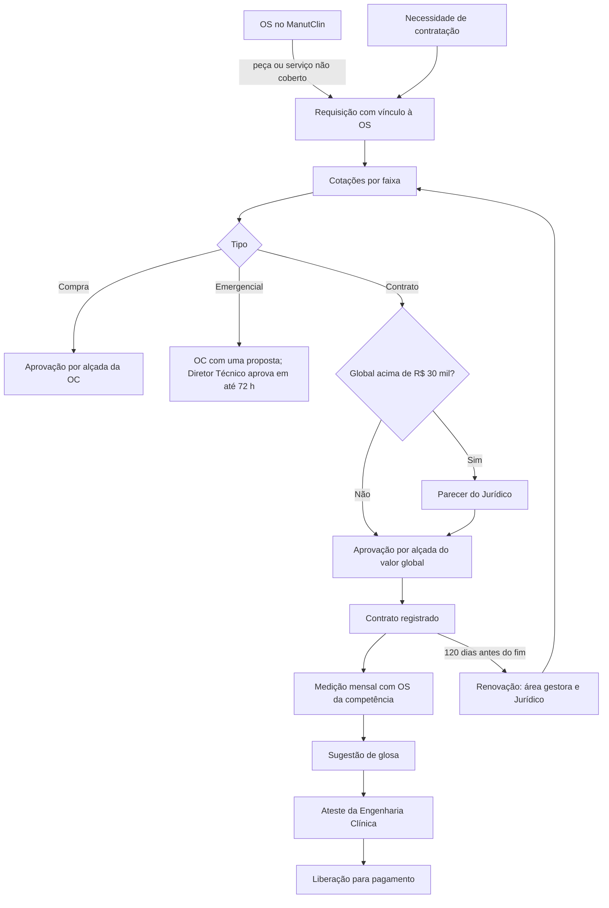

# Documentação de negócio: sistema único de compras e contratos de manutenção de equipamentos

Rede Hospitalar Aurora do Vale. Patrocínio: Diretoria Geral. Base: `escopo.md`, `fontes/`, `entrega/01-diagnostico.md` e `entrega/respostas.md`. As pessoas são citadas por função.

**Situação do documento:** versão 2 (com as mudanças de `08-mudancas.md`), pronta para validação, com 20 decisões pendentes (seção 8). "Não sei" foi tratado como falta de decisão, e não como aceite das suposições feitas em `perguntas.md`. Tudo que depende disso está marcado como provisório.

## 1. Problema e objetivo

A contratação de manutenção passa por ERP SupriMax, ManutClin e uma planilha do Jurídico, que não conversam. Em 2025 foram gastos R$ 3.025.880,00 nesse processo, e os controles previstos na POL-SUP-004 rev. 3 não estão implantados nos sistemas: a configuração do ERP é antiga e não foi revista após a rev. 3 (Diretor Financeiro e Gerente de Suprimentos).

**Objetivo:** ter um sistema único para comprar, contratar, acompanhar e pagar esses serviços, aplicando a Política e relacionando contratos com OS e inventário.

**Restrição:** a primeira fase entra em operação até 30/06/2027.

## 2. Escopo

### Primeira fase, na ordem definida pela Diretora Geral

1. Cadastro único de contratos, com vigência, valor, SLA e alertas de renovação.
2. Aprovações conforme a Política, com trilha de auditoria.
3. Ligação entre OS, requisição e medição, com ateste no sistema.
4. Cálculo de glosa por SLA.

O escopo original também pede itens que a lista acima não cita. Mantive-os na primeira fase, depois dos quatro, por decisão minha a validar:

| Item do escopo | Tratamento |
|---|---|
| Requisição, cotação | Necessários para as aprovações |
| Aditivo, renovação | Parte do cadastro de contratos |
| Pagamento | Até a **liberação para pagamento** com vencimento calculado. A execução e a baixa dependem de DP-12 |
| Visão consolidada por contrato, fornecedor, equipamento e unidade | Depois da glosa; sem custo por equipamento |
| Relação com inventário | Consulta e vínculo; criticidade oficial no novo sistema (DP-15) |

Acrescentei também, como recomendação, o painel de exceções técnicas (RF-34), porque o caso da OS 88213 é risco assistencial. Ele não consta da lista da Diretora Geral e precisa do aceite dela.

### Depois da primeira fase

- Custo por equipamento: desejável, pode ir para a segunda fase. A fase 1 já guarda o patrimônio em OS, requisição e OC para viabilizá-lo.

### Fora do escopo

- Medicamentos, OPME, obras prediais e prontuário eletrônico.
- Portal do prestador, na primeira fase. **Isso não resolve a exposição atual:** a conta `prestador_portal` do ManutClin continua existindo (seção 9).

### Pontos abertos de fronteira

"Sistema único" não tem definição (DP-01), a entrada das quatro unidades não foi decidida (DP-02) e o enquadramento de usina de oxigênio e gases também não (DP-04). Trabalhei com as quatro unidades do escopo mais o **Hospital Aurora Serra**, que entra na Rede em janeiro de 2027 com dois contratos próprios (M-01; inclusão a confirmar, DP-20), e com gases dentro, porque o CT-2025-0064 está em `MANUT_EQUIP` e no inventário.

## 3. Partes interessadas e perfis

| Função | Interesse | Uso previsto |
|---|---|---|
| Diretora Geral | Patrocínio; decisão acima de R$ 250 mil | Aprova; consulta visões |
| Diretor Financeiro | Alçada intermediária, câmbio de referência, pagamento | Aprova; libera; consulta |
| Gerente e analistas de Suprimentos | Requisição, cotação, OC; alçada até R$ 50 mil | Operam |
| Gerente e analistas de Engenharia Clínica | Área gestora, ateste, inventário, criticidade | Medição, ateste, renovação |
| Jurídico | Parecer, contratos | Mantém contrato (dono a definir: DP-08) |
| Diretor Técnico | Compra emergencial, segurança assistencial | Aprova emergencial |
| Comitê de Contratos | Acompanhamento | Recebe compras emergenciais e relatórios |
| Unidades | Demandantes. A Litoral assinou contrato localmente. Hospital Aurora Serra: novo, a partir de janeiro de 2027 | Abrem requisição |
| TI | Responsável técnico não identificado | DP-01 |
| Gerência de Qualidade e Segurança do Paciente | **Novo:** indicada para evento adverso | A consultar (DP-17) |
| Encarregado de dados (DPO) | **Novo:** indicado para dados pessoais | A consultar (DP-18) |

## 4. Processo futuro

**Principais mudanças:** não há redigitação da OS como requisição, a vigência é calculada por data, nenhuma medição é liberada sem ateste, e toda aprovação fica registrada.

## 5. Regras de negócio

**Confirmada:** um stakeholder confirmou nas respostas. **Vigente:** consta de documento em vigor e não foi contestada. **Provisória:** falta decisão; pode mudar.

| ID | Regra | Situação | Fonte |
|---|---|---|---|
| RN-01 | Alçada de OC pelo valor total: até R$ 50.000,00, Gerente de Suprimentos; até R$ 250.000,00, Diretor Financeiro; acima, Diretora Geral | Confirmada | POL 2 e 2.1; R3 |
| RN-02 | Alçada de contrato pelo valor global da vigência, para contrato assinado desde 01/01/2025. Contratos anteriores: DP-05 | Confirmada | POL 2.2; R3 |
| RN-03 | Quem solicita não aprova. Substituto do aprovador: DP-11 | Vigente | POL 2.3 |
| RN-04 | Cotações: até R$ 5.000,00, dispensa; até R$ 15.000,00, duas; acima, três | Confirmada | POL 3; R3 |
| RN-05 | É vedado dividir a mesma necessidade para enquadrar em alçada inferior. Critério de detecção: DP-11 | Vigente | POL 3.1 |
| RN-06 | Compra emergencial: até R$ 100.000,00 por ocorrência, uma proposta, aprovação do Diretor Técnico em até 72 h da emissão, pagamento pode ser inferior a 30 dias, aviso ao Comitê na reunião seguinte | Vigente | Portaria DG-017/2025 |
| RN-07 | Contrato com valor global acima de R$ 30.000,00 exige parecer jurídico antes da aprovação. Aditivo e renovação: DP-06. **O Memorando 2026/14 propõe R$ 200 mil; não aplicado (DP-19)** | Confirmada | POL 4.5; R4 |
| RN-08 | Contrato é registrado antes do primeiro pagamento, inclusive se assinado na unidade | Vigente | POL 4.1; R8 |
| RN-09 | Renovação começa 120 dias antes do fim, pela área gestora e pelo Jurídico. Fluxo e planilha devem se adequar. Dono por etapa: DP-07 | Confirmada | POL 4.2; R5 |
| RN-10 | Índice: IPCA para contrato assinado desde 01/01/2024; anteriores mantêm o original até o fim da vigência. Periodicidade: DP-07 | Vigente | POL 4.3; R6 |
| RN-11 | Contrato em moeda estrangeira: registrado na moeda, sem índice, com câmbio de referência do Financeiro para controle orçamentário | Vigente | POL 4.4; R12 |
| RN-12 | Pagamento em 45 dias da emissão da nota; mínimo de 30, salvo emergencial | Vigente | POL 5.1 |
| RN-13 | Medição só é paga após ateste da Engenharia Clínica | Vigente | POL 5.2 |
| RN-14 | Descumprir SLA contratual gera glosa de 2% do valor mensal por evento. A soma por competência é limitada a 10% do valor mensal (teto provisório, a formalizar). Forma de cálculo: DP-13 | Vigente | POL 5.3; M-02 |
| RN-15 | Equipamento só volta ao uso com teste aprovado e liberação assinada. Impedir ou alertar: DP-16 | Confirmada | Fluxo; R14 |
| RN-16 | Equipamento com calibração vencida não permanece em uso assistencial | Vigente | POL 6.3 |
| RN-17 | Criticidade oficial em quatro níveis: 1 Suporte à vida, 2 Alto, 3 Médio, 4 Baixo. Provisoriamente no ManutClin: A = 1; B = 2 ou 3; C = 4 | Confirmada | POL 6.2; R13 |
| RN-18 | Ventiladores têm preventiva semestral, como no contrato assinado. O plano de 365 dias do ManutClin está incorreto | Confirmada | R13 |
| RN-19 | O registro de aditivo notifica o Jurídico. Criada porque o aditivo 2 do CT-2023-0088 foi lançado sem aviso | Provisória | R6 (proposta minha) |
| RN-20 | Contrato vencido nunca interrompe o atendimento, mas a liberação de pagamento exige exceção justificada e aprovada. Autorizador: DP-09 | Provisória | Ata; proposta minha |
| RN-21 | Nome e prontuário de paciente não entram no novo sistema | Provisória | Minimização; validar com DPO (DP-18) |
| RN-22 | Toda aprovação fica em trilha de auditoria | Confirmada | R2; R15 |

**Hierarquia confirmada:** nos pontos respondidos, a Política prevalece sobre ERP, fluxo e planilha; o contrato assinado define SLA, índice e preventiva do contrato. Falta saber se há alguma exceção formal (DP-05).

## 6. Requisitos funcionais

| ID | Requisito | Fase | Regras |
|---|---|---|---|
| RF-01 | Cadastro único de contrato: número, unidade, fornecedor, objeto, vigência, valor, índice, SLA de atendimento e solução, preventiva, documento | F1 | RN-08, RN-18 |
| RF-02 | Fornecedor único por CNPJ, com nomes alternativos | F1 | |
| RF-03 | Vínculo entre contrato, equipamentos (um equipamento pode ter vários contratos) e unidades | F1 | |
| RF-04 | Contrato em moeda estrangeira, com câmbio de referência | F1 | RN-11 |
| RF-05 | Status de vigência calculado por data, separado do andamento da renovação | F1 | RN-09 |
| RF-06 | Alertas de renovação a partir de 120 dias | F1 | RN-09 |
| RF-07 | Fluxo de renovação com etapas e responsáveis | F1 | RN-09, RN-07 |
| RF-08 | Aditivos numerados com histórico, notificando o Jurídico | F1 | RN-19, RN-07 |
| RF-09 | Registro e agenda de reajuste por contrato | F1 | RN-10 |
| RF-10 | Carga dos contratos saneados contra o documento assinado | F1 | RN-08 |
| RF-11 | Levantamento de contratos não registrados e de OCs avulsas recorrentes | F1 | RN-08 |
| RF-12 | Requisição com área demandante, unidade, patrimônio e origem | F1 | RN-03 |
| RF-13 | Cotações exigidas conforme a faixa de valor | F1 | RN-04 |
| RF-14 | Limites da Política como parâmetros com data de vigência | F1 | RN-01, RN-02, RN-04, RN-06, RN-07, RN-09, RN-12, RN-14 |
| RF-15 | Aprovação de OC por alçada | F1 | RN-01, RN-22 |
| RF-16 | Impedimento de autoaprovação | F1 | RN-03 |
| RF-17 | Aprovação de contrato por valor global, com parecer jurídico | F1 | RN-02, RN-07, RN-22 |
| RF-18 | Detecção de possível fracionamento | F1 | RN-05 |
| RF-19 | Compra emergencial conforme a Portaria | F1 | RN-06 |
| RF-20 | Trilha de auditoria de aprovações e alterações de contrato | F1 | RN-22 |
| RF-21 | Perfis de acesso por função e unidade | F1 | RN-21 |
| RF-22 | Consulta a OS e inventário do ManutClin, sem dados de paciente | F1 | RN-21 |
| RF-23 | Abertura de requisição a partir da OS, com vínculo estruturado | F1 | |
| RF-24 | Medição mensal única por contrato e competência | F1 | RN-13 |
| RF-25 | Conferência da medição com as OS da competência | F1 | RN-13, RN-14 |
| RF-26 | Ateste no sistema pela Engenharia Clínica | F1 | RN-13, RN-22 |
| RF-27 | Liberação para pagamento, com vencimento calculado | F1 | RN-12, RN-13 |
| RF-28 | Tratamento de pagamento de contrato vencido | F1 | RN-20 |
| RF-29 | Cálculo de atendimento de SLA por OS | F1 | RN-14 |
| RF-30 | Sugestão e decisão de glosa | F1 | RN-14 |
| RF-31 | Visão consolidada por contrato, fornecedor, equipamento e unidade | F1 | RN-11 |
| RF-32 | Indicadores de acompanhamento do processo | F1 | |
| RF-33 | Criticidade oficial em quatro níveis por equipamento | F1 | RN-17 |
| RF-34 | Painel de exceções: OS fechada sem teste ou liberação, calibração vencida em uso | F1 | RN-15, RN-16 |
| RF-35 | Custo por equipamento: contrato, chamados e peças | F2 | |
| RF-36 | Adequação de fluxo e planilha à Política durante a transição | F1 | RN-07, RN-09 |
| RF-37 | Cadastro do Hospital Aurora Serra e carga de seus dois contratos | F1 | RN-08 |

Os requisitos não funcionais estão em `03-tecnico.md`.

## 7. Critérios de sucesso

A Diretora Geral não definiu como medir o sucesso (DP-03). Proponho estes indicadores, com metas numéricas a definir. Só os dois primeiros têm valor fixado pela própria Política.

| Indicador | Linha de base | Meta |
|---|---|---|
| Contratos pagos sem registro | 1 de 8 (CT-2026-0021) | Zero (POL 4.1) |
| Medições pagas sem ateste | Ocorre; 1 na amostra de 5 | Zero (POL 5.2) |
| Contratos em renovação iniciada 120 dias antes | Não medido | A definir |
| Ciclo de contratação | 38 dias, 23 em parecer | A definir |
| OS corretiva em AGUARDANDO_COMPRA | 21 dias | A definir |
| Conferência de medição | Duas analistas, cerca de 6 dias úteis/mês | A definir |
| Títulos com vencimento alterado à mão | Cerca de 140/mês | A definir |
| Glosas aplicadas | R$ 0,00 em 2025 | Sem meta de valor: acompanhar violações e decisão |

A aplicação do limite de R$ 30 mil pode piorar o ciclo de contratação, cujo principal gargalo já é o parecer. A capacidade do Jurídico não é conhecida (DP-06).

## 8. Decisões pendentes

Estes pontos não tiveram resposta. A coluna "Enquanto isso" mostra o que este documento adota, sem que isso seja decisão dos responsáveis.

| ID | Decisão | Responsável | Enquanto isso | Bloqueia |
|---|---|---|---|---|
| DP-01 | Limites do "sistema único", comprar ou desenvolver, responsável técnico | Diretora Geral, TI | Backlog neutro; ManutClin mantido como hipótese | **Arquitetura e todas as integrações** |
| DP-02 | Entrada das quatro unidades de uma vez; momento de entrada do Hospital Aurora Serra | Diretora Geral | Todas na primeira fase | Plano de implantação |
| DP-03 | Métricas de sucesso | Diretora Geral | Seção 7 | Aceite da fase |
| DP-04 | Usina de oxigênio e gases: equipamento ou predial | Diretora Geral | Dentro | Carga do CT-2025-0064 |
| DP-05 | Exceção formal à Política; reavaliação de contratos anteriores à rev. 3 | Diretor Financeiro, Gerente de Suprimentos | Sem exceção; contratos antigos mantêm o registro | RF-14, RF-10 |
| DP-06 | Parecer em aditivo e renovação; causas dos 23 dias; minuta padrão; capacidade | Jurídico | Parecer exigido se o global passar de R$ 30 mil | RF-07, RF-08 |
| DP-07 | Dono de cada etapa da renovação; transição; periodicidade de reajuste | Jurídico, Eng. Clínica, Suprimentos | Periodicidade por contrato | RF-07, RF-09, RF-36 |
| DP-08 | Acesso aos originais; dono do cadastro; valor e parecer do aditivo 2 do CT-2023-0088; aditivo 1 | Jurídico | Jurídico propõe o cadastro; lacunas ficam visíveis | RF-10 |
| DP-09 | Tratamento de contrato vencido, autorizador | Jurídico, Diretor Financeiro | RN-20 | RF-28 |
| DP-10 | Outros contratos fora do ERP; definição e continuidade da OC AVULSA | Suprimentos, Jurídico | Mantém o tipo, com alerta de recorrência | RF-11, RF-15 |
| DP-11 | Substituto do aprovador; quem é solicitante; critério de fracionamento e reação | Suprimentos, Diretor Financeiro | Solicitante é a área; alerta com mesma requisição, ou mesmo fornecedor e objeto em 30 dias | RF-12, RF-16, RF-18 |
| DP-12 | Sistema financeiro; entrada da nota; causa dos 140 títulos; onde o pagamento termina | Diretor Financeiro | Termina na liberação | RF-27 |
| DP-13 | Conferência atual; suspensão do relógio; horas corridas; definição de evento; decisor; motivo da glosa zero | Eng. Clínica, Financeiro, Jurídico | Horas corridas, por OS, sem suspensão automática; casos duvidosos vão para decisão humana | RF-25, RF-29, RF-30 |
| DP-14 | Rateio, equipe própria, histórico, valor consolidado em dólar | Diretora Geral, Diretor Financeiro | Câmbio de referência rotulado na visão | RF-31, RF-35 |
| DP-15 | Crítico/Não crítico; herança pelo contrato; tomógrafo; planos de desfibriladores | Eng. Clínica | Classificação por equipamento; B fica pendente de reclassificação | RF-33 |
| DP-16 | Impedir ou alertar retorno ao uso; exceção extrema; desfecho da OS 88213 e da calibração | Diretor Técnico, Eng. Clínica | Só painel de exceções | RF-34 |
| DP-17 | Responsável e tratamento do evento adverso | Gerência de Qualidade e Segurança do Paciente | Fora do sistema; só o indicador | RF-22, RF-34 |
| DP-18 | Dados de paciente em OS, auditoria do acesso, retenção e acesso | Encarregado de dados (DPO) | RN-21 | RF-20, RF-21, RF-22 |
| DP-19 | Limite do parecer jurídico: R$ 30 mil (Política) ou R$ 200 mil (Memorando 2026/14); revisão formal e vigência | Diretora Geral, Diretor Financeiro, ouvido o Jurídico | R$ 30 mil | RF-07, RF-08, RF-14, RF-17, RF-36 |
| DP-20 | Hospital Aurora Serra: confirmação na primeira fase; dados dos dois contratos; parque, patrimônio e sistemas; aplicação da Política | Diretora Geral, Suprimentos, Jurídico, Eng. Clínica | Carga com campos não confirmados | RF-37 |

**Recomendação:** DP-01 deve ser decidida primeiro. Sem responsável técnico e sem definição do que o sistema substitui, não há como estimar nem assumir com segurança o prazo de 30/06/2027. Sugiro levar as demais pendências à próxima reunião do Comitê de Contratos, pois os responsáveis já participam dele.

## 9. Ações fora do sistema

Não dependem do novo sistema e não deveriam esperar por ele. Todos os dados vêm de extração de 30/09/2026.

| # | Ação | Responsável sugerido | Base |
|---|---|---|---|
| 1 | Conferir PAT-004512 (calibração vencida em 31/03/2026, OS 88213 sem teste e sem liberação) e outros equipamentos nessa condição | Diretor Técnico, Eng. Clínica | R14: desfecho desconhecido |
| 2 | Levar o caso da OS 88213 à Gerência de Qualidade e Segurança do Paciente | Diretor Técnico | R14 |
| 3 | Levar ao DPO a exposição de dados de paciente à conta `prestador_portal` e a possibilidade de o prestador editar `atendimento` | TI, DPO | R15: excluir o portal da fase 1 não elimina o acesso existente |
| 4 | Regularizar o CT-2022-0055 | Jurídico, Diretor Financeiro | Vencido desde 31/08/2025 |
| 5 | Registrar o CT-2026-0021 no ERP e verificar alçada e parecer (global de R$ 58.800,00) | Suprimentos, Jurídico | R8 |
| 6 | Atualizar a planilha: CT-2023-0088 até 31/12/2026, status coerente; CT-2024-0117 R$ 132.480,00/ano | Jurídico | R6 |
| 7 | Corrigir ManutClin: CT-2024-0117 SLA de 4 h; plano de ventiladores semestral | Eng. Clínica | R6, R13 |
| 8 | Corrigir ERP: CT-2025-0064 para IPCA | Suprimentos | R6 |
| 9 | Rever os limites do ERP (R$ 50 mil, R$ 15 mil, valor global) até a entrada do novo sistema | TI, Suprimentos | R3 |
| 10 | Revisar fluxo e critério da planilha para 120 dias e R$ 30 mil | Eng. Clínica, Suprimentos, Jurídico | R4, R5 |
| 11 | Iniciar as renovações em janela: 7 dos 8 contratos estão vencidos ou vencem antes de 30/06/2027 | Área gestora, Jurídico | R5 |
| 12 | Avaliar CT-2025-0064, CT-2025-0102 (alçada abaixo da exigida) e OCs 00301/302/303 e 00388 | Diretor Financeiro | R3 |
| 13 | Colocar os dois contratos do Hospital Aurora Serra nos controles atuais a partir de janeiro de 2027 | Jurídico, Suprimentos | M-01 |
| 14 | Até decidir DP-19, seguir o parecer acima de R$ 30 mil | Jurídico | POL 4.5; M-02 |

## 10. Riscos do projeto

| Risco | Resposta |
|---|---|
| Sem dono técnico e sem definição de arquitetura a menos de oito meses do prazo | Decidir DP-01 primeiro; entregar em ondas |
| Muitas regras sem resposta, em especial glosa e contrato vencido | Histórias afetadas só entram em desenvolvimento após a decisão |
| Sobrecarga do Jurídico com o limite de R$ 30 mil | Medir a capacidade; avaliar minutas padrão |
| Contratos saneados sem os originais | Campo de origem e situação de confirmação em cada dado |
| Renovações durante a transição | Renovar no processo atual, com 120 dias, e cadastrar o resultado |
| Incorporação do Hospital Aurora Serra antes da entrada, sem dados | Obter dados (DP-20) e reavaliar o prazo |
| Regra alterada por memorando, sem revisão da Política | Decidir DP-19; só mudar parâmetro após formalização |
| Aceitação baixa pela Eng. Clínica | Evitar redigitação e manter o ManutClin, se DP-01 confirmar |

### Ordem proposta de entrega

As ondas seguem a prioridade da Diretora Geral. Não há estimativa de esforço: o time não existe ainda e a arquitetura não foi definida.

| Onda | Conteúdo |
|---|---|
| 0 | Ações da seção 9 e DP-01 |
| 1 | Cadastro, vigência e alertas, com carga (assim que possível, por causa das renovações de 2027) |
| 2 | Requisição, cotação, aprovações e trilha |
| 3 | Integração, medição, ateste e liberação |
| 4 | SLA, glosa e visão consolidada |
| F2 | Custo por equipamento |

## 11. Histórico

| Versão | Alteração |
|---|---|
| 1 | Etapa 2, com as respostas dos stakeholders |
| 2 | Etapa 3: nova unidade, teto de glosa, conflito do parecer. Ver `08-mudancas.md` |

## 12. Glossário

A linguagem oficial está em `[método]/knowledge/CONTEXT.md`: Unidade, Fornecedor, Equipamento, Criticidade, Requisição, Cotação, OC, Compra emergencial, Alçada, Contrato, Aditivo, Renovação, Medição, Ateste, Glosa, SLA, OS, Liberação e Título.
