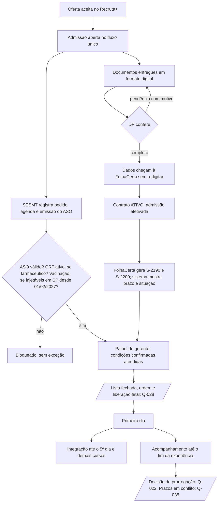

# Documentação de negócio: Projeto Admissão Única

**Projeto:** Admissão Única, Drogarias Caliandra S.A. · **Atualizado na Etapa 3** (ver `08-mudancas.md`) · **Baseline:** B-001, foto de trabalho, **ainda não validada** pelas áreas.

**Fontes:** `escopo.md`, `entrega/respostas.md`, ata do Comitê de 28/10/2026 (M-01), e-mail do Jurídico de 30/10/2026 (M-02), Política RH-012 rev. 4, Manual v3.2, Comunicado DP 07/2024, ata de 22/09/2026, fluxo atual, LEIA-ME e planilha de controle, dumps da FolhaCerta e do Recruta+, exportações do EducaFarma. Siglas de citação em `01-diagnostico.md`, seção 2. As respostas aparecem como `[entrevista: perfil Q-NNN]`.

**Como ler:** o corpo traz só o que tem resposta humana ou evidência citada. Tudo o mais está em **Pendências** (seção 11). Muitas respostas foram "Não sei", e nada foi preenchido no lugar delas.

## 1. Contexto e problema

A rede tem 212 lojas em MG e SP, 184 delas próprias [doc: `escopo.md`], [doc: POL#0 §1]. A média é de 190 admissões por mês nas lojas próprias [doc: ATA#0]. Uma admissão passa por Recruta+, planilha, FolhaCerta, EducaFarma e e-mail.

O diagnóstico mostrou três problemas centrais:

- **Regras:** as mesmas regras têm valores diferentes em cada lugar, e o bloqueio de início falha.
- **Trabalho manual:** há redigitação de cerca de 25 minutos por admissão e cerca de 30% de pastas devolvidas.
- **Dados pessoais:** dados sensíveis estão expostos.

## 2. Objetivos e indicadores

Helena Vasconcelos definiu três prioridades [entrevista: negocio Q-002]:

| Ordem | Objetivo | Requisitos |
|---|---|---|
| 1 | Fluxo único para CLT de loja, com bloqueio de início sem ASO válido e sem CRF ativo | RF-001, RF-012, RN-002, RN-003, RN-016 |
| 2 | Fim da redigitação, com integração Recruta+ → FolhaCerta e entrega digital de documentos | RF-002, RF-003 |
| 3 | Conformidade de dados pessoais, com saída da planilha e tratamento de dados de saúde e de seleção | RF-014, RN-007, RN-008, RN-012, RN-013, RNF-002 |

Aprendizes entram no fluxo único como **prioridade 5** [entrevista: negocio Q-001]. A prioridade 4 não foi informada (Q-016).

**Metas numéricas: não definidas** (Q-017). A tabela mostra apenas a situação relatada, como referência. Não são medições nem metas.

| Indicador | Situação relatada | Meta |
|---|---|---|
| Tempo de digitação por admissão | cerca de 25 min [doc: ATA#0] | a definir |
| Pastas devolvidas | cerca de 30% [doc: ATA#0] | a definir |
| Pedido até exame | cerca de 1 semana [doc: ATA#1] | a definir |
| Dias sem login no PDV | cerca de 3 [doc: ATA#1] | a definir |
| Início sem ASO válido | casos na amostra (RIS-001) | zero, porque a regra não tem exceção [entrevista: juridico-compliance Q-005] |

## 3. Stakeholders e decisões

| Pessoa | Papel | Decide ou informou | Fonte |
|---|---|---|---|
| Helena Vasconcelos | Diretora de Gente & Gestão, patrocinadora | Escopo, prioridades e texto final da RH-012 | [entrevista: negocio Q-002] |
| Marina Quintela | Jurídico Trabalhista | Experiência; ASO, com Fábio | Q-004, Q-005 |
| Fábio Arantes | Médico coordenador do SESMT | ASO, com Marina | Q-005 |
| Beatriz Lobo | Assuntos Regulatórios [doc: M-01] | CRF e prazo da integração | Q-006, Q-008, M-01 |
| Paula Nogueira | Encarregada de Dados | Dados de seleção, CID e retenção de candidatos | Q-012, Q-013 |
| Rogério Tavares | Gerência de DP | Conceito de admissão, piso, prazo de documentos | Q-003, Q-007, Q-011 |
| Cláudia Reis, Sérgio Antunes | Operações de Loja | Usuários do painel; sem respostas além da regra de ASO | Q-015 |
| Igor Melo | TI, em apoio | Sem resposta | Q-014 |
| Vera Castro | CFO | Indicada para orçamento e data; ainda não consultada | Q-002 |

Helena informou que as demais regras têm decisor por assunto. **O dono do produto e quem arbitra conflitos entre áreas não são conhecidos** (Q-019), por isso não há RACI completa.

## 4. Escopo

**Dentro, primeira fase:** CLT de loja (balconista, caixa e farmacêutico, inclusive RT) nas lojas próprias [entrevista: negocio Q-001], [entrevista: juridico-compliance Q-006]. Vai do candidato aprovado até o fim da experiência e acompanha oferta, documentos, exame, contrato, eSocial, acessos e treinamentos [doc: `escopo.md`].

**Dentro, fase posterior:** aprendizes de 14 a 24 anos, com prioridade 5 [entrevista: negocio Q-001], [entrevista: departamento-pessoal Q-009].

**Fora:**

- Lojas franqueadas.
- CD e escritório, na primeira fase. A RH-012 continua valendo para eles (RIS-017).
- Folha de pagamento, que continua na FolhaCerta.
- Rescisão e desligamento [doc: `escopo.md`], [entrevista: juridico-compliance Q-004]. O pedido de Sérgio Antunes para incluir cálculo de rescisão e homologação [doc: M-01] foi registrado como fora do escopo. Só Helena pode mudar isso (Q-036).

**Dentro, sujeito a confirmação de abrangência:** programa Acolher, de pessoas refugiadas e migrantes, a partir do 1º trimestre de 2027 [doc: M-02] (Q-034).

**Não decidido:** estágio (Q-016) e comprar ou construir, que o escopo deixa para depois deste levantamento.

## 5. Processo atual e futuro

O fluxo atual detalhado está em `01-diagnostico.md`, seção 4. O fluxo futuro abaixo vale para CLT de loja. Em tracejado, o que **não está decidido**.

| Gargalo | O que muda | Requisitos | Depende de |
|---|---|---|---|
| GAR-001 Redigitação | Dados da oferta chegam à folha | RF-002 | Canal técnico, **desconhecido** (Q-014) |
| GAR-002 Devoluções | Entrega digital, motivo e prazo registrados | RF-003, RN-010 | Lista vigente (Q-029) |
| GAR-003 ASO por e-mail | Etapas visíveis; API só como hipótese | RF-004, RF-016 | Q-031 |
| GAR-004 Corrida do S-2190 | Prazo visível com antecedência; a geração segue na folha | RF-005 | Q-028 |
| GAR-005 Login | Solicitação acompanhada; prazo e solução em aberto | RF-006, RNF-003 | Q-014, Q-032 |
| GAR-006 Matrícula tardia | Prazo controlado; automação só como hipótese | RF-007, RF-017 | Q-026 |
| GAR-008 Vários canais | Painel único | RF-001 | Q-032 |

## 6. Regras de negócio confirmadas

| ID | Regra | Decisor ou evidência | Substitui |
|---|---|---|---|
| RN-002 | ASO apto emitido antes do início e até 30 dias corridos antes dele, sem exceção. Se o início for adiado além disso, o ASO não vale para aquele início | Fábio Arantes e Marina Quintela, Q-005 | 60 dias da planilha e 90 da folha |
| RN-003 | CRF ativo antes do início em toda função farmacêutica, inclusive RT; protocolo não vale. A prova é a certidão de regularidade | Beatriz Lobo, Q-006; [doc: POL#1 §7] | Protocolo com 30 dias, da planilha |
| RN-005 | Integração até o 5º dia corrido e antes de atender sozinho no balcão | Beatriz Lobo, Q-008 | 15 dias do Manual e 30 do EducaFarma |
| RN-006 | Programa de aprendiz de 14 a 24 anos entra no novo processo | Helena Vasconcelos, Q-001; Rogério Tavares, Q-009 | Limite de 18 anos da folha, como caminho a resolver |
| RN-007 | Candidatos não contratados: eliminação em 6 meses, inclusive cópias e backups | Paula Nogueira, Q-012 | 24 meses do expurgo |
| RN-008 | CID só no ambiente do SESMT | Paula Nogueira, Q-012, Q-013 | Colunas e acessos atuais da folha |
| RN-010 | Documentos completos até 5 dias úteis antes do início | Rogério Tavares, Q-011 | 3 dias do Manual, já revogados |
| RN-011 | Piso é o da convenção coletiva vigente de cada UF, conforme a FolhaCerta | Rogério Tavares, Q-007 | Tabela do Recruta+, se divergente |
| RN-012 | Gravidez e antecedentes não são perguntados nem guardados na seleção | Paula Nogueira, Q-012 | Campos atuais do Recruta+ |
| RN-013 | Dado de pessoa com deficiência só para cota, com acesso restrito | Paula Nogueira, Q-012 | Acesso atual do gerente |
| RN-016 | A partir de 01/02/2027, quem vai aplicar injetáveis em loja de SP apresenta, junto com o ASO e antes do início, comprovante de vacinação contra hepatite B e tétano. ASO e prazos atuais não mudam | Marina Quintela, M-02 (Portaria CVS-SP 88/2026; texto não recebido) | Nova |
| RN-015 | Admissão efetivada é contrato assinado, ASO apto validado e ATIVO na folha. Oferta aceita e primeiro dia são etapas diferentes, e as três seguem úteis | Rogério Tavares, Q-003 | "Concluída só em Iniciado", do LEIA-ME |

**Atenção:** a prevalência geral da RH-012 **não foi confirmada** (Q-021). Cada regra acima vale por decisão própria. Não se deve estender a RH-012 às regras abertas com base nisso.

**A regra de experiência saiu desta tabela.** Marina Quintela confirmou 30+60 (Q-004), mas Sérgio Antunes comunicou 45+45 para toda a rede a partir de 01/12/2026 (M-01). Nenhuma decisão foi registrada, por isso RN-001 e RN-017 estão em conflito (CR-001, Q-035). O valor em vigor no modelo segue sendo 30+60.

## 7. Requisitos de alto nível por área

| Área | Necessidade | Requisitos |
|---|---|---|
| Operações de Loja | Saber em um só lugar a situação e se pode começar | RF-001, RF-011, RF-006, RF-007, RF-012 |
| DP | Não redigitar; acompanhar contrato, eSocial e documentos; aceitar CRNM e controlar validade | RF-002, RF-003, RF-005, RF-013, RF-019, RF-020, RN-010, RN-015 |
| SESMT | Registrar o exame sem expor dado clínico | RF-004, RN-002, RN-008 |
| Jurídico | Regras aplicadas sem exceção informal | RF-012, RN-002, RN-003, RN-016 |
| Dados pessoais | Acesso e retenção | RF-014, RNF-002, RN-007, RN-008, RN-012, RN-013 |
| Gente & Gestão | Etapas contadas separadamente | RF-008, RF-009, RN-015 |

## 8. Premissas, restrições e dependências

**Restrições confirmadas:** a FolhaCerta segue como sistema da folha [doc: `escopo.md`], [doc: ATA#1] e o bloqueio de ASO não tem exceção [entrevista: juridico-compliance Q-005].

**Decisões de trabalho, para confirmar.** Foram tomadas porque não havia resposta e estão marcadas como hipótese:

| Decisão | Motivo | Validar em |
|---|---|---|
| Estágio fica fora da primeira fase | Helena priorizou CLT de loja; estágio sem resposta | Q-016 |
| Documentos, contrato e S-2190 aparecem no painel, mas **só ASO e CRF bloqueiam** por ora | Rogério confirmou só essas duas condições, embora a RH-012 e a ata citem as outras | Q-028 |
| O DP e o gerente veem apenas aptidão e datas do ASO | Precisam saber a situação, e a RH-012 restringe a saúde | Q-031 |
| Demais cursos seguem o prazo do EducaFarma | Só a integração teve prazo decidido | Q-026 |
| Contábil Alfa segue como está até a fase de aprendizes | Papel dela é desconhecido | Q-027 |
| Top 3 viram Must, aprendizes e etapas viram Should | Conversão nossa da ordem dada por Helena | Q-017 |
| Comprovante de vacinação é tratado como dado de saúde: fora do SESMT só aparece a situação | RH-012 §11.2 restringe saúde ao SESMT | Q-033 |
| Portaria entra como Must e CRNM como Should | Obrigação legal com data; o Acolher ainda não foi priorizado por Helena | Q-034 |

**Dependências:**

- Canais de FolhaCerta e Recruta+ (Q-014).
- Possibilidade de alterar as regras da folha (Q-014).
- Decisão sobre a lista de condições (Q-028).
- Matriz de acesso (Q-030, Q-031).

## 9. Riscos de negócio

| Risco | Sev. | Situação depois das respostas |
|---|---|---|
| RIS-014 A viabilidade da prioridade 2 é desconhecida, porque a TI não respondeu | Crítica | **Novo.** Primeira ação recomendada |
| RIS-002 RT sem CRF registrado | Crítica | Regra decidida; providência para o caso desconhecida |
| RIS-003 Login do gerente em venda com receita | Crítica | **Sem decisão e fora do top 3.** Precisa de responsável |
| RIS-004 Planilha aberta | Crítica | Saída aprovada como prioridade, mas sem responsável pela contenção imediata |
| RIS-005 Dados sensíveis na seleção | Crítica | Regra de coleta decidida; orientação jurídica sobre os casos sem resposta |
| RIS-001 Início antes do ASO | Crítica | Regra sem exceção; causa dos casos desconhecida |
| RIS-015 Manual vigente até o sistema chegar, com regras superadas | Alta | **Novo.** A data do sistema é desconhecida, então recomenda-se comunicado provisório (Q-021) |
| RIS-016 Ativação direta na folha pode contornar o bloqueio | Alta | **Novo** |
| RIS-010 Sem metas, orçamento, data e dono do produto | Alta | Mantido |
| RIS-017 Processo residual fora da primeira fase | Média | **Novo** |
| RIS-018 Portaria em 01/02/2027 e Acolher no 1º trimestre de 2027, sem cronograma do projeto | Alta | **Novo (Etapa 3).** Pode exigir controle transitório |
| RIS-019 Migrantes sem campo de documento e validade, e com CPF obrigatório nos sistemas | Média | **Novo (Etapa 3).** A Encarregada não estava entre os destinatários do e-mail |
| DIV-003 Experiência 30+60 ou 45+45 | Alta | **Reaberto (Etapa 3).** Risco de lojas aplicarem 45+45 em 01/12/2026 sem decisão |

## 10. Glossário

| Termo | Definição | Fonte |
|---|---|---|
| ASO | Atestado de Saúde Ocupacional | POL#1 |
| Oferta aceita | Status `CONTRATADO` no Recruta+; ainda não é admissão | Q-003 |
| Admissão efetivada | Contrato assinado, ASO apto validado e ATIVO na FolhaCerta | Q-003 |
| Iniciado | Primeiro dia cumprido | Q-003, LEIA#1 |
| CRNM | Carteira de Registro Nacional Migratório | M-02 |
| Programa Acolher | Programa de contratação de pessoas refugiadas e migrantes | M-02 |
| CLT de loja | Balconista, caixa e farmacêutico, inclusive RT, de loja própria | Q-001, Q-006 |
| RT | Farmacêutico responsável técnico | POL#1 |
| BP de RH | Business Partner de RH da regional | POL#0 |
| S-2190, S-2200 | Registro preliminar e admissão no eSocial | FC:esocial_prazo |
| Franqueada | Loja com empregador próprio, fora da RH-012 e do projeto | POL#0, Q-001 |

## 11. Pendências

**Requisitos ainda não confirmados** (não entram no backlog):

| ID | Tema | Status | Pergunta |
|---|---|---|---|
| RN-001, RN-017 | Experiência: 30+60 ou 45+45 a partir de 01/12/2026 | conflito | Q-035 |
| RN-004 | Validação do BP de RH e alçada do gerente regional. A RH-012 exige, mas Manual e Recruta+ divergem, e a prática é desconhecida | conflito | Q-025 |
| RN-009 | Lista fechada, ordem e liberador | hipótese | Q-028 |
| RN-014 | O que sai do SESMT e observação clínica | hipótese | Q-031 |
| RF-010 | Regras como parâmetros | hipótese | Q-014 |
| RF-016 | Agendamento pela API da MedTrab | hipótese | Q-031 |
| RF-017 | Matrícula automática | hipótese | Q-014, Q-026 |
| RF-018 | Registro da decisão de prorrogação | hipótese | Q-022 |
| RNF-001 | Trilha de auditoria | hipótese | Q-030 |
| RNF-003 | Credencial individual desde o primeiro dia | hipótese | Q-032 |
| RNF-004, RNF-005 | Falha de integração, disponibilidade e desempenho | hipótese | Q-014 |

**Perguntas abertas**, com responsável sugerido:

| ID | Pergunta | Responsável |
|---|---|---|
| Q-014 | Canais, fornecedores, regras da folha, chaves, PDV e restrições | Igor Melo |
| Q-016 | Estágio; o que é a prioridade 4 | Helena Vasconcelos |
| Q-017 | Metas e indicador oficial | Helena Vasconcelos |
| Q-018 | Data, orçamento e restrições | Vera Castro |
| Q-019 | Dono do produto e arbitragem | Helena Vasconcelos |
| Q-020 | Números fechados de setembro e explicação | Rogério Tavares, com Recrutamento e Cláudia Reis |
| Q-021 | Prevalência da RH-012 e correção do Manual até a nova versão | Marina Quintela, com Helena e Rogério |
| Q-022 | Contratos 45+45 vigentes, prorrogação, contagem de dias e limite do sistema | Marina Quintela, com Rogério |
| Q-023 | Quem paga o novo ASO; ASO emitido no próprio dia do início | Fábio Arantes, com Vera Castro |
| Q-024 | Revalidação do CRF e caso de RT em aberto | Beatriz Lobo, com Marina Quintela |
| Q-025 | BP de RH, alçada, substituição, tabela e referência de aprendiz | Helena Vasconcelos, com BPs |
| Q-026 | Balcão sem acompanhamento, demais cursos, trilhas de RT e aprendiz | Beatriz Lobo, com Cláudia Reis |
| Q-027 | Papel da Contábil Alfa e registro do aprendiz | Rogério Tavares |
| Q-028 | Condições, liberador, assinatura, S-2190 antes do ASO, eventos faltantes | Rogério Tavares, com Marina Quintela |
| Q-029 | Devoluções, lista de documentos, digitação, prazo descumprido, calendário | Rogério Tavares, com Paula Nogueira |
| Q-030 | Base legal, retenção de admitidos, contratos, contenção, casos de gravidez e ação trabalhista | Paula Nogueira, com Marina Quintela |
| Q-031 | Ambiente do SESMT, o que sai dele, inapto, cobertura, substituição | Fábio Arantes, com Paula Nogueira |
| Q-032 | Necessidades do gerente, exceções, trabalho até ter login, conversas de 30 e 60 dias | Cláudia Reis, com Sérgio Antunes e Igor Melo |
| Q-033 | Portaria: texto, cargos que aplicam injetáveis, quem já trabalha ou muda de função, quem confere, prova, guarda | Marina Quintela, com Fábio Arantes, Beatriz Lobo e Paula Nogueira |
| Q-034 | Acolher: cargos, lojas, data, prioridade, CPF, CRNM vencida, proteção da condição migratória | Helena Vasconcelos, com Marina Quintela, Rogério Tavares e Paula Nogueira |
| Q-035 | Experiência: qual vale, quem altera a RH-012, casos em andamento, orientação às lojas até a decisão | Marina Quintela e Helena Vasconcelos, com Sérgio Antunes |
| Q-036 | Rescisão e homologação seguem fora? Qual caminho para o pedido de Sérgio | Helena Vasconcelos |
