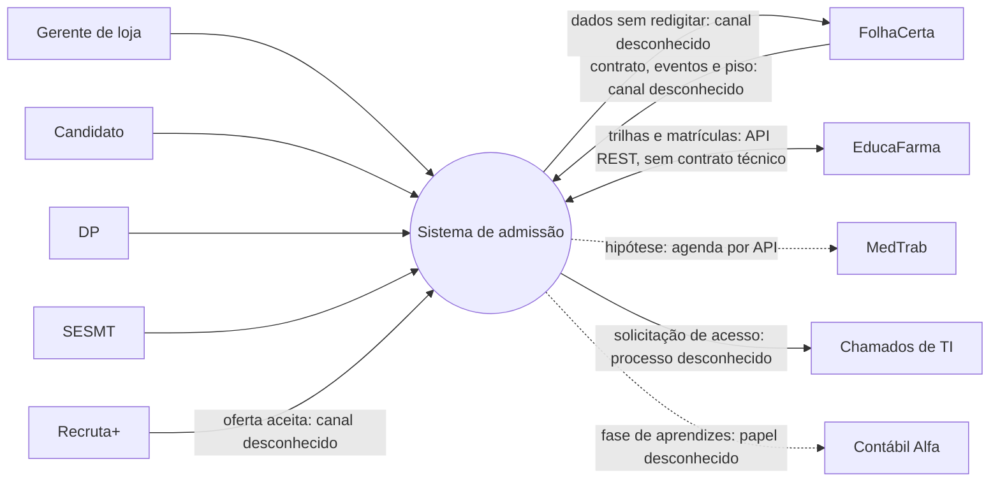
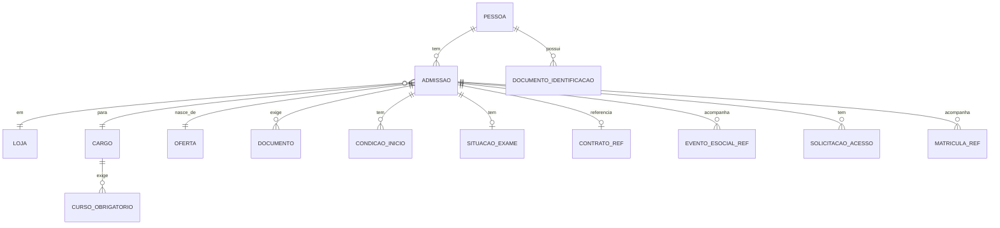

# Documentação técnica: Projeto Admissão Única

**Projeto:** Admissão Única · **Atualizado na Etapa 3** (ver `08-mudancas.md`) · **Baseline:** B-001, foto de trabalho, **ainda não validada**. · **Base:** ISO/IEC/IEEE 29148.

**Fontes:** `entrega/respostas.md`, ata do Comitê de 28/10/2026 (M-01), e-mail do Jurídico de 30/10/2026 (M-02), dumps da FolhaCerta e do Recruta+, planilha, exportações do EducaFarma, Política RH-012, ata de 22/09/2026, fluxo atual.

**Limite principal:** a TI não respondeu à Q-014. Este documento **não escolhe tecnologia nem assume** API na FolhaCerta ou no Recruta+. Também não define comprar ou construir, nem traz números de desempenho, porque nenhum consta das fontes.

## 1. Introdução

**Propósito:** especificar o que o sistema único de admissão deve fazer, de modo verificável pelas áreas e neutro quanto à solução.

**Escopo:** primeira fase para CLT de loja em lojas próprias e fase posterior para aprendizes. Limites em `02-negocio.md`, seção 4.

## 2. Visão geral

**Restrições:**

- A FolhaCerta segue como sistema da folha, gerando S-2190 e S-2200 e validando piso [doc: ATA#1].
- O sistema acompanha o eSocial, não o transmite [doc: `escopo.md`].
- Rescisão e desligamento ficam fora [entrevista: juridico-compliance Q-004].

**Atores:** candidato, gerente de loja, analista do DP, analista do SESMT, Jurídico, Encarregada de Dados, Operações, Gente & Gestão. BP de RH e gerente regional dependem de RN-004.

## 3. Requisitos funcionais confirmados

Os critérios de aceite completos estão em `04-backlog.md`.

| Módulo | ID | Requisito | Prior. | Histórias | Dependência aberta |
|---|---|---|---|---|---|
| Painel | RF-001 | Situação de cada etapa e se pode começar, em um só lugar | Must | US-001, US-002 | Q-032 |
| Oferta | RF-011 | Situação da oferta | Must | US-003 | Q-014 |
| Contrato | RF-013 | Situação do contrato | Must | US-004, US-011 | Q-014, Q-028 |
| eSocial | RF-005 | Prazo e situação de S-2190 e S-2200 | Must | US-005 | Q-014 |
| Acessos | RF-006 | Acompanhar a solicitação de acesso | Must | US-006 | Q-014 |
| Etapas | RF-008 | Registrar três etapas separadas | Should | US-007 | Q-017 |
| Bloqueio | RF-012 (v2, alterado) | Impedir liberação sem ASO válido, em função farmacêutica sem CRF ativo e, quando aplicável, sem comprovante de vacinação | Must | US-002, US-008, US-010, US-011, US-033 | Q-028, Q-033 |
| Exame | RF-004 | Pedido, agenda e emissão, sem dado clínico | Must | US-012 | Q-031 |
| Treinamento | RF-007 | Matrícula e conclusão de todo curso obrigatório | Must | US-013, US-014 | Q-026 |
| Experiência | RF-009 | Acompanhar até o fim, sem rescisão | Should | US-015 (`revisar`) | Q-022, **Q-035** |
| Documentos | RF-003 | Entrega digital, conferência e pendência com data | Must | US-016, US-017 | Q-029 |
| Identificação | RF-019 | Aceitar CRNM nas admissões do programa Acolher | Should | US-034 | Q-034 |
| Identificação | RF-020 | Registrar a validade da CRNM e sinalizar vencimento | Should | US-035 | Q-034 |
| Integração | RF-002 | Oferta aceita chega à FolhaCerta sem redigitação | Must | US-019, US-020 e US-021 (`revisar`) | **Q-014**, Q-034, Q-035 |
| Planilha | RF-014 | Substituir a planilha em CLT de loja | Must | US-023, US-024 | Q-030 |
| Aprendiz | RF-015 | Conduzir aprendizes no fluxo, mesmo sem aceite atual da folha | Should | US-031, US-032 | Q-027 |

### Regras a calcular

| Regra | Cálculo | Pontos a tratar |
|---|---|---|
| RN-002 | Válido se apto e `início − emissão` entre 1 e 30 dias corridos. Recalcular quando a data de início mudar | ASO emitido no próprio dia do início não foi decidido (Q-023); até lá, é **tratado como inválido**, por ser a leitura conservadora de "antes do início" |
| RN-003 | Se o cargo exigir CRF, condição só atendida com certidão e CRF ativo | Usar `exige_crf`, não o código de cargo, porque o trigger atual só testa `FARM`. Revalidação aberta (Q-024) |
| RN-001, RN-017 | **Em conflito.** 30+60 (Q-004) ou 45+45 desde 01/12/2026 (M-01). Tratar duração como dado por vigência, não como valor fixo, e não codificar nenhum valor antes da Q-035 | A folha calcula início + dias. Contagem a confirmar (Q-022) |
| RN-016 | Se loja em SP, se vai aplicar injetáveis e se início ≥ 01/02/2027, exigir comprovante de hepatite B e tétano | Nenhuma fonte identifica quem aplica injetáveis: `cargo` não tem esse dado (Q-033). A data usada é a de início; quem já trabalha está em aberto |
| RN-005 | Início + 5 dias corridos | O EducaFarma mostra 30; **o sistema não deve herdar esse prazo** |
| RN-010 | 5 dias úteis antes do início | Calendário de dias úteis indefinido (Q-029) |
| RN-007 | 6 meses após o encerramento do processo seletivo | O Recruta+ não tem data de encerramento, só `dt_atualizacao` [sql: RM:candidato]; definir o marco |
| RN-011 | Piso vigente por cargo e UF, conforme `cargo_piso` | A tabela do Recruta+ não tem histórico nem caixa e RT |

## 4. Requisitos não funcionais

Só RNF-002 está confirmado. Métricas com número não constam das fontes e **não foram criadas**.

| Categoria ISO 25010 | ID | Requisito | Status | Como verificar |
|---|---|---|---|---|
| Segurança | RNF-002 | Dado pessoal restrito aos perfis que precisam dele em cada etapa | Confirmado | Teste por perfil contra a matriz da seção 7 |
| Segurança | RNF-001 | Trilha de autor, data e valor anterior | Hipótese | Métrica a definir (Q-030) |
| Segurança | RNF-003 | Credencial individual desde o primeiro dia | Hipótese | Q-032 |
| Confiabilidade | RNF-004 | Falha de integração visível e reprocessável | Hipótese | Q-014 |
| Desempenho, disponibilidade | RNF-005 | Níveis a definir | Hipótese | Q-014 |

## 5. Interfaces externas

Nenhum canal abaixo tem contrato técnico nas fontes. Volume de referência: média de 190 admissões por mês [doc: ATA#0].

| Integração | Direção | Meio | Frequência | Falha e monitoramento | Responsável | Situação |
|---|---|---|---|---|---|---|
| Recruta+ | para o sistema | Desconhecido | A definir | A definir, RNF-004 | Fornecedor externo; contato desconhecido | Q-014 |
| FolhaCerta, entrada | do sistema | Desconhecido | A definir | A definir | Desconhecido | **Crítica para RF-002**, RIS-014 |
| FolhaCerta, leitura de contrato, evento e piso | para o sistema | Desconhecido | A definir | A definir | Desconhecido | Q-014 |
| EducaFarma | Duas vias | API REST existe [doc: ATA#1]; contrato técnico não recebido | A definir | A definir | Desconhecido | Chave de e-mail pessoal a rever |
| MedTrab | Hipótese | API existe, não usada [doc: ATA#1] | A definir | A definir | SESMT | RF-016, Q-031 |
| Chamados de TI | Do sistema | Desconhecido | A definir | A definir | TI | Q-014 |
| Contábil Alfa | Desconhecida | Lote quinzenal hoje [doc: ATA#0] | A definir | A definir | DP | Q-027 |

**Alterações que dependem da FolhaCerta**, cuja possibilidade é desconhecida (Q-014):

| Regra atual | Decisão | Consequência |
|---|---|---|
| Padrão de 45 dias de experiência | RN-001, RN-017 em conflito | Depende da Q-035. Se valer 45+45, o padrão atual coincide, mas a RH-012 precisará mudar |
| ASO de até 90 dias e sem limite superior | RN-002 | A folha sozinha não garante a regra (RIS-016) |
| CRF só para `FARM` | RN-003 | RT pode ser ativado sem CRF |
| Mínimo de 18 anos, sem tipo aprendiz | RN-006 | Aprendiz não entra na folha como está |
| `cpf` obrigatório e só o campo `rg`, sem tipo de documento nem validade | RF-019, RF-020 | CRNM pode não caber sem ajuste (RIS-019) |
| `cid_restricao` e acesso de `rh_loja` e `dp_analista` | RN-008 | Remover coluna e dado, ou mudar acesso |

Enquanto essas alterações não ocorrerem, a US-011 aponta inconsistências, mas **não impede** a ativação direta na folha.

## 6. Dados

### Modelo conceitual

Modelo lógico neutro, sem definir armazenamento.

### Fonte da verdade

| Dado | Fonte | Observação |
|---|---|---|
| Oferta | Recruta+ | Sem data de aceite própria |
| Piso | FolhaCerta (RN-011) | |
| Contrato, S-2190, S-2200 | FolhaCerta | |
| Documentos, etapas, condições | Novo sistema | Hoje em e-mail e planilha |
| Dado clínico | Ambiente do SESMT | Ambiente ainda não definido (Q-031) |
| Cursos e matrículas | EducaFarma | Prazo da integração vem da RN-005 |

### De-para

| Conceito | Recruta+ | FolhaCerta | Planilha | EducaFarma | Transformação |
|---|---|---|---|---|---|
| Pessoa | `candidato.cpf`, com máscara | `colaborador.cpf`, 11 dígitos | `cpf`, misto | só `email_usuario` | Normalizar para 11 dígitos; ligar o LMS pelo e-mail da folha, **nunca por nome**, porque há homônimos. CPF de todo participante do Acolher não está confirmado (Q-034) |
| Documento de identificação | não tem | `colaborador.rg` | não tem | não tem | Novo: tipo, número e validade, para CRNM. Não há origem hoje |
| Loja | `LJ-0147` | `147` | `147 - Savassi` | `MG-SAV` | Tabela de correspondência; cadastro mestre desconhecido |
| Cargo | `BALCONISTA`, `FARMACEUTICO`, `APRENDIZ` | `BALC`, `CAIXA`, `FARM`, `FARM_RT` | texto livre | `BALCONISTA`, `CAIXA`, `FARMACEUTICO` | `FARMACEUTICO` não separa RT; caixa ausente na tabela do Recruta+ |
| Tipo de contrato | não tem | `CLT_EXP`, `CLT_IND`, `ESTAGIO` | `CLT`, `APRENDIZ` | não tem | Aprendiz sem correspondente na folha |
| Situação | `CONTRATADO` | `PRE`, `ATIVO` | 4 situações | `status` | Etapas da RN-015 |
| Início | não tem | `data_admissao` | `dt_inicio` | não tem | Coincidem na amostra |
| Exame | não tem | `dt_emissao`, `resultado` | `dt_aso`, `resultado_aso` | não tem | Trazer só o que a RN-014 permitir |
| Salário | `oferta.salario` | `contrato.salario` | não tem | não tem | Coincide na amostra |

**Não migrar:** `gestante`, `antecedentes_ok`, `antecedentes_obs`, `pcd_cid`, `cid_restricao`, a observação clínica e o campo `obs` da planilha. A observação clínica depende da Q-031, mas não deve sair do SESMT até lá.

### Migração

- Só admissões em andamento de CLT de loja vão para o sistema (US-024). Histórico: não pedido.
- Risco: a planilha mistura formatos e texto livre com dado sensível.
- A eliminação de `candidato_bkp_2022` e o ajuste de `sp_expurgo_candidatos` (US-030) ocorrem no Recruta+, de fornecedor externo. É preciso confirmar como executar (Q-014).

## 7. Dados pessoais

Inventário por sistema em `01-diagnostico.md`, seção 8. **Base legal: não informada** (Q-030).

| Dado | Finalidade | Retenção | Acesso | Fonte |
|---|---|---|---|---|
| Identificação e contato do candidato | Seleção e admissão | Não contratado: 6 meses; admitido: a definir | A definir na matriz | Q-012, Q-030 |
| Gravidez, antecedentes | **Não coletar nem guardar** | Dados existentes: tratamento a definir | Nenhum | Q-012, Q-030 |
| Pessoa com deficiência | Só cota | A definir | Restrito | Q-012 |
| CID | Só SESMT | A definir | Ambiente do SESMT | Q-012, Q-013 |
| Observação clínica | Saúde ocupacional | A definir | SESMT, conforme POL#1 §11.2; armazenamento em aberto | Q-013, Q-031 |
| Comprovante de vacinação (hepatite B, tétano) | Cumprir a Portaria CVS-SP 88/2026 | A definir | Hipótese: conteúdo só no SESMT, situação visível a DP e gerente | M-02, Q-033 |
| CRNM e validade; condição migratória | Identificação no programa Acolher | A definir | A definir; atenção à exposição da condição migratória | M-02, Q-034 |
| Aptidão e datas do ASO | Validar o início | A definir | Hipótese: DP e gerente (RN-014) | Q-003, Q-031 |
| Documentos do admitido | Admissão | A definir | A definir | Q-029, Q-030 |

**Matriz de acesso a aprovar.** Proposta inicial, **hipótese**:

| Dado | Gerente da loja | DP | SESMT | Candidato |
|---|---|---|---|---|
| Situação das etapas | Sim | Sim | Só exame | Só o próprio |
| Documentos | Situação | Conteúdo | Não | Só o próprio |
| Aptidão e datas do ASO | Sim | Sim | Sim | Conforme definição do SESMT |
| Comprovante de vacinação | Só a situação | Só a situação | Conteúdo | Só o próprio |
| CRNM | Situação | Conteúdo | Não | Só o próprio |
| CID e observação clínica | Não | Não | Sim | Conforme definição do SESMT |
| Salário | A definir | Sim | Não | Só o próprio |

## 8. Decisões candidatas a ADR

Nenhuma foi tomada. Dependem da Q-014:

1. Comprar, construir ou estender.
2. Como integrar com a FolhaCerta: API, arquivo ou alteração do fornecedor.
3. Onde fica o ambiente do SESMT.
4. Como registrar aprendizes.
5. Regras como parâmetros (RF-010). A mudança de experiência e a Portaria reforçam a necessidade de regras com vigência.

## 9. Pendências

Requisitos não confirmados e perguntas abertas estão em `02-negocio.md`, seção 11. A primeira ação recomendada é responder à Q-014 e executar a US-019, porque RF-002, RF-005, RF-011 e RF-013 e a força do bloqueio dependem dela.
