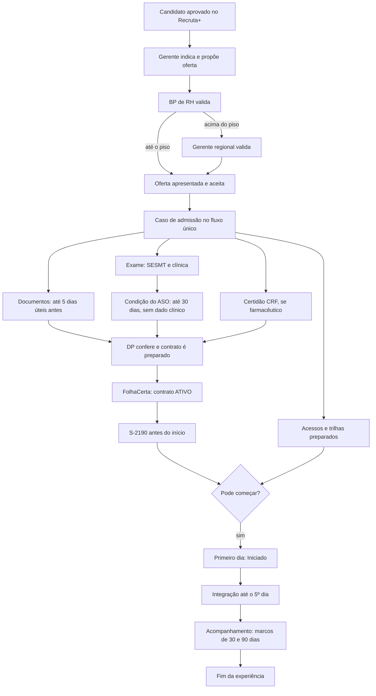

# Documentação de negócio — Projeto Admissão Única

Drogarias Caliandra S.A. | Patrocinadora: Helena Vasconcelos, Diretora de Gente & Gestão

Base: escopo, fontes em `fontes/`, `entrega/respostas.md` e comunicações avaliadas em `08-mudancas.md`. O diagnóstico está em `01-diagnostico.md`. Muitas respostas foram "Não sei". Tudo o que não foi decidido aparece como **pendência** (seção 9) e não como regra.

## 1. Objetivo

Criar um **fluxo único de admissão e onboarding**, do candidato aprovado ao fim do período de experiência, de modo que:

- o gerente de loja saiba, em um só lugar, quando o novo colaborador pode começar;
- o DP pare de digitar a mesma informação várias vezes;
- o Jurídico tenha segurança sobre o cumprimento das regras.

Helena definiu o resultado mínimo: **fluxo único, saída da planilha e integração Recruta+ → FolhaCerta**. Se Recruta+ e EducaFarma também serão substituídos ainda não foi decidido (PD-02). Por isso os requisitos descrevem o que o fluxo deve fazer, sem depender dessa decisão nem de um produto ou fornecedor.

## 2. Abrangência

| Item | Situação | Fonte |
|---|---|---|
| 184 lojas próprias (MG e SP) | **Dentro** | Resposta 2 |
| CLT de loja: balconista, caixa, farmacêutico (com RT) | **Dentro, primeira fase** | Respostas 2 e 7 |
| Aprendizes | **Depois**, no fluxo único, como prioridade 5 | Resposta 2 |
| Centro de distribuição e escritório central | **Fora da primeira fase** | Resposta 2 |
| 28 lojas franqueadas | **Fora** | Resposta 2; RH-012 §1 |
| Folha de pagamento | **Fora**: continua no FolhaCerta | Escopo; ata |
| Rescisão e desligamento | **Fora**. O pedido de inclusão de Sérgio (M-01) não foi aplicado | Escopo; resposta 4 |
| Estágio | **Não decidido** | PD-22 |

## 3. Stakeholders e decisores

| Pessoa | Papel | Decide ou responde por |
|---|---|---|
| Helena Vasconcelos | Dir. Gente & Gestão, patrocinadora | Escopo, prioridades, texto final da RH-012 |
| Rogério Tavares | Gerência de DP | Regras de DP, conceito de admissão |
| Marina Quintela | Jurídico Trabalhista | Regras trabalhistas |
| Paula Nogueira | Encarregada de Dados | Dados pessoais, retenção |
| Fábio Arantes | Médico coordenador do SESMT | Regras do ASO |
| Beatriz Lobo | Assuntos Regulatórios (ata de 28/10) | CRF, integração |
| Sérgio Antunes / Cláudia Reis | Dir. e Coord. de Operações de Loja | Operação de loja, planilha |
| Igor Melo | TI (apoio, não dona do projeto) | Sistemas, identificadores |
| Vera Castro | CFO | Orçamento (indicada por Helena) |

Sem representante nas respostas: BPs de RH, Recrutamento, gerentes de loja e regionais, analista do SESMT e analistas do DP.

**Ponto aberto de governança:** há decisor por assunto, mas ninguém soube dizer quem arbitra uma discordância entre áreas (PD-01).

## 4. Decisões já tomadas

| Conflito do diagnóstico | Decisão | Quem |
|---|---|---|
| Experiência 30+60 ou 45+45 | **30+60**. Sérgio comunicou 45+45 a partir de 01/12/2026, sem decisão registrada: conflito em PD-25 | Marina |
| ASO 30, 60 ou 90 dias | **30 dias corridos**; adiou e passou, deixa de valer para aquele início | Fábio |
| ASO depois do início, loja desfalcada | **Sem exceção**, e ninguém pode autorizar | Fábio, Marina |
| CRF com protocolo | **Não vale**, inclusive para RT | Beatriz |
| Quem aprova a oferta | **BP sempre; regional acima do piso; gerente de loja indica e não aprova sozinho** | Marina |
| Referência do piso | **CCT vigente de cada UF, conforme o FolhaCerta** | Rogério |
| Integração em 5, 15 ou 30 dias | **Até o 5º dia corrido**, antes de atender sozinho no balcão | Beatriz |
| 214, 188 ou 176 | **Etapas diferentes**; a admissão oficial é o conceito do DP | Rogério |
| Gestação e antecedentes | **Não perguntar nem guardar na seleção** | Paula |
| CID | **Só no ambiente do SESMT** | Paula |
| Retenção de não contratados | **6 meses, inclusive cópias e backups** | Paula |
| Identificadores | **CPF só com dígitos; código numérico de loja do FolhaCerta** | Igor |

**Consequência imediata:** essas decisões tornam L431 e L438 descumprimentos confirmados da regra, e não dúvidas de interpretação. Também confirmam que Manual, planilha, Recruta+ e parte das regras do FolhaCerta estão em desacordo. O tratamento dos casos não foi decidido (PD-08, PD-12, PD-13).

**Atenção ao Manual:** só o prazo da seção 4 foi revogado formalmente e as lojas ainda o consultam. A intenção é substituí-lo quando o sistema vier. Até lá, ele seguirá ensinando 45+45, 15 dias e aprovação pelo gerente. Por isso o backlog propõe um aviso provisório (US-002), a ser decidido por Helena e Rogério.

## 5. Processo futuro

Desenho **proposto**, para validação pelas áreas. As etapas correm em paralelo depois da oferta, ao contrário dos status lineares da planilha.

## 6. Quando o colaborador pode começar

Este é o requisito central. Só parte dele está decidida.

| Condição | Efeito | Situação | Fonte |
|---|---|---|---|
| ASO apto, até 30 dias, anterior ao início | **Bloqueia** | Decidido | Respostas 5 e 8; RH-012 §6 |
| Certidão com CRF ativo (farmacêutico e RT) | **Bloqueia** | Decidido | Respostas 7 e 8; RH-012 §7 |
| S-2190 enviado | Tratado como bloqueio na RH-012 §10 e no relato da ata | **A confirmar**: Rogério não definiu na resposta 8 | PD-14 |
| Contrato assinado | Compõe a admissão oficial | **A confirmar** se bloqueia o início | PD-14 |
| Oferta validada | Exigida antes de apresentar a oferta | **A confirmar** se bloqueia o início | PD-14 |
| Documentos completos | Prazo de 5 dias úteis | **A confirmar** se o atraso bloqueia | PD-14 |
| Acesso ao PDV | — | **A confirmar** | PD-14, PD-20 |
| Kit | — | **A confirmar** | PD-14 |
| Comprovante de vacinação (quem vai aplicar injetáveis em SP, a partir de 01/02/2027) | **Exigido antes do início das atividades** | Regra nova; alcance a confirmar | M-02; PD-27 |
| CRNM válida (programa Acolher, a partir do 1º tri/2027) | Documento aceito e validade controlada | **A confirmar** o efeito do vencimento | M-02; PD-28 |

**Quem dá a liberação final:** não definido (PD-14). Exceção por falta de pessoal **não existe** para ASO. Para CRF, a regra foi confirmada sem menção a exceção.

Enquanto PD-14 não for decidida, a proposta é que cada condição tenha sua configuração (bloqueia ou alerta) em uma tabela de regras. ASO e CRF ficam fixos como bloqueio. A entrega do painel não depende da decisão, mas o resultado "pode começar" só é confiável depois dela.

## 7. Regras de negócio

| ID | Regra | Fonte | Situação | Decisor |
|---|---|---|---|---|
| RN-01 | Nas regras já definidas, vale a RH-012. | Resposta 1; RH-012 | Confirmado | Helena |
| RN-02 | Documentos completos no DP até 5 dias úteis antes do início. Efeito do atraso em aberto. | RH-012 §2; Comunicado 07/2024; leia-me | Parcial (PD-14) | DP |
| RN-03 | BP de RH valida toda oferta antes de apresentá-la ao candidato. Oferta acima do piso exige também o gerente regional. | RH-012 §3; resposta 9 | Confirmado | Jurídico |
| RN-04 | O gerente de loja indica o candidato, mas não aprova sozinho. | Resposta 9 | Confirmado | Jurídico |
| RN-05 | O piso é o da convenção coletiva vigente de cada UF, conforme o FolhaCerta. | Resposta 9; FolhaCerta `cargo_piso` | Confirmado | DP |
| RN-06 | Ninguém começa sem ASO apto. Sem exceção, mesmo com a loja desfalcada; ninguém pode autorizar exceção. | RH-012 §6.1; respostas 5 e 8 | Confirmado | SESMT, Jurídico |
| RN-07 | ASO emitido até 30 dias corridos antes do início. Se o início for adiado e passar disso, o ASO deixa de valer para aquele início. | RH-012 §6.2; resposta 5 | Confirmado | SESMT |
| RN-08 | Farmacêutico, inclusive RT, precisa de certidão de regularidade com CRF ativo antes do início. Protocolo não vale. | RH-012 §7; respostas 7 e 8 | Confirmado (detalhes em PD-13) | Beatriz Lobo |
| RN-09 | Experiência CLT de 30 dias, prorrogável por mais 60, total de 90. | RH-012 §4.1; resposta 4 | Confirmado (transição em PD-06; conflito em PD-25) | Jurídico |
| RN-10 | Integração e Boas Práticas Farmacêuticas até o 5º dia corrido e antes de atender sozinho no balcão. | RH-012 §9; resposta 15 | Confirmado (comprovação em PD-21) | Beatriz Lobo |
| RN-11 | S-2190 antes do início; S-2200 até o dia 15 do mês seguinte à admissão. | RH-012 §10; FolhaCerta; ata | Confirmado no prazo; bloqueio em PD-14 | DP |
| RN-12 | Admissão oficial: contrato assinado, ASO apto validado e status ATIVO no FolhaCerta. | Resposta 3; comentário de `contrato.status` | Confirmado | DP |
| RN-13 | Contratado (oferta aceita), admissão (ATIVO) e Iniciado (primeiro dia) são etapas diferentes e continuam úteis. | Resposta 3; ata; leia-me | Confirmado | DP |
| RN-14 | Gravidez e antecedentes não devem ser perguntados nem guardados na seleção. | Resposta 11 | Confirmado | Encarregada |
| RN-15 | CID só pode existir no ambiente do SESMT. Dados de saúde são acessados exclusivamente pelo SESMT. | RH-012 §11.2; respostas 6 e 11 | Confirmado (alcance em PD-09) | Encarregada |
| RN-16 | Dado de pessoa com deficiência, só com finalidade clara de cota e acesso restrito. | Resposta 11 | Confirmado | Encarregada |
| RN-17 | Candidatos não contratados: eliminação em até 6 meses, inclusive em cópias e backups. | RH-012 §11.3; resposta 11 | Confirmado | Encarregada |
| RN-18 | Coletar só os dados necessários a cada etapa. | RH-012 §11.1 | Parcial (PD-17) | Encarregada |
| RN-19 | Abrangência: 184 lojas próprias; CLT de loja primeiro; aprendiz depois (prioridade 5); CD e escritório fora da primeira fase; franqueadas fora. | Resposta 2; RH-012 §1 | Confirmado | Helena |
| RN-20 | Identificadores: CPF só com dígitos para pessoa; código numérico do FolhaCerta para loja. | Resposta 13 | Confirmado | TI |
| RN-21 | Folha continua no FolhaCerta; rescisão e desligamento ficam fora. | Escopo; ata; resposta 4 | Confirmado | Helena |
| RN-22 | A partir de 01/02/2027, quem vai aplicar injetáveis em lojas de SP apresenta, junto com o ASO, comprovante de vacinação contra hepatite B e tétano antes do início das atividades. ASO e prazos atuais continuam valendo. | M-02 (Portaria CVS-SP 88/2026, conforme Marina; texto não conferido) | Parcial (PD-27) | Jurídico; execução SESMT |
| RN-23 | A partir do 1º trimestre de 2027, nas admissões do programa Acolher, aceitar a CRNM como documento de identificação e controlar sua validade. | M-02 | Parcial (PD-28) | Jurídico; escopo com Helena |

**Mantidas sem conflito (sem requisito novo):** jornada de 44 h semanais; carência do plano de 90 dias, 30 para farmacêutico; vale-alimentação desde o primeiro dia. Essas regras seguem na folha. A vigência do Acordo Coletivo de 2024 precisa ser conferida (PD-24).

## 8. Requisitos funcionais e não funcionais

"Confirmado" indica decisão de stakeholder ou da RH-012. "Derivado" indica que nasceu do escopo ou das fontes, mas ainda precisa ser validado pela área. "Parcial" indica que parte depende de pendência.

| ID | Requisito | Fonte | Situação | Decisor |
|---|---|---|---|---|
| RF-01 | Fluxo único por caso, do candidato aprovado ao fim da experiência, com situação de cada etapa. | Escopo; resposta 1 | Confirmado | Helena |
| RF-02 | Validação da oferta: indicação do gerente, BP e regional quando acima do piso, com registro de responsável e data. | RH-012 §3; resposta 9; Recruta+ | Parcial (PD-15) | Jurídico, RH |
| RF-03 | Verificar o piso vigente no momento da oferta, não só no FolhaCerta ao final. | Resposta 9; D-10; L433 | Derivado | DP |
| RF-04 | Coleta e conferência de documentos por cargo, sem e-mail. | Escopo; ata; Manual §4 | Parcial (PD-18) | DP |
| RF-05 | Acompanhar o prazo de documentos e registrar motivo de devolução. | RH-012 §2; ata | Derivado | DP |
| RF-06 | Pedir e acompanhar o exame admissional. | Escopo; ata; fluxo | Parcial (PD-10) | SESMT |
| RF-07 | Registrar a condição do ASO, sem dado clínico, e calcular a validade para a data de início. | RH-012 §6; respostas 5, 6 e 11 | Parcial (PD-09) | SESMT, Encarregada |
| RF-08 | Conferir a certidão de CRF de farmacêutico e RT; protocolo não satisfaz. | RH-012 §7; resposta 7 | Parcial (PD-13) | Beatriz Lobo |
| RF-09 | Integrar Recruta+ → FolhaCerta para o DP não redigitar. | Escopo; respostas 1 e 13; ata | Parcial (PD-19) | Helena, TI |
| RF-10 | Acompanhar o contrato, sua assinatura e o tipo de experiência 30+60. | Escopo; respostas 3 e 4 | Parcial (PD-18) | DP |
| RF-11 | Acompanhar S-2190 e S-2200, prazos e recibos. O FolhaCerta continua gerando os eventos. | Escopo; RH-012 §10; ata | Parcial (PD-19) | DP |
| RF-12 | Mostrar ao gerente, em um só lugar, se e quando o colaborador pode começar. | Escopo; respostas 5, 7 e 8 | Parcial (PD-14) | A definir (PD-14) |
| RF-13 | Solicitar e acompanhar acessos antes do início. | Escopo; ata; D-11 | Parcial (PD-20) | Operações, TI |
| RF-14 | Matricular em treinamentos obrigatórios por cargo e acompanhar prazos, incluindo o 5º dia. | Escopo; RH-012 §9; resposta 15; ata | Parcial (PD-21) | Beatriz Lobo |
| RF-15 | Acompanhar marcos da experiência e encaminhar a decisão de continuidade, sem tratar desligamento. | Escopo; respostas 4 e 15 | Parcial (PD-06, PD-07) | Jurídico, Helena |
| RF-16 | Mostrar funil com as três etapas e indicadores por definição única. | Resposta 3; ata | Parcial (PD-05) | Helena |
| RF-17 | Tirar a planilha de uso. | Resposta 1; leia-me | Confirmado | Helena |
| RF-18 | Manter catálogo versionado de regras, com fonte, vigência e decisor; substituir o Manual. | Respostas 1 e 2; seção 3 do diagnóstico | Derivado | Helena, decisores |
| RF-19 | Avisar responsáveis sobre tarefas e prazos no lugar do e-mail. | Escopo; fluxo | Derivado | Operações |
| RF-20 | Incluir aprendizes no fluxo único, em etapa posterior. | Resposta 2; ata; D-07 | Parcial (PD-16) | Helena, DP |
| RF-21 | Conter exposição de dados nos sistemas atuais, sem esperar o novo fluxo. | Resposta 11; R-03, R-04, R-06, R-07 | Parcial (PD-11) | Encarregada |
| RF-22 | Tratar os casos já ocorridos fora da regra. | Respostas 4, 5, 7 e 11; seção 4 do diagnóstico | Parcial (PD-06, PD-08, PD-12, PD-13) | Jurídico, SESMT, Beatriz Lobo |
| RF-23 | Identificar quem é abrangido pela portaria e controlar o comprovante de vacinação como condição de início, com o comprovante no ambiente do SESMT. | M-02; RN-15 | Parcial (PD-09, PD-27) | SESMT, Jurídico, Encarregada |
| RF-24 | Aceitar a CRNM na coleta de documentos e acompanhar sua validade. | M-02 | Parcial (PD-19, PD-28) | DP, Jurídico |

Os requisitos não funcionais estão detalhados em `03-tecnico.md`.

## 9. Pendências de decisão

Exceto PD-04, nenhuma destas foi respondida. PD-25 a PD-28 vieram das comunicações de `08-mudancas.md`. Onde há premissa, ela vem de `perguntas.md`, é só uma hipótese de trabalho e **não** é fato. Para os temas de risco legal, não foi adotada premissa.

| ID | Pendência | Com quem | Impacto | Premissa até a decisão |
|---|---|---|---|---|
| PD-01 | Quem arbitra discordância entre áreas | Helena / comitê | Todas as regras | Nenhuma |
| PD-02 | Recruta+ e EducaFarma serão substituídos? | Helena | Integrações | Permanecem, sem depender disso nos requisitos |
| PD-03 | Data-limite e orçamento | Helena, Vera Castro | Plano e estimativa | Nenhuma |
| PD-04 | **Encerrada:** a ata de 28/10 (M-01) registra só informes, sem decisão | — | — | — |
| PD-05 | Números fechados, decomposição das diferenças, metas | Helena, Rogério, Cláudia, Recrutamento | Indicadores | Nenhuma |
| PD-06 | Contratos em curso de 45+45; como a prorrogação é registrada; C9140 e C9177; contagem dos dias | Marina, Rogério | Risco legal; RF-15 | Sem premissa para os casos. Hipótese: 30+60 só para novos contratos |
| PD-07 | Ponto exato em que o projeto termina; antecedência do aviso ao DP | Helena | RF-15 | Termina ao encaminhar a decisão ao DP |
| PD-08 | Tratamento de L438, L415 e L426 | Fábio, Marina | Risco legal | Sem premissa |
| PD-09 | O que chega a DP e gerente sobre o ASO; onde fica o ambiente do SESMT; origem de CID no FolhaCerta; inapto e restrição | Fábio, Paula | RF-07, painel | Fora do SESMT só condição, data e validade |
| PD-10 | Cobertura e contrato da MedTrab; substituta da analista do SESMT | Fábio | RF-06 | Nenhuma |
| PD-11 | Quem autoriza as contenções imediatas, e quando | Paula, Helena | RF-21 | Tratar como urgente |
| PD-12 | Registro de "reavaliar início" de candidata após menção a gravidez | Marina | Risco legal | Sem premissa |
| PD-13 | Quantos farmacêuticos estão em protocolo; origem da regra da planilha; o que conferir além do número; vaga de RT aberta | Beatriz Lobo, Sérgio | RF-08, L431 | Sem premissa para os casos |
| PD-14 | Quais condições bloqueiam; por modalidade; quem dá a liberação final | Rogério, Marina, Sérgio | RF-12 | S-2190, contrato, oferta e documentos bloqueiam; acesso e kit alertam; DP libera |
| PD-15 | BP hoje valida fora do Recruta+? Quem são os BPs, prazo; dono da tabela salarial e da lista de regionais | Helena, BPs, Recrutamento | RF-02, RF-03 | BP valida depois da indicação do gerente |
| PD-16 | Aprendiz: toda a pergunta 10 sem resposta (motivo da Contábil Alfa, eSocial, folha, regras de menores) | Rogério, Marina | RF-20 | Contábil Alfa continua até o levantamento |
| PD-17 | Dados por etapa, finalidade, base legal; retenção de contratados; contratos de operador | Paula | RNF-03, RNF-04 | Nenhuma |
| PD-18 | Toda a pergunta 12 sem resposta: lista de documentos, causas de devolução, assinatura do contrato, anomalia de C9240, eventos ausentes, calendário | Rogério | RF-04, RF-05, RF-10, RF-11 | Lista do Manual até revisão por Paula |
| PD-19 | APIs e integrações; criação sem digitação; recibo; correções no FolhaCerta; permissões de produção; sustentação | Igor, fornecedores | RF-09 e demais integrações | Sem premissa sobre viabilidade; contingência no doc. técnico |
| PD-20 | Toda a pergunta 14 sem resposta: acessos por cargo, causa dos 3 dias, substituto do login do gerente | Cláudia, Igor | RF-13, R-05 | Pedido na liberação, ativo na data de início |
| PD-21 | Viabilidade do 5º dia; comprovação e responsável; atribuição de trilhas; trilhas de RT; conversas de 30 e 60 dias | Beatriz Lobo, Sérgio | RF-14 | Confirmação pelo gerente; RT usa trilha de farmacêutico |
| PD-22 | Estágio; papel do gerente em CD e escritório | Helena | Abrangência futura | Fora da primeira fase |
| PD-23 | Ordem completa de autoridade, com Comunicado e planilha | Helena | Baixo: o Comunicado coincide com a RH-012 | Planilha não é norma |
| PD-24 | Vigência do Acordo Coletivo de 2024 (carência) | Marina | Baixo | Continua vigente |
| PD-25 | **Conflito M-01:** Sérgio comunica 45+45 a partir de 01/12/2026, contra 30+60 da RH-012 confirmado por Marina. Haverá revisão da RH-012? | Helena (texto da RH-012), Marina | RN-09, RF-15, RF-22, US-012, US-046 | Vale 30+60 (RN-01) até decisão formal |
| PD-26 | Resposta formal ao pedido de incluir rescisão e homologação (M-01) | Helena | Nenhum enquanto o escopo não mudar | Fica fora, como em RN-21 |
| PD-27 | Portaria: texto; "quem vai aplicar" é cargo ou função; quais lojas; quem já trabalha; início sem aplicar; o que o comprovante demonstra; quem confere; tratamento como dado de saúde | Marina, Beatriz Lobo, Fábio, Paula | RN-22, RF-23 | Bloqueia a atividade abrangida, com comprovante restrito ao SESMT |
| PD-28 | Acolher: data, lojas, modalidades, prioridade; identificador se não houver CPF; efeito do vencimento da CRNM; acompanhamento depois da experiência; dados de condição migratória | Helena, Marina, Rogério, Paula | RN-23, RF-24 | Sem bloqueio assumido por vencimento |

## 10. Indicadores

Helena não sabe quais são as metas (PD-05). Abaixo estão os indicadores possíveis, sem meta. Os valores atuais são relatos ainda não medidos.

| Indicador | Situação atual | Origem do valor |
|---|---|---|
| Tempo de digitação por admissão | Cerca de 25 min | Relato, ata |
| Pastas devolvidas | Cerca de 30% | Relato, ata |
| Dias do pedido ao exame | Cerca de 1 semana (5 a 8 dias na amostra) | Ata e dados |
| Dias sem login no PDV | Cerca de 3 | Relato, ata |
| Oferta aceita → ATIVO → Iniciado | 214 / 188 / 176 (projeção de setembro) | Ata. Números fechados não disponíveis |
| Integração no 5º dia | 0 de 4 conclusões na amostra | Dados |
| Início com ASO válido | 5 de 8 inícios CLT na amostra | Dados |

## 11. Riscos para a decisão

- **Riscos que não esperam o projeto:** planilha aberta, login compartilhado, registro de "reavaliar início" após menção a gravidez, RT sem CRF. Ninguém soube dizer quem autoriza a contenção nem quando ela ocorre (PD-11). **Recomendação: que Helena nomeie um responsável pela contenção na próxima reunião.**
- **Integração incerta:** a integração Recruta+ → FolhaCerta faz parte do resultado mínimo, mas não se sabe se é tecnicamente possível (PD-19). Sem ela, o objetivo do DP fica parcialmente atendido.
- **Prazo e orçamento desconhecidos** (PD-03): o backlog não tem estimativa nem data.
- **ATIVO não é prova de conformidade:** a admissão oficial depende do status ATIVO, mas o FolhaCerta aceita ASO de até 90 dias e deixa o RT sem CRF passar. Até a correção, a conformidade precisa ser verificada no fluxo único.

## 12. Validação por área

Lista de itens para cada área validar. O detalhamento e as fontes estão em `07-rastreabilidade.md`.

| Área | Regras e requisitos | Pendências |
|---|---|---|
| Gente & Gestão (Helena) | RN-01, RN-19, RF-01, RF-16, RF-17, RF-18 | PD-01 a PD-03, PD-05, PD-07, PD-15, PD-22, PD-23, PD-25, PD-26, PD-28 |
| DP (Rogério) | RN-02, RN-05, RN-11, RN-12, RN-13, RF-04, RF-05, RF-09, RF-10, RF-11, RF-24 | PD-06, PD-14, PD-16, PD-18, PD-28 |
| Jurídico (Marina) | RN-03, RN-04, RN-06, RN-09, RN-22, RN-23, RF-02, RF-15, RF-22 | PD-06, PD-08, PD-12, PD-24, PD-25, PD-27, PD-28 |
| Encarregada (Paula) | RN-14 a RN-18, RF-21, RF-23, RF-24, RNF-01 a RNF-04 | PD-09, PD-11, PD-17, PD-27, PD-28 |
| SESMT (Fábio) | RN-06, RN-07, RN-22, RF-06, RF-07, RF-23 | PD-08, PD-09, PD-10, PD-27 |
| Assuntos Regulatórios (Beatriz) | RN-08, RN-10, RN-22, RF-08, RF-14 | PD-13, PD-21, PD-27 |
| Operações de Loja (Sérgio, Cláudia) | RF-12, RF-13, RF-14, RF-17, RF-19 | PD-14, PD-20, PD-21 |
| TI (Igor) | RN-20, RF-09, RNF-05, RNF-06, RNF-07 | PD-19 |
| RH / BPs / Recrutamento | RN-03, RN-04, RF-02, RF-03 | PD-15 |
