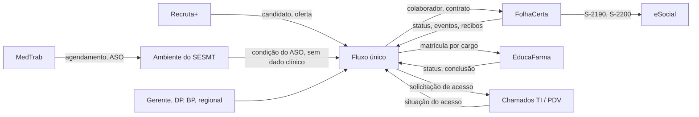
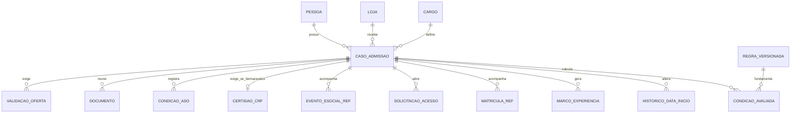

# Documentação técnica — Projeto Admissão Única

Base: dumps do FolhaCerta e do Recruta+, exportações do EducaFarma, planilha, RH-012 e respostas. Os identificadores RN, RF e PD estão em `02-negocio.md`.

**Limite deste documento:** ele descreve requisitos técnicos e um modelo lógico, sem escolher produto ou fornecedor, como pediu a patrocinadora. Nada aqui comprova que uma integração existe: Igor não soube responder sobre APIs e formas de integração (PD-19). As APIs do EducaFarma e da MedTrab são relatos da ata.

## 1. Contexto lógico

O fluxo único coordena as etapas. Os sistemas atuais continuam donos dos seus dados até decisão contrária.

| Dado | Sistema de registro | Observação |
|---|---|---|
| Candidato, vaga | Recruta+ | Pendente de substituição ou não (PD-02) |
| Validação de oferta (BP, regional) | **A definir** | O Recruta+ não tem BP. Fica no fluxo único ou em mudança no Recruta+ (PD-15, PD-19) |
| Situação do caso, condições, liberação | Fluxo único | Substitui a planilha |
| Colaborador, contrato, folha, piso | FolhaCerta | Decisão do escopo e da ata |
| Geração de eventos do eSocial | FolhaCerta | O fluxo único só acompanha |
| Dado clínico, CID | Ambiente do SESMT | Resposta 6; onde fica esse ambiente é PD-09 |
| Trilhas, matrículas | EducaFarma | Pendente (PD-02) |

## 2. Modelo lógico

Modelo conceitual, sem definição de tecnologia.

| Entidade | Conteúdo essencial | Restrições |
|---|---|---|
| Pessoa | CPF só com dígitos, nome, contato | Sem gestação, antecedentes ou CID |
| Caso de admissão | Oferta de origem, loja, cargo, modalidade, data de início prevista | Só um caso ativo por pessoa e oferta |
| Validação de oferta | Papel, responsável, decisão, data, piso de referência | BP sempre; regional acima do piso |
| Documento | Tipo, situação, motivo de devolução, data de recebimento | Motivo em lista fechada |
| Condição do ASO | Apto/inapto, data de emissão, validade calculada para a data de início | **Conteúdo final depende de PD-09**. Nunca CID ou observação |
| Certidão CRF | Situação, número, UF, validade se houver, data de conferência | Protocolo não satisfaz a condição. Campos dependem de PD-13 |
| Condição de vacinação | Abrangida ou não, cumprida ou pendente, data da conferência | Comprovante só no ambiente do SESMT; só em lojas de SP, a partir de 01/02/2027 (RN-22, PD-27) |
| Documento de identificação | Tipo (inclui CRNM), número, validade quando houver | Validade obrigatória na CRNM (RN-23) |
| Condição avaliada | Condição, resultado, versão da regra, data da avaliação | Reavaliada se a data de início mudar |
| Regra versionada | Parâmetro, valor, vigência, fonte, decisor | Sem exclusão; só nova versão |

**Campo de texto livre:** não usar um campo como o `obs` da planilha, que já recebeu dados de saúde e de gestação. Se for inevitável, deve ser curto, com aviso e por categoria.

## 3. Situação do caso

A planilha usa uma sequência linear (Em documentos → Em ASO → Liberado → Iniciado). O processo real é paralelo, então cada condição precisa de situação própria, e o estado geral é calculado.

| Estado calculado | Definição | Fonte |
|---|---|---|
| Oferta em validação | Falta BP ou regional | RN-03 |
| Contratado | Oferta aceita | RN-13 |
| Em preparação | Alguma condição pendente | Proposta |
| Admissão oficial | Contrato assinado, ASO apto validado, ATIVO no FolhaCerta | RN-12 |
| Pode começar | Todas as condições bloqueantes cumpridas para a data de início | RN-06, RN-08; restante em PD-14 |
| Iniciado | Primeiro dia cumprido | RN-13 |
| Em experiência / Fim da experiência | Marcos de 30 e 90 dias | RN-09 |
| Encerrado sem início | Desistência ou cancelamento | Proposta; o Recruta+ não tem esse estado |

## 4. Regras calculáveis

| Regra | Cálculo | Atenção |
|---|---|---|
| ASO (RN-06, RN-07) | `emissão <= início` e `início - emissão <= 30` dias corridos e resultado apto | Mudar a data de início reavalia. Limite exato: 30 dias vale |
| Documentos (RN-02) | Completos até `início - 5 dias úteis` | Calendário de feriados por UF ou município não definido (PD-18) |
| Experiência (RN-09) | 1º termo 30 dias; prorrogação 60; total 90. Conflito com 45+45 em PD-25: valor parametrizado, sem impacto estrutural | O FolhaCerta usa `admissão + dias`. **Confirmar a contagem**: com o dia da admissão incluído, somar 90 pode dar o 91º dia (PD-06) |
| Integração (RN-10) | `conclusão <= início + 5` dias corridos | Só a trilha de Integração. As demais seguem o prazo do EducaFarma, sem conflito apontado |
| S-2190 (RN-11) | `envio <= início - 1` | Verificar tratamento de dia não útil (PD-18) |
| S-2200 (RN-11) | `envio <= dia 15 do mês seguinte` | Igual no FolhaCerta |
| Piso (RN-05) | `salário >= piso` da maior vigência `<= início`, por cargo e UF | Hoje a falta de piso cadastrado não barra no FolhaCerta (comparação com nulo) |
| Vacinação (RN-22) | Se abrangido, loja em SP e `início >= 01/02/2027`: comprovante conferido | Independe do ASO. Alcance em PD-27 |
| CRNM (RN-23) | `validade >= início`, com aviso de proximidade | Efeito do vencimento em PD-28; não assumir bloqueio |
| Regional (RN-03) | `salário > piso` exige regional | Igual ao piso: não exige |

## 5. Integrações

Todas sujeitas a PD-19. A coluna "Contingência" é uma proposta para quando a integração não for possível.

| Integração | Dados | Situação conhecida | Contingência |
|---|---|---|---|
| Recruta+ → fluxo único | Candidato, vaga, oferta | Instância dedicada de fornecedor externo; forma desconhecida | Importação periódica |
| Fluxo único → FolhaCerta | Colaborador, contrato | Desconhecida. **Resultado mínimo do projeto** | Tela de conferência para o DP e arquivo de carga |
| FolhaCerta → fluxo único | Status, eventos, recibos | Desconhecida. Os dumps são noturnos, o que não indica canal disponível | Consulta ou importação periódica |
| MedTrab ↔ SESMT | Agendamento, ASO | Portal e API relatados, não usados; contrato desconhecido (PD-10) | Agendamento por e-mail, com registro da data |
| SESMT → fluxo único | Condição do ASO | Sem definição (PD-09) | Registro direto pelo SESMT |
| Fluxo único ↔ EducaFarma | Matrícula, conclusão | API REST relatada | Exportação e importação periódica |
| Fluxo único → chamados / PDV | Solicitação de acesso | Sem fonte (PD-20) | Abertura manual com registro de data |

### Dados necessários no FolhaCerta

| Campo | Vem do Recruta+? | Observação |
|---|---|---|
| CPF | Sim | Retirar máscara |
| Nome, nascimento, e-mail | Sim | Conferir com o documento |
| RG, nome da mãe | **Não** | Vêm da coleta de documentos. **O dump só tem `rg` como identificação**: registrar CRNM depende de PD-19 |
| Filial | Sim, com conversão | `LJ-0147` → `147`. Confirmar em toda a rede |
| Cargo | Parcial | **`FARMACEUTICO` não distingue `FARM` de `FARM_RT`**. Precisa de informação adicional na vaga |
| Salário | Sim | Da oferta aceita |
| Data de admissão | **Não** | Vem do fluxo |
| `tipo_contrato`, `dias_experiencia` | **Não** | Definidos no fluxo: `CLT_EXP`, 30 |
| `crf_numero` | **Não** | Vem da conferência do CRF |

**Conclusão:** a integração Recruta+ → FolhaCerta, sozinha, não elimina a digitação. Parte do cadastro precisa vir da coleta de documentos.

### Identificadores e conversões

Decisão de Igor: CPF só com dígitos e código numérico de loja do FolhaCerta.

| Conceito | Conversão | Lacuna |
|---|---|---|
| CPF | Retirar máscara no Recruta+. CPF é obrigatório e único no FolhaCerta e no Recruta+: ver o caso do programa Acolher em PD-28 | **EducaFarma não tem CPF**: mapear via e-mail no início e tratar exceções. Nome não pode ser chave, pois há homônimos |
| Loja | `LJ-0147` → `147` | **`MG-SAV` não é derivável**: exige tabela de equivalência, para as 184 lojas |
| Cargo | Tabela `BALC`/`BALCONISTA`, `CAIXA`, `FARM`, `FARM_RT` | `CAIXA` falta na tabela salarial do Recruta+; `FARM_RT` falta no Recruta+ e no EducaFarma |
| Regional | Necessária para roteamento a BP e regional | Só existe na planilha, que será desativada. Precisa de novo dono (PD-15) |

## 6. Lacunas nos sistemas atuais

Se os sistemas podem ser alterados é PD-19. Até lá, o fluxo único deve aplicar a regra mais rígida.

| Sistema | Situação | Regra | Mudança necessária | Compensação no fluxo |
|---|---|---|---|---|
| FolhaCerta | ASO aceito até 90 dias, sem limite superior | RN-06, RN-07 | Ajustar validação | Verificação própria antes de enviar |
| FolhaCerta | CRF só em `FARM` | RN-08 | Usar `exige_crf` | Verificação própria |
| FolhaCerta | Padrão de 45 dias | RN-09 | Padrão 30; registrar prorrogação | Informar `dias_experiencia = 30` no envio, o que a estrutura já permite |
| FolhaCerta | `cid_restricao`, `observacao_clinica` legíveis por DP e loja | RN-15 | Remover acesso e dados. A validação usa só resultado e emissão | Não enviar dado clínico |
| FolhaCerta | Permissões sem filtro por loja | RNF-01 | Limitar `rh_loja` | Usuário de loja só no fluxo |
| FolhaCerta | Mínimo de 18 anos e sem tipo aprendiz | RF-20 | Depende de PD-16 | Fase de aprendiz |
| Recruta+ | `gestante`, `antecedentes_*` | RN-14 | Remover campos e valores | Não importar |
| Recruta+ | `pcd_cid` | RN-15, RN-16 | Remover CID; deficiência só com finalidade de cota | Não importar |
| Recruta+ | Expurgo 24 meses, só `REPROVADO`; `candidato_bkp_2022` | RN-17 | 6 meses, todos os não contratados, com cópias | — |
| Recruta+ | Aprovador sem BP; gerente altera oferta | RN-03, RN-04 | Depende de PD-15 | Validação no fluxo |
| Recruta+ | Tabela salarial defasada e sem histórico | RN-05 | Corrigir (dono em PD-15) | Consultar piso do FolhaCerta |
| Recruta+ | Sem desistência após `CONTRATADO` | RF-16 | Estado de desistência | Estado "Encerrado sem início" |
| Planilha | Link aberto e editável, `obs` livre | RNF-01 | Fechar agora; desativar depois | — |
| EducaFarma | Prazo de 30 dias na Integração | RN-10 | Ajustar para 5 | Alerta no fluxo |
| EducaFarma | E-mail pessoal como usuário | RN-18 | Avaliar | Mapeamento por CPF no fluxo |

## 7. Requisitos não funcionais

Valores numéricos de desempenho e disponibilidade **não foram informados** e não foram inventados.

| ID | Requisito | Situação |
|---|---|---|
| RNF-01 | Acesso por papel e por loja ou regional. O gerente vê só a sua loja e nunca dado clínico. | Confirmado no princípio; matriz abaixo é proposta |
| RNF-02 | Trilha de auditoria imutável: quem, quando, antes e depois, com a versão da regra, para decisões, liberações, leitura de dado restrito e alteração de data | Derivado |
| RNF-03 | Retenção configurável por categoria, com eliminação comprovada, inclusive em cópias e backups. Não contratados: 6 meses. Contratados: PD-17 | Parcial |
| RNF-04 | Coleta mínima por etapa, sem campos para gestação, antecedentes ou CID, e sem texto livre não controlado | Parcial; lista em PD-17 |
| RNF-05 | Integrações com repetição, detecção de falha, conciliação diária e contingência, sem perda silenciosa. Divergência entre sistemas gera alerta | Derivado |
| RNF-06 | Atender à média relatada de 190 admissões por mês, em 184 lojas de MG e SP, com calendário de dias úteis e uso em loja. Picos não informados | Derivado |
| RNF-07 | Solução sustentável por um modelo em que TI apoia e não é dona: regras alteráveis pela área responsável, com trilha. O que a TI sustenta é PD-19 | Derivado |

### Matriz de acesso proposta

Sujeita a PD-09, PD-15 e PD-17. **L** é leitura, **E** é escrita e **—** é sem acesso.

| Dado | Gerente | Regional | BP | DP | SESMT | TI (suporte) |
|---|---|---|---|---|---|---|
| Situação e condições (sim/não) | L (loja) | L (regional) | L | L | L | — |
| Oferta e salário | L (loja) | E (acima do piso) | E | L | — | — |
| Documentos | E até enviar | — | — | E | — | — |
| Condição do ASO | L (cumprida ou não) | L (cumprida ou não) | — | L (a confirmar) | E | — |
| CID, observação clínica | — | — | — | — | Só ambiente SESMT | — |
| Deficiência (finalidade de cota) | — | — | A definir | A definir | A definir | — |
| Certidão CRF | L | L | — | E | — | — |
| Condição de vacinação | L (cumprida ou não) | L (cumprida ou não) | — | L (a confirmar) | E | — |
| Comprovante de vacinação | — | — | — | — | Só ambiente SESMT | — |
| CRNM e validade | L (validade cumprida ou não) | — | — | E | — | — |

Não está resolvido se o DP pode ver "apto/inapto" ou só "condição cumprida". O conceito de admissão fala em "ASO apto validado" pelo DP, e a RH-012 §11.2 restringe dados de saúde ao SESMT. A definição é de Paula e Fábio (PD-09).

## 8. Transição

1. **Contenção:** ações imediatas sobre os sistemas atuais (E-02), independentes da construção.
2. **Decisões e regras:** catálogo vigente, com PD-01, PD-14 e PD-19 priorizadas.
3. **Avaliação de integração:** antes de escolher ou construir.
4. **Piloto:** sugere-se testar em um grupo de lojas de MG e SP, por haver CCTs e CRFs diferentes. Tamanho e lojas ainda não definidos.
5. **Coexistência:** casos em andamento terminam na planilha ou migram. Novos casos entram só no fluxo. Dados da planilha não são migrados em massa, em especial o campo `obs`.
6. **Saída da planilha:** bloquear edição, arquivar conforme decisão de Paula, depois eliminar. Publicar o novo Manual na mesma data.
