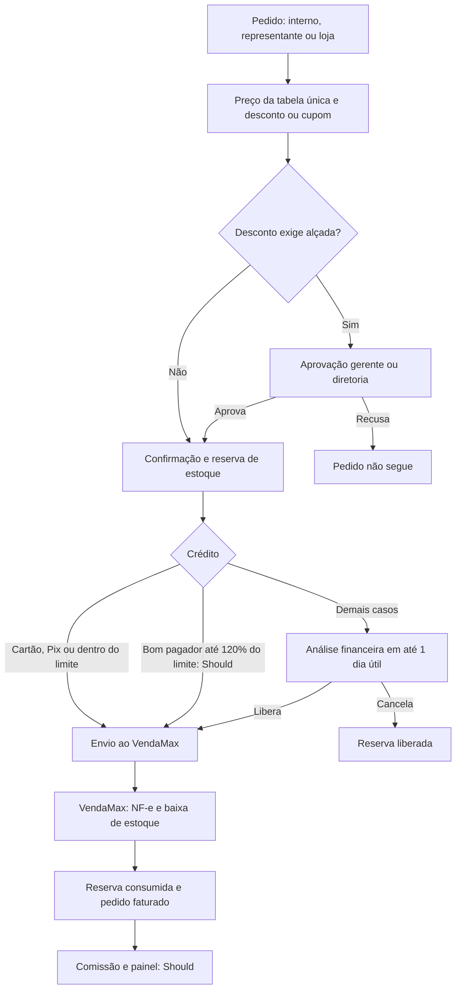

# Documentação de negócio — Sistema de Vendas Unificado

**Base:** `escopo.md`, `fontes/`, `entrega/respostas.md` e `mudancas/` (avaliadas em `08-mudancas.md`). Pessoas são citadas pelo cargo. "Resp. N" é a resposta N de `respostas.md`.

**Como ler o status de cada item:**

- **Decidido:** afirmado por um stakeholder ou por documento aprovado.
- **Premissa (PR):** decisão provisória nossa para o trabalho avançar. Não é fato e precisa ser confirmada.
- **Pendente (PA):** sem resposta. Não foi preenchido com suposição quando isso criaria regra de negócio.

## 1. Resumo

A Distribuidora Aurora vende por vendedores internos e representantes no ERP VendaMax e por uma loja B2B na web. Cliente e desconto são tratados de formas diferentes, a integração é um CSV noturno e a comissão paga é calculada em uma planilha.

O projeto cria um sistema único para cliente, preço, desconto, pedidos e reserva de estoque. A NF-e continua no VendaMax durante 2027.

**O que precisa de decisão antes de comprometer prazo:**

1. **A API do VendaMax foi confirmada apenas em parte.** Segundo o fornecedor, via TI, ela cria pedido e consulta faturamento, com limite de 60 requisições por minuto e sem webhook. Estoque, clientes, preço, impostos, frete, devoluções e número da NF-e seguem sem confirmação, e estoque e clientes são necessários aos Musts (PA-01).
2. **O ERP hoje recusa desconto acima de 10% e não aceita CPF.** Sem mudança no ERP, as alçadas e a venda a pessoa física não chegam à NF-e (PA-02, PA-03).
3. **O crédito é a prioridade nº 1 no kickoff, mas ficou como Should na resposta 10.** Se cair da v1, a reclamação citada pela diretoria continua (C-01).
4. **A data de início e a escolha entre prazo e escopo não foram definidas** (PA-15). Por isso, este documento não promete que os Musts cabem em 6 meses.
5. **A diretoria incluiu o app offline na v1 sem retirar nada do escopo** (ata de 20/01/2027). Isso exige replanejamento e decisão sobre o que sai ou sobre o prazo (PA-22).

## 2. Objetivos e indicadores

| Objetivo | Indicador | Situação atual | Meta |
|---|---|---|---|
| Acabar com a recusa indevida de desconto | Pedidos recusados dentro da política | Sem medida | Nenhuma recusa dentro da política, conforme objetivo do kickoff e Resp. 2. Medição a implantar |
| Reduzir espera por crédito | Tempo de análise | Média de 2 dias úteis | 1 dia útil (política, item 3) |
| Eliminar recadastro de pessoa física | Horas por dia | Cerca de 1h/dia | A definir. Depende de PA-03 |
| Reduzir venda sem estoque | Cancelamentos por falta de estoque | 20/mês na loja. Sem dado nos outros canais | A definir |
| Comissão igual ao pagamento | Reclamações de representantes e divergência com a planilha | 15/mês. Duas contas | A definir (PA-11) |
| Visão unificada de vendas | Atraso do painel | Pedido da loja chega ao ERP só no lote noturno | No máximo 5 minutos (Resp. 11) |

## 3. Partes interessadas

| Perfil | Interesse | Observação |
|---|---|---|
| Diretor Comercial | Vendas em tempo real, desconto sem recusa indevida, crédito sem travar bons pagadores | Decide alçadas e exceções |
| Coordenadora Financeira | Comissão correta e configurável, crédito | Dona das regras de comissão |
| Gerente de TI | Integração por API, continuidade do VendaMax, RPO/RTO | Deve levantar RPO/RTO (Resp. 15) |
| PO | Backlog e priorização | Respondeu por ausentes nas respostas 8 e 14 |
| Gerente Comercial | Aprova desconto acima de 15% até 20% e cupons acima de 15% | Não ouvida diretamente |
| Vendedores internos (8) | Pedidos, desconto, disponibilidade | Não ouvidos |
| Representantes (22) | Uso em campo, comissão clara | Web responsiva e app offline na v1, por decisão da diretoria. Não ouvidos diretamente |
| Clientes da loja | Preço, cupom e estoque corretos | Inclui pessoas físicas profissionais |
| Analista de crédito | Fila e análise | Não ouvido |
| Setor de Faturamento | NF-e e baixa de estoque | Não ouvido. PF continua em aberto |
| Fornecedor do VendaMax | API e alterações | Ainda não consultado |
| Jurídico externo | LGPD e validade das regras de comissão | Ainda não consultado (Resp. 14) |

## 4. Escopo da primeira versão

Prioridades conforme a resposta 10, atualizadas pela ata de diretoria de 20/01/2027.

| Prioridade | Capacidade |
|---|---|
| **Must** | Cadastro único · Pedidos unificados (multicanal) · Alçadas de desconto · Reserva de estoque · Integração com VendaMax · App offline para representantes (ata de 20/01/2027; classificação em PR-18) |
| **Should** | Comissão automática · Crédito automático · Painel |
| **Fora da v1** | NF-e e baixa fiscal fora do VendaMax |

**Incluído por necessidade, embora não listado na resposta 10** (detalhe em seção 8):

- **Crédito manual com SLA, cartão e Pix, em Must.** Pedidos unificados não podem deixar de cumprir o item 3 da política. Só a aprovação automática é Should.
- **Tabela de preços única, em Must.** Decidida na resposta 9 e necessária para os pedidos multicanal.
- **Consentimento explícito e reconfirmação, em Must.** Exigidos pela política e pela resposta 14.
- **Continuidade da planilha de comissão, em Must.** Se a comissão automática ficar para depois, o pagamento não pode parar.
- **Proteção da operação atual**, como alerta do lote noturno e teste de restauração da loja. Reduzem risco até a migração.

**Volumes de referência (Resp. 15):** 4 mil clientes ativos, 12 mil SKUs, 400 pedidos/dia com pico de 900 em novembro (60% ERP, 40% loja), 8 vendedores internos e 22 representantes.

## 5. Regras de negócio

| ID | Regra | Status | Origem |
|---|---|---|---|
| RN-01 | Desconto até **15%** não exige aprovação. Acima de 15% até 20%, exige gerente comercial. Acima de 20%, exige diretoria. Substitui o limite anterior de 12% | Decidido. Vigência e revisão formal da política pendentes (PA-21) | Ata 20/01/2027 item 3, política 1, Resp. 2 |
| RN-02 | A política de desconto vale para todos os canais, inclusive cupons | Decidido | Resp. 2, 3 |
| RN-03 | Cupom acima do limite sem aprovação precisa de autorização da gerente ao criar a campanha. O limite era 12% e passa a 15% por seguir a mesma política (derivado). Acima de 20%, exige diretoria (derivado) | Regra decidida. Novo patamar a confirmar em PA-21 e acima de 20% em PA-06 | Resp. 3, ata 20/01/2027 item 3 |
| RN-04 | Tabela de preços única para todos os canais, cadastrada no novo sistema | Decidido | Política 4, Resp. 9 |
| RN-05 | Pedido acima do limite exige análise pelo financeiro em até 1 dia útil, salvo RN-06 e RN-07 | Decidido | Política 3 |
| RN-06 | Bom pagador é o cliente sem atraso nos últimos 12 meses. Pedido dentro de 120% do limite é aprovado automaticamente | Decidido, mas depende de alterar a política e de fonte de dados (PA-07) | Resp. 1 |
| RN-07 | Cartão e Pix dispensam análise de crédito | Decidido | Resp. 13 |
| RN-08 | Comissão segue a planilha, com as alterações da ata: base líquida; interno com 3% até a meta e 5% sobre o excedente, passando a **6% a partir de março**; representante com 4% e **bônus de meta igual ao dos internos**; desconto acima de 8% paga metade; pedido da loja paga 1% ao responsável pela carteira | Decidido como referência. Combinações pendentes (PA-09). Fórmula e vigência do bônus e competência da mudança pendentes (PA-20) | Planilha, Resp. 4, ata 20/01/2027 itens 1 e 2 |
| RN-09 | Devolução no mês seguinte estorna a comissão | Decidido. Demais casos pendentes (PA-10) | Planilha, Resp. 5 |
| RN-10 | Estoque é reservado na confirmação do pedido, em qualquer canal | Decidido. "Confirmação" e duração pendentes (PA-13) | Resp. 11 |
| RN-11 | A baixa de estoque continua no faturamento do VendaMax | Decidido | Resp. 9 |
| RN-12 | NF-e continua no VendaMax em 2027 | Decidido. Horizonte posterior desconhecido (PA-18) | Escopo, Resp. 9 |
| RN-13 | Marketing exige consentimento marcado explicitamente pelo cliente. A base atual da loja precisa ser reconfirmada | Decidido | Política 6, Resp. 14 |
| RN-14 | O financeiro altera regras de comissão sem depender de TI. A política prevê aprovação anual da diretoria | Decidido. Forma de aprovação pendente (PA-11) | Ata, Resp. 6, política 5 |
| RN-15 | Fechamento da comissão no dia 5 e pagamento no dia 10 do mês seguinte | Decidido como regra atual (planilha) | Planilha |
| RN-16 | A empresa vende para pessoas jurídicas e pessoas físicas profissionais | Decidido | Política 2 |

## 6. Requisitos funcionais

| ID | Requisito | Prioridade |
|---|---|---|
| RF-01 | Manter cadastro único de clientes PJ e PF, sem duplicar documento | Must |
| RF-02 | Permitir mais de um usuário de acesso por cliente | Must |
| RF-03 | Registrar o responsável pela carteira, com histórico | Must |
| RF-04 | Registrar consentimento explícito e reconfirmar a base atual | Must |
| RF-05 | Migrar e unificar clientes do ERP e da loja | Must |
| RF-06 | Manter tabela de preços única, aplicada a todos os canais | Must |
| RF-07 | Registrar pedidos de internos, representantes e loja no mesmo lugar | Must |
| RF-08 | Oferecer digitação de pedido por web responsiva | Must |
| RF-09 | Controlar o ciclo de vida do pedido e permitir consulta única | Must |
| RF-10 | Aplicar as faixas de desconto em todos os canais | Must |
| RF-11 | Encaminhar aprovações, com substituto e trilha de auditoria | Must |
| RF-12 | Criar e aplicar cupons conforme a política | Must |
| RF-13 | Reservar estoque na confirmação e liberar reservas | Must |
| RF-14 | Mostrar a mesma disponibilidade em todos os canais | Must |
| RF-15 | Conciliar reserva com a baixa feita no faturamento | Must |
| RF-16 | Enviar pedidos ao VendaMax e receber faturamento e NF-e por API | Must |
| RF-17 | Sincronizar clientes e preços com o VendaMax | Must |
| RF-18 | Monitorar, alertar e reprocessar falhas de integração | Must |
| RF-19 | Conduzir a análise manual de crédito com SLA de 1 dia útil | Must |
| RF-20 | Dispensar análise em cartão e Pix | Must |
| RF-21 | Aprovar automaticamente bons pagadores até 120% do limite | Should |
| RF-22 | Permitir que o financeiro configure regras de comissão, com vigência e versão | Should |
| RF-23 | Calcular comissão automaticamente | Should |
| RF-24 | Estornar comissão em devolução | Should |
| RF-25 | Apurar o fechamento, comparar com a planilha e exibir extrato ao vendedor | Should |
| RF-26 | Exibir painel unificado com atraso máximo de 5 minutos | Should |
| RF-27 | Encerrar a integração por CSV depois do corte | Must |
| RF-28 | Manter o cálculo pela planilha viável enquanto a comissão automática não entra | Must |
| RF-29 | Proteger a operação atual até a migração e conduzir a implantação | Must |
| RF-30 | Permitir ao representante consultar catálogo e registrar pré-pedido sem internet | Must (PR-18) |
| RF-31 | Sincronizar pré-pedidos e tratar divergências de preço, estoque, desconto e crédito | Must (PR-18) |
| RF-32 | Proteger dados de clientes guardados no dispositivo | Must (PR-18) |

## 7. Processo futuro

A ordem entre aprovação, reserva e crédito é proposta. Ela depende de confirmar PR-08 e PA-13. No app offline, o pré-pedido entra neste fluxo apenas ao sincronizar (PR-19). O faturamento é detectado por consulta periódica ao VendaMax, porque a API não tem webhook.

## 8. Conflitos identificados e tratamento

| ID | Conflito | Tratamento | Quem confirma |
|---|---|---|---|
| C-01 | No kickoff, crédito de bom pagador é "prioridade número 1". Na resposta 10, crédito automático é Should | Vale a resposta 10, por ser mais recente e dada em conjunto. O risco de frustrar a expectativa fica explícito. Propomos crédito automático como primeiro Should, mas a ordem dentro do grupo não foi definida (PA-15) | Diretor Comercial |
| C-02 | O escopo inclui comissão automática na visão do sistema, mas a resposta 10 a coloca em Should | Fica em Should, e a planilha continua viável (RF-28) | Coord. Financeira, PO |
| C-03 | Aprovação automática até 120% contraria o item 3 da política, que exige análise acima do limite. Não se sabe se a política será alterada | A aprovação automática só entra em produção com a política alterada ou exceção formal | Diretor Comercial |
| C-04 | Preço será cadastrado no novo sistema, mas o ERP lê `preco_tabela` e emite a NF-e | Novo sistema é mestre e publica no ERP (depende de PA-01) | Gerente de TI |
| C-05 | Regra de comissão editável sem TI, enquanto a política exige aprovação da diretoria | Sem TI não significa sem aprovação: a edição fica com o financeiro e a vigência exige aprovação registrada (PR-12) | Coord. Financeira, Diretor Comercial |
| C-06 | Cupons seguem a política, mas o BLACK15 (15%) valia até 30/11/2026, sem evidência da autorização, e era rejeitado pelo ERP. Com o novo limite, 15% deixaria de exigir autorização | Tratamento dos pedidos da campanha fica pendente. A v1 aplica a regra vigente aos cupons ativos no corte | Diretor Comercial |
| C-07 | Decisão por API, com confirmação apenas de criar pedido e consultar faturamento | Prova técnica segue como primeira atividade, focada nas lacunas e no limite de uso. Lacuna sem solução volta para a TI e a diretoria, sem adotar outro meio por conta própria | Gerente de TI |
| C-08 | Reserva na confirmação e baixa só no faturamento | São compatíveis: a reserva reduz a disponibilidade, e a baixa consome a reserva. Como não há webhook, o faturamento é detectado por consulta, e a conciliação precisa tolerar esse atraso | Gerente de TI |
| C-09 | A PO e a resposta 10 deixaram o app fora da v1. A diretoria o incluiu em 20/01/2027 | Vale a ata, por ser posterior e de maior autoridade. O efeito em prazo e escopo não foi decidido (PA-22) | Diretoria, PO |
| C-10 | A ata fixa 15% sem aprovação, mas a política revisada em 2025 ainda diz 12%, e o ERP recusa acima de 10% | Vale a ata como decisão, com política a ser revisada e dependência de PA-02 maior | Diretor Comercial |
| C-11 | A planilha diz que o representante não tem bônus de meta. A ata diz que passa a ter | Vale a ata, mas fórmula e vigência não estão definidas (PA-20) | Coord. Financeira, diretoria |
| C-12 | Painel em até 5 minutos e ausência de webhook com limite de 60 requisições por minuto | Pedidos nascem no novo sistema e não dependem do ERP. Indicador de faturamento depende da quantidade pendente e pode exigir outro prazo (PA-14) | Diretor Comercial, Gerente de TI |

## 9. Premissas adotadas

Substituem, quando divergem, as premissas de `perguntas.md`.

| ID | Premissa | Risco se errada | Confirma em |
|---|---|---|---|
| PR-01 | Desconto é aplicado por pedido, como no ERP | Refazer cálculo e aprovação | PA-05 |
| PR-02 | Sem resposta do aprovador, o pedido fica pendente, com alerta depois de 1 dia útil. Nunca há aprovação automática | Vendas paradas | PA-05 |
| PR-03 | Cupom não soma com outro desconto | Regra comercial diferente | PA-06 |
| PR-04 | Limite é comparado ao valor do pedido, como hoje. A exposição total fica como risco | Risco de crédito (R-15) | PA-08 |
| PR-05 | Cliente bloqueado não pode confirmar pedido | Venda bloqueada indevidamente | PA-08 |
| PR-06 | Novo sistema é mestre de cliente, pedido, desconto e reserva. ERP é mestre de NF-e, tributos e saldo físico | Sincronização errada | PA-12 |
| PR-07 | Migram cadastros e pedidos em aberto, sem histórico completo | Consultas e metas de comissão incompletas | PA-12 |
| PR-08 | Pedido confirmado mantém a reserva durante análise de desconto ou crédito, até o prazo de expiração a ser definido | Estoque preso ou perda de venda | PA-13 |
| PR-09 | Cartão e Pix dispensam a análise apenas depois de pagamento aprovado | Pedido não pago chegar ao faturamento | PA-08 |
| PR-10 | Cliente sem limite definido ou sem 12 meses de relacionamento não é bom pagador | Aprovação restritiva demais | PA-07 |
| PR-11 | Clientes só presentes no ERP ficam sem consentimento para marketing, conforme a política | Reduz a base de marketing | PA-16 |
| PR-12 | Regra de comissão entra em vigor apenas com aprovação registrada da diretoria | Burocracia maior que a desejada | PA-11 |
| PR-13 | Comissão é apurada pela data de faturamento. Casos sem regra escrita vão para conferência manual, sem cálculo automático | Fechamento com trabalho manual | PA-09, PA-10 |
| PR-14 | Dois fechamentos em paralelo sem diferença inexplicada antes de aposentar a planilha | Corte cedo ou tarde demais | PA-11 |
| PR-15 | Um único depósito | Refazer o modelo de estoque | PA-13 |
| PR-16 | Consulta ao Serasa continua fora do sistema na v1 | Fila menos eficiente | PA-08 |
| PR-17 | Prazo é o objetivo fixo, cortando escopo a partir dos Should | Expectativa de escopo frustrada | PA-15 |
| PR-18 | App offline é tratado como Must, porque a diretoria o colocou na primeira versão sem indicar prioridade | Must inflado e prazo em risco | PA-22 |
| PR-19 | Offline gera apenas pré-pedido. Reserva, alçada e crédito ocorrem ao sincronizar, e nada é prometido como garantido antes disso | Comercial pode esperar garantia em campo | PA-19 |
| PR-20 | O limite de 15% vale para todos os canais, inclusive vendedores e cupons, e não só para campanhas da loja | Desconto liberado além do pretendido | PA-21 |
| PR-21 | Até definir a fórmula, o bônus do representante não é calculado automaticamente e vai para conferência manual | Fechamento manual | PA-20 |
| PR-22 | "Março" é março de 2027, aplicado às vendas com competência a partir desse mês | Pagamento incorreto na transição | PA-20 |

## 10. Pendências

| ID | Pendência | Responsável | O que trava |
|---|---|---|---|
| PA-01 | **Parcial:** criar pedido e consultar faturamento confirmados por e-mail. A API cobre número da NF-e, impostos, frete, estoque, clientes, preço e devoluções? Há consulta em lote ou por período? Como funciona o limite de 60 requisições por minuto (por credencial, cotas, resposta ao exceder, ampliação)? Dump está completo? Prazo e custo? | Gerente de TI, fornecedor | Estoque, clientes, preço e comissão |
| PA-02 | O fornecedor pode alterar os triggers de desconto, crédito e comissão? | Gerente de TI, fornecedor | Alçadas e crédito na NF-e |
| PA-03 | Como CPF entra hoje no ERP e como a NF-e é emitida? Sem resposta na Resp. 8 | Faturamento, Comercial | Pessoa física de ponta a ponta |
| PA-04 | Substituto da gerente comercial | Diretor Comercial (a resposta pede para perguntar depois) | Valor da configuração de substituto |
| PA-05 | Prazo do aprovador, comportamento sem resposta, desconto por pedido ou item | Diretor Comercial | Fechar PR-01 e PR-02 |
| PA-06 | Limite de cupom, soma de descontos, BLACK15, diferença em pedido já pago | Diretor Comercial | Campanhas e PR-03 |
| PA-07 | Alteração da política de crédito e fonte do histórico de pagamentos | Diretor Comercial, Coord. Financeira | Crédito automático |
| PA-08 | Limite por saldo ou pedido, cliente bloqueado, limite de PF, volume da fila, cobertura para 1 dia útil, Serasa, confirmação de cartão/Pix | Coord. Financeira, Analista de crédito | Regras de crédito e dimensionamento |
| PA-09 | Aprovação da planilha pela diretoria, corte de 8%, casos (a) a (f) e exemplos | Coord. Financeira | Comissão automática |
| PA-10 | Origem de impostos e frete, mês de competência, devolução parcial ou em outro período, como reconhecer devolução, vendedores trocados | Coord. Financeira | Comissão automática |
| PA-11 | Aprovação de alterações, aprovação mensal, envio à folha, diferença aceitável, fechamentos em paralelo | Coord. Financeira | Fechamento e corte da planilha |
| PA-12 | Mestre de cliente, estoque e limite; entrada de mercadoria; histórico a migrar; exceções de preço | Gerente de TI, PO | Sincronização e migração |
| PA-13 | Sentido de "confirmação", tempo de retenção, prioridade na falta, retenção em análise, depósitos, atraso aceitável no estoque | Diretor Comercial, Logística | Reserva de estoque |
| PA-14 | Indicadores do painel, e se os 5 minutos valem também para faturamento | Diretor Comercial | Painel |
| PA-15 | Data de início, prazo ou escopo, ordem dentro dos grupos, destino da loja, ordem de migração, terceirizado nos 4 devs, QA, UX e DevOps | PO, Diretor Comercial, Gerente de TI | Plano e compromisso de prazo |
| PA-16 | Retenção e controles de CPF, base legal, respaldo contratual e legal da comissão | Jurídico externo | Produção com CPF e comissão automática |
| PA-17 | Disponibilidade, RPO/RTO, capacidade do servidor da loja, responsável por incidentes, restrição de hospedagem ou tecnologia | Gerente de TI | Requisitos não funcionais e arquitetura final |
| PA-18 | Destino do VendaMax depois de 2027 | Gerente de TI | Quanto investir na integração |
| PA-19 | Requisitos do app offline: frequência sem internet, necessidades, aceite do pré-pedido, dispositivo, tratamento de divergências | PO, representantes | App offline |
| PA-20 | Bônus do representante: mesma taxa (6%) ou mesmo acréscimo, meta usada e início. Mudança de 6%: vale por competência ou pagamento em março? Regras na planilha atualizadas? Validade contratual | Coord. Financeira, diretoria, jurídico | Comissão e planilha |
| PA-21 | Limite de 15%: início, abrangência, revisão formal da política, novo patamar de autorização de cupom e impacto em margem | Diretor Comercial | Alçadas e cupons |
| PA-22 | Com o app na v1: é Must? O que sai do escopo, o prazo muda, ou a equipe aumenta? | Diretoria, PO, Gerente de TI | Compromisso de prazo |

## 11. Riscos de negócio

| Risco | Prob. | Impacto | Resposta |
|---|---|---|---|
| Musts dependem de capacidades da API não confirmadas e de alterações que o fornecedor pode não entregar | Média | Alto | Resolver PA-01 e PA-02 antes de firmar prazo |
| App offline consumir capacidade dos demais Musts sem decisão sobre o que sai | Alta | Alto | Decidir PA-22 antes de nova estimativa |
| Limite de 60 requisições por minuto atrasar status de faturamento e sincronizações | Média | Médio | Fila, priorização, medição e consulta em lote, se houver |
| Desconto de até 15% sem aprovação reduzir margem | A avaliar | A avaliar | Diretoria acompanhar impacto (PA-21) |
| Capacidade de 4 devs e 1 PO não cobrir os Musts e os itens necessários em 6 meses | Alta | Alto | Estimar depois da prova técnica e, se preciso, reduzir escopo com decisão da diretoria |
| Regras de comissão mudarem em março antes do sistema estar pronto | Alta | Médio | Financeiro atualizar a planilha para a vigência, independentemente da v1 |
| Expectativa do diretor comercial sobre crédito não atendida na v1 | Média | Alto | Tratar C-01 logo. Manter SLA de 1 dia útil já no Must |
| Comissão automática fora da v1 prolonga reclamações | Média | Médio | Manter a planilha funcional e priorizar a comissão no Should |
| Aprovação automática elevar a inadimplência | Média | Alto | Trilha, regra aprovada e acompanhamento |
| Corte coincidir com o pico de novembro (até 900 pedidos/dia) | Média | Alto | Evitar corte próximo a novembro |
| Regras de comissão terem risco trabalhista ou contratual | A avaliar | Alto | Revisão pelo jurídico antes de automatizar (PA-16) |
| Respostas por ausentes (8 e 14) não refletirem as áreas responsáveis | Média | Médio | Confirmar com Faturamento e jurídico externo |

## 12. Histórico de mudanças

| Data da origem | Origem | Alteração neste documento |
|---|---|---|
| 20/01/2027 | M-01, ata de diretoria | RN-01, RN-03, RN-08, escopo com app offline, RF-30 a RF-32, C-09 a C-11, PR-18 a PR-22, PA-20 a PA-22 |
| Sem data | M-02, e-mail da TI | Situação de PA-01, C-07, C-08, C-12, PA-14 |

Detalhes em `08-mudancas.md`. O texto de `fontes/` não foi alterado: a política e a planilha originais precisam ser atualizadas por seus responsáveis.
