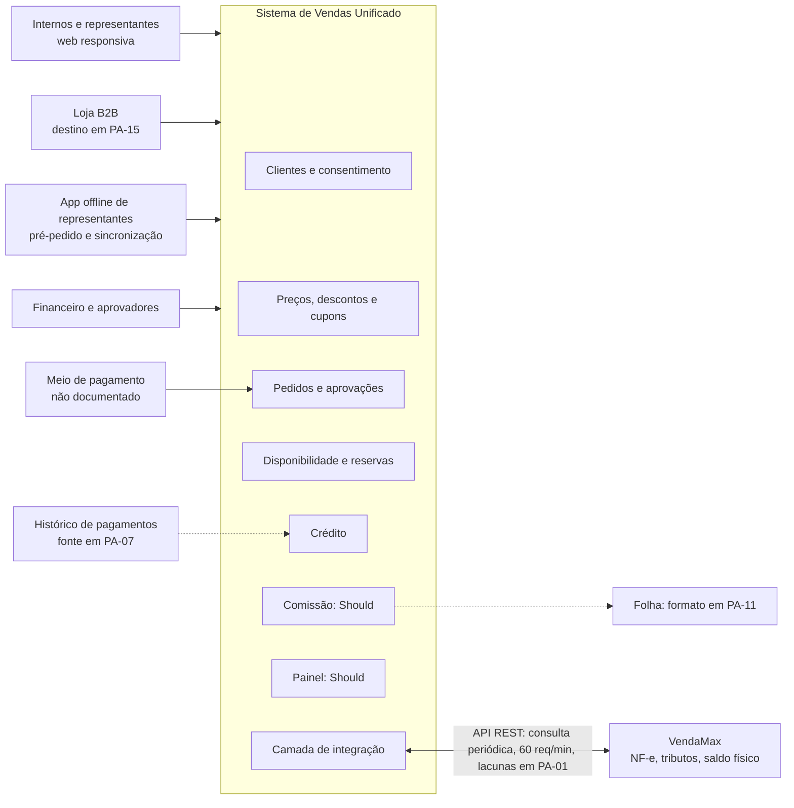
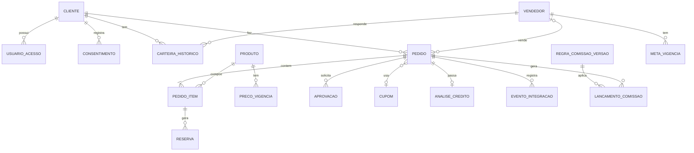
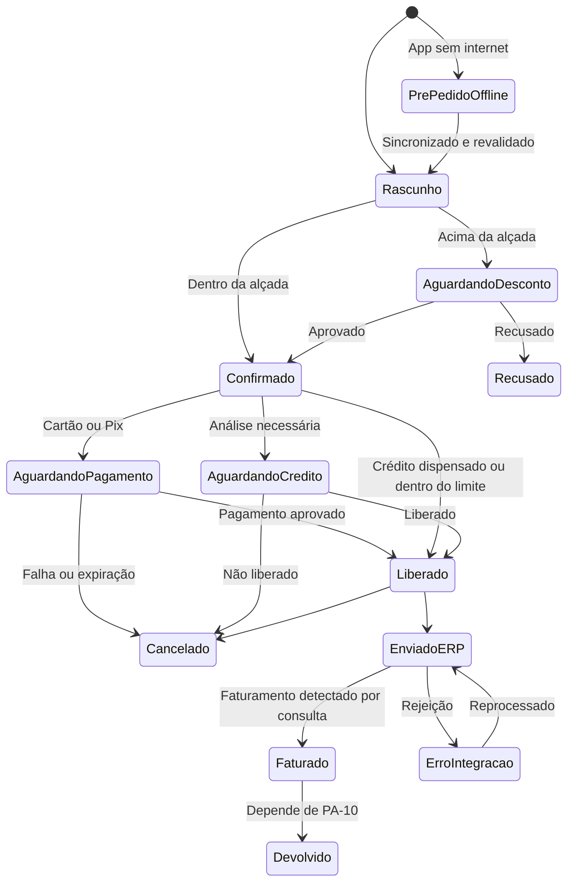

# Documentação técnica — Sistema de Vendas Unificado

Documento de requisitos e arquitetura lógica, sem código. Tecnologia e hospedagem não são prescritas porque as restrições ainda são desconhecidas (PA-17). IDs PA, PR, RF e RN estão em `02-negocio.md`.

## 1. Situação técnica atual

| Sistema | Tecnologia | Papel | Limitações relevantes |
|---|---|---|---|
| VendaMax | PostgreSQL 13 (dump de 01/10/2026) | Pedidos internos e de representantes, NF-e, estoque | Triggers de desconto, crédito e comissão. `cnpj CHAR(14) NOT NULL`. Sem forma de pagamento, fluxo de aprovação, entidade de devolução ou data de faturamento no dump |
| LojaB2B | MySQL 8 | Loja web | `cpf_cnpj` com máscara e sem unicidade. `pedidos_web` sem status. `aceita_marketing` com padrão 1. Servidor antigo e sem backup testado |
| Planilha de comissões | Excel | Cálculo pago | Manual. Alimentada por exportação do VendaMax |
| CSV noturno | Arquivos | Pedidos às 02:00/03:00, preço e estoque às 04:00/05:00 | Falha silenciosa, rejeição de CPF e de desconto acima de 10% |

## 2. Requisitos não funcionais

| ID | Requisito | Valor | Status |
|---|---|---|---|
| RNF-01 | Atraso máximo do painel | 5 minutos | Decidido (Resp. 11) |
| RNF-02 | Capacidade | 4 mil clientes, 12 mil SKUs, 400 pedidos/dia, pico de 900/dia, 30 vendedores | Decidido como base (Resp. 15). Pico por hora e usuários simultâneos a medir |
| RNF-03 | Integração com VendaMax | Por API, não por arquivo | Decidido (ata, Resp. 7). Viabilidade em PA-01 |
| RNF-04 | Auditoria | Registrar quem, quando e o valor em aprovação, regra, carteira e liberação de crédito | Derivado de RN-01, RN-05 e RN-14 |
| RNF-05 | LGPD | Consentimento versionado, acesso mínimo a CPF, logs sem dado pessoal. Retenção a definir | Política 6, Resp. 14. Prazos em PA-16 |
| RNF-06 | Disponibilidade e recuperação | Sem valor definido: não usar número até o levantamento | Pendente (PA-17) |
| RNF-07 | Observabilidade | Alertar falha ou atraso de integração e fila, sem depender de alguém perceber | Derivado da falha silenciosa atual |
| RNF-08 | Web responsiva | Digitação completa em celular e tablet | Decidido (Resp. 12). Conexão limitada não medida |
| RNF-09 | Consistência de estoque | Reservas concorrentes nunca excedem a disponibilidade | Derivado de RN-10 |
| RNF-10 | Idempotência | Reenvio de pedido ou evento não cria duplicidade | Derivado da integração |
| RNF-11 | Atraso de estoque | Sem valor definido. Resp. 11 só fixa o painel | Pendente (PA-13) |
| RNF-12 | Limite de uso da API do VendaMax | 60 requisições por minuto, sem exceder, com fila e priorização | Confirmado por e-mail da TI (M-02). Escopo do limite em PA-01 |
| RNF-13 | Dados no dispositivo do app | Apenas o necessário à carteira, protegidos e com revogação de acesso | Derivado de M-01 e RNF-05. Prazos em PA-16 |
| RNF-14 | Detecção de faturamento | Por consulta periódica, porque a API não tem webhook. Intervalo calculado a partir do volume pendente | Confirmado por e-mail da TI (M-02). Tolerância em PA-13 e PA-14 |

**Ordem de grandeza:** o pico de 900 pedidos/dia equivale a 540 no ERP e 360 na loja, se a proporção de 60/40 se mantiver no pico (hipótese). O volume diário não é um desafio por si só. A dificuldade está em concorrência de reserva e confiabilidade da integração. O pico por hora precisa ser medido antes do teste de carga.

## 3. Arquitetura lógica

**Princípios:**

- **Isolar o VendaMax em uma camada de integração.** Os módulos dependem de um contrato próprio, não das tabelas do ERP. Isso reduz o custo de um ERP sucessor, considerando PA-18.
- **Canal desacoplado.** Internos, representantes, app e loja usam o mesmo contrato de pedido. Assim, a loja pode manter o front-end ou ser substituída (PA-15), sem mudar a regra.
- **Forma do app não prescrita.** A escolha entre aplicativo instalado e web com operação offline depende de PA-17 e PA-19.
- **Regra no novo sistema, fiscal no ERP.** O ERP não deve decidir desconto, crédito ou comissão depois do corte.
- **Sem acesso direto ao banco do ERP nem volta ao CSV** sem aprovação explícita da TI.

## 4. Propriedade dos dados

| Dado | Mestre | Status | Observação |
|---|---|---|---|
| Tabela de preços | Novo sistema | Decidido (Resp. 9) | Publicada ao ERP (`preco_tabela`) |
| Pedido comercial | Novo sistema | Decidido (escopo) | ERP recebe o pedido apto a faturar |
| Política de desconto e cupons | Novo sistema | Decidido (escopo, Resp. 2 e 3) | |
| Reserva e disponibilidade | Novo sistema | Decidido (Resp. 11) | |
| Baixa física de estoque | VendaMax | Decidido (Resp. 9) | |
| NF-e e faturamento | VendaMax | Decidido (Resp. 9) | |
| Tributos e frete | VendaMax | PR-06 | Origem não confirmada (PA-10) |
| Cliente | Novo sistema | PR-06 | Escopo pede cadastro único |
| Limite de crédito | Novo sistema | Hipótese, PA-12 | Campo manual hoje no ERP |
| Entrada de mercadoria | Desconhecido | PA-12 | Sem fonte |
| Dados de produto além do preço | VendaMax | Hipótese, PA-12 | SKU é a chave comum |

## 5. Modelo conceitual

**Pontos de modelagem que corrigem problemas atuais:**

- **Cliente:** um documento (CPF ou CNPJ, normalizado sem máscara e com tipo) para cada cadastro. Usuários de acesso ficam separados porque a loja usa e-mail como identificador.
- **Carteira:** com vigência, permitindo saber o responsável em cada data. O ERD e o dump divergem hoje.
- **Pedido:** inclui canal, forma de pagamento, desconto, cupom, situações comercial e de pagamento. O percentual real de desconto é preservado.
- **Comissão:** lançamentos permitem base, regra aplicada e estorno. Isso substitui o modelo de uma linha por pedido. A meta tem vigência.
- **Devolução:** será evento próprio assim que a fonte for confirmada (PA-10), distinto de cancelamento.

## 6. Ciclo de vida do pedido

A proposta segue PR-08, PR-09 e PR-19: há reserva a partir de `Confirmado`, e não em `PrePedidoOffline`, e ela é liberada em `Cancelado`. Ajustar quando PA-13 for fechado. Cada transição guarda usuário ou sistema, data e motivo.

## 7. Integração com o VendaMax

### 7.1 Capacidades necessárias

| Capacidade | Direção | Prioridade | Para quê | Situação na API |
|---|---|---|---|---|
| Criar pedido com vendedor, desconto real e itens | Novo → ERP | Must | Faturamento e continuidade da planilha | Criar pedido confirmado. Campos a verificar |
| Consultar faturamento | ERP → Novo | Must | Situação do pedido, baixa de reserva | Confirmado, só por consulta |
| Obter número da NF-e e cancelamento | ERP → Novo | Must | Situação do pedido | Não confirmado |
| Consultar saldo físico por SKU | ERP → Novo | Must | Disponibilidade | Não confirmado |
| Enviar e atualizar clientes PJ e PF | Novo → ERP | Must | NF-e | Não confirmado |
| Publicar preço por SKU | Novo → ERP | Must | Decisão de mestre | Não confirmado |
| Obter impostos, frete e devoluções | ERP → Novo | Should | Comissão | Não confirmado |

A confirmação veio por e-mail da TI (M-02), sem documentação da API. A prova técnica precisa comprová-la. O assunto do e-mail cita NF-e, mas o texto não descreve operação de NF-e.

### 7.2 Conflitos com o que existe no ERP

| Objeto no ERP | Comportamento | Efeito no novo sistema | Necessidade |
|---|---|---|---|
| `trg_valida_desconto` | Recusa desconto acima de 10% em inserção e alteração | Pedido aprovado até 20% ou mais é rejeitado | Alterar ou desativar para pedidos vindos do novo sistema |
| `trg_checa_credito` | Em inserção, muda para `aguardando_credito` se `total > limite` | Pedido liberado volta para fila no ERP. Inclui cartão, Pix e bom pagador | Mesmo tratamento, e entender a discrepância da importação |
| `trg_calcula_comissao` | Grava 3% ao faturar | Valor que não é pago e confunde | Pode permanecer como legado, sem uso |
| `cliente.cnpj CHAR(14) NOT NULL` | Não representa CPF formalmente | PF sem caminho claro para a NF-e | Mudança no ERP. Depende de PA-03 |
| `pedido` sem forma de pagamento | ERP não sabe como foi pago | Dado permanece no novo sistema | Avaliar necessidade no faturamento |

**Contorno rejeitado:** enviar preço líquido com `desconto_pct` zerado para burlar o trigger. A planilha usa o desconto para aplicar a metade da comissão acima de 8%, logo essa solução quebraria o pagamento e a rastreabilidade.

### 7.3 Critério de decisão da prova técnica

Estado atual: existência da API confirmada, com cobertura parcial. O caso vigente é "API parcial".

| Resultado | Encaminhamento |
|---|---|
| API cobre as capacidades e o fornecedor altera os triggers | Seguir com a arquitetura |
| API parcial | Fornecedor implementa a diferença. Reavaliar prazo |
| Sem API, ou triggers imutáveis | Parar e levar à TI e à diretoria. Opções como adaptador do fornecedor, antecipar substituição ou redesenhar escopo exigem decisão formal, com C-07 em aberto |

### 7.4 Orçamento de uso da API

60 requisições por minuto equivalem a 300 a cada 5 minutos e 3.600 por hora. As contas abaixo supõem **uma requisição por item, sem operação em lote**, o que ainda precisa ser verificado.

| Operação | Volume | Consumo com o limite inteiro | Leitura |
|---|---|---|---|
| Criar pedidos no pico | 900 por dia | 15 minutos no dia | Confortável, salvo rajada acima de 60 por minuto, absorvida pela fila |
| Consultar 300 pedidos pendentes | 300 | 5 minutos | É o máximo para percorrer todos em 5 minutos, sem nenhum outro uso |
| Consultar 900 pedidos pendentes | 900 | 15 minutos | Excede 5 minutos |
| Consultar 1.800 pedidos pendentes (hipótese de 2 dias de pico) | 1.800 | 30 minutos | Excede 5 minutos |
| Saldo de 12 mil SKUs, se houver operação | 12.000 | 200 minutos | Inviável para acompanhar item a item |
| Preço de 12 mil SKUs, se houver operação | 12.000 | 200 minutos | Carga inicial precisa de janela |
| Clientes ativos, se houver operação | 4.000 | Cerca de 67 minutos | Carga inicial precisa de janela |

**Requisitos decorrentes:**

- **Limitador único e fila com prioridade.** Todas as chamadas passam pela mesma camada. Prioridade proposta: criar pedido, consultar faturamento, depois sincronizações.
- **Consulta focada.** Consultar apenas pedidos em aberto, com frequência maior para os mais prováveis de faturar, e parar em estados finais.
- **Medir antes de fixar intervalo.** O tempo real entre envio e faturamento define a quantidade pendente, e esse dado não existe nas fontes.
- **Pedir ao fornecedor** consulta em lote ou por período e alterações de saldo por período. Sem isso, estoque não acompanha a venda com folga (PA-01).

**Efeito no painel:** pedidos nascem no novo sistema, então os 5 minutos de RNF-01 não dependem do ERP. O indicador "faturado" pode não cumprir os 5 minutos com muitos pendentes, o que precisa ser decidido em PA-14.

### 7.5 Requisitos de confiabilidade

- Fila de envio com tentativa automática, chave idempotente e fila de erros visível.
- Alerta para rejeição, indisponibilidade, atraso acima do limite, e consumo perto de 60 requisições por minuto.
- Verificar se criar pedido é idempotente no fornecedor. Se não for, um reenvio após erro de rede precisa de consulta prévia.
- Conciliação diária entre pedidos liberados e recebidos no ERP, e entre faturados e reservas consumidas.

## 8. Regras de domínio

### 8.1 Disponibilidade e reserva

`disponível = saldo físico no ERP − reservas abertas`

- A reserva e a verificação são atômicas por SKU (RNF-09).
- A consulta periódica detecta o faturamento com atraso. Nesse intervalo o saldo do ERP pode já refletir a baixa enquanto a reserva segue aberta, subestimando a disponibilidade. A leitura de saldo e a confirmação de faturamento precisam ser conciliadas, e é preciso medir essa janela.
- Reserva expirada libera o estoque. O prazo é parâmetro sem valor definido (PA-13).
- A base de cálculo fica pronta para múltiplos depósitos apenas se PA-13 confirmar a necessidade (PR-15).

### 8.2 Desconto

| Desconto | Resultado |
|---|---|
| Até 15%, inclusive | Sem aprovação |
| Acima de 15% até 20%, inclusive | Gerente comercial |
| Acima de 20% | Diretoria |

O limite de 15% vem da ata de 20/01/2027. Como a regra já mudou, os limites são parâmetros com vigência, e não valores fixos. O limite exato de 20% com gerente decorre de "acima de 20%" na política. Substituto é configuração sem valor até PA-04. Sem substituto ou sem resposta, o pedido permanece pendente com alerta (PR-02).

### 8.3 Crédito

Ordem de avaliação proposta:

1. Cliente bloqueado impede a confirmação (PR-05).
2. Cartão ou Pix aprovados dispensam a análise (RN-07, PR-09).
3. Pedido dentro do limite segue.
4. Bom pagador com pedido até 120% do limite é aprovado, quando RF-21 estiver ativo.
5. Os demais vão à fila com SLA de 1 dia útil.

Limite padrão zero faz com que 120% também seja zero, logo clientes sem limite sempre vão para análise em boleto, inclusive PF. A contagem de 1 dia útil precisa de calendário e cobertura definidos (PA-08).

### 8.4 Comissão

Parâmetros por versão, com vigência: percentuais por tipo de vendedor, meta, corte de desconto, fator redutor, percentual da loja e regras de estorno. A versão precisa aceitar excedente de meta também para representantes.

Mudança já conhecida: excedente do interno passa de 5% para 6% a partir de março (PR-22). O bônus do representante fica sem cálculo automático até PA-20 (PR-21). Cada lançamento guarda versão da regra, base, percentual e motivo.

A edição é de configuração estruturada, sem escrita de código. Combinações sem definição (PA-09) não recebem valor automático e vão à conferência manual (PR-13). A regra não entra em produção antes da análise do jurídico (PA-16).

## 9. Migração

| Dado | Tratamento | Pendência |
|---|---|---|
| Clientes ERP e loja | Normalizar documento, casar por documento e unir atributos. Divergências vão para revisão | PA-12 |
| Usuários da loja | Migrar como usuários de acesso. Credenciais dependem do algoritmo e do destino da loja, e o `senha_hash` nunca é exposto | PA-15 |
| CPF cadastrado no ERP | Tratamento só depois de entender como foi gravado | PA-03 |
| Consentimento | `aceita_marketing = 1` não vale como consentimento. Reconfirmar a base | RN-13 |
| Preços e SKUs | Carga inicial a partir do ERP, 12 mil SKUs | PA-12 |
| Pedidos | Em aberto, conforme PR-07 | PA-12 |
| Metas e carteiras | Com vigência a partir da carga | PA-09 |

**Convivência:** cada canal migra em uma ordem a definir (PA-15). Enquanto um canal estiver no modelo antigo, sua demanda precisa entrar no cálculo de disponibilidade, ou haverá venda duplicada. Não realizar corte perto do pico de novembro.

## 10. Segurança e LGPD

- Perfis mínimos: vendedor (carteira), representante (carteira), cliente (próprios dados), gerente, diretoria, financeiro, crédito, TI.
- CPF e dados de contato com acesso restrito e fora de logs e relatórios gerais.
- Consentimento com finalidade, data, versão do texto e origem, sem caixa pré-marcada.
- No app offline: dados apenas da carteira, armazenamento protegido, bloqueio de acesso e revogação remota em caso de perda ou desligamento (RNF-13).
- Encerrar a pasta `erros/` e arquivos intermediários no corte, com descarte conforme orientação do jurídico (PA-16).
- Regras de retenção não estão definidas, o que impede declarar conformidade até a resposta do jurídico externo.

## 11. Estratégia de validação

| Tema | Como validar |
|---|---|
| Faixas de desconto | Casos de limite: 15,00%, 15,01%, 20,00%, 20,01%, e troca de vigência |
| Reserva | Teste concorrente para a última unidade e carga no pico de 900 pedidos/dia |
| Crédito | Casos em exatamente 100% e 120% do limite, atraso e PF |
| Comissão | Casos aprovados pelo financeiro, incluindo transição de 5% para 6%, e fechamentos em paralelo com a planilha |
| Limite da API | Pico com fila, sem exceder 60 requisições por minuto, e tempo de detecção de faturamento medido |
| App offline | Perda de conexão, sincronização repetida, divergência de preço e estoque, dispositivo perdido |
| Integração | Homologação com o fornecedor: falhas, reenvio, triggers e rejeição |
| Painel | Medir atraso real contra 5 minutos |
| LGPD | Revisão de permissões, logs, consentimento e retenção |

## 12. Decisões de arquitetura

| ID | Decisão | Status | Revisar quando |
|---|---|---|---|
| ADR-01 | Integrar por API, com camada isolada | Decidido (TI) | PA-01 |
| ADR-02 | Novo sistema é mestre de preço, e VendaMax da baixa e NF-e | Decidido (Resp. 9) | PA-18 |
| ADR-03 | Disponibilidade = saldo do ERP − reservas | Proposto | PA-12, PA-13 |
| ADR-04 | Comissão por lançamentos com regra versionada | Proposto | PA-09, PA-11 |
| ADR-05 | Contrato de pedido único por canal | Proposto | PA-15 |
| ADR-06 | Não mascarar desconto para burlar o trigger | Proposto | PA-02 |
| ADR-07 | Faturamento detectado por consulta, com limitador único | Decorrente de M-02 | Se surgir webhook ou consulta em lote |
| ADR-08 | Offline gera pré-pedido, e as regras só valem ao sincronizar | Proposto | PA-19 |
| ADR-09 | Limites de alçada como parâmetros com vigência | Proposto | PA-21 |

## 13. Plano técnico proposto

As fases são por dependência, sem datas, porque a data de início, a capacidade real e o resultado da prova técnica são desconhecidos.

| Fase | Conteúdo | Condição de saída |
|---|---|---|
| 0. Viabilidade e proteção | Prova técnica, triggers, destino da loja, alertas, restauração, requisitos do app e replanejamento | Decisão sobre PA-01, PA-02, PA-15, PA-19 e PA-22, com estimativa feita pela equipe |
| 1. Fundação Must | Clientes, preço, contrato de pedido e integração | Pedido interno completo até a NF-e em homologação |
| 2. Regras Must | Alçadas, cupons, crédito manual e reservas | Regras validadas por negócio |
| 2b. App offline | Catálogo local, pré-pedido, sincronização e proteção de dados, sobre as regras da fase 2 | Pré-pedido validado por representantes |
| 3. Corte | Migração, treinamento, canais | Critérios de corte aceitos e CSV encerrado |
| 4. Should | Crédito automático, comissão e painel, em ordem a confirmar | Conforme capacidade restante |
