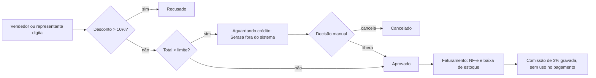
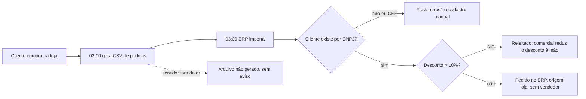
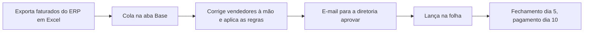

# Diagnóstico do cenário atual: Sistema de Vendas Unificado

Versão 2, de 03/11/2026, atualizada com `entrega/respostas.md`. As seções 2 a 9 mantêm a foto da versão 1, antes das respostas; **as seções 11 e 12 trazem o que mudou e prevalecem em caso de diferença.** Tudo aqui vem das fontes em `fontes/` e do `escopo.md`. O que é inferência está marcado como hipótese. Registros de dados dos dumps não foram copiados.

## 1. Resumo executivo

A empresa aplica regras diferentes para o mesmo conceito em cada sistema, e a política comercial não está implementada em nenhum deles. Foram registrados 47 achados: 13 divergências, 6 gargalos, 13 riscos, 6 pontos de apoio e 9 oportunidades. Os três mais críticos são:

1. **O ERP pode anular as regras novas (RIS-001).** O faturamento continua no VendaMax, cujos triggers recusam desconto acima de 10%, reavaliam crédito e gravam comissão de 3%. Sem mudar o ERP, um desconto de 12% aprovado no sistema novo não chegaria à NF-e.
2. **A integração por API não está comprovada (RIS-002).** A TI pede API, mas as fontes só mostram troca de arquivos. A arquitetura e o prazo de 6 meses dependem dessa resposta.
3. **Pessoa física não cabe no ERP que emite a nota (DIV-003, RIS-003).** A política vende a PF desde 2025 e a loja aceita CPF, mas o ERP só aceita CNPJ. As fontes não explicam como a nota dessas vendas é emitida.

Também pesam a comissão (o valor do ERP não é o valor pago) e o crédito, em que o pedido nº 1 do Diretor Comercial ("bom pagador não trava") contraria a política atual.

## 2. Mapa dos sistemas

| Sistema | Papel | Processos | Entidades | Tecnologia |
|---|---|---|---|---|
| SIS-01 VendaMax | ERP legado principal | Pedido, crédito, faturamento/NF-e, baixa de estoque | cliente, vendedor, produto, pedido, pedido_item, comissao | PostgreSQL 13 |
| SIS-02 Planilha de Comissões | Satélite manual | Apuração e pagamento de comissão | aba "Base" e aba "Leia-me" | Excel/planilha |
| SIS-03 LojaB2B | Canal web | Autoatendimento, cupom, pagamento | clientes, produtos, cupons, pedidos_web, itens_pedido_web | MySQL 8 |
| SIS-04 Vendas Unificado | Alvo | Todos os acima, menos NF-e | A definir | A definir |

Quem é a fonte da verdade hoje:

| Dado | Hoje | Situação |
|---|---|---|
| Cliente | ERP e loja, cada um com o seu | Sem dono único; a chave não fecha para CPF |
| Preço e estoque | ERP; a loja recebe cópia diária | Cópia defasada durante o dia |
| Pedido | ERP e loja | Loja chega no dia seguinte |
| Comissão paga | Planilha | O valor do ERP é só referência |
| Regra de desconto | Política, ERP e loja | Três valores diferentes |

## 3. Processos atuais

### 3.1 Pedido no ERP

- Desconto máximo de 10% `[sql: SIS-01/schema.sql:fn_valida_desconto]` `[doc: SIS-01/manual-pedido.md#0]`.
- Crédito por pedido, só na inserção `[sql: SIS-01/schema.sql:fn_checa_credito]`.
- Estoque baixado no faturamento: dois vendedores podem vender o mesmo item `[doc: SIS-01/manual-pedido.md#0]`.
- Achados: DIV-001, DIV-004, DIV-007, GAR-001, GAR-006, RIS-009.

### 3.2 Pedido na loja web

- Cerca de 1h/dia de recadastro de PF, 20 cancelamentos/mês por falta de estoque, e cartão fora da análise de crédito `[doc: SIS-03/integracao-erp.md#0]`.
- Achados: DIV-001, DIV-003, DIV-006, GAR-002, GAR-004, GAR-005, RIS-005, RIS-006.
- **Hipótese:** as fontes não mostram retorno do ERP para a loja sobre status do pedido, e `exportado_erp` não confirma a aceitação pelo ERP `[sql: SIS-03/schema.sql:pedidos_web]`.

### 3.3 Comissão

- Regras completas e média de 15 reclamações/mês dos representantes `[doc: SIS-02/regras-comissao.md#0]`.
- Achados: DIV-002, DIV-009, DIV-010, DIV-012, GAR-003, RIS-008, RIS-011, RIS-013.

### 3.4 Sincronização de produtos

ERP gera `produtos.csv` às 04:00 e a loja importa às 05:00, com preço e estoque `[doc: SIS-03/integracao-erp.md#0]`. Como o ERP só baixa estoque no faturamento, **hipótese:** o saldo enviado à loja não desconta pedidos ainda não faturados. Achados: DIV-007, DIV-011.

## 4. Matriz de divergências

| ID | Regra | VendaMax (SIS-01) | Planilha (SIS-02) | LojaB2B (SIS-03) | Documentos (geral/escopo) | Sev. |
|---|---|---|---|---|---|---|
| DIV-001 | Desconto | Máx. 10% `[sql: fn_valida_desconto]` | Acima de 8% paga metade da comissão `[doc: regras-comissao.md#0]` | Cupom até 15% `[sql: cupons]` | 12% livre; até 20% gerente; acima, diretoria `[doc: politica-comercial.md#0]` | Alta |
| DIV-002 | Comissão | 3% do total, a todos; sem vendedor, nada `[sql: fn_calcula_comissao]` | Líquido; 3%/5%; 4%; loja 1% `[doc: regras-comissao.md#0]` | Pedido não tem vendedor | "Duas contas diferentes" `[doc: ata-kickoff.md#0]` | Alta |
| DIV-003 | Cliente PF | Só CNPJ, único, sem máscara `[sql: cliente]` | Não se aplica | CPF ou CNPJ, com máscara, sem unicidade `[sql: clientes]` | PF desde 2025 `[doc: politica-comercial.md#0]` | Alta |
| DIV-004 | Prazo de crédito | Média de 2 dias úteis; sexta só na terça `[doc: manual-pedido.md#0]` | Não se aplica | Não se aplica | Até 1 dia útil `[doc: politica-comercial.md#0]` | Média |
| DIV-005 | Bom pagador | Sem histórico de pagamento no dump `[sql: cliente]` | Não se aplica | Não se aplica | Kickoff: não trava `[doc: ata-kickoff.md#0]`; política: acima do limite exige análise | Alta |
| DIV-006 | Crédito e pagamento | Todo INSERT é avaliado; pedido sem forma de pagamento `[sql: fn_checa_credito]` | Não se aplica | Cartão não passa; boleto passa; pix não citado `[doc: integracao-erp.md#0]` | Política sem exceção | Alta |
| DIV-007 | Estoque | Baixa no faturamento `[doc: manual-pedido.md#0]` | Não se aplica | Foto diária `[sql: produtos]` | "Atualizado para todos" `[doc: escopo.md]` | Alta |
| DIV-008 | Consentimento | Sem campo `[sql: cliente]` | Não se aplica | `aceita_marketing` padrão 1 `[sql: clientes]` | Consentimento explícito `[doc: politica-comercial.md#0]` | Alta |
| DIV-009 | Devolução | Cancela pedido, sem entidade `[doc: erd-vendamax.md#0]` | Estorna no mês seguinte `[doc: regras-comissao.md#0]` | Não documentado | Não documentado | Média |
| DIV-010 | Carteira | Opcional e sem FK `[sql: cliente]`; ERD: único vendedor `[doc: erd-vendamax.md#0]` | 1% à carteira; correção manual `[doc: regras-comissao.md#0]` | Sem carteira `[sql: clientes]` | Não documentado | Média |
| DIV-011 | Preço | Tabela do produto `[doc: manual-pedido.md#0]` | Não se aplica | Cópia diária do ERP `[sql: produtos]` | Escopo: próprios; política: única | Média |
| DIV-012 | Governança da comissão | Não se aplica | E-mail à diretoria `[doc: regras-comissao.md#0]` | Não se aplica | Aprovação anual `[doc: politica-comercial.md#0]`; sem TI `[doc: ata-kickoff.md#0]` | Média |
| DIV-013 | Horizonte do ERP | Fica "neste ano" `[doc: ata-kickoff.md#0]` | Não se aplica | Não se aplica | "Por enquanto"; v1 em 6 meses `[doc: escopo.md]` | Média |

Observações sobre os limites de desconto: cinco números se cruzam (8%, 10%, 12%, 15% e 20%). Pela política, um vendedor pode dar 12% sem aprovação, mas perderia metade da comissão acima de 8%. Isso não é contradição formal, mas é um incentivo a validar (Q-005).

Leitura adotada da política, a confirmar: 12% exatos não precisam de aprovação e 20% exatos ficam com o gerente.

## 5. Gargalos

| ID | Gargalo | Medida nas fontes | Fonte |
|---|---|---|---|
| GAR-001 | Fila manual de crédito, com Serasa fora do sistema | 2 dias úteis em média | `[doc: SIS-01/manual-pedido.md#0]` |
| GAR-002 | Recadastro de PF rejeitada | Cerca de 1h/dia | `[doc: SIS-03/integracao-erp.md#0]` |
| GAR-003 | Apuração manual de comissão | 15 reclamações/mês | `[doc: SIS-02/regras-comissao.md#0]` |
| GAR-004 | Pedido da loja só chega ao ERP no lote noturno | Até o lote seguinte | `[doc: SIS-03/integracao-erp.md#0]` |
| GAR-005 | Redução manual de cupom de 15% | Sem medida | `[doc: SIS-03/integracao-erp.md#0]` |
| GAR-006 | Aprovação de desconto sem registro no sistema, sem substituto | Sem medida | `[sql: SIS-01/schema.sql:pedido]` `[doc: geral/ata-kickoff.md#0]` |

## 6. Riscos

Probabilidade e impacto são avaliação inicial do analista, a validar.

| ID | Risco | Prob. | Impacto | Sev. | Mitigação sugerida |
|---|---|---|---|---|---|
| RIS-001 | Triggers do ERP anulam as regras novas | Alta | Alto | Crítica | Decidir com o fornecedor o ajuste dos triggers antes de fechar a arquitetura (Q-010) |
| RIS-002 | API do VendaMax não comprovada | Média | Alto | Crítica | Prova de conceito no início; plano alternativo com contrato e prazo do fornecedor (Q-010) |
| RIS-003 | NF-e de PF com ERP só CNPJ | Média | Alto | Alta | Levantar o fluxo real com Faturamento antes de desenhar PF (Q-009) |
| RIS-004 | Escopo maior que prazo e equipe | Alta | Alto | Alta | Corte explícito da v1 e entrega por etapas (Q-011) |
| RIS-005 | Servidor da loja sem backup testado; um único terceirizado | Média | Alto | Alta | Testar restauração já, sem esperar a v1; documentar operação (Q-015) |
| RIS-006 | Falha silenciosa da integração | Média | Alto | Alta | Alerta e conferência diária durante a convivência |
| RIS-007 | Duas fontes da verdade na convivência | Alta | Alto | Alta | Definir dono de cada dado e plano de virada (Q-011, Q-012) |
| RIS-008 | Dados insuficientes para a base líquida | Alta | Alto | Alta | Confirmar a origem de imposto, frete e data de faturamento (Q-004) |
| RIS-009 | Brechas no controle de crédito | Média | Médio | Média | Revisar a regra na migração (Q-008) |
| RIS-010 | Qualidade dos dados na unificação | Alta | Médio | Alta | Perfilar duplicidades antes da migração; definir precedência (Q-003) |
| RIS-011 | Regra configurável sem controle | Baixa | Alto | Média | Versão, vigência, aprovação e auditoria (Q-006) |
| RIS-012 | Dados pessoais em CSV, `erros/` e dumps | Média | Médio | Média | Definir acesso e retenção; usar dumps sem dados (Q-014) |
| RIS-013 | Contrato de representante restringir comissão | Baixa | Alto | Média | Revisar os contratos, ausentes das fontes (Q-014) |

Detalhes que sustentam alguns riscos:

- **RIS-001:** vale para qualquer pedido enviado ao ERP. A consequência é hipótese até a TI confirmar como os pedidos entrarão (Q-010) `[sql: SIS-01/schema.sql:fn_valida_desconto]` `[sql: SIS-01/schema.sql:fn_checa_credito]` `[sql: SIS-01/schema.sql:fn_calcula_comissao]`.
- **RIS-008:** o pedido só tem `total`, `desconto_pct` e `criado_em`. Falta confirmar se os outros dados existem em partes do ERP que não estão no dump `[sql: SIS-01/schema.sql:pedido]`.
- **RIS-009:** o trigger não considera saldo em aberto e não roda em alteração do pedido. O campo `bloqueado` não aparece em nenhum trigger do dump, e `limite_credito` nasce como 0, o que manda à análise qualquer pedido de cliente novo sem limite `[sql: SIS-01/schema.sql:cliente]`.
- **RIS-010:** `cpf_cnpj` na loja não é único; `email` é `[sql: SIS-03/schema.sql:clientes]`. No ERP, `cliente.vendedor_id` não tem FK `[sql: SIS-01/schema.sql:cliente]`.
- **Lacuna do dump:** nenhum trigger baixa estoque. **Hipótese:** a baixa descrita no manual está no código do ERP.

Documentos antigos (ERD de 2022, manual de 2023) devem ser tratados com cautela. Exemplo: o ERD desenha vendedor obrigatório no pedido, mas sua própria observação diz que pedidos da loja não têm vendedor `[doc: geral/erd-vendamax.md#0]`.

## 7. Pontos de apoio

| ID | O que preservar ou reaproveitar | Fonte |
|---|---|---|
| APO-001 | Política comercial aprovada e objetiva | `[doc: geral/politica-comercial.md#0]` |
| APO-002 | Regras de comissão escritas, base para cálculo e testes | `[doc: SIS-02/regras-comissao.md#0]` |
| APO-003 | NF-e já emitida no VendaMax, fora da v1 | `[doc: SIS-01/manual-pedido.md#0]` `[doc: escopo.md]` |
| APO-004 | SKU como identificador comum | `[sql: SIS-01/schema.sql:produto]` `[sql: SIS-03/schema.sql:produtos]` |
| APO-005 | Loja já modela CPF/CNPJ, consentimento, cupom e pagamento | `[sql: SIS-03/schema.sql:clientes]` `[sql: SIS-03/schema.sql:pedidos_web]` |
| APO-006 | ERP já modela tipo de vendedor, meta, limite e status | `[sql: SIS-01/schema.sql:vendedor]` `[sql: SIS-01/schema.sql:pedido]` |

## 8. Oportunidades

| ID | Oportunidade | Ganho indicado nas fontes |
|---|---|---|
| OPO-001 | Motor único de desconto e alçada | Reduz reclamação de desconto recusado |
| OPO-002 | Comissão automática e rastreável | Ataca as 15 reclamações/mês e a conta dupla |
| OPO-003 | Cadastro único com PF | Elimina cerca de 1h/dia de recadastro |
| OPO-004 | Reserva de estoque compartilhada | Ataca os 20 cancelamentos/mês da loja |
| OPO-005 | Crédito com fila, prazo e critério | Aproxima a prática de 1 dia útil |
| OPO-006 | Visão consolidada de vendas | Atende ao pedido do Diretor Comercial |
| OPO-007 | Integração monitorada | Encerra a falha silenciosa e o atraso do lote |
| OPO-008 | Canal móvel do representante | Pedido dos representantes, ainda a avaliar |
| OPO-009 | Consentimento auditável | Prova do consentimento explícito |

## 9. Perguntas e perfis

As 15 perguntas estão em `entrega/perguntas.md`:

| Perfil | Destinatário | Perguntas |
|---|---|---|
| Comercial | Diretor Comercial | 1, 2, 3 |
| Negócio | Diretor Comercial, com a Coordenadora Financeira na 7 | 7, 13 |
| Financeiro | Coordenadora Financeira; Setor de Faturamento na 9 | 4, 5, 6, 8, 9 |
| Arquitetura e DevOps | Gerente de TI | 10, 15 |
| Gestão/PMO | PO | 11 |
| Operações | Responsável por Operações/Estoque | 12 |
| Jurídico | Jurídico / Encarregado de dados | 14 |

Lacunas deixadas de fora pelo limite de 15, a tratar como pendência ou hipótese na Etapa 2: papéis e permissões detalhados, autenticação, telas, estratégia de testes, relatórios além do painel, e marketing/campanhas.

As fontes não indicam quem responde por Operações/Estoque nem por Jurídico/LGPD. Os dois não estavam no kickoff `[doc: geral/ata-kickoff.md#0]`, então o PO precisa indicá-los.

## 10. Método e limitações

- **Estado da skill:** modelo em `[método]modelo/` validado por `[método] check`. O estado atual está na seção 11.
- **Motor RAG:** o embedder `fastembed` falhou ("fastembed não instalado"). As fontes foram indexadas com `--embedder hash` (lexical), e 19 consultas foram registradas em `[método]log-rag.jsonl`.
- **Estratégia RAG:** consultas com `--llm none`, sempre em baseline. O Corrective RAG não foi executado. Com 11 chunks pequenos, os achados foram verificados pela leitura integral das 8 fontes.
- **Citações:** caminhos abreviados na matriz da seção 4 referem-se aos mesmos arquivos citados nas outras seções.
- **Log do RAG:** o campo `usadas` foi preenchido depois das consultas, por filtro de palavras-chave sobre os chunks recuperados. Ele é aproximado; as citações deste documento vieram da leitura das fontes.
- **Desvios de execução:** o índice lexical é um substituto escolhido por mim, já que a instrução era seguir sem o motor se ele falhasse. Scripts auxiliares foram gravados temporariamente fora deste diretório, na pasta `exp/` e em `/tmp`, e removidos em seguida. O comando do motor usa o ambiente em `<skill>/engine`.
- **Decisões sem confirmação:** escopo reformulado e lista de perfis foram definidos sem validação humana, por causa do modo Delegado.
- **Dados pessoais:** os dumps trazem registros de clientes e vendedores. Eles foram excluídos do índice e não aparecem nas entregas. Pessoas são citadas pelo cargo.

## 11. O que mudou com as respostas

As 15 perguntas tiveram resposta parcial ou "não sei". As hipóteses do campo "se ficar sem resposta" de `perguntas.md` **não foram adotadas** como regra: o que ficou sem resposta virou Q-016 a Q-029, e Q-003 e Q-009 seguem abertas. Situação do modelo: 34 requisitos (28 confirmados, 1 em conflito, 5 hipóteses) e 49 achados (7 tratados).

### Novos achados

- **DIV-014 (crítica): Must da v1 × metas de 6 meses.** O PO lista cinco itens Must, sem comissão, crédito e painel `[entrevista: gestao-pmo Q-011]`. Mas as metas são zero planilha, reclamações abaixo de 3/mês, crédito em até 1 dia útil e painel com até 5 minutos `[entrevista: negocio Q-013]`. Isso não foi resolvido: os itens ficaram Should, com conflito aberto (Q-025).
- **RIS-014 (alta): donos das regras ausentes.** Operações e Jurídico foram respondidos pelo PO, e Faturamento ficou sem resposta.

### Achados tratados

| Achado | Decisão | O que resta |
|---|---|---|
| DIV-001 Desconto | Vale a política, com cupons; cupom acima de 12% autorizado pela gerente na campanha `[entrevista: comercial Q-001]` | Substituto (Q-016); trigger do ERP (RIS-001) |
| DIV-002 Comissão | Vale a planilha; cálculo do ERP abandonado `[entrevista: financeiro Q-004]` | Dados de base (RIS-008, Q-018) |
| DIV-004 Prazo de crédito | Meta de 1 dia útil continua `[entrevista: financeiro Q-008]` | Cobertura do analista (Q-022) |
| DIV-006 Crédito e pagamento | Cartão e pix dispensam análise `[entrevista: financeiro Q-008]` | Trigger do ERP (RIS-001); revisar a política |
| DIV-008 Consentimento | Marcação explícita e reconfirmação da base da loja `[entrevista: juridico-compliance Q-014]` | Validação jurídica e base do ERP (Q-028) |
| DIV-011 Preço | Tabela única `[entrevista: comercial Q-002]` | Exceções atuais (Q-017) |
| DIV-013 Horizonte do ERP | NF-e no VendaMax em 2027 `[entrevista: software-architect Q-010]` | Data final (Q-023) |

### Achados que seguem abertos, com avanço parcial

| Achado | Avanço | O que falta |
|---|---|---|
| DIV-005 Bom pagador | Sem atraso em 12 meses; até 120% do limite, aprovação automática `[entrevista: negocio Q-007]` | **Conflita com a política, que exige análise acima do limite**; histórico não localizado (Q-021) |
| DIV-007 Estoque | Reserva na confirmação, em qualquer canal `[entrevista: operacoes Q-012]` | Definir confirmação, dono do saldo e dupla baixa com o ERP (Q-026) |
| DIV-012 Governança da comissão | Alteração sem TI confirmada `[entrevista: financeiro Q-006]` | Aprovador e vigência (Q-020) |
| RIS-002 API | Decisão por API tomada `[entrevista: software-architect Q-010]` | **Existência da API continua não comprovada** (Q-023) |
| RIS-004 Prazo | App offline fora da v1 `[entrevista: gestao-pmo Q-011]` | DIV-014 e dados de equipe e início (Q-024, Q-025) |

### Sem nenhum avanço

RIS-001 (triggers), RIS-003 e DIV-003 (PF e NF-e; Q-009 sem resposta), DIV-009 (devolução no ERP), DIV-010 e RIS-010 (carteira, dono do cadastro e precedência; Q-003 sem resposta), RIS-005 (responsável pela loja e backup), RIS-008 (base líquida), RIS-012 e RIS-013 (retenção e contratos).

### Novos dados de dimensionamento

400 pedidos/dia, pico de 900 em novembro (60% ERP, 40% loja), 4 mil clientes ativos, 8 vendedores internos e 22 representantes `[entrevista: devops Q-015]`. Isso gera RNF-006. Volumes mensais e RPO/RTO seguem abertos (Q-029).

### Limitações desta etapa

Os documentos não passaram por validação humana, portanto não há baseline. RN-005, por estar em conflito, e os 5 requisitos em hipótese não geraram histórias. Isso inclui RNF-001 a RNF-004 e RF-008 (migração), que são importantes para a v1 e precisam de decisão. A validação contra as fontes foi por leitura direta, com uma consulta `validacao` em baseline, sem Corrective RAG.

## 12. O que mudou com as comunicações de `mudancas/`

Detalhes em `08-mudancas.md`. Situação do modelo: 37 requisitos (31 confirmados, 1 em conflito, 5 hipóteses) e 54 achados (7 tratados).

| Achado | Mudança | Fonte |
|---|---|---|
| DIV-015 (novo, crítica) | App offline na v1 × corte, prazo e regras online | `[doc: geral/M-01-ata-diretoria.md#0]` |
| DIV-016 (novo, alta) | Bônus do representante sem valor definido | `[doc: geral/M-01-ata-diretoria.md#0]` |
| DIV-017 (novo, média) | Política e planilha desatualizadas em relação à ata | `[doc: geral/M-01-ata-diretoria.md#0]` |
| RIS-015 (novo, alta) | Consulta periódica e limite podem não atender 5 minutos | `[doc: geral/M-02-email-ti.md#0]` |
| RIS-016 (novo, alta) | API confirmada só para dois fluxos | `[doc: geral/M-02-email-ti.md#0]` |
| RIS-002 | Cai de crítica para alta: a API existe | `[doc: geral/M-02-email-ti.md#0]` |
| RIS-004 | Sobe de alta para crítica | `[doc: geral/M-01-ata-diretoria.md#0]` |
| RIS-001 | Segue crítica e pesa mais com 15% sem aprovação | `[doc: geral/M-01-ata-diretoria.md#0]` |
| DIV-001 | Segue tratada, agora com limite de 15% | `[doc: geral/M-01-ata-diretoria.md#0]` |
