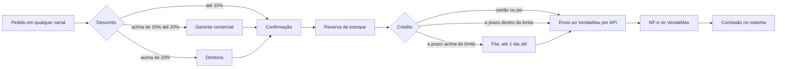

# Documentação de negócio

- **Projeto:** Sistema de Vendas Unificado
- **Data:** 03/11/2026
- **Baseline:** sem baseline (documentos ainda não validados pelos stakeholders)
- **Revisão:** inclui CR-001 a CR-005 (ver `08-mudancas.md`)
- **Fontes:** `escopo.md`; `fontes/SIS-01-erp/` (manual-pedido.md, schema.sql); `fontes/SIS-02-comissoes/regras-comissao.md`; `fontes/SIS-03-loja-b2b/` (integracao-erp.md, schema.sql); `fontes/geral/` (ata-kickoff.md, erd-vendamax.md, politica-comercial.md); `entrega/respostas.md`; `mudancas/` (M-01, M-02)

## 1. Contexto e problema

A Distribuidora Aurora vende por dois canais, o VendaMax (vendedores internos e representantes) e a LojaB2B, e calcula comissão em planilha. Cada um tem regras e cadastros próprios, e a integração é um CSV noturno `[doc: escopo.md]`. O detalhamento está em `01-diagnostico.md`.

Volume informado: 400 pedidos/dia, com pico de 900 em novembro (60% ERP, 40% loja), 4 mil clientes ativos, 8 vendedores internos e 22 representantes `[entrevista: devops Q-015]`.

## Bloqueios que decidem a v1

1. **Triggers do VendaMax (RIS-001, Q-023).** A API REST existe para criar pedido e consultar faturamento `[doc: geral/M-02-email-ti.md#0]`, mas ninguém confirmou o efeito dos triggers. Se valerem para a API, o limite de 10% do ERP impede RN-001, que libera até 15%, de chegar à NF-e.
2. **App offline na v1 (DIV-015, Q-032).** A diretoria incluiu o app `[doc: geral/M-01-ata-diretoria.md#0]`, sem ajuste de prazo ou equipe, e as regras offline não estão definidas.
3. **Cobertura e limite da API (RIS-015, RIS-016, Q-033).** Só dois fluxos estão confirmados, com 60 requisições por minuto e sem webhook.
4. **Corte da v1 (DIV-014, Q-025).** O Must do PO não inclui comissão, crédito e painel, mas as metas de 6 meses dependem deles. Recomendação: incluir a comissão automática no Must ou trocar a meta de zero planilha. Quem decide é o PO, com o Diretor Comercial.
5. **Pessoa física na NF-e (RIS-003, Q-009, Q-023).** O cadastro único aceita CPF, mas ninguém soube dizer como a nota sai hoje para PF.

## 2. Objetivos e indicadores de sucesso

Metas para 6 meses `[entrevista: negocio Q-013]`. A data de início dos 6 meses não foi informada (Q-024).

| Indicador | Hoje | Meta | Depende de |
|---|---|---|---|
| Uso da planilha de comissão | Em uso para todo pagamento `[doc: SIS-02/regras-comissao.md#0]` | Zero | RF-004 (fora do Must, DIV-014) |
| Reclamações de comissão | 15/mês, de representantes `[doc: SIS-02/regras-comissao.md#0]` | Abaixo de 3/mês | RF-004 |
| Cancelamentos por falta de estoque | 20/mês, na loja `[doc: SIS-03/integracao-erp.md#0]` | Abaixo de 5/mês | RN-006, RF-006 |
| Tempo de crédito | 2 dias úteis em média `[doc: SIS-01/manual-pedido.md#0]` | Até 1 dia útil | RF-005 (fora do Must, DIV-014) |
| Atraso do painel | Pedido da loja só no dia seguinte `[doc: SIS-03/integracao-erp.md#0]` | Máximo de 5 minutos | RF-012 (fora do Must, DIV-014), RNF-005; em risco se venda for faturado (RIS-015) |

Ressalva: os números atuais de reclamações e cancelamentos têm recortes próprios (representantes e loja). A meta foi informada sem recorte, então é preciso confirmar a mesma medida antes de comparar. Metas de 3 meses não foram definidas (Q-027).

## 3. Stakeholders e áreas

RACI simples, proposto a partir das fontes e a validar.

| Atividade | Responsável | Aprova | Consultado |
|---|---|---|---|
| Política de desconto e preço | Comercial | Diretor Comercial | Gerente comercial |
| Regras de comissão | Financeiro | Diretoria (política; fluxo em Q-020) | Comercial |
| Crédito | Financeiro | Financeiro | Comercial |
| Escopo e backlog | PO | Não definido (Q-025) | TI |
| Integração com VendaMax | TI | Gerente de TI | Fornecedor |
| Estoque | A indicar (Q-026) | A indicar | PO |
| LGPD | Jurídico externo, a indicar (Q-028) | A indicar | PO |

## 4. Escopo

**Must da v1:** cadastro único, pedido multicanal, política de desconto com alçada, reserva de estoque e integração com o VendaMax `[entrevista: gestao-pmo Q-011]`, mais o app offline, por decisão da diretoria `[doc: geral/M-01-ata-diretoria.md#0]`.

**Dentro do escopo, com prioridade em conflito (DIV-014):** comissão automática, fila de crédito e painel `[doc: escopo.md]` `[entrevista: negocio Q-013]`.

**Fora da v1:** faturamento e NF-e, que continuam no VendaMax, inclusive em 2027 `[entrevista: software-architect Q-010]`.

**Sem definição:** fim da digitação no VendaMax, destino da LojaB2B e paralelo da planilha (Q-024). A web responsiva e o app para representantes sugerem que eles sairão do VendaMax, mas isso não foi afirmado (Q-024, Q-032).

## 5. Processos: atual e futuro

O fluxo atual está em `01-diagnostico.md`, seção 3. O fluxo futuro abaixo só traz o que foi confirmado. O que falta está listado logo depois dele.

Pendente nesse fluxo: o caminho do pedido offline (Q-032), a definição de "confirmação" e a ordem entre reserva e crédito (Q-026), a aprovação automática de bom pagador (RN-005) e a entrada do pedido no ERP (Q-023). A etapa "dentro do limite" mantém a comparação por pedido só como leitura atual, pois saldo ou pedido está em aberto (Q-022).

| Gargalo | Tratamento | Requisitos |
|---|---|---|
| GAR-001 Fila manual de crédito | Fila com prazo | RF-005 |
| GAR-002 Recadastro de PF | Cadastro único | RF-001, RN-003 |
| GAR-003 Planilha de comissão | Cálculo automático | RF-004 |
| GAR-004 Lote noturno | API e pedido único | RF-007, RF-002 |
| GAR-005 Ajuste manual de cupom | Política única de cupom | RN-001, RN-009 |
| GAR-006 Aprovação fora do sistema | Fluxo registrado; substituto pendente (Q-016) | RF-003 |

## 6. Regras de negócio confirmadas

| ID | Enunciado | Prioridade | Fontes |
|---|---|---|---|
| RN-001 | O sistema deve exigir aprovação de desconto por faixa, em todos os canais: até 15% nenhuma; acima de 15% até 20% gerente comercial; acima de 20% diretoria. | Must | doc:geral/politica-comercial.md#0, doc:geral/ata-kickoff.md#0, entrevista:comercial Q-001, doc:geral/M-01-ata-diretoria.md#0 |
| RN-002 | O sistema deve calcular a comissão sobre o valor líquido faturado (total menos impostos e frete): vendedor interno 3% até a meta mensal e, sobre o excedente, 5% até fevereiro de 2027 e 6% a partir de março de 2027; representante 4% até a meta mensal. | Should | doc:SIS-02/regras-comissao.md#0, doc:geral/ata-kickoff.md#0, entrevista:financeiro Q-004, doc:geral/M-01-ata-diretoria.md#0 |
| RN-003 | O sistema deve aceitar cliente pessoa física e jurídica, com um único cadastro por documento (CPF ou CNPJ) normalizado. | Must | doc:geral/politica-comercial.md#0, sql:SIS-03/schema.sql:clientes, doc:SIS-03/integracao-erp.md#0 |
| RN-004 | O sistema deve encaminhar à análise do Financeiro, com prazo de até 1 dia útil, o pedido a prazo acima do limite de crédito. | Should | doc:geral/politica-comercial.md#0, doc:SIS-01/manual-pedido.md#0, entrevista:financeiro Q-008 |
| RN-006 | O sistema deve reservar o estoque do item na confirmação do pedido, em qualquer canal. | Must | doc:SIS-01/manual-pedido.md#0, doc:SIS-03/integracao-erp.md#0, doc:escopo.md, entrevista:operacoes Q-012 |
| RN-007 | O sistema deve usar dados de clientes para marketing somente com consentimento explícito registrado. | Must | doc:geral/politica-comercial.md#0, entrevista:juridico-compliance Q-014 |
| RN-008 | O sistema deve usar uma única tabela de preços em todos os canais. | Must | doc:geral/politica-comercial.md#0, doc:escopo.md, entrevista:comercial Q-002 |
| RN-009 | O sistema deve exigir autorização da gerente comercial na criação de campanha com cupom acima de 15%. | Must | entrevista:comercial Q-001, doc:geral/M-01-ata-diretoria.md#0 |
| RN-010 | O sistema deve dispensar da análise de crédito o pedido pago com cartão ou pix. | Should | entrevista:financeiro Q-008, doc:SIS-03/integracao-erp.md#0 |
| RN-011 | O sistema deve pagar metade da comissão em pedido com desconto acima de 8%. | Should | doc:SIS-02/regras-comissao.md#0, entrevista:financeiro Q-004 |
| RN-012 | O sistema deve pagar 1% do pedido da loja ao vendedor responsável pela carteira do cliente. | Should | doc:SIS-02/regras-comissao.md#0, entrevista:financeiro Q-004 |
| RN-013 | O sistema deve estornar a comissão de pedido devolvido no mês seguinte. | Should | doc:SIS-02/regras-comissao.md#0, entrevista:financeiro Q-005 |
| RN-014 | O sistema deve fechar a comissão no dia 5 e indicar pagamento no dia 10 do mês seguinte. | Should | doc:SIS-02/regras-comissao.md#0, entrevista:financeiro Q-004 |
| RN-015 | O sistema deve aplicar ao representante, sobre o que exceder a meta mensal, o bônus de meta igual ao do vendedor interno. | Should | doc:geral/M-01-ata-diretoria.md#0 |

Respostas de quem não é dono da regra: RN-006 veio do PO, sem Operações; RN-007 e RF-013 vieram do PO, sem o jurídico. Elas valem como decisão de trabalho e precisam de validação (Q-026, Q-028, RIS-014).

## 7. Requisitos de negócio por área

| Área | Requisitos |
|---|---|
| Comercial | RF-001, RF-002, RF-003, RF-009, RF-011, RF-012, RF-014 |
| Financeiro | RF-004, RF-005, RF-010 |
| Operações/Estoque | RF-006 |
| TI | RF-007, RF-015, RNF-005, RNF-006, RNF-007 |
| Jurídico/LGPD | RF-013 |

## 8. Premissas, restrições e dependências

- **Restrições:** primeira versão desejada em 6 meses, com 4 devs e 1 PO `[doc: escopo.md]`. NF-e no VendaMax em 2027 `[entrevista: software-architect Q-010]`. Integração por API `[doc: geral/ata-kickoff.md#0]`.
- **Dependências:** fornecedor do VendaMax (API, triggers, CPF); jurídico externo; responsável por Operações, ainda não indicado.
- **Premissa:** o estorno mantém a regra da planilha para devolução no mês seguinte; outros casos não estão definidos (Q-019).
- **Divergência documental a corrigir (DIV-017):** a política ainda traz 12% e exige análise de todo pedido acima do limite, sem prever RN-005 nem RN-010. A aba Leia-me ainda traz 5% e representante sem bônus, e o pagamento sai dela até o sistema entrar.

## 9. Riscos de negócio

| ID | Risco | Severidade | Situação |
|---|---|---|---|
| RIS-001 | Regras do ERP podem anular a nova política quando ele continuar faturando | critica | M-02 não diz se os triggers atuam na API. Com 15% sem aprovação, o limite de 10% do ERP passa a barrar descontos rotineiros (Q-023). |
| RIS-002 | API do VendaMax não comprovada | alta | M-02 confirma API REST para criar pedido e consultar status. Risco cai de 'existe?' para cobertura, que passa a RIS-016. |
| RIS-003 | NF-e de pessoa física com ERP só CNPJ | alta | Q-009 sem resposta; fluxo de PF no ERP bloqueado. |
| RIS-004 | Escopo maior que prazo e equipe | critica | M-01 acrescenta app offline ao Must, sem mudar prazo ou equipe (DIV-015). |
| RIS-005 | Servidor da loja antigo, sem backup testado, e dependência de um terceirizado | alta | aberto |
| RIS-006 | Falha silenciosa da integração | alta | aberto |
| RIS-007 | Duas fontes da verdade na convivência | alta | aberto |
| RIS-008 | Comissão automática sem os dados necessários | alta | M-02 não indica que a API devolva imposto, frete ou data de faturamento (Q-018, Q-033). |
| RIS-010 | Qualidade dos dados na unificação | alta | aberto |
| RIS-014 | Donos das regras ausentes da rodada de respostas | alta | aberto |
| RIS-015 | Consulta periódica com limite de 60/min pode não atender 5 minutos | alta | aberto |
| RIS-016 | API confirmada cobre só dois fluxos | alta | aberto |

## 10. Glossário

| Termo | Definição | Fonte |
|---|---|---|
| Alçada | Faixa de desconto e quem a aprova | doc:geral/politica-comercial.md#0 |
| Base líquida | Total do pedido menos impostos e frete | doc:SIS-02/regras-comissao.md#0 |
| Bom pagador | Sem atraso nos últimos 12 meses; regra em conflito (RN-005) | entrevista:negocio Q-007 |
| Carteira | Vínculo do cliente com um único vendedor | doc:geral/erd-vendamax.md#0 |
| Confirmação do pedido | Momento da reserva; definição pendente (Q-026) | entrevista:operacoes Q-012 |
| PF profissional | Pessoa física profissional que compra pela loja | doc:geral/politica-comercial.md#0 |

## 11. Pendências

### Requisitos fora do corpo

| ID | Status | Enunciado proposto | Por que está pendente |
|---|---|---|---|
| RN-005 | conflito | O sistema deve aprovar automaticamente o pedido de até 120% do limite de crédito de cliente sem atraso nos últimos 12 meses. | critério definido; contraria a política vigente, e o histórico não foi localizado (Q-021) |
| RF-008 | hipótese | O sistema deve importar clientes do ERP e da loja, identificando duplicidades por documento. | segue hipótese: dono e precedência sem resposta (Q-003) |
| RNF-001 | hipótese | O sistema deve confirmar cada troca com o ERP, reprocessar falhas e alertar um responsável, nos limites a definir. | sem confirmação humana; evidência só do problema |
| RNF-002 | hipótese | O sistema deve registrar quem alterou preço, regra de comissão, limite de crédito e aprovações, e quando. | sem confirmação humana; evidência só do problema |
| RNF-003 | hipótese | O sistema deve tratar dados pessoais conforme a LGPD, com finalidade, controle de acesso e retenção definidos. | segue hipótese: retenção e direitos dependem de jurídico externo (Q-028) |
| RNF-004 | hipótese | O sistema deve ter backup com restauração testada, com RPO e RTO a definir. | segue hipótese: RPO/RTO a levantar (Q-029) |

### Perguntas abertas

| ID | Para | Pergunta aberta | Achados |
|---|---|---|---|
| Q-003 | Diretor Comercial (reenviar) | Quem será o dono do cadastro único e qual dado prevalece quando ERP e loja divergirem? Todo cliente precisa ter vendedor de carteira, inclusive pessoa física da loja, e quem define e troca essa carteira? O que causa os vendedores trocados? | DIV-003, DIV-010, RIS-010 |
| Q-009 | Setor de Faturamento, com a Coordenadora Financeira (reenviar) | Como exatamente esses clientes são cadastrados no ERP hoje, e como sai a NF-e deles? Há impacto fiscal ou de contabilização que o novo fluxo deva corrigir? | DIV-003, RIS-003, GAR-002 |
| Q-016 | Diretor Comercial | Quem aprova desconto de 12% a 20% nas férias da gerente, e o que acontece se ninguém responder? | GAR-006, DIV-001 |
| Q-017 | Diretor Comercial | Existe hoje preço diferente por canal, cliente ou representante? Há exceção à tabela única na v1? | DIV-011 |
| Q-018 | Coordenadora Financeira | A aba Leia-me é a regra completa? De onde vêm impostos e frete por pedido? Qual data define o mês e a meta? Como é o arredondamento? | RIS-008, DIV-002 |
| Q-019 | Coordenadora Financeira | Como as regras de comissão se combinam (cupom e loja, loja na meta, carteira de representante, metade sobre 5%)? Como fica devolução parcial, no mesmo mês ou depois de mais de um mês? Há casos reais para teste? | DIV-009, DIV-010 |
| Q-020 | Coordenadora Financeira e diretoria | Quais itens da regra de comissão o Financeiro altera sozinho, quem aprova, com que vigência e retroatividade? A aprovação mensal continua? | DIV-012, RIS-011 |
| Q-021 | Diretor Comercial e Coordenadora Financeira | A política será revisada para permitir a aprovação automática até 120% do limite? Onde está o histórico de atraso e quem assume o risco? | DIV-005 |
| Q-022 | Coordenadora Financeira | O limite considera saldo em aberto ou só o pedido? O que fazer com cliente bloqueado e cliente novo? Quem cobre o analista? Serasa entra na v1? | RIS-009 |
| Q-023 | Gerente de TI e fornecedor | O VendaMax tem API? Se não, quem cria, com que custo e prazo? O fornecedor ajusta os triggers e aceita CPF? Qual a data final de uso? | RIS-001, RIS-002, DIV-003 |
| Q-024 | PO | Vendedores deixam de digitar no VendaMax? A LojaB2B é substituída ou reconectada? Há paralelo da planilha, por quantos ciclos? Qual a data de início e a equipe de QA, UX e DevOps? | RIS-004, RIS-007 |
| Q-025 | PO e Diretor Comercial | Comissão automática, fila de crédito e painel fazem parte da v1? O Must de cinco itens não os inclui, mas as metas de 6 meses dependem deles. | DIV-014 |
| Q-026 | Responsável por Operações/Estoque (a indicar) | O que é 'confirmação do pedido'? Por quanto tempo vale a reserva, ela vale durante a análise de crédito, há mais de um depósito, venda sem saldo é permitida, quem faz o estorno ao cliente, e quem é a fonte do saldo enquanto o ERP baixa no faturamento? | DIV-007, RIS-007, RIS-014 |
| Q-027 | Diretor Comercial | Quais metas para 3 meses e quais indicadores do painel? Venda é pedido criado ou faturado? | OPO-006, RIS-015 |
| Q-028 | Jurídico externo (a indicar) | Quais prazos de retenção e direitos do titular o sistema atende? Consentimento dos clientes só no ERP precisa de reconfirmação? Os contratos de representantes alteram a comissão? Validar o que o PO respondeu. | RIS-012, RIS-013, RIS-014 |
| Q-029 | Gerente de TI | Quais RPO e RTO, total mensal de pedidos e horário de operação? Há stack ou hospedagem obrigatória? Quem responde pela loja e pelo backup até a virada? | RIS-005, RIS-006 |
| Q-030 | Diretoria e Coordenadora Financeira | Qual o valor do bônus de meta do representante: 6% sobre o excedente, 7%, ou outro? Vale desde março? 'A partir de março' é venda faturada em março ou pagamento em março? O Financeiro revisou a mudança? | DIV-016, DIV-017 |
| Q-031 | Diretoria | Desde quando vale o limite de 15%? A faixa da gerente passa a ser acima de 15% até 20%? Cupom só exige autorização acima de 15%? O redutor de comissão acima de 8% permanece? Quem revisa a política? | DIV-001, DIV-017 |
| Q-032 | Diretoria e PO | Para o app offline na v1, o que sai, quanto o prazo aumenta ou quem entra na equipe? Offline, como ficam reserva, alçada, crédito e preço? A web responsiva continua? Qual o tempo máximo sem sincronizar? | DIV-015, RIS-004 |
| Q-033 | Gerente de TI e fornecedor | O limite de 60/min é por chave ou global? A consulta aceita vários pedidos em uma chamada? A API cobre cliente com CPF, produto, preço, estoque, imposto, frete, data de faturamento e devolução? O que ela retorna ao exceder o limite? | RIS-015, RIS-016, RIS-008 |
