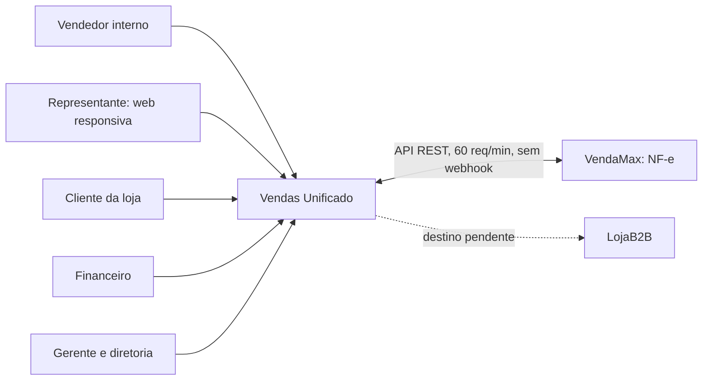
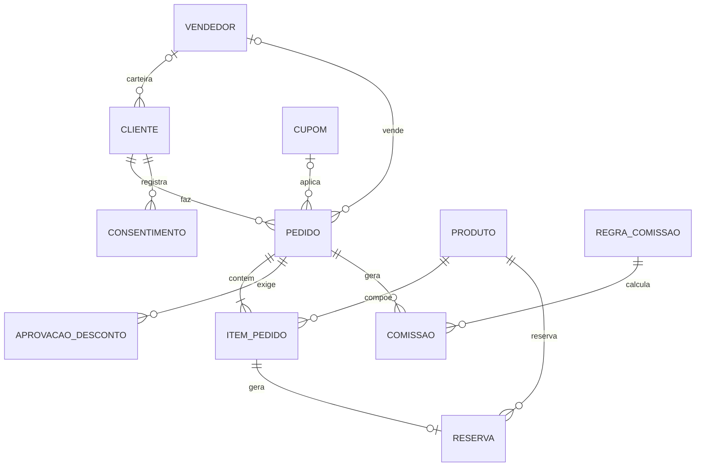

# Documentação técnica

- **Projeto:** Sistema de Vendas Unificado
- **Data:** 03/11/2026
- **Baseline:** sem baseline (documentos ainda não validados pelos stakeholders)
- **Revisão:** inclui CR-001 a CR-005 (ver `08-mudancas.md`)
- **Fontes:** `escopo.md`; `fontes/SIS-01-erp/` (manual-pedido.md, schema.sql); `fontes/SIS-02-comissoes/regras-comissao.md`; `fontes/SIS-03-loja-b2b/` (integracao-erp.md, schema.sql); `fontes/geral/` (ata-kickoff.md, erd-vendamax.md, politica-comercial.md); `entrega/respostas.md`; `mudancas/` (M-01, M-02)

## 1. Introdução

Especifica o sistema de vendas único: cadastro, preço e desconto, pedidos, reserva de estoque, comissão e integração com o VendaMax. Só requisitos confirmados entram no corpo; o resto está na seção 9. Nenhuma tecnologia foi decidida: stack e hospedagem não foram informadas (Q-029).

## Bloqueios que decidem a v1

1. **Triggers do VendaMax (RIS-001, Q-023).** A API REST existe para criar pedido e consultar faturamento `[doc: geral/M-02-email-ti.md#0]`, mas ninguém confirmou o efeito dos triggers. Se valerem para a API, o limite de 10% do ERP impede RN-001, que libera até 15%, de chegar à NF-e.
2. **App offline na v1 (DIV-015, Q-032).** A diretoria incluiu o app `[doc: geral/M-01-ata-diretoria.md#0]`, sem ajuste de prazo ou equipe, e as regras offline não estão definidas.
3. **Cobertura e limite da API (RIS-015, RIS-016, Q-033).** Só dois fluxos estão confirmados, com 60 requisições por minuto e sem webhook.
4. **Corte da v1 (DIV-014, Q-025).** O Must do PO não inclui comissão, crédito e painel, mas as metas de 6 meses dependem deles. Recomendação: incluir a comissão automática no Must ou trocar a meta de zero planilha. Quem decide é o PO, com o Diretor Comercial.
5. **Pessoa física na NF-e (RIS-003, Q-009, Q-023).** O cadastro único aceita CPF, mas ninguém soube dizer como a nota sai hoje para PF.

## 2. Visão geral

Candidatas a decisão registrada (ADR), todas abertas: fonte da verdade de estoque, cliente e preço na convivência; forma de entrada do pedido no ERP; destino da LojaB2B; stack e hospedagem.

## 3. Requisitos funcionais por módulo

### Clientes

**RF-001 (Must)**: O sistema deve manter um cadastro único de clientes usado por todos os canais.

- Dado um cliente cadastrado, quando acessado por qualquer canal, então os dados são os mesmos.

**RF-013 (Must)**: O sistema deve solicitar reconfirmação de consentimento aos clientes atuais da loja.

- Dado cliente migrado da loja, quando ainda não reconfirmou, então é tratado como sem consentimento.

### Pedidos

**RF-002 (Must)**: O sistema deve registrar os pedidos de todos os canais em um só lugar, com canal e vendedor.

- Dado um pedido da loja e um do vendedor, quando consultados, então aparecem na mesma lista, com o canal.

**RF-011 (Must)**: O sistema deve permitir ao representante registrar pedidos pelo navegador do celular, com conexão.

- Dado um representante no celular, quando abre o sistema, então consegue registrar um pedido.

**RF-009 (Must)**: O sistema deve permitir ao representante tirar pedido no cliente sem internet.

- Dado um representante sem internet, quando registra um pedido, então o pedido fica salvo no aparelho.
- Dado o aparelho reconectado, quando sincroniza, então o pedido chega ao sistema e não é duplicado.

### Desconto e cupom

**RF-003 (Must)**: O sistema deve encaminhar o desconto acima de 15% ao aprovador da faixa e registrar a decisão.

- Dado um desconto de 18%, quando a gerente aprova, então o pedido segue e guarda aprovador e data.
- Dado um desconto de 18%, quando a gerente recusa, então o pedido não é confirmado.

**RF-014 (Must)**: O sistema deve manter cupons com percentual, validade e autorização.

- Dado um cupom vencido, quando o cliente o usa, então é recusado.

### Estoque

**RF-006 (Must)**: O sistema deve disponibilizar o mesmo saldo de estoque a todos os canais.

- Dado um pedido confirmado, quando outro canal consulta o saldo, então vê o saldo já sem a reserva.

### Integração

**RF-007 (Must)**: O sistema deve integrar-se ao VendaMax por API, para o faturamento e a NF-e, sem troca de arquivos.

- Dado um pedido aprovado, quando enviado ao VendaMax, então é criado pela API REST.
- Dado um pedido com desconto acima de 10%, dentro da alçada, quando enviado, então não é recusado pelo ERP.

**RF-015 (Must)**: O sistema deve consultar periodicamente no VendaMax o status de faturamento dos pedidos enviados e ainda não faturados.

- Dado um pedido enviado, quando o ERP o fatura, então o sistema registra o faturamento em uma consulta seguinte, sem aviso do ERP.
- Dado um pedido já faturado, quando o ciclo roda, então ele não é mais consultado.

### Comissão

**RF-004 (Should)**: O sistema deve calcular automaticamente a comissão por pedido e por vendedor, sem uso da planilha.

- Dado um pedido faturado, quando a apuração roda, então a comissão aparece por pedido, com a regra aplicada.

**RF-010 (Should)**: O sistema deve permitir ao Financeiro alterar regras de comissão sem depender da TI, com data de início de vigência.

- Dado um usuário do Financeiro, quando altera um percentual, então a mudança é salva sem intervenção da TI, com autor e data.
- Dado um percentual com vigência em março, quando se calcula fevereiro, então vale o percentual anterior.

### Crédito

**RF-005 (Should)**: O sistema deve manter a fila de análise de crédito com prazo, responsável e decisão registrados.

- Dado um pedido na fila, quando se aproxima 1 dia útil, então o prazo restante fica visível ao analista.

### Painel

**RF-012 (Should)**: O sistema deve mostrar em painel as vendas de todos os canais.

- Dado pedidos de ERP e loja, quando o diretor abre o painel, então vê as vendas por canal.

## 4. Requisitos não funcionais confirmados

| ID | Categoria | Enunciado | Métrica |
|---|---|---|---|
| RNF-005 | desempenho | O sistema deve atualizar a visão consolidada de vendas com atraso máximo de 5 minutos. | 5 minutos |
| RNF-006 | desempenho | O sistema deve processar 900 pedidos por dia, volume do pico de novembro. | 900 pedidos/dia |
| RNF-007 | desempenho | O sistema deve manter as chamadas à API do VendaMax em até 60 requisições por minuto, enfileirando o excedente. | 60 requisições/minuto |

Sem meta definida: disponibilidade, RPO e RTO (Q-029), tempo de resposta e retenção (Q-028). A divisão de 60/40 foi informada junto do pico; **se valer para ele**, são cerca de 540 pedidos no ERP e 360 na loja por dia.

## 5. Regras de negócio

As regras estão em `02-negocio.md`, seção 6. Pontos de implementação:

- **RN-001, RN-011:** o limite é "acima de": 15%, 20% e 8% exatos ficam na faixa inferior. A ata só mudou o limite sem aprovação; a faixa da gerente acima de 15% é dedução (Q-031).
- **RN-002, RF-010:** o sistema precisa guardar percentuais por vigência. O início em março está indefinido entre venda e pagamento (Q-030). RN-015 não tem valor (Q-030).
- **RN-002, RN-012, RN-011:** a combinação entre regras não está definida (Q-019). A implementação não deve assumir ordem de aplicação.
- **Cálculo do ERP:** o valor da tabela `comissao` deixa de ser referência `[entrevista: financeiro Q-004]`.

## 6. Dados

Modelo conceitual proposto. A cardinalidade da carteira depende de Q-003.

### De-para

| Origem | Destino | Transformação | Conflito ou pendência |
|---|---|---|---|
| SIS-01 `cliente.cnpj` | CLIENTE.documento | Normalizar, só dígitos | Chave de deduplicação |
| SIS-03 `clientes.cpf_cnpj` | CLIENTE.documento | Remover máscara; tipo PF ou PJ | Sem unicidade na origem (RIS-010) |
| SIS-01 `razao_social`, SIS-03 `nome` | CLIENTE.nome | Precedência a definir | Q-003 |
| SIS-03 `email`, `senha_hash` | CLIENTE, acesso | A definir | Reaproveitar senha depende do destino da loja (Q-024) |
| SIS-03 `aceita_marketing` | CONSENTIMENTO | **Não migrar como consentimento válido**; marcar para reconfirmar | RF-013 |
| SIS-01 `limite_credito`, `bloqueado` | CLIENTE, crédito | Copiar | Uso de `bloqueado` em Q-022 |
| SIS-01 `cliente.vendedor_id` | Carteira | Validar existência | Sem FK na origem (DIV-010) |
| SIS-01 `vendedor` | VENDEDOR | Copiar tipo e meta | Uso de meta na loja em Q-019 |
| SIS-01 `produto`, SIS-03 `produtos` | PRODUTO | Chave SKU; preço e saldo do ERP | Cópia da loja não migra; dono do saldo em Q-026 |
| SIS-03 `cupons` | CUPOM | Copiar | Autorização de cupons atuais acima de 12% a verificar |
| SIS-01 `pedido.desconto_pct`, SIS-03 `cupom` | PEDIDO | Unificar desconto | Histórico a migrar não definido |
| SIS-01 `comissao` | Não migra | Cálculo abandonado | Histórico para auditoria a decidir |
| Planilha, aba Leia-me | REGRA_COMISSAO | Parametrizar | Completude em Q-018 |

Campos sem origem no dump do ERP: imposto, frete, data de faturamento, forma de pagamento e devolução. A base líquida depende deles (RIS-008, Q-018).

**Migração:** a estratégia depende de Q-003, Q-024 e Q-026. Riscos: duplicidade de documento e PF no ERP com cadastro de forma desconhecida (Q-009). RF-008 segue como hipótese.

### Dados pessoais

| Dado | Finalidade | Base legal | Retenção |
|---|---|---|---|
| CPF, nome, e-mail de PF | Venda e nota | A definir com jurídico (Q-028) | A definir (Q-028) |
| Consentimento | Marketing | Consentimento explícito `[doc: geral/politica-comercial.md#0]` | A definir (Q-028) |
| Senha (hash) | Acesso | A definir | A definir |
| Vendedor: nome e comissão | Pagamento | A definir | A definir |

## 7. Integrações

| Integração | Direção | Meio | Frequência e volume | Falha e monitoramento | Responsável |
|---|---|---|---|---|---|
| Pedido para faturamento | Novo → VendaMax | API REST confirmada `[doc: geral/M-02-email-ti.md#0]` | Até 900 pedidos/dia; limite de 60 req/min | Fila (RNF-007); retorno de erro em Q-033; RNF-001 é hipótese | TI |
| Status de faturamento | VendaMax → novo | API REST por consulta periódica; sem webhook | Intervalo a definir (RF-015) | Fila e limite compartilhado (RIS-015) | TI |
| Imposto, frete, data e devolução, para comissão | VendaMax → novo | Não confirmado (Q-033, Q-018) | A definir | A definir | TI |
| Cliente, inclusive CPF | Novo ↔ VendaMax | Não confirmado (Q-033) | A definir | CPF bloqueado por Q-009 e Q-023 | TI |
| Preço, produto e saldo | Dono a definir | Não confirmado (Q-033) | Painel e saldo pedem atraso curto; só o painel tem meta | A definir (Q-026) | TI |
| LojaB2B | A definir | Destino em Q-024 | 40% dos pedidos | Enquanto o CSV existir, a falha é silenciosa (RIS-006) | Não informado (Q-029) |
| Pagamento em folha | Financeiro → folha | Manual hoje `[doc: SIS-02/regras-comissao.md#0]` | Mensal | Fora do Must; integração não pedida | Financeiro |
| Serasa | Externo | Manual hoje `[doc: SIS-01/manual-pedido.md#0]` | Por análise | Q-022 | Financeiro |

## 8. Convivência com o VendaMax

Os triggers são a principal restrição técnica:

| Objeto | Comportamento | Impacto | Decisão necessária |
|---|---|---|---|
| `fn_valida_desconto` | Recusa desconto acima de 10% | Se valer na API, barra descontos de 10% a 15%, agora sem aprovação (RN-001) | Ajustar no fornecedor ou definir outra forma de envio (Q-023) |
| `fn_checa_credito` | Põe em análise se total > limite, em INSERT | Pode refazer análise e ignorar RN-010 | Q-023 |
| `fn_calcula_comissao` | Grava 3% ao faturar | Sem efeito no pagamento, pois foi abandonado | Definir se o trigger segue ativo |
| Baixa de estoque | No faturamento `[doc: SIS-01/manual-pedido.md#0]` | Risco de dupla contagem com RN-006; o sistema só sabe do faturamento por consulta | Q-026 |

### Dimensionamento da consulta (estimativa)

Premissas não confirmadas: uma chamada por pedido, limite exclusivo desta integração e envios espalhados em 8 horas. A 60 req/min, 5 minutos dão 300 chamadas. No pico, os envios usam cerca de 10 delas, restando cerca de 290. Com 900 pedidos em aberto, o ciclo levaria cerca de 16 minutos; com 400, cerca de 7. Logo, o painel de 5 minutos só é seguro se venda for pedido criado, que não depende do ERP, ou se a API aceitar consulta em lote (Q-027, Q-033). O limite total de 86.400 chamadas/dia não é o problema; o gargalo é o ciclo curto.

## 9. Pendências

### Requisitos fora do corpo

| ID | Status | Enunciado proposto | Por que está pendente |
|---|---|---|---|
| RN-005 | conflito | O sistema deve aprovar automaticamente o pedido de até 120% do limite de crédito de cliente sem atraso nos últimos 12 meses. | critério definido; contraria a política vigente, e o histórico não foi localizado (Q-021) |
| RF-008 | hipótese | O sistema deve importar clientes do ERP e da loja, identificando duplicidades por documento. | segue hipótese: dono e precedência sem resposta (Q-003) |
| RNF-001 | hipótese | O sistema deve confirmar cada troca com o ERP, reprocessar falhas e alertar um responsável, nos limites a definir. | sem confirmação humana; evidência só do problema |
| RNF-002 | hipótese | O sistema deve registrar quem alterou preço, regra de comissão, limite de crédito e aprovações, e quando. | sem confirmação humana; evidência só do problema |
| RNF-003 | hipótese | O sistema deve tratar dados pessoais conforme a LGPD, com finalidade, controle de acesso e retenção definidos. | segue hipótese: retenção e direitos dependem de jurídico externo (Q-028) |
| RNF-004 | hipótese | O sistema deve ter backup com restauração testada, com RPO e RTO a definir. | segue hipótese: RPO/RTO a levantar (Q-029) |

### Perguntas abertas

| ID | Para | Pergunta aberta | Achados |
|---|---|---|---|
| Q-003 | Diretor Comercial (reenviar) | Quem será o dono do cadastro único e qual dado prevalece quando ERP e loja divergirem? Todo cliente precisa ter vendedor de carteira, inclusive pessoa física da loja, e quem define e troca essa carteira? O que causa os vendedores trocados? | DIV-003, DIV-010, RIS-010 |
| Q-009 | Setor de Faturamento, com a Coordenadora Financeira (reenviar) | Como exatamente esses clientes são cadastrados no ERP hoje, e como sai a NF-e deles? Há impacto fiscal ou de contabilização que o novo fluxo deva corrigir? | DIV-003, RIS-003, GAR-002 |
| Q-016 | Diretor Comercial | Quem aprova desconto de 12% a 20% nas férias da gerente, e o que acontece se ninguém responder? | GAR-006, DIV-001 |
| Q-017 | Diretor Comercial | Existe hoje preço diferente por canal, cliente ou representante? Há exceção à tabela única na v1? | DIV-011 |
| Q-018 | Coordenadora Financeira | A aba Leia-me é a regra completa? De onde vêm impostos e frete por pedido? Qual data define o mês e a meta? Como é o arredondamento? | RIS-008, DIV-002 |
| Q-019 | Coordenadora Financeira | Como as regras de comissão se combinam (cupom e loja, loja na meta, carteira de representante, metade sobre 5%)? Como fica devolução parcial, no mesmo mês ou depois de mais de um mês? Há casos reais para teste? | DIV-009, DIV-010 |
| Q-020 | Coordenadora Financeira e diretoria | Quais itens da regra de comissão o Financeiro altera sozinho, quem aprova, com que vigência e retroatividade? A aprovação mensal continua? | DIV-012, RIS-011 |
| Q-021 | Diretor Comercial e Coordenadora Financeira | A política será revisada para permitir a aprovação automática até 120% do limite? Onde está o histórico de atraso e quem assume o risco? | DIV-005 |
| Q-022 | Coordenadora Financeira | O limite considera saldo em aberto ou só o pedido? O que fazer com cliente bloqueado e cliente novo? Quem cobre o analista? Serasa entra na v1? | RIS-009 |
| Q-023 | Gerente de TI e fornecedor | O VendaMax tem API? Se não, quem cria, com que custo e prazo? O fornecedor ajusta os triggers e aceita CPF? Qual a data final de uso? | RIS-001, RIS-002, DIV-003 |
| Q-024 | PO | Vendedores deixam de digitar no VendaMax? A LojaB2B é substituída ou reconectada? Há paralelo da planilha, por quantos ciclos? Qual a data de início e a equipe de QA, UX e DevOps? | RIS-004, RIS-007 |
| Q-025 | PO e Diretor Comercial | Comissão automática, fila de crédito e painel fazem parte da v1? O Must de cinco itens não os inclui, mas as metas de 6 meses dependem deles. | DIV-014 |
| Q-026 | Responsável por Operações/Estoque (a indicar) | O que é 'confirmação do pedido'? Por quanto tempo vale a reserva, ela vale durante a análise de crédito, há mais de um depósito, venda sem saldo é permitida, quem faz o estorno ao cliente, e quem é a fonte do saldo enquanto o ERP baixa no faturamento? | DIV-007, RIS-007, RIS-014 |
| Q-027 | Diretor Comercial | Quais metas para 3 meses e quais indicadores do painel? Venda é pedido criado ou faturado? | OPO-006, RIS-015 |
| Q-028 | Jurídico externo (a indicar) | Quais prazos de retenção e direitos do titular o sistema atende? Consentimento dos clientes só no ERP precisa de reconfirmação? Os contratos de representantes alteram a comissão? Validar o que o PO respondeu. | RIS-012, RIS-013, RIS-014 |
| Q-029 | Gerente de TI | Quais RPO e RTO, total mensal de pedidos e horário de operação? Há stack ou hospedagem obrigatória? Quem responde pela loja e pelo backup até a virada? | RIS-005, RIS-006 |
| Q-030 | Diretoria e Coordenadora Financeira | Qual o valor do bônus de meta do representante: 6% sobre o excedente, 7%, ou outro? Vale desde março? 'A partir de março' é venda faturada em março ou pagamento em março? O Financeiro revisou a mudança? | DIV-016, DIV-017 |
| Q-031 | Diretoria | Desde quando vale o limite de 15%? A faixa da gerente passa a ser acima de 15% até 20%? Cupom só exige autorização acima de 15%? O redutor de comissão acima de 8% permanece? Quem revisa a política? | DIV-001, DIV-017 |
| Q-032 | Diretoria e PO | Para o app offline na v1, o que sai, quanto o prazo aumenta ou quem entra na equipe? Offline, como ficam reserva, alçada, crédito e preço? A web responsiva continua? Qual o tempo máximo sem sincronizar? | DIV-015, RIS-004 |
| Q-033 | Gerente de TI e fornecedor | O limite de 60/min é por chave ou global? A consulta aceita vários pedidos em uma chamada? A API cobre cliente com CPF, produto, preço, estoque, imposto, frete, data de faturamento e devolução? O que ela retorna ao exceder o limite? | RIS-015, RIS-016, RIS-008 |
