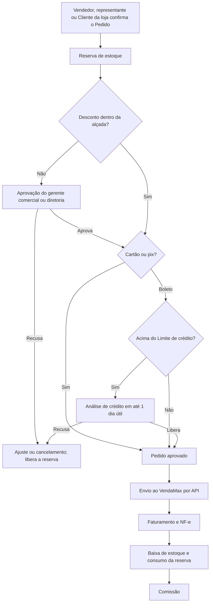

# Documentação de negócio — Vendas Unificado

Distribuidora Aurora. Versão 2, baseada em `escopo.md`, `fontes/`, `respostas.md` e `mudancas/` (ver `08-mudancas.md`).

**Situação:** as metas e a maior parte das regras estão definidas. Três coisas ainda condicionam o plano: as operações que faltam na API do VendaMax (só criar pedido e consultar status foram confirmados), a fronteira da v1 (PEND-03, PEND-04) e a entrada do app offline sem mudança declarada de prazo ou equipe (CON-08).

Legenda de fontes: ESC escopo; ATA ata de kickoff; POL-n item da Política Comercial; MAN-n seção do manual; PLA planilha de comissões; INT integração da loja; SQL-ERP e SQL-LOJA schemas; ERD diagrama; Rn resposta à pergunta n; MUD-nn.n afirmação de `mudancas/`. "Não sei" não é tratado como fato: vira pendência (seção 8) e, quando o trabalho precisa seguir, premissa declarada (seção 9).

## 1. Problema

A empresa vende pelo VendaMax e pela LojaB2B, com cadastro separado, regras de Desconto divergentes e integração noturna por arquivo. A Comissão paga é calculada numa planilha, diferente do valor gravado no ERP. Efeitos medidos: fila de crédito de 2 dias úteis, 20 cancelamentos por mês por falta de estoque, 15 reclamações de Comissão por mês e cerca de 1 hora por dia de recadastro manual.

## 2. Objetivo e metas

Um sistema de vendas único: um cadastro, uma política de preço e Desconto, Pedidos de todos os Canais no mesmo lugar, Comissão automática e estoque comum, com a NF-e no VendaMax.

| ID | Meta (Paulo, R1) | Hoje | Em 6 meses | Como medir |
|---|---|---|---|---|
| M-01 | Planilha de Comissão | Em uso | Zero | Fechamento feito sem planilha (ver CON-02) |
| M-02 | Reclamações de Comissão | 15/mês (representantes) | Menos de 3/mês | Registro mensal; canal de registro a definir |
| M-03 | Cancelamentos por falta de estoque | 20/mês (loja) | Menos de 5/mês | Motivo de cancelamento no Pedido |
| M-04 | Prazo de Análise de crédito | 2 dias úteis em média | Até 1 dia útil | Tempo registrado na fila |

Observação: a linha de base de M-03 vem só da loja, enquanto a meta não distingue Canal. O início dos 6 meses não foi informado (PEND-04).

## 3. Partes interessadas e usuários

| Papel | Interesse ou uso |
|---|---|
| Diretor Comercial (Paulo) | Patrocínio, alçadas, painel, metas |
| Coordenadora Financeira (Renata) | Comissão, crédito |
| Gerente de TI (Sérgio) | VendaMax, integração, infraestrutura, encaminhamento de LGPD |
| PO (Aline) | Escopo, cadastro, prioridades |
| 8 Vendedores internos | Digitação de Pedidos |
| 22 representantes | Pedidos em web responsiva, com internet, e em app offline |
| Clientes da loja (PJ e PF) | Compra por autoatendimento |
| Gerente comercial e diretoria | Aprovação de Desconto; autorização de Cupom |
| Analista de crédito | Fila de análise |
| Setor de faturamento | NF-e no VendaMax |
| Fornecedor do VendaMax | Evolução e API do ERP (ouvido por Sérgio, MUD-02) |
| Jurídico externo | Retenção e acesso a dados de PF (ainda não ouvido) |

Sem responsável identificado: estoque/operações e LGPD.

## 4. Escopo e prioridade

Classificação de Paulo (R1). "Derivado" significa que a classificação é inferência deste levantamento.

| Prioridade | Itens |
|---|---|
| **Must** | Cadastro único; Pedido multicanal; política de Desconto com alçada; Reserva de estoque; integração com o VendaMax; app offline para representantes (MUD-01.4: "entra na primeira versão"; classificá-lo como Must é inferência) |
| **Must derivado** | Análise de crédito no prazo (sem ela o Pedido não atende POL-3 nem M-04); consentimento (R15, POL-6); acesso e auditoria; migração; transição |
| **Should** | Comissão; crédito automático; painel; proteção da operação atual |
| **Could** | Ajustar o limite do VendaMax de 10% para 15% antes da v1 |
| **Fora da v1** | Emissão de NF-e fora do VendaMax (R2, R3); integração com Serasa (não solicitada); lançamento automático do pagamento na folha (PRE-12); uso de dados para marketing sem consentimento |

## 5. Processo futuro

Hipótese, condicionada a PEND-02 e PEND-03.

Depois da história 39, o bom pagador dentro de 120% do Limite de crédito passa da decisão F direto para H.

Pedido offline (PRE-14): fica no aparelho como não confirmado e entra no início deste fluxo ao sincronizar.

## 6. Regras de negócio

| ID | Requisito | Prioridade | Situação | Fontes |
|---|---|---|---|---|
| RN-01 | Cliente é identificado por CPF ou CNPJ sem máscara; o documento é a chave única do Cliente. | Must | confirmado | R12; INT; SQL-ERP; SQL-LOJA |
| RN-02 | PJ e PF profissional são Clientes válidos em todos os fluxos, inclusive no Faturamento. | Must | confirmado; solução no ERP pendente | POL-2; INT |
| RN-03 | A Tabela de preços é única para todos os Canais. | Must | confirmado | POL-4; ESC |
| RN-04 | Alçadas de Desconto: até 15% (inclusive) o Vendedor; acima de 15% até 20% (inclusive) o gerente comercial; acima de 20% a diretoria. | Must | alterado por MUD-01.3; Política a revisar (CON-10); representante é premissa (PRE-05) | POL-1; ATA; MUD-01.3 |
| RN-05 | Aprovador de Desconto acima de 15% até 20% na ausência do gerente comercial. | Must | pendente (PEND-01) | ATA; R7; MUD-01.3 |
| RN-06 | Cupom segue a política de Desconto; Cupom acima da alçada do Vendedor (agora 15%) precisa de autorização do gerente comercial ao criar a campanha. | Must | R7 citava 12%; novo limiar é premissa (PRE-15); limite de 15% pendente | R7; INT; SQL-LOJA; MUD-01.3 |
| RN-07 | Pedido acima do Limite de crédito exige Análise de crédito do financeiro em até 1 dia útil. | Must | confirmado (Must derivado) | POL-3; R1; MAN-2 |
| RN-08 | Pedido em cartão ou pix dispensa Análise de crédito; boleto precisa. | Must | confirmado; exceção não consta da Política | R6; INT |
| RN-09 | Bom pagador é o Cliente sem atraso nos últimos 12 meses; o Pedido dele é aprovado automaticamente se estiver dentro de 120% do Limite de crédito. | Should | confirmado; depende de alteração da Política e de dados de títulos (PEND-05) | R5; ATA; POL-3 |
| RN-10 | O estoque é reservado na confirmação do Pedido, em qualquer Canal. | Must | confirmado; Pedido offline reserva só ao sincronizar (PRE-14) | R11; R1; MUD-01.4 |
| RN-11 | Comissão segue a planilha: base líquida; interno 3% até a meta e, sobre o excedente, 5% até fevereiro e 6% a partir de março; representante 4% e bônus de meta igual ao do interno (forma pendente); Desconto acima de 8% paga metade; Pedido da loja paga 1% ao Vendedor da Carteira. | Should | alterado por MUD-01.1 e MUD-01.2; PEND-06 e PEND-11 abertas | PLA; R8; MUD-01.1; MUD-01.2 |
| RN-12 | Devolução no mês seguinte estorna a Comissão. | Should | confirmado; parcial e mesmo mês pendentes | PLA; R9 |
| RN-13 | Fechamento da Comissão no dia 5; pagamento no dia 10 do mês seguinte. | Should | confirmado pela planilha | PLA |
| RN-14 | O financeiro altera as regras de Comissão sem depender de TI; as regras são aprovadas anualmente pela diretoria. | Should | confirmado; MUD-01.1 é o primeiro caso de vigência; efeito retroativo pendente | ATA; R10; POL-5; MUD-01.1 |
| RN-15 | Consentimento de marketing é marcado explicitamente pelo Cliente; a base atual da loja precisa ser reconfirmada. | Must | confirmado (Must derivado) | POL-6; R15; SQL-LOJA |
| RN-16 | A emissão de NF-e permanece no VendaMax, inclusive em 2027. | Must | confirmado; data final desconhecida | ESC; ATA; R2; R3 |

## 7. Requisitos funcionais

| ID | Requisito | Prioridade | Situação | Fontes |
|---|---|---|---|---|
| RF-01 | Manter um cadastro único de Clientes. | Must | confirmado | ESC; R1 |
| RF-02 | Consolidar e migrar os Clientes do VendaMax e da LojaB2B. | Must | derivado | ESC; SQL-ERP; SQL-LOJA; R12; R14 |
| RF-03 | Disponibilizar a mesma Tabela de preços a todos os Canais. | Must | confirmado | ESC; POL-4 |
| RF-04 | Aplicar alçadas de Desconto com fluxo de aprovação. | Must | confirmado | ESC; POL-1; R1; ATA |
| RF-05 | Gerir campanhas de Cupom sob as mesmas alçadas. | Must | confirmado | R7; INT |
| RF-06 | Registrar e consultar Pedidos de todos os Canais no mesmo lugar. | Must | confirmado | ESC; R1 |
| RF-07 | Oferecer digitação de Pedido em web responsiva a Vendedores internos e, com internet, a representantes. | Must | confirmado; offline em RF-25; internos é premissa (PRE-01) | R13; ATA; MAN-1 |
| RF-08 | Reservar e liberar estoque ao longo da vida do Pedido. | Must | confirmado | R1; R11; MAN-3; INT |
| RF-09 | Mostrar o mesmo saldo disponível em todos os Canais. | Must | confirmado | ESC; INT |
| RF-10 | Enviar Pedidos ao VendaMax por API para Faturamento e obter o resultado por consulta periódica. | Must | operações confirmadas pelo fornecedor, via Sérgio; homologação e triggers pendentes | R1; R2; R3; ATA; MUD-02.1; MUD-02.2; MUD-02.4; MUD-02.5 |
| RF-11 | Expor falhas de integração com alerta e responsável. | Must | derivado | INT |
| RF-12 | Encaminhar o Pedido à Análise de crédito conforme forma de pagamento e Limite de crédito. | Must | confirmado (Must derivado) | POL-3; R6; SQL-ERP |
| RF-13 | Oferecer fila de Análise de crédito com controle do prazo de 1 dia útil. | Must | derivado da meta de sucesso | R1; POL-3; MAN-2; ATA |
| RF-14 | Aprovar automaticamente Pedido de bom pagador dentro de 120% do Limite de crédito. | Should | confirmado; bloqueado por PEND-05 | R1; R5; ATA |
| RF-15 | Calcular a Comissão automaticamente pelas regras da planilha. | Should | confirmado; ver CON-02 | ESC; R1; R8; PLA; ATA; MUD-01.1; MUD-01.2 |
| RF-16 | Permitir ao financeiro configurar regras de Comissão com vigência. | Should | confirmado; primeira alteração real em março (MUD-01.1) | ATA; R10; POL-5 |
| RF-17 | Registrar Devolução separada de cancelamento e estornar a Comissão. | Should | derivado | PLA; R9; ERD |
| RF-18 | Apoiar o fechamento mensal da Comissão e substituir a planilha com segurança. | Should | confirmado | R1; PLA; ATA |
| RF-19 | Oferecer painel de vendas por Canal. | Should | confirmado; indicadores pendentes | ATA; R1; R11 |
| RF-20 | Registrar e reconfirmar o consentimento de marketing. | Must | derivado | POL-6; R15 |
| RF-21 | Controlar o acesso por perfil. | Must | derivado | POL-1; POL-3; R15; ATA |
| RF-22 | Conduzir a transição dos Canais sem interromper vendas. | Must | derivado | R2; R3; ATA; INT |
| RF-23 | Reduzir o risco da operação atual até a migração. | Should | derivado | ATA; INT |
| RF-24 | Alinhar o limite de Desconto do VendaMax à Política (15%), se viável, antes da v1. | Could | proposta | POL-1; SQL-ERP; ATA; MUD-01.3 |
| RF-25 | Permitir a representantes consultar dados e registrar Pedidos sem internet, em app, com sincronização posterior. | Must | alterado por MUD-01.4; classificação Must é inferência; regras em PEND-13 | MUD-01.4; ATA |

Os requisitos não funcionais estão em `03-tecnico.md`.

## 8. Conflitos e pendências

### Conflitos a arbitrar

| ID | Conflito | Tratamento neste documento | Quem decide |
|---|---|---|---|
| CON-01 | Na ata, crédito é "prioridade número 1"; em R1, crédito automático é Should | Vale R1, mais recente e específica; análise no prazo fica como Must derivado | Paulo |
| CON-02 | Comissão é Should, mas "zero planilha" é meta de sucesso em 6 meses, e o escopo pede Comissão automática | Mantida como Should, ao fim da sequência. Se ela sair da v1, M-01 e M-02 não serão atingidas | Paulo |
| CON-03 | Bom pagador (R5) e dispensa para cartão e pix (R6) não constam de POL-3, que exige análise acima do limite | Regras registradas; RN-09 só vai a produção após alteração formal. A dispensa em RN-08 também precisa constar da Política | Paulo e Renata |
| CON-04 | Fornecedor confirma API para criar pedido e consultar status (MUD-02), mas nada sobre Cliente, CPF, produto, preço, estoque, impostos, frete e Devolução; R4 segue sem resposta | História 1 vem primeiro e verifica cada operação; operação essencial ausente exige replanejamento | Sérgio |
| CON-05 | Reserva "em qualquer Canal" (R11) exige Pedidos no novo sistema, mas a saída da digitação do VendaMax não foi decidida (R2). Representantes na web (R13) indicam esse caminho | PRE-01 | Aline |
| CON-06 | Renata quer alterar regras sem TI (R10); POL-5 exige aprovação anual da diretoria | Alteração sem TI, com vigência e auditoria; aprovação formal fora do sistema até decisão | Renata |
| CON-07 | O ERP continua recusando Desconto acima de 10%, enquanto a alçada e os Cupons chegam a 15% (MUD-01.3). BLACK15 venceu em 30/11/2026, sem evidência de autorização | Até a v1, a recusa continua; opção em US-049 | Paulo |
| CON-08 | App entra na v1 (MUD-01.4), sem mudança declarada de prazo, equipe ou escopo; substitui a decisão de R13 | Incluído como Must, com decisão em US-055 sobre o que muda | Paulo |
| CON-09 | Reserva na confirmação em qualquer Canal (R11) não funciona sem internet | PRE-14: Pedido offline é confirmado ao sincronizar, podendo não ser aceito | Paulo e Aline |
| CON-10 | MUD-01.3 eleva a alçada para 15%, enquanto a Política (POL-1) e R7 falam em 12% | Vale a ata, mais recente e da diretoria; Política precisa de revisão formal, sem data de vigência informada | Paulo |

### Pendências

Nenhuma destas informações foi obtida na rodada de perguntas.

| ID | Pendência | Responsável | Bloqueia |
|---|---|---|---|
| PEND-01 | **Aprovador de Desconto acima de 15% até 20% nas férias do gerente** (faixa ajustada por MUD-01.3) e prazo até escalar. Em R7, o respondente adiou a decisão ("pergunte ao Paulo depois"). Também: alçadas de representantes, limite de 15% do Cupom, quem cria Cupom, intenção dos 8% da Comissão, agora ainda mais distantes da alçada de 15% | Paulo | 23; parcialmente 21 e 24 |
| PEND-02 | VendaMax: documentação, homologação, contrato, custo, prazo, data final; demais operações da API (Cliente, CPF, produto, preço, estoque, impostos, frete, Devolução); alterabilidade dos triggers e do campo de CNPJ; como cartão escapa do crédito hoje; como é a NF-e de PF | Sérgio, com fornecedor | 1, 2 e todas as dependentes |
| PEND-03 | Destino da digitação de Vendedores internos; destino da LojaB2B; ordem de migração dos Canais | Aline | 3, 16, 26, 27, 30 |
| PEND-04 | Início dos 6 meses; ordem dentro do Must; CON-02 | Paulo | 3 |
| PEND-05 | Crédito: alteração da Política, aprovador, responsável pela inadimplência, exposição acumulada, dados de títulos, Cliente bloqueado, Cliente novo, PF com limite zero, Serasa | Paulo e Renata | 38, 39; parcialmente 36 |
| PEND-06 | Comissão: planilha de mês fechado, apuração da meta, Pedidos da loja na meta, ordem entre meta e redução, 1% com Cupom acima de 8%, Cliente sem Carteira, origem de impostos e frete, Devolução parcial ou no mesmo mês, vendedores trocados, vigência, aprovação mensal, folha, consulta, período paralelo | Renata | 40 a 46 |
| PEND-07 | Tempo de retenção, venda sem saldo, depósitos, atraso aceitável no estoque, indicadores do painel, responsável por estoque/operações | Paulo | 31, 33, 35, 47 |
| PEND-08 | Dono do cadastro, dado que prevalece, várias contas por CNPJ, recadastro de PF no ERP, Carteira e limite de PF | Aline | 12, 14, 16 |
| PEND-09 | Responsável por LGPD; retenção e acesso a dados de PF | Sérgio, com jurídico externo | 19; parcialmente 5, 18 |
| PEND-10 | Hospedagem, tecnologia, orçamento, composição dos 4 devs (agora também competência em app), QA/banco/infraestrutura, capacidade do servidor da loja, histórico a migrar | Sérgio | 4, 14 |
| PEND-11 | Bônus de representante: forma de cálculo (4% + diferença, ou 6% no excedente, ou outra), vigência e meta usada | Renata, com diretoria | 43, 46 |
| PEND-12 | O que muda com o app: prazo, equipe ou itens cortados | Paulo | 55 |
| PEND-13 | Regras do app: tecnologia, mínimo offline, confirmação ao sincronizar, preço que prevalece, tempo máximo offline, frequência sem internet | Aline, com representantes | 55 a 60 |
| PEND-14 | Limite da API: por chave ou global, consulta em lote, atraso aceitável para saber do Faturamento | Sérgio, com fornecedor | 1, 8, 61 |

## 9. Premissas

Usadas para o trabalho seguir. Nenhuma foi confirmada; se uma cair, o impacto está indicado.

| ID | Premissa | Se for falsa |
|---|---|---|
| PRE-01 | A digitação de Vendedores internos também passa ao novo sistema | Reserva em qualquer Canal fica inviável sem integração síncrona com o ERP |
| PRE-02 | A LojaB2B é integrada por API, não refeita na v1, e migra por último | Refazer amplia muito as histórias 16 e 27 |
| PRE-03 | Para planejamento, 6 meses a partir do kickoff (15/10/2026), cerca de abril/2027 | Datas mudam |
| PRE-04 | Ordem: viabilidade, base, Pedido ponta a ponta, loja e migração, depois os Should | Reordenar o plano |
| PRE-05 | Representantes seguem as mesmas alçadas dos Vendedores | Ajuste pequeno em 21 e 22 |
| PRE-06 | "Boleto precisa" (R6) vale, conforme POL-3, para boleto acima do Limite de crédito | Se for todo boleto, a fila cresce e M-04 fica mais difícil |
| PRE-07 | Cliente bloqueado não confirma Pedido | Ajuste em 36 |
| PRE-08 | Limite comparado por Pedido, como no ERP hoje; 120% também | Exposição acumulada exige dados de títulos e amplia 36 e 39 |
| PRE-09 | Comissão vai ao Vendedor registrado no Pedido; Cliente sem Carteira vai a tratamento manual | Ajuste em 43 |
| PRE-10 | Regra de Comissão aplicável é a vigente na data do Pedido | Ajuste em 42 |
| PRE-11 | Migram-se Clientes e Pedidos em aberto; histórico fica disponível para consulta | Amplia 15 |
| PRE-12 | Aprovação e lançamento do pagamento seguem fora do sistema, com relatório | Amplia 45 |
| PRE-14 | Pedido offline é não confirmado até sincronizar; só então passa por reserva, alçada e crédito | Reserva exigiria outro mecanismo, como cota por representante |
| PRE-15 | O limiar de autorização de Cupom acompanha a alçada do Vendedor (15%), pois R7 diz que Cupom segue a mesma política | Se continuar em 12%, ajustar US-024 |
| PRE-13 | Confirmação do Pedido é o ato final de digitação ou compra, antes de aprovação de Desconto e crédito. A reserva fica retida nessas filas | Muda o momento da reserva em 32 |

## 10. Principais riscos de negócio

| Risco | Impacto | Resposta |
|---|---|---|
| VendaMax sem API ou com regras inalteráveis | Inviabiliza o desenho e o prazo | História 1 no início; decisão de Paulo e Sérgio com alternativas |
| Volume de trabalho maior que a capacidade em 6 meses | Metas de Comissão podem não ser atingidas | Corte explícito (CON-02); ver soma de pontos em `04-backlog.md` |
| Pendências de Renata sem resposta (planilha, ordem de cálculo, impostos e frete) | Comissão não bate; reclamações continuam | Paralelo antes de desligar a planilha (46) |
| Reserva retida em filas prende saldo | Vendas perdidas ou Pedidos parados | Decidir retenção (31) e cumprir o prazo de crédito (37) |
| Liberação automática de crédito | Inadimplência sem responsável definido | Não entra em produção antes da história 38 |
| Pico de novembro | Transição em período crítico | Transição fora do pico (30) |
| Servidor da loja sem backup testado | Perda de dados | História 48, independente do resto |
| App offline na v1 sem mudança de prazo ou equipe | Atrasa o Must ou expulsa a Comissão, afetando M-01 e M-02 | Decisão de Paulo (US-055), antes de construir |
| Alçada livre de 15% sem estudo de margem | Efeito financeiro não quantificado nas fontes | Acompanhar Desconto médio; revisar a Política |

## 11. Benefícios esperados

- Fim do recadastro manual de PF, cerca de 1 hora por dia.
- Fim do ajuste manual de Cupom e da recusa por limite defasado.
- Uma única conta de Comissão.
- Saldo comum entre os Canais.
- Trilha de quem aprovou cada exceção.

Não há dados financeiros nas fontes para calcular retorno sobre o investimento.
