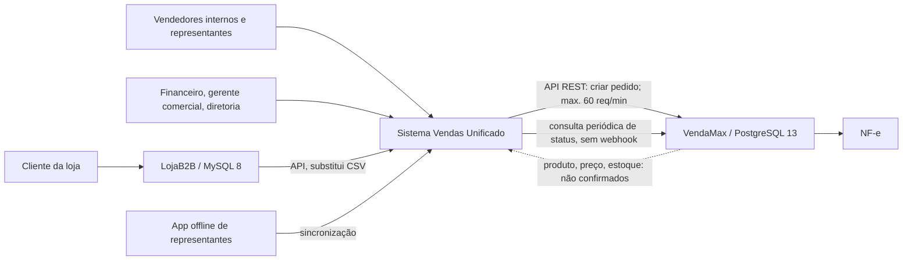

# Documentação técnica — Vendas Unificado

**Versão 2**, atualizada por `mudancas/`. **Situação:** proposta sujeita à história 1 (verificar a API) e à história 2 (regras do VendaMax). Tecnologia e hospedagem não foram definidas (PEND-10) e não são escolhidas aqui. Termos conforme `[método]/knowledge/CONTEXT.md`; pendências e premissas conforme `02-negocio.md`.

## 1. Contexto

Fatos vigentes: VendaMax permanece emitindo NF-e em 2027 (R2, R3); integração por API, não por arquivo (ATA).

## 2. Requisitos não funcionais

| ID | Requisito | Prioridade | Situação | Fontes |
|---|---|---|---|---|
| RNF-01 | Suportar 400 Pedidos/dia e pico de 900/dia em novembro, 4 mil Clientes ativos, 12 mil SKUs, 8 Vendedores internos e 22 representantes. | Must | confirmado | R14; R13; MUD-02.3 |
| RNF-02 | Painel com atraso máximo de 5 minutos. | Should | confirmado | R11; ATA |
| RNF-03 | Integração com o VendaMax por API, não por arquivo. | Must | API confirmada só para criar pedido e consultar status; demais operações pendentes (PEND-02) | ATA; R2; R3; MUD-02.1; MUD-02.2 |
| RNF-04 | Integração idempotente: reenvio não duplica Pedido. | Must | derivado | SQL-ERP; INT |
| RNF-05 | Reservas concorrentes não podem vender o mesmo saldo duas vezes. | Must | derivado | MAN-3; R11 |
| RNF-06 | Trilha de auditoria para aprovações de Desconto, decisões de crédito e alterações de regras de Comissão. | Must | derivado | POL-1; POL-3; POL-5 |
| RNF-07 | Interface de digitação utilizável em celular. | Must | confirmado | R13 |
| RNF-08 | Tratamento de dados pessoais conforme LGPD; retenção e acesso a dados de PF a definir com jurídico externo. | Must | parcial (PEND-09) | POL-6; R15 |
| RNF-09 | Monitoramento e alerta das integrações. | Must | derivado | INT |
| RNF-10 | Backup com restauração testada para os dados do novo sistema e da LojaB2B enquanto ela operar. | Must | derivado | ATA |
| RNF-11 | Consumo da API do VendaMax limitado a 60 requisições por minuto, somando criação de pedido e consulta de status, sem bloquear a digitação. | Must | novo; escopo do limite pendente (PEND-14) | MUD-02.3; MUD-02.4; MUD-02.5 |
| RNF-12 | Dados guardados no aparelho limitados à Carteira do representante, protegidos e removíveis. | Must | derivado; regras jurídicas em PEND-09 | MUD-01.4; POL-6; R15 |

### Dimensionamento (R14)

| Medida | Valor | Observação |
|---|---|---|
| Pedidos/dia | 400; pico 900 em novembro | Pela divisão informada, cerca de 240 ERP e 160 loja por dia; no pico, cerca de 540 e 360, se a proporção se mantiver [inferência] |
| Clientes ativos | 4 mil | Total da base, inativos incluídos, é desconhecido |
| SKUs | 12 mil | |
| Vendedores | 8 internos + 22 representantes | |
| Limite da API (MUD-02.3) | 60 req/min, ou 3.600/h | Se contínuo, 86.400/dia [cálculo] |

Mesmo concentrando os 900 Pedidos em 8 horas, a média fica perto de 2 por minuto [inferência]. O volume não justifica distribuição. O ponto difícil é consistência da reserva e o uso do limite da API, não vazão interna. Não há requisito informado de disponibilidade, RPO ou RTO: a definir com Sérgio.

## 3. Arquitetura proposta

**ADR-01. Monólito modular com um banco relacional transacional.** Status: proposta.
- *Motivo:* 4 devs, volume baixo, regras que precisam de transação (reserva, aprovação).
- *Alternativa descartada:* microsserviços e mensageria, sem necessidade comprovada.
- *Limite conhecido:* novos indicadores pesados podem exigir tabela agregada.

| Módulo | Responsabilidade | Histórias |
|---|---|---|
| Acesso e auditoria | Perfis fixos e registro de decisões | 5, 6 |
| Clientes | Cadastro, Carteira, Limite de crédito, consentimento | 11 a 19 |
| Preço e Desconto | Tabela de preços, alçadas, Cupom | 20 a 25 |
| Pedidos | Ciclo do Pedido em todos os Canais | 26 a 30 |
| Estoque | Reserva, saldo, conciliação | 31 a 35 |
| Crédito | Encaminhamento, fila, bom pagador | 36 a 39 |
| Comissão | Regras, cálculo, estorno, fechamento | 40 a 46 |
| Painel | Consulta por Canal | 47 |
| Integração VendaMax | Único ponto de contato com o ERP; fila, taxa, consulta periódica | 1, 2, 7 a 10, 13, 61 |
| App offline | Consulta, Pedido local, sincronização | 55 a 60 |

**ADR-02. Novo sistema é mestre de:** Cliente, Desconto e aprovações, Reserva de estoque e Comissão. **VendaMax é mestre de:** NF-e, Faturamento, baixa de estoque. Preço e entradas de estoque seguem no VendaMax até decisão, [inferência] pois as fontes só mostram essas informações saindo do ERP. Status: proposta; depende de PEND-02, PEND-07 e PEND-08.

**ADR-03. Toda chamada ao VendaMax passa pelo módulo de integração, com chave de idempotência.** Motivo: `pedido` não guarda referência à origem, e `pedidos_web` só tem o indicador `exportado_erp`. Status: proposta.

**ADR-04. Envio e consulta são assíncronos, com fila no próprio banco e controle único de taxa.** Motivo: limite de 60 requisições por minuto e ausência de webhook (MUD-02). Sem mensageria: o volume não exige. Status: proposta.

**ADR-05. App offline trata o Pedido como não confirmado até sincronizar.** Motivo: reserva, crédito e aprovação dependem do servidor. Tecnologia (nativa ou PWA) em aberto: PWA seria a opção mínima, se aceita por "app" e se o armazenamento atender. Status: proposta; PEND-13.

## 4. VendaMax: o que foi confirmado e o que falta

O fornecedor confirmou, por e-mail de Sérgio: API REST, criar pedido, consultar status de faturamento, 60 requisições por minuto, sem webhook. Falta prova em homologação. O título do e-mail cita "API de NF-e", mas o texto não descreve emissão pela API.

### Contrato mínimo a verificar na história 1

| Necessidade | Direção | História | Se não existir | Situação |
|---|---|---|---|---|
| Criar Pedido com itens, preços, Desconto e referência externa | Novo → ERP | 7 | Bloqueia o desenho | Criar pedido confirmado; campos e referência externa, não |
| Criar ou atualizar Cliente, com CPF | Novo → ERP | 13 | Bloqueia PF | Não confirmado |
| Consultar status, número da NF-e | ERP → novo | 8 | Bloqueia retorno | Status confirmado; número da NF-e, não |
| Consultar produto, preço, estoque | ERP → novo | 9 | Bloqueia saldo comum | Não confirmado |
| Impostos e frete por Pedido faturado | ERP → novo | 41 | Bloqueia base líquida | Não confirmado |
| Cancelamento e Devolução | ERP → novo | 29, 44 | Bloqueia estorno automático | Não confirmado |

**Para operação ausente,** a decisão é de Sérgio e Paulo, com custo e prazo. Alternativas a avaliar: (a) evolução pelo fornecedor; (b) acesso controlado ao banco, se o fornecedor e o contrato permitirem; (c) arquivos mais frequentes, o que contraria a decisão da ATA e só serviria como transição. Nenhuma foi escolhida.

### Uso do limite de 60 requisições por minuto

Cálculos com o volume de R14. Consultas por Pedido são hipótese: a existência de consulta em lote é desconhecida.

| Uso | Conta | Conclusão |
|---|---|---|
| Criar 900 Pedidos/dia (pico) | 900 de 86.400 disponíveis, cerca de 1% | Limite só afeta rajadas; a fila absorve |
| Rajada de sincronização do app | Exemplo: 300 Pedidos juntos levam 5 minutos a 60/min | Pedido fica registrado no novo sistema; só o envio ao ERP espera |
| Consultar status, com 50/min reservados | 900 Pedidos pendentes: ciclo de 18 min; 1.800: 36 min | Viável; o atraso cresce com a fila |
| Carga de 12 mil SKUs, se a consulta for por item | 200 min usando todo o limite | Inviável como rotina frequente, se a operação existir nesse formato; sincronizar só alterações |

Regras: criação tem prioridade; consulta só de Pedidos enviados e não finalizados; orçamento entre criação e consulta configurável; recusa por limite gera nova tentativa; alerta para fila acima do esperado. Falta confirmar se o limite é por chave ou global (PEND-14).

### Regras do ERP em conflito (história 2)

| Objeto | Comportamento | Consequência | Opções a avaliar |
|---|---|---|---|
| `fn_valida_desconto` | Recusa `desconto_pct` > 10 em `INSERT` e `UPDATE` | Pedido aprovado até 20% ou mais não entra | Alterar ou isentar pelo fornecedor. Enviar preço líquido com desconto zero é hipótese, e exige validação fiscal e do faturamento |
| `fn_checa_credito` | Coloca em `aguardando_credito` em todo `INSERT` acima do limite | Decisão de crédito é refeita no ERP | Isentar Pedidos do novo sistema |
| `fn_calcula_comissao` | Grava 3% ao faturar, se há vendedor | Segunda conta continua no ERP | Ignorar o valor (história 43), sem usá-lo para pagamento |
| `cliente.cnpj CHAR(14)` | Só CNPJ | PF não fatura sem recadastro | Alterar pelo fornecedor; prática atual desconhecida (PEND-02) |
| `pedido.origem` | Só `erp` ou `loja` | Pode não identificar o novo sistema | Avaliar valor novo ou preservar o Canal real como referência |
| Baixa no Faturamento | Saldo do ERP não vê reservas | Saldo correto só no novo sistema | Fórmula da seção 6 |

## 5. Modelo de dados proposto

Lógico e mínimo; não é schema final. Os campos de origem estão em `fontes/SIS-01-erp/schema.sql` e `fontes/SIS-03-loja-b2b/schema.sql`.

| Entidade | Campos principais | Origem e observação |
|---|---|---|
| Cliente | documento (único, sem máscara), tipo PJ/PF, nome, Limite de crédito, bloqueado, Vendedor da Carteira | `cliente`, `clientes`. Endereço e dados fiscais não constam dos dumps: levantar |
| ContaAcesso | Cliente, e-mail, hash de senha | `clientes`. Cardinalidade em PEND-08 |
| Consentimento | Cliente, situação, data, origem | Novo; não migra o padrão de `aceita_marketing` |
| Vendedor | nome, tipo, meta mensal | `vendedor` |
| HistóricoCarteira | Cliente, Vendedor, início, fim | Novo; apoia a atribuição da Comissão |
| Produto | SKU, descrição, preço, estoque do ERP | `produto`, cópia do mestre |
| Pedido | Cliente, Vendedor, Canal, status, forma de pagamento, Desconto, Cupom, total, referência externa, id no ERP, impostos, frete | Forma de pagamento, impostos e frete não existem em `pedido` |
| ItemPedido | Pedido, Produto, quantidade, preço | `pedido_item`, `itens_pedido_web` |
| AprovaçãoDesconto | Pedido, faixa, aprovador, decisão, data | Novo |
| Cupom | código, Desconto, validade, autorizador | `cupons` |
| Reserva | Pedido, Produto, quantidade, situação, validade | Novo |
| AnáliseCrédito | Pedido, entrada, prazo, analista, decisão | Novo |
| RegraComissão | tipo de regra, parâmetro, início e fim de vigência, autor | Novo; substitui constantes |
| LançamentoComissão | Pedido, Vendedor, competência, base, valor, tipo (cálculo, estorno, ajuste) | Substitui o 1:1 de `comissao` |
| Devolução | Pedido, itens, valor, data | Novo; ERD lança como cancelamento |
| Auditoria | autor, data, objeto, antes, depois | Novo; somente inclusão |
| PendênciaIntegração | Pedido, operação, tentativas, erro, situação | Novo; substitui a pasta `erros/` |

## 6. Regras de cálculo

**Status do Pedido.** Mantém os do ERP e acrescenta as filas necessárias:

```mermaid
stateDiagram-v2
    [*] --> digitado
    digitado --> aguardando_desconto: acima da alçada
    digitado --> aguardando_credito: boleto acima do limite
    digitado --> aprovado: sem exceção
    aguardando_desconto --> aguardando_credito: aprovado; boleto acima do limite
    aguardando_desconto --> aprovado: aprovado; sem pendência de crédito
    aguardando_desconto --> cancelado: recusado
    aguardando_credito --> aprovado: liberado
    aguardando_credito --> cancelado: recusado
    aprovado --> enviado_faturamento
    enviado_faturamento --> faturado
    enviado_faturamento --> cancelado
    faturado --> [*]
    cancelado --> [*]
```

Devolução é um registro ligado ao Pedido faturado, não um status. A confirmação (PRE-13) cria a Reserva na saída de `digitado`.

**Saldo disponível** = estoque do VendaMax menos reservas ativas. A reserva é atômica por SKU, com bloqueio ou condição no banco. A Reserva só é consumida quando o retorno mostrar a baixa no ERP (história 34). Sem isso, o saldo cai duas vezes ou sobe antes da hora. Sem webhook, o retorno atrasa conforme o ciclo de consulta: nesse intervalo, o saldo pode ficar temporariamente menor, sem risco de venda dupla, mas exige conciliação pela consulta de status [inferência].

**Desconto.** Até 15%, inclusive: Vendedor (MUD-01.3). Acima de 15% até 20%, inclusive: gerente comercial. Acima de 20%: diretoria. Cupom ativo já autorizado não gera aprovação por Pedido (RN-06).

**Crédito.**
1. Cliente bloqueado: não confirma (PRE-07).
2. Cartão ou pix: sem análise (RN-08).
3. Boleto até o Limite de crédito: sem análise (PRE-06).
4. Boleto acima do Limite, bom pagador, até 120%: automático. Somente depois da história 38.
5. Demais: fila, com prazo de 1 dia útil.

Com Limite zero, 120% é zero; logo o Cliente novo sempre vai à fila enquanto PEND-05 não decidir.

**Comissão (RN-11).**
- Base = total faturado menos impostos e frete.
- Interno = 3% até a meta mensal + excedente a 5% até fevereiro e 6% a partir de março (MUD-01.1; ano inferido: 2027).
- Representante = 4% e bônus de meta igual ao do interno. **Forma do bônus não definida** (PEND-11): não é calculado automaticamente até a decisão.
- Desconto acima de 8% = metade.
- Pedido da loja = 1% ao Vendedor da Carteira.
- A ordem entre meta e redução pela metade **não está definida** (PEND-06). Pedidos de interno com Desconto acima de 8% vão a revisão até a decisão. Não se escolhe um algoritmo sem Renata, porque o resultado afeta valores pagos.

## 7. Migração

1. Perfilar as bases reais (história 14), com relatório sem dados pessoais.
2. Normalizar documento, validar dígitos e agrupar por documento.
3. Aplicar regras de prioridade (PEND-08).
4. Ensaiar, conferir contagens e reexecutar sem duplicar.
5. Executar. Conflitos vão a um relatório para tratamento pelo dono do cadastro.

Pontos de atenção: `clientes.cpf_cnpj` sem unicidade; possíveis documentos artificiais para PF no ERP [hipótese]; algoritmo de `senha_hash` desconhecido, a verificar antes de migrar contas; `aceita_marketing` não é migrado como consentimento válido (RN-15).

## 8. Segurança e LGPD

- Autenticação obrigatória e autorização por perfil, verificada no servidor.
- Representante acessa só sua Carteira (proposta; validar em PEND-09).
- CPF, e-mail e dados de PF: acesso mínimo, sem registro em logs; dados protegidos em trânsito.
- Senhas somente em hash.
- Credenciais do VendaMax e do meio de pagamento fora do código.
- Retenção e bases legais: aguardando jurídico externo.
- Dumps com registros reais não vão para ambientes de teste sem anonimização.
- App: só a Carteira do representante no aparelho, dados protegidos, autenticação e remoção ao revogar o acesso (RNF-12).

## 9. Observabilidade e operação

- Alerta para falha definitiva de integração, integração parada e Análise de crédito perto do prazo.
- Medição das metas M-01 a M-04 a partir dos registros do sistema.
- Backup com restauração testada, já antes da entrada em produção.
- Até a migração: alerta do lote noturno e teste de restauração da LojaB2B (história 48).

## 10. Transição

- VendaMax e LojaB2B coexistem enquanto os Canais migram um a um. O CSV é desligado só quando a loja usar API.
- Evitar a virada no pico de novembro e no fechamento da Comissão (dia 5).
- Durante a coexistência, a reserva só é plena entre Canais já migrados. **M-03 deve ser medida depois da migração de todos os Canais** [inferência].
- A Comissão precisa de período paralelo (história 46), que também consome parte dos 6 meses.
- Plano de retorno por Canal (história 30).

## 11. Estratégia de testes

| Nível | Foco | Fonte do resultado esperado |
|---|---|---|
| Regras | Limites de 15%, 20%, 120%, Limite de crédito e meta; vigência de 5% para 6% | `04-backlog.md` |
| Taxa da API | Simulação de envio e consulta sem passar de 60/min; recusa por limite | US-061 |
| App | Sem internet, reinício, reenvio, saldo e preço alterados na sincronização | US-057, US-058 |
| Concorrência | Duas confirmações pelo último saldo; simulação no pico de 900 Pedidos/dia | RNF-01, RNF-05 |
| Integração | Homologação do VendaMax: idempotência, indisponibilidade, recusa | História 1 |
| Migração | Contagens, duplicados, reexecução | História 15 |
| Comissão | Comparação com mês fechado | Planilha, quando fornecida (PEND-06) |
| Interface | Celular, teclado e contraste | RNF-07 |
| Acesso | Tentativas negadas por perfil | RF-21 |

## 12. Dúvidas técnicas em aberto

- Campos fiscais e de endereço necessários à NF-e não aparecem no dump. O dump é parcial?
- Como cartão escapa do `fn_checa_credito` na importação atual, se `pedido` não tem forma de pagamento?
- Qual meio de pagamento atende à loja? Não documentado.
- O `POST` de pedido pela API passa pelos triggers do ERP? O e-mail não informa (R4 segue aberta).
- PostgreSQL 13 (informação externa às fontes: fim do suporte comunitário em nov/2025): qual a posição do fornecedor?
- Que tecnologia sustenta a LojaB2B? Define o esforço da história 27.
