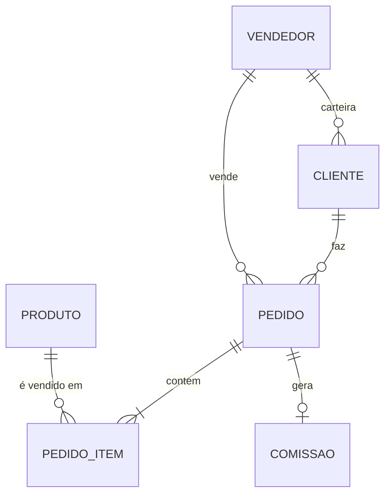

# ERD — VendaMax (transcrito do diagrama do fornecedor, 2022)

Observações do diagrama: um cliente pertence a um único vendedor (carteira). Pedidos da
loja web não têm vendedor. Não há entidade de devolução: devoluções são lançadas como
pedido cancelado.
