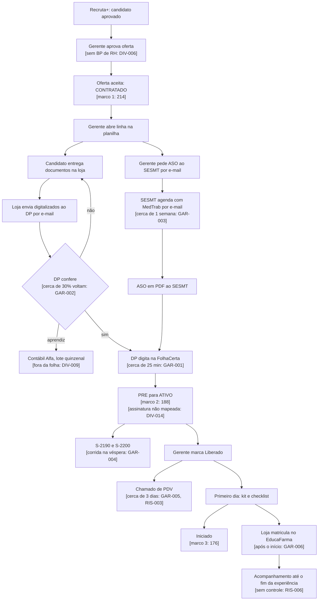

# Diagnóstico do cenário atual: Projeto Admissão Única

Drogarias Caliandra S.A. · Versão 3, atualizada com `entrega/respostas.md` e `mudancas/`. As seções 12 e 13 mostram o que mudou; as seções 2 a 10 preservam o cenário encontrado nas fontes.

## 1. Resumo executivo

Hoje a admissão depende de quatro sistemas, e-mail e dois terceiros. Cada um aplica a sua versão das regras. O problema principal não é só a digitação: **as regras de início de trabalho não estão decididas de forma única e os controles existentes deixam passar exceções graves**.

Os três achados mais críticos, depois das respostas, são:

1. **O bloqueio de início falha.** A amostra tem um início 3 dias antes do ASO e um farmacêutico RT com contrato ativo sem número de CRF. A ata relata colaborador novo usando o login do gerente, inclusive em venda com receita (RIS-001, RIS-002, RIS-003).
2. **A mesma regra tem valores diferentes.** O ASO vale 30, 60 ou 90 dias; a experiência é 30+60 ou 45+45; a integração tem prazo de 5, 15 ou 30 dias. Os decisores confirmaram os valores da RH-012 para ASO (30 dias) e integração (5 dias), mas nenhum sistema os executa ainda. A experiência voltou a ter conflito: 30+60 pelo Jurídico, 45+45 comunicado por Operações (DIV-003, DIV-004, DIV-005, DIV-008).
3. **Dados sensíveis estão expostos.** A planilha com CPF e dado de saúde pode ser editada por quem tiver o link. Gerentes consultam dados clínicos, gestação, CID e antecedentes. Registros de candidatos de 2021 e 2022 continuam guardados, enquanto a Política manda eliminar em 6 meses (RIS-004, RIS-005, DIV-010, DIV-011).

Os três números de setembro (214, 188 e 176) não são necessariamente um erro de contagem: cada área mede um marco diferente (DIV-002). O custo operacional aparece em cerca de 79 horas de redigitação por mês e cerca de 57 pastas devolvidas por mês, valores calculados a partir da ata (GAR-001, GAR-002).

A FolhaCerta deve ser preservada como sistema da folha. Ela já valida piso e gera os eventos do eSocial. As APIs do EducaFarma e da MedTrab são bases prontas para reduzir trabalho manual, mas ainda não se sabe se a FolhaCerta aceita entrada automática.

### Pontos que não deveriam esperar o projeto

Estas são recomendações para decisão dos responsáveis. Nada foi alterado nas fontes.

| Ponto | Responsável sugerido | Achado |
|---|---|---|
| Fechar o link aberto da planilha | Cláudia Reis, com Paula Nogueira | RIS-004 |
| Avaliar o caso do RT sem CRF registrado (contrato 9233) | Marina Quintela, com Rogério Tavares | RIS-002 |
| Revisar o acesso à `candidato_bkp_2022` e o expurgo dela | Paula Nogueira | DIV-010, RIS-005 |
| Rever o acesso de `rh_loja` e `dp_analista` aos campos clínicos | Paula Nogueira, com Fábio Arantes | DIV-011 |
| Avaliar os registros de gestação e antecedentes usados na seleção e no início | Marina Quintela | RIS-005 |
| Orientar as lojas contra o uso do login do gerente | Sérgio Antunes, com Igor Melo | RIS-003 |

## 2. Base, limites e como ler as citações

**Evidência.** Foram lidos todos os documentos, a estrutura dos dois dumps e os dados das amostras, sem copiar registros pessoais para esta entrega. O comando indicado do motor RAG falhou por falta do `fastembed` e funcionou com `--extra embeddings`, indexando 23 trechos com o embedder local. Ele foi usado para localizar evidências por sistema, e cada achado foi confirmado pela leitura direta. As consultas rodaram sem LLM (`--llm none`), logo em modo baseline. O Corrective RAG não foi executado, porque exigiria um processo auxiliar não permitido nesta execução.

**Limites.**

- Os dumps são amostras de 4 filiais, a planilha tem 10 linhas e o LMS tem 7 matrículas. As contagens mostram que algo ocorre, mas **não medem a frequência** na rede.
- A exportação do LMS não tem data.
- Os números de setembro são uma projeção de 22/09.
- Volumes e tempos da ata são relatos, não medições.
- Normas externas, como CLT, regras do eSocial e do CRF e LGPD, não constam das fontes. O enquadramento legal cabe ao Jurídico.

**Fontes não recebidas:**

- exportação de chamados de TI;
- e-mails e modelo de contrato;
- contratos com MedTrab, Contábil Alfa e fornecedores dos sistemas;
- Acordo Coletivo de 2024 e CCTs;
- documentação de integração da FolhaCerta e do Recruta+;
- texto da Portaria CVS-SP nº 88/2026.

A ata do Comitê de 28/10 chegou na Etapa 3 (seção 13).

**Legenda das citações.** Cada `#n` é o trecho indexado.

| Sigla | Fonte |
|---|---|
| POL | `geral/politica-RH-012-admissao-integracao.md` |
| MAN | `geral/manual-admissao-lojas-v3.2-2019.md` |
| COM | `geral/comunicado-dp-07-2024.md` |
| ATA | `geral/ata-2026-09-22-grupo-trabalho-admissao.md` |
| FLU | `geral/fluxo-admissao-atual.md` |
| LEIA | `SIS-03/LEIA-ME.md` |
| PLA | `SIS-03/controle_admissoes_2026.csv` (estrutura em `SIS-03/planilha-estrutura.md`) |
| LMS | `SIS-04/export_*_lms.csv` (estrutura em `SIS-04/lms-estrutura.md`) |
| FC | `SIS-01/folhacerta_dump.sql` |
| RM | `SIS-02/recrutamais_dump.sql` |

`[dados: …]` indica uma contagem agregada sobre a amostra.

## 3. Mapa dos sistemas

| Sistema | Papel hoje | Processos | Entidades | Chave de pessoa | Código de loja |
|---|---|---|---|---|---|
| SIS-01 FolhaCerta | Folha, contrato, eSocial. **Permanece** [doc: ATA#1], [doc: `escopo.md`] | Registro, ativação, eventos | colaborador, contrato, exame, evento | CPF com 11 dígitos, matrícula | inteiro: `147` |
| SIS-02 Recruta+ | Seleção e oferta; fornecedor externo [sql: RM:cabeçalho] | Candidato, vaga, oferta | candidato, vaga, oferta, tabela salarial | CPF com máscara | `LJ-0147` |
| SIS-03 Planilha | Controle manual das lojas em drive [doc: LEIA#0] | Situação até o primeiro dia | linha de controle | CPF em formato misto | `147 - Savassi` |
| SIS-04 EducaFarma | Treinamentos [doc: ATA#1] | Trilhas, matrículas | trilha, matrícula | e-mail pessoal, sem CPF | `MG-SAV` |
| E-mail | Pasta, pedido e PDF de ASO [doc: FLU#0] | Documentos, exame | sem estrutura | não se aplica | não se aplica |
| MedTrab (terceiro) | Exame admissional [doc: ATA#1] | Agenda, ASO | não recebido | não recebido | não recebido |
| Contábil Alfa (terceiro) | Cadastro de aprendizes em lote quinzenal [doc: ATA#0] | Aprendiz | não recebido | não recebido | não recebido |
| Sistema de chamados de TI | Acesso ao PDV [doc: MAN#1], [doc: ATA#1] | Liberação de login | não recebido | não recebido | não recebido |

## 4. Fluxo atual e achados por etapa

Fluxo baseado em [doc: FLU#0]. As notas entre colchetes marcam o que os demais materiais revelam.

| Etapa | O que acontece | Achados |
|---|---|---|
| Oferta | Aprovação sem BP de RH no registro. Tabela de SP defasada leva a oferta abaixo do piso, que volta da folha e é refeita | DIV-006, DIV-007, RIS-013 |
| Documentos | Envio por e-mail, 30% de devolução, prazo não medido, lista de 2019 | GAR-002, DIV-012, DIV-016 |
| Exame | Uma analista, e-mail e janela de validade divergente. O ASO pode vencer quando o início é adiado | GAR-003, DIV-004, RIS-001, RIS-009 |
| Cadastro e contrato | Redigitação. A assinatura não aparece no fluxo | GAR-001, DIV-013, DIV-014 |
| eSocial | Eventos gerados corretamente, mas só depois da ativação, o que comprime a véspera | APO-002, GAR-004, RIS-011 |
| Farmacêuticos | Três regras de CRF e validação que não alcança o RT | DIV-005, RIS-002 |
| Aprendizes | Processo paralelo, por terceiro, com menores de idade | DIV-009, GAR-007, RIS-007 |
| Acessos e primeiro dia | Chamado em momento incerto e login compartilhado | DIV-015, GAR-005, RIS-003 |
| Treinamentos | Matrícula manual, prazo divergente, sem visão dos demais cursos | DIV-008, GAR-006, RIS-008 |
| Fim da experiência | Sem registro de prorrogação. O desligamento está fora do escopo, então o limite precisa ser definido | RIS-006 |
| Exceções | Inapto, desistência e mudança de data não estão mapeados | RIS-012 |

**Tempos da amostra** [dados: PLA]:

- Oferta até início: mediana de 21 dias corridos (n=9, de 7 a 70).
- Pedido até ASO: de 5 a 8 dias, média de 6,8 (n=9), o que confirma o relato de cerca de uma semana.
- O caso típico cabe em uma janela de 30 dias. O que estoura a janela é o **adiamento do início**, como as próprias observações da planilha indicam.

## 5. Matriz de divergências

| ID | Regra | Política RH-012 (vigente desde 03/2025) | Manual 2019 ou Comunicado 2024 | Planilha | FolhaCerta | Recruta+ ou EducaFarma | Evidência na amostra | Sev. |
|---|---|---|---|---|---|---|---|---|
| DIV-001 | Abrangência | 184 próprias, CD e escritório; 28 franqueadas fora [doc: POL#0 §1] | não trata | não trata | não permite concluir | não permite concluir | Escopo diz 212 lojas [doc: `escopo.md`]; ata usa 184 [doc: ATA#0] | Alta |
| DIV-003 | Experiência | 30+60 [doc: POL#0 §4.1] | 45+45 [doc: MAN#1 §6] | 45+45 [doc: LEIA#0] | padrão de 45 [sql: FC:contrato, fn_valida_contrato] | não trata | 8 de 8 contratos de 2026 com 45 dias [dados: FC:contrato] | Alta |
| DIV-004 | Validade do ASO | até 30 dias corridos [doc: POL#1 §6.2] | só exige exame feito [doc: MAN#0 §5] | até 60 dias [doc: LEIA#0] | até 90 dias, sem limite superior [sql: FC:fn_valida_contrato] | não trata | 2 de 9 acima de 30 dias (45 e 63), 1 deles acima de 60 [dados: PLA, FC:exame_admissional] | Alta |
| DIV-005 | CRF | certidão com CRF ativo em toda função farmacêutica, inclusive RT; protocolo não substitui [doc: POL#1 §7] | cópia da carteira [doc: MAN#1 §7] | protocolo com até 30 dias [doc: LEIA#0] | número obrigatório só para `FARM`, embora `FARM_RT` tenha `exige_crf` [sql: FC:fn_valida_contrato, cargo] | não trata | contrato 9233 ATIVO sem número [dados: FC:contrato] | Crítica |
| DIV-006 | Aprovação de oferta | BP de RH sempre; regional acima do piso [doc: POL#0 §3] | gerente [doc: MAN#0 §2]; fluxo igual [doc: FLU#0] | não trata | não trata | só gerente de loja ou regional, um aprovador [sql: RM:oferta] | 0 de 11 com BP de RH; 8 de loja e 3 de regional [dados: RM:oferta] | Alta |
| DIV-007 | Piso de balconista em SP | "piso da função", sem valor | não trata | não trata | 1.820,00, vigência 03/2026, CCT SP [dados: FC:cargo_piso] | 1.750,00, vigência 03/2025, sem histórico [sql: RM:tabela_salarial] | oferta 7005 cancelada e refeita em 7006 [dados: RM:oferta], [doc: PLA obs] | Alta |
| DIV-008 | Integração | até o 5º dia corrido e antes do balcão sem acompanhamento [doc: POL#1 §9] | 15 dias [doc: MAN#1 §9] | apenas mostrar a trilha [doc: LEIA#1] | não trata | 30 dias [doc: LMS] | 4 de 4 concluídas entre 15 e 24 dias [dados: LMS] | Alta |
| DIV-009 | Aprendiz | 14 a 24 anos, 30 h [doc: POL#0 §4.2] | não trata | 30 h, Contábil Alfa [doc: LEIA#0] | mínimo de 18 anos; sem tipo, cargo ou piso [sql: FC:chk_tipo_contrato, fn_valida_contrato] | Recruta+ tem vaga sem salário de referência [dados: RM:vaga]; LMS sem trilha [doc: LMS] | contratação de menor de idade fora da folha [dados: PLA] | Alta |
| DIV-010 | Retenção de candidatos | 6 meses para todo não contratado [doc: POL#2 §11.3] | não trata | sem regra | não se aplica | só REPROVADO, 24 meses; backup fora do expurgo [sql: RM:sp_expurgo_candidatos, candidato_bkp_2022] | 1 reprovado de 02/2025 ainda na base; 3 registros de 2021 e 2022 no backup [dados: RM] | Crítica |
| DIV-011 | Acesso à saúde | só SESMT [doc: POL#1 §11.2] | não trata | resultado de ASO e texto livre [doc: PLA] | `rh_loja` e `dp_analista` leem CID e observação; sem papel de SESMT [sql: FC:GRANT, exame_admissional] | Recruta+: gerente lê gestação e CID [sql: RM:GRANT] | registros clínicos presentes em FC e PLA [dados] | Crítica |
| DIV-012 | Prazo de documentos | 5 dias úteis [doc: POL#0 §2] | 3 no Manual, revogado para 5 [doc: MAN#0 §4], [doc: COM#0] | 5 dias úteis [doc: LEIA#0] | não trata | não trata | prática não medida, sem campo de data [doc: PLA] | Baixa |
| DIV-014 | Condição para começar | ASO, CRF, documentos e registro preliminar [doc: POL#0, POL#1] | exame feito [doc: MAN#0 §5] | documentos e ASO [doc: LEIA#1] | contrato assinado e ASO [sql: FC:contrato.status] | não trata | ata: S-2190 também é condição [doc: ATA#0] | Alta |

Outras divergências:

- **DIV-002, números de setembro.** Recrutamento conta oferta aceita, que vira `CONTRATADO` por trigger [sql: RM:trg_oferta_aceita]. O DP conta `ATIVO` [sql: FC:contrato.status]. As lojas contam o primeiro dia trabalhado [doc: LEIA#1]. A diferença é de 26 entre os dois primeiros e de 12 entre os dois últimos [doc: ATA#0].
  - Hipóteses a testar, sem evidência suficiente: início em outro mês, desistências, aprendizes fora da folha, e franqueadas no Recruta+.
  - Na amostra, 10 pessoas constam como `CONTRATADO`, 8 têm contrato ativo e há 8 `Iniciado` [dados: RM, FC, PLA], o que mostra os marcos defasados.
- **DIV-013, identificadores.** Há quatro códigos de loja e quatro vocabulários de cargo. `FARMACEUTICO` no Recruta+ corresponde a `FARM` ou `FARM_RT` na folha, e o Recruta+ não tem cargo de caixa na tabela salarial. O LMS só tem e-mail pessoal. Existem homônimos com CPF diferente na FolhaCerta, portanto conciliar por nome gera erro [dados: FC:colaborador].
- **DIV-015, chamado de PDV.** Primeiro dia [doc: MAN#1 §8], após Liberado [doc: FLU#0] ou conferência no primeiro dia [doc: LEIA#1].
- **DIV-016, lista de documentos.** Só existe no Manual e pede título de eleitor e certidão dos filhos sem condição [doc: MAN#0 §4]. A Política pede somente o necessário [doc: POL#1 §11.1]. O Comunicado revogou apenas o prazo e manteve o resto do Manual até nova versão [doc: COM#0].

**Hierarquia de documentos: não confirmada.** Marina Quintela não soube dizer se a Política prevalece em geral, e Rogério Tavares informou que só a seção 4 do Manual foi revogada. A prevalência vale apenas regra a regra (Q-021, RIS-015).

### Verificado e sem divergência

Estes pontos parecem conflito, mas não são:

- **Jornada.** 220 horas mensais na FolhaCerta equivalem às 44 semanais da Política e da planilha [sql: FC:cargo], [doc: POL#0 §5], [doc: LEIA#0]. O caso de aprendiz, com 30 h, está em DIV-009.
- **Carência do plano.** 90 dias e 30 para farmacêuticos coincidem nas três fontes [doc: POL#1 §8], [dados: FC:beneficio_regra], [doc: LEIA#0].
- **S-2200.** Dia 15 do mês seguinte na Política e no trigger [doc: POL#1 §10], [sql: FC:fn_gera_esocial].
- **Pisos de MG e de farmacêutico.** Recruta+ e FolhaCerta coincidem [dados: RM:tabela_salarial, FC:cargo_piso].
- **Dois colaboradores com o mesmo nome.** Têm CPF diferente, portanto são duas pessoas, não duplicidade [dados: FC:colaborador].
- **Comando de carga do dump.** `DISABLE TRIGGER ALL` é só parte da carga do arquivo, não prova de desligamento em produção [sql: FC:ALTER TABLE].

## 6. Gargalos

| ID | Gargalo | Evidência | Efeito |
|---|---|---|---|
| GAR-001 | Redigitação na FolhaCerta | 25 min por admissão [doc: ATA#0] | cerca de 79 h/mês, com 190 admissões (cálculo) |
| GAR-002 | Devolução de pastas | 30% voltam [doc: ATA#0]; sem data de entrega [doc: PLA] | cerca de 57 pastas/mês (cálculo); prazo não medido |
| GAR-003 | ASO por e-mail com uma analista | [doc: ATA#1], [dados: PLA] | cerca de 1 semana |
| GAR-004 | Corrida do S-2190 | [doc: ATA#0]; evento só nasce com ATIVO [sql: FC:fn_gera_esocial] | trabalho concentrado na véspera |
| GAR-005 | Login do PDV por chamado | [doc: ATA#1] | cerca de 3 dias sem login |
| GAR-006 | Matrícula manual após o início | [doc: ATA#1]; de 1 a 6 dias depois [dados: LMS] | prazo de 5 dias fica inviável |
| GAR-007 | Lote de aprendizes | cerca de 40/ano, quinzenal [doc: ATA#0] | início preso ao calendário do lote |
| GAR-008 | Gerente sem visão única | [doc: FLU#0], [doc: `escopo.md`] | situação manual, por vários canais |

## 7. Riscos

Probabilidade: **Observada** quando há caso nas fontes, mesmo sem frequência conhecida; caso contrário, é estimativa a validar.

| ID | Risco | Evidência | Prob. | Impacto | Sev. | Mitigação sugerida |
|---|---|---|---|---|---|---|
| RIS-001 | Início antes do ASO | Contrato 9240: início 3 dias antes do ASO e S-2190 enviado antes dele, embora o evento dependa de ATIVO com ASO; merece verificação [dados: FC], [sql: FC:fn_valida_contrato] | Observada | Legal, saúde | Crítica | Bloqueio único de liberação, sem exceção informal |
| RIS-002 | RT sem CRF registrado | Contrato 9233 [dados: FC:contrato]; observação de protocolo [dados: PLA] | Observada | Regulatório | Crítica | Validar por `exige_crf` e tratar o caso em aberto |
| RIS-003 | Login compartilhado em venda com receita | [doc: ATA#1] | Observada | Regulatório, auditoria | Crítica | Acesso individual pronto antes do primeiro dia |
| RIS-004 | Planilha aberta com CPF e saúde | [doc: LEIA#0], [doc: PLA] | Observada | LGPD | Crítica | Fechar link; aposentar a planilha |
| RIS-005 | Dados sensíveis e possível discriminação | Campos de gestação, CID e antecedentes, visíveis ao gerente [sql: RM:candidato, GRANT]; registro de ação trabalhista contra empregador anterior em candidato reprovado; início reavaliado por gravidez em uma linha da planilha [dados: RM, PLA] | Observada | Legal, reputação | Crítica | Avaliação do Jurídico; retirar da decisão de seleção o que não for permitido |
| RIS-006 | Experiência vencida sem registro | Contratos 9140 e 9177 com fim anterior ao dump e ainda `CLT_EXP` [dados: FC:contrato]; sem campo de prorrogação | Observada | Trabalhista | Alta | Alertas e registro da decisão |
| RIS-007 | Aprendiz fora dos controles | [doc: FLU#0], [sql: FC:chk_tipo_contrato], [doc: LMS] | Observada | Legal, dados de menor | Alta | Definir canal, responsável e contrato |
| RIS-008 | Treinamento obrigatório sem acompanhamento | Sem matrícula além do 1º curso, inclusive SNGPC, com prazo de 30 dias [dados: LMS]; exportação sem data | A validar | Regulatório | Alta | Visão por cargo e prazo |
| RIS-010 | Automatizar regra errada; sem dono do produto | Conflitos acima; quatro áreas puxam a iniciativa e TI só apoia [doc: `escopo.md`] | Alta (estimada) | Projeto | Alta | Decidir regras antes de escolher solução; nomear dono |
| RIS-013 | Sem trilha de auditoria | Nenhuma tabela de auditoria nos dumps; gerente com `UPDATE` em oferta [sql: RM:GRANT] | Observada | Auditoria | Alta | Registrar autor, data e valor |
| RIS-009 | Dependência de pessoas | Uma analista de SESMT; quatro analistas de DP [doc: ATA#0, ATA#1] | Média (estimada) | Operacional | Média | Fila compartilhada e automação |
| RIS-011 | Eventos ausentes na amostra | 6 de 8 contratos ativos de 2026 sem evento [dados: FC:evento_esocial]; pode ser recorte | A validar | Legal | Média | Conferir na base completa |
| RIS-012 | Exceções não mapeadas | Sem ramo para inapto e desistência [doc: FLU#0]; `CONTRATADO` sem volta [sql: RM:candidato]; vagas 501 e 507 com duas ofertas aceitas, sem campo de quantidade [dados: RM] | Alta (estimada) | Operacional | Média | Mapear exceções |

## 8. Inventário de dados pessoais por sistema

Pedido pela Encarregada de Dados [doc: ATA#1]. Lista categorias, sem valores. A **base legal e a finalidade não constam das fontes** (pergunta 12).

| Sistema | Dados comuns | Sensíveis ou de maior risco | Quem acessa (nas fontes) | Retenção nas fontes |
|---|---|---|---|---|
| FolhaCerta | CPF, nome, nascimento, RG, nome da mãe, e-mail pessoal, salário, CRF | Resultado de ASO, CRM do médico, CID de restrição, observação clínica | `dp_analista` lê e altera tudo; `rh_loja` lê colaborador, contrato e exame; sem filtro por loja [sql: FC:GRANT] | Não definida |
| Recruta+ `candidato` | CPF, nome, e-mail, telefone, nascimento | Gestante, PCD, CID, antecedentes e observações | `gerente_loja` lê tudo, sem filtro por unidade [sql: RM:GRANT] | 24 meses, só REPROVADO |
| Recruta+ `oferta` | Salário, aprovador | Não se aplica | `gerente_loja` lê e altera | Não definida |
| Recruta+ `candidato_bkp_2022` | CPF, nome, e-mail, nascimento | Gestante, CID, observações de antecedentes | `gerente_loja`, `app_relatorios` | Sem expurgo |
| Planilha | CPF, nome, cargo, datas, responsáveis | Resultado de ASO; `obs` livre com saúde, gestação e idade de menor [dados: PLA] | Qualquer pessoa com o link pode editar [doc: LEIA#0] | Não definida |
| EducaFarma | E-mail pessoal, nome, unidade, cursos | Não identificados | Não informado | Não definida |
| E-mail (DP, loja, SESMT) | Cópias de identidade, CPF, residência, carteira de trabalho, título, dados bancários [doc: MAN#0 §4] | Certidão de filhos (menores), ASO em PDF | Não informado | Não definida |
| Clínica MedTrab | Não recebido | Dados de saúde | Terceiro | Não recebido |
| Contábil Alfa | Não recebido | Dados de aprendizes menores | Terceiro | Não recebido |
| Fornecedor do Recruta+ | Mesmo conteúdo do Recruta+ | Mesmo conteúdo | Terceiro [sql: RM:cabeçalho] | Não recebido |

## 9. Pontos de apoio

| ID | O que preservar ou reaproveitar | Fonte |
|---|---|---|
| APO-001 | Validação de piso por cargo, UF e vigência, com origem na CCT | [sql: FC:cargo_piso, fn_valida_contrato], [doc: ATA#1] |
| APO-002 | Geração de S-2190 e S-2200 com prazos coerentes com a Política | [sql: FC:fn_gera_esocial], [doc: POL#1 §10] |
| APO-003 | Carência e jornada coerentes entre as fontes | seção 5 |
| APO-004 | Campo `exige_crf`, já pronto para cobrir o RT | [sql: FC:cargo] |
| APO-005 | API REST e trilhas por cargo no EducaFarma | [doc: ATA#1], [doc: LMS] |
| APO-006 | Portal com API de agendamento da MedTrab, ainda não usado | [doc: ATA#1] |
| APO-007 | CPF, depois de normalizado, liga Recruta+, folha e planilha | [dados: RM, FC, PLA] |
| APO-008 | Início, ASO e salário coincidem nos 8 casos comparáveis, o que ajuda na migração | [dados: RM, FC, PLA] |
| APO-009 | Fluxo mapeado, Política aprovada por três áreas, situações e checklist aproveitáveis | [doc: FLU#0], [doc: POL#0], [doc: LEIA#1] |

## 10. Oportunidades

| ID | Oportunidade | Ataca | Dependência |
|---|---|---|---|
| OPO-005 | Painel único de "pode começar" para o gerente | GAR-008, DIV-014 | Lista fechada de condições |
| OPO-001 | Reaproveitar dados da oferta até a folha | GAR-001 | Canal de entrada da FolhaCerta: **desconhecido** |
| OPO-002 | Coleta e conferência prévia de documentos | GAR-002 | Lista vigente |
| OPO-003 | Agendamento integrado com checagem de validade | GAR-003, RIS-001 | Contrato e cobertura da MedTrab |
| OPO-004 | Matrícula automática por cargo, antes do início | GAR-006, RIS-008 | Chave de e-mail e API |
| OPO-006 | Acesso individual pronto para o primeiro dia | GAR-005, RIS-003 | Processo de TI |
| OPO-007 | Funil único com marcos definidos | DIV-002 | Definição dos marcos |
| OPO-008 | Regras como parâmetros com vigência e origem | DIV-003 a DIV-008 | Decisão de cada regra |
| OPO-009 | Aposentar a planilha e completar o inventário de dados | RIS-004 | Decisão de contenção |

Estas oportunidades não pressupõem comprar ou construir: a decisão fica para depois do entendimento do processo, como pede o escopo [doc: `escopo.md`].

## 11. Próximos passos

As 15 perguntas da Etapa 1 estão em `entrega/perguntas.md` e as respostas, em `entrega/respostas.md`. O que ficou sem resposta virou as perguntas Q-014 e Q-016 a Q-032, listadas em `02-negocio.md`, seção 11. Recomenda-se começar por Q-014, Q-019 e Q-018.

O modelo completo está em `.re/modelo/` e os requisitos, em `.re/requisitos.md`.

## 12. O que mudou com as respostas

### Achados tratados: regra decidida

A execução nos sistemas ainda não mudou.

| Achado | Decisão | Quem | O que continua divergente |
|---|---|---|---|
| DIV-001 | Franqueadas fora; CD e escritório fora na primeira fase; CLT de loja primeiro | Helena Vasconcelos | Estágio sem resposta |
| DIV-003 | Experiência 30+60. **Reaberto na Etapa 3, ver seção 13** | Marina Quintela | Folha, Manual e planilha com 45+45; contratos vigentes sem orientação |
| DIV-004 | ASO até 30 dias corridos antes do início, sem exceção | Fábio Arantes, Marina Quintela | Folha aceita 90; planilha, 60 |
| DIV-005 | CRF ativo antes do início, sem protocolo, inclusive RT | Beatriz Lobo | Trigger não cobre RT; planilha aceita protocolo |
| DIV-007 | Piso é o da convenção vigente de cada UF, conforme a FolhaCerta | Rogério Tavares | Tabela do Recruta+ segue defasada |
| DIV-008 | Integração até o 5º dia corrido e antes de atender sozinho | Beatriz Lobo | EducaFarma com 30; Manual com 15 |
| DIV-010 | Não contratados: 6 meses, inclusive cópias e backups | Paula Nogueira | Expurgo de 24 meses; backup sem expurgo |
| DIV-012 | Prazo de documentos: 5 dias úteis | Rogério Tavares | Texto do Manual |

### Achados com avanço parcial

| Achado | O que avançou | O que falta |
|---|---|---|
| DIV-002 | A admissão é contrato assinado, ASO apto validado e ATIVO; as três etapas seguem úteis (Rogério Tavares). **Corrige a suposição de usar "Iniciado" como conclusão** | Números fechados, explicação das diferenças, indicador oficial |
| DIV-009 | Programa de 14 a 24 anos é legítimo e entra no novo processo, com prioridade 5 | Caminho na FolhaCerta, papel da Contábil Alfa |
| DIV-011 | CID só no ambiente do SESMT | Observação clínica, definição do ambiente, o que sai do SESMT |
| DIV-014 | ASO e CRF confirmados como condições | Lista fechada, ordem, liberador, assinatura. **Documentos, contrato e S-2190 não foram confirmados como bloqueio** |
| RIS-005 | Gravidez e antecedentes fora da seleção; pessoa com deficiência só para cota | Orientação jurídica sobre os casos da amostra; dados já existentes |

### Sem resposta

DIV-006, DIV-013, DIV-015, DIV-016 e os riscos RIS-003, RIS-006, RIS-008, RIS-009, RIS-011 e RIS-012 seguem como estavam. O responsável pelas medidas imediatas da seção 1 também não foi indicado (Q-030).

### Achados novos

| ID | Achado | Sev. |
|---|---|---|
| RIS-014 | A TI não respondeu: a viabilidade de integração é desconhecida, e a prioridade 2 depende dela | Crítica |
| RIS-015 | Manual segue em uso, e formalmente em vigor fora da seção 4, com regras superadas, até o sistema chegar | Alta |
| RIS-016 | A ativação direta na FolhaCerta pode contornar o bloqueio do novo sistema | Alta |
| RIS-017 | CD, escritório e estágio ficam no processo atual, com a RH-012 ainda valendo | Média |
| DIV-017 | O DP valida ASO apto, e a RH-012 restringe dados de saúde ao SESMT | Média |

### Fatos novos sobre pessoas

- **Beatriz Lobo** respondeu por CRF e integração. É de Assuntos Regulatórios, conforme a ata de 28/10 (M-01).
- **Vera Castro** (CFO) foi indicada para orçamento e data e ainda não foi consultada.

## 13. O que mudou com as comunicações novas

Avaliação completa em `08-mudancas.md`.

| Achado | Mudança | Fonte |
|---|---|---|
| DIV-003 | **Reaberto.** Sérgio Antunes comunicou 45+45 para toda a rede a partir de 01/12/2026, contra a decisão de 30+60 de Marina Quintela. Não há decisão registrada | [doc: M-01 item 2], [entrevista: juridico-compliance Q-004] |
| DIV-005 | Reforçado: certidão com CRF ativo, inclusive RT; protocolo não basta | [doc: M-01 item 1] |
| DIV-011 | Ampliado: o comprovante de vacinação é um novo dado de saúde a proteger | [doc: M-02], [doc: POL#1 §11.2] |
| DIV-016 | Ampliado: a lista de documentos precisa prever a CRNM | [doc: M-02] |
| RIS-015 | Agravado: lojas podem seguir 45+45 sem decisão | [doc: M-01 item 2] |
| RIS-018 | **Novo, alta.** Portaria em 01/02/2027 e Acolher no 1º trimestre de 2027, sem cronograma do projeto | [doc: M-02], Q-002 |
| RIS-019 | **Novo, média.** CPF obrigatório e sem campo para tipo e validade de documento nos sistemas; Encarregada fora dos destinatários | [doc: M-02], [sql: FC:colaborador], [sql: RM:candidato] |
