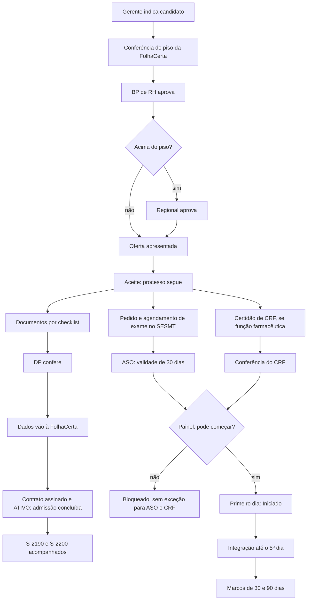

# Documentação de negócio

Projeto Admissão Única, Drogarias Caliandra S.A. Data: 04/11/2026. Baseline: sem baseline. Situação: não validado pelas áreas. Atualizado com `mudancas/` (ver `08-mudancas.md`).

Fontes: `escopo.md`; `fontes/geral/` (política RH-012 rev. 4, manual 3.2, comunicado DP 07/2024, fluxo atual, ata de 22/09/2026); SIS-01 FolhaCerta (dump); SIS-02 Recruta+ (dump); SIS-03 planilha e Leia-me; SIS-04 EducaFarma (exportações); `entrega/respostas.md`; `mudancas/` (ata de 28/10/2026 e e-mail de 30/10/2026).

Convenção: itens sem marca estão confirmados por resposta ou evidência; `[hipótese]` é proposta deste levantamento; `[conflito]` aguarda decisão. IDs seguem `.re/modelo/`.

## 1. Contexto e problema

A Rede admite o ano inteiro, com média anual de 190 admissões por mês nas lojas próprias e pico de cerca de 320 em novembro e dezembro [doc: ata#0; entrevista: Q-010]. Uma admissão passa pelo Recruta+, por uma planilha, pela FolhaCerta, pelo EducaFarma e por e-mail. O diagnóstico está em `01-diagnostico.md`.

Os problemas que justificam o projeto são:

- **DP:** cerca de 25 min de redigitação por admissão e cerca de 30% de pastas devolvidas.
- **Gerente de loja:** não há um só lugar para saber quando o colaborador pode começar.
- **Jurídico, Encarregada e Regulatório:** regras divergentes entre sistemas, dados sensíveis expostos e início fora das regras.
- **Lojas:** cerca de 3 dias sem login, com uso do login do gerente, inclusive em venda com receita.

## 2. Objetivos e indicadores

As metas numéricas **não foram definidas**: Helena e Rogério não souberam informar (Q-003, aberta em Q-023). O sistema medirá a linha de base para que as metas sejam decididas.

| Objetivo | Indicador | Situação atual | Meta | Requisitos |
|---|---|---|---|---|
| Um número oficial de admissões | Admissões concluídas (contrato assinado, ASO apto validado, ATIVO) | 188 na projeção de setembro; 214 aceites e 176 inícios são outras etapas | Não se aplica | RN-015, RF-010 |
| Reduzir redigitação | Minutos por admissão | Cerca de 25 min (relato) | Não definida, Q-023 | RF-002, RF-025 |
| Reduzir devolução | % de pastas devolvidas, por motivo | Cerca de 30% (relato) | Não definida, Q-023 | RF-003, RF-025 |
| Início conforme as regras | Inícios sem ASO válido ou CRF ativo | Há casos na amostra; sem medida geral | 0, pois não há exceção (RN-011) | RN-001, RN-003, RN-011 |
| Acesso individual | Inícios com login ativo no primeiro dia | Cerca de 3 dias de espera (relato) | Não definida, Q-023 | RF-007, RNF-003 [hipótese] |
| Integração no prazo | % concluída até o 5º dia | 0 de 7 na amostra | RH-012 exige 100% | RN-004, RF-008 |
| Conformidade de dados | Dados de não contratados com mais de 6 meses | Expurgo atual de 24 meses | 0 (RN-006) | RN-006, RNF-010 |

## 3. Stakeholders e áreas

| Pessoa | Papel | Decide ou responde por | Fonte |
|---|---|---|---|
| Helena Vasconcelos | Patrocinadora, Dir. Gente & Gestão | Escopo, prioridades e texto final da RH-012 | Q-002 |
| Rogério Tavares | Gerência de DP | Conceito de admissão, piso como referência | Q-003, Q-008 |
| Marina Quintela | Jurídico Trabalhista | Experiência, alçada da oferta | Q-005, Q-008 |
| Paula Nogueira | Encarregada de Dados | CID, retenção, dados sensíveis | Q-012, Q-013 |
| Beatriz Lobo | Assuntos Regulatórios | CRF, RT e treinamentos sanitários | Q-006, Q-015 |
| Fábio Arantes | Médico coordenador do SESMT | Validade do ASO, com Marina | Q-004 |
| Sérgio Antunes e Cláudia Reis | Operações de Loja | Critérios de início, com Marina | Q-007 |
| Igor Melo | TI, apoio | Integrações (sem resposta) | Q-014 |
| Vera Castro | CFO | Orçamento (indicada, ainda não consultada) | Q-002 |
| BP de RH, Recrutamento | Sem pessoa nomeada | Oferta, Recruta+ | Q-008, Q-034, Q-035 |

RACI simples, **proposto [hipótese]**, exceto as decisões citadas na tabela anterior:

| Atividade | Responsável | Aprovador | Consultados | Informados |
|---|---|---|---|---|
| Indicar candidato | Gerente de loja | BP de RH | Recrutamento | Regional |
| Aprovar oferta | BP de RH; regional acima do piso | BP de RH e regional | DP (piso) | Gerente |
| Documentos | Loja | DP | Encarregada | Gerente |
| Exame admissional | SESMT | SESMT | Jurídico | DP e gerente, no limite de Q-040 |
| CRF | A definir, Q-029 | Regulatório | Jurídico | Gerente |
| Contrato e eSocial | DP | DP | Jurídico | Gerente |
| Acesso ao PDV | TI | TI | Operações | Gerente |
| Treinamentos sanitários | Loja | Regulatório | Operações | DP |
| Fim da experiência | A definir, Q-028 | A definir | Jurídico | DP |

## 4. Escopo

| Situação | Item | Fonte |
|---|---|---|
| Dentro, primeira fase | 184 lojas próprias; CLT de balconista, caixa e farmacêutico, inclusive RT | Q-001, Q-006 |
| Dentro, primeira fase | Oferta, documentos, exame, contrato, eSocial, acessos, treinamentos e acompanhamento até o fim da experiência | escopo |
| Dentro, depois da CLT | Aprendizes no fluxo único (prioridade 5 de Helena; prioridades 2 a 4 não informadas, Q-021) | Q-001, Q-011 |
| Fora da primeira fase | Escritório central e centro de distribuição | Q-001 |
| Fora | 28 franqueadas | Q-001 |
| Fora | Folha de pagamento; desligamento, inclusive cálculo de rescisão e homologação pedidos em M-01 (confirmar em Q-056) | escopo, M-01 |
| Dentro, com vigência própria | Comprovante de vacinação de quem vai aplicar injetáveis em lojas de SP, a partir de 01/02/2027 | M-02 |
| Dentro, fase a confirmar | Programa Acolher, com CRNM, a partir do 1º trimestre de 2027 (Q-055) | M-02 |
| Indefinido | Estágio: fora da primeira fase até resposta [hipótese] | Q-016 |

## 5. Processos: atual e futuro

Este fluxo reflete as regras confirmadas; a partir de 01/02/2027, o critério de vacinação entra na mesma decisão "pode começar" para os casos de RN-019, e a CRNM entra no checklist para o programa Acolher. A posição exata de contrato, S-2190 e acesso como bloqueio segue aberta (Q-009, Q-031). A etapa fora do escopo é o desligamento em si: o sistema só registra a decisão de não continuar.

| Processo | Hoje | Futuro | Gargalos tratados | Regras | Pendências |
|---|---|---|---|---|---|
| Oferta | Gerente aprova; piso defasado | BP sempre; regional acima do piso; piso da folha | DIV-005, DIV-010 | RN-005, RN-009 | Q-034, Q-035 |
| Documentos | E-mail; 30% devolvidos | Checklist e conferência registrada | GAR-002 | RN-010 | Q-036, Q-037 |
| Exame | E-mail; analista única; cerca de 1 semana | Fila no SESMT; API se viável | GAR-003 | RN-001, RN-007 | Q-024, Q-025, Q-026, Q-040 |
| Contrato e eSocial | Redigitação; corrida na véspera | Envio sem digitar; prazos visíveis | GAR-001, GAR-006 | RN-015, RN-017 | Q-009, Q-014 |
| Início | Planilha; "Liberado" sem CRF nem prazo do ASO | Painel com bloqueio | GAR-007 | RN-011, RN-018 | Q-031, Q-033 |
| Acesso | Chamado; cerca de 3 dias; login do gerente | Pedido antes do início [hipótese] | GAR-004 | RF-007 | Q-014 |
| Treinamentos | Matrícula manual; prazos divergentes | Prazo de 5 dias; restrição visível | GAR-005 | RN-004 | Q-045, Q-046 |
| Experiência | Sem controle | Marcos de 30 e 90 dias | RIS-007 | RN-002 | Q-027, Q-028, Q-047 |
| Vacinação para injetáveis | Não existe | Comprovante com o ASO, no SESMT, como critério condicional | — | RN-019, RN-020, RN-011 | Q-051, Q-052 |
| Programa Acolher | Não existe | CRNM no checklist e controle de validade | — | RN-021, RN-022 | Q-053, Q-054, Q-055 |
| Aprendiz | Contábil Alfa, lote quinzenal | Mesmo painel; destino a decidir | GAR-008 | RN-008 | Q-032, Q-038, Q-039 |

## 6. Regras de negócio

| ID | Regra | Prior. | Fontes | Aberta em |
|---|---|---|---|---|
| RN-001 | O sistema deve aceitar só ASO com resultado apto emitido no máximo 30 dias corridos antes do início e antes da data de início, sem exceção. | Must | doc:geral/politica-RH-012-admissao-integracao.md#1, entrevista:sesmt Q-004, entrevista:operacoes Q-007, doc:geral/M-02-email-juridico-2026-10-30.md#0 | — |
| RN-002 | O sistema deve aplicar à experiência CLT 30 dias, prorrogáveis por mais 60, totalizando 90 dias. [conflito] | Must | doc:geral/politica-RH-012-admissao-integracao.md#0, entrevista:juridico-compliance Q-005, doc:geral/M-01-ata-comite-2026-10-28.md#0 | Q-050 |
| RN-003 | O sistema deve exigir CRF ativo comprovado por certidão de regularidade antes do início de toda função farmacêutica, inclusive RT, sem aceitar protocolo. | Must | doc:geral/politica-RH-012-admissao-integracao.md#1, entrevista:regulatorio Q-006, entrevista:operacoes Q-007, doc:geral/M-01-ata-comite-2026-10-28.md#0 | Q-029 |
| RN-004 | O sistema deve exigir a conclusão de Integração e Boas Práticas Farmacêuticas até o 5º dia corrido após o início e antes de o colaborador atender sozinho no balcão. | Must | doc:geral/politica-RH-012-admissao-integracao.md#1, entrevista:regulatorio Q-015 | — |
| RN-005 | O sistema deve exigir aprovação do BP de RH em toda oferta e também do gerente regional quando o valor estiver acima do piso, sem permitir aprovação só pelo gerente de loja. | Must | doc:geral/politica-RH-012-admissao-integracao.md#0, entrevista:juridico-compliance Q-008, entrevista:departamento-pessoal Q-008 | — |
| RN-006 | O sistema deve eliminar dados de candidatos não contratados, incluindo cópias e backups, em até 6 meses após o encerramento do processo seletivo. | Must | doc:geral/politica-RH-012-admissao-integracao.md#2, entrevista:juridico-compliance Q-013 | Q-049 |
| RN-007 | O sistema deve manter CID só no ambiente do SESMT e restringir dados de saúde ao SESMT, nos termos da RH-012, sem armazenar CID em outro sistema. | Must | doc:geral/politica-RH-012-admissao-integracao.md#1, entrevista:juridico-compliance Q-012, entrevista:juridico-compliance Q-013 | — |
| RN-008 | O sistema deve tratar no fluxo único a admissão de aprendiz de 14 a 24 anos, com jornada de 30 horas semanais, com prioridade posterior à CLT de loja. | Should | doc:geral/politica-RH-012-admissao-integracao.md#0, entrevista:negocio Q-001, entrevista:departamento-pessoal Q-011 | Q-021 |
| RN-009 | O sistema deve usar como referência o piso da convenção coletiva vigente de cada UF, conforme a FolhaCerta, para enquadrar toda oferta. | Must | sql:SIS-01/folhacerta_dump.sql:cargo_piso, entrevista:departamento-pessoal Q-008 | — |
| RN-010 | O sistema deve exigir documentos completos no DP até 5 dias úteis antes do início e sinalizar o descumprimento. | Must | doc:geral/politica-RH-012-admissao-integracao.md#0, doc:geral/comunicado-dp-07-2024.md#0, doc:SIS-03/LEIA-ME.md#0 | — |
| RN-011 | O sistema deve bloquear a confirmação de início sem ASO válido; em função farmacêutica, sem CRF ativo; e, nos casos de RN-019, sem comprovante de vacinação, sem exceção para ASO mesmo com loja desfalcada. | Must | doc:geral/politica-RH-012-admissao-integracao.md#1, entrevista:operacoes Q-007, entrevista:sesmt Q-004, entrevista:regulatorio Q-006 | — |
| RN-012 | O sistema não deve perguntar nem guardar gravidez e antecedentes na seleção. | Must | sql:SIS-02/recrutamais_dump.sql:candidato, entrevista:juridico-compliance Q-013 | Q-042 |
| RN-013 | O sistema deve mostrar a DP e gerente a informação sobre o ASO que a Encarregada de Dados definir; está em aberto, porque a RH-012 restringe dados de saúde ao SESMT e o conceito de admissão exige ASO apto validado pelo DP. [conflito] | Must | doc:geral/politica-RH-012-admissao-integracao.md#1, entrevista:departamento-pessoal Q-003, entrevista:juridico-compliance Q-012, doc:geral/fluxo-admissao-atual.md#0 | Q-040 |
| RN-014 | O sistema deve tratar dado de pessoa com deficiência só com finalidade clara de cota e acesso restrito, sem CID fora do SESMT. | Must | sql:SIS-02/recrutamais_dump.sql:candidato, entrevista:juridico-compliance Q-013 | — |
| RN-015 | O sistema deve considerar concluída a admissão com contrato assinado, ASO apto validado e status ATIVO na FolhaCerta, mantendo oferta aceita e primeiro dia como etapas distintas. | Must | sql:SIS-01/folhacerta_dump.sql:contrato.status, entrevista:departamento-pessoal Q-003 | — |
| RN-016 | O sistema deve abranger na primeira fase as 184 lojas próprias, com CLT de balconista, caixa e farmacêutico, excluindo escritório central, centro de distribuição e as 28 franqueadas. | Must | doc:geral/politica-RH-012-admissao-integracao.md#0, entrevista:negocio Q-001 | — |
| RN-017 | O sistema deve acompanhar S-2190 até a véspera do início e S-2200 até o dia 15 do mês seguinte ao da admissão. | Must | doc:geral/politica-RH-012-admissao-integracao.md#1, sql:SIS-01/folhacerta_dump.sql:esocial_prazo, sql:SIS-01/folhacerta_dump.sql:fn_gera_esocial | — |
| RN-018 | O sistema deve tratar documentos, contrato assinado, S-2190, acesso e kit como critérios configuráveis, bloqueantes ou de alerta, conforme decisão ainda não tomada. [hipótese] | Should | doc:geral/ata-2026-09-22-grupo-trabalho-admissao.md#0, doc:geral/politica-RH-012-admissao-integracao.md#1, entrevista:operacoes Q-007 | Q-031 |
| RN-019 | O sistema deve exigir, a partir de 01/02/2027, junto com o ASO e antes do início das atividades, comprovante de vacinação contra hepatite B e tétano de quem vai aplicar injetáveis em lojas de São Paulo. | Must | doc:geral/M-02-email-juridico-2026-10-30.md#0 | Q-052 |
| RN-020 | O sistema deve tratar o comprovante de vacinação como dado de saúde, com acesso só do SESMT, mostrando aos demais só a situação do critério. [hipótese] | Must | doc:geral/politica-RH-012-admissao-integracao.md#1, doc:geral/M-02-email-juridico-2026-10-30.md#0 | Q-051 |
| RN-021 | O sistema deve aceitar, a partir do 1º trimestre de 2027, admissões de pessoas refugiadas e migrantes do programa Acolher, com a CRNM como documento de identificação. | Must | doc:geral/M-02-email-juridico-2026-10-30.md#0 | Q-055 |
| RN-022 | O sistema deve limitar a visibilidade da condição de pessoa refugiada ou migrante aos papéis definidos pela Encarregada de Dados. [hipótese] | Should | doc:geral/M-02-email-juridico-2026-10-30.md#0, doc:geral/politica-RH-012-admissao-integracao.md#1 | Q-054 |

Prioridades MoSCoW são propostas e dependem da decisão de Helena, que responde por prioridades (Q-002). RN-002 permanece com o valor da RH-012 enquanto CR-001 não for decidido.

## 7. Requisitos de alto nível por área

| Área | Necessidade | Requisitos |
|---|---|---|
| Gerente de loja | Um só lugar, critérios claros e menos planilha | RF-001, RF-015, RF-022, RNF-008 |
| DP | Parar de digitar, conferir com motivo, ver prazos | RF-002, RF-003, RF-004, RF-006, RF-009 |
| RH e BP | Alçada e funil | RF-010, RF-011, RF-012, RF-013, RF-025 |
| SESMT | Fila de exames e sigilo | RF-005, RF-019, RN-007, RN-013 |
| Jurídico e Encarregada | Prova, permissões, retenção | RF-017, RNF-001, RNF-002, RNF-004, RNF-010 |
| Regulatório | CRF e treinamentos sanitários | RF-016, RF-008, RF-022 |
| TI | Integrações, monitoramento e falha | RF-020, RNF-005, RNF-006, RNF-007, RNF-011 |
| Programa | Migração, transição e legados | RF-018, RF-023, RF-024 |
| SESMT e Regulatório | Vacinação para injetáveis em SP | RN-019, RN-020, RF-026 |
| DP e Jurídico | Programa Acolher e CRNM | RN-021, RN-022, RF-027, RF-028, RF-029 |

## 8. Premissas, restrições e dependências

**Restrições confirmadas**

- A FolhaCerta segue como sistema da folha [doc: ata#1; escopo].
- Mudança em regra da RH-012 exige revisão aprovada (Q-005, DIV-017).
- A escolha entre comprar e construir vem depois do levantamento [doc: escopo].

**Premissas [hipótese]**

- Estágio fica fora da primeira fase.
- As integrações são viáveis; se não forem, o valor do sistema cai, principalmente em redigitação.
- Até a decisão de cada pendência, o sistema não assume comportamento diferente da RH-012.

**Datas externas (M-01 e M-02)**

- 01/12/2026: data do comunicado de 45+45, sem decisão (CR-001).
- 01/02/2027: vigência da Portaria CVS-SP 88/2026. O texto da portaria não está nas fontes, só o resumo de Marina.
- 1º trimestre de 2027: programa Acolher, sem data exata.
- Como não há data de entrada em operação (Q-017), essas obrigações podem exigir processo provisório (US-050).

**Dependências**

- Respostas de Igor Melo e Rogério Tavares sobre integrações, contrato e eSocial (Q-014, Q-009).
- Decisões de Paula sobre visibilidade do ASO e contenção (Q-040, Q-044).
- Orçamento com Vera Castro (Q-018); prazo e critérios (Q-017, Q-019).
- Fornecedor do Recruta+, MedTrab e Contábil Alfa.

## 9. Riscos de negócio

| ID | Risco | Severidade | Status |
|---|---|---|---|
| RIS-001 | Planilha aberta com dados pessoais | critica | aberto |
| RIS-002 | Dados sensíveis de candidatos acessíveis a gerentes | critica | aberto |
| RIS-003 | Risco de discriminação na admissão | critica | aberto |
| RIS-004 | Login do gerente usado por colaborador novo | critica | aberto |
| RIS-005 | Farmacêutico em atividade sem certidão | critica | aberto |
| RIS-006 | Início sem ASO válido sob pressão da loja | critica | aberto |
| RIS-007 | Fim da experiência sem controle | alta | aberto |
| RIS-008 | Dependência de pessoa no SESMT | alta | aberto |
| RIS-009 | Aprendiz fora dos controles | alta | aberto |
| RIS-010 | Adiamento pode não recalcular eventos | media | aberto |
| RIS-011 | Cobertura de eventos eSocial a verificar | media | aberto |
| RIS-012 | CPF redigitado errado na folha | alta | aberto |
| RIS-013 | Documentos pessoais circulando por e-mail | alta | aberto |
| RIS-014 | Lacunas de fonte para o projeto | alta | aberto |
| RIS-015 | Casos em curso fora da regra confirmada | alta | aberto |
| RIS-016 | Perguntas 9 e 14 sem resposta | critica | aberto |
| RIS-017 | Convivência prolongada de processos | media | aberto |
| RIS-018 | Lojas adotarem 45+45 antes de uma decisão | alta | aberto |
| RIS-019 | CRNM sem lugar nos cadastros atuais | alta | aberto |
| RIS-020 | Datas externas antes de o sistema existir | alta | aberto |

**Ações que não devem esperar o sistema** (recomendação deste levantamento; quem decide as medidas está em aberto, Q-044 e Q-030): restringir o link da planilha, revisar acessos a dados sensíveis, tratar `candidato_bkp_2022` e verificar farmacêuticos ou RT em atividade sem CRF ativo. O início fora das regras e a planilha aberta continuam ocorrendo enquanto o sistema não existe.

## 10. Glossário

| Termo | Definição | Fonte |
|---|---|---|
| Admissão concluída | Contrato assinado, ASO apto validado e ATIVO na FolhaCerta | Q-003 |
| Oferta aceita (CONTRATADO) | Só a oferta foi aceita; etapa | Q-003 |
| Iniciado | Primeiro dia cumprido; etapa | Q-003, Leia-me |
| ASO válido | Apto, emitido até 30 dias corridos antes do início | RH-012, Q-004 |
| CRF ativo | Regularidade comprovada por certidão; protocolo não vale | RH-012, Q-006 |
| Acima do piso | Acima do piso da CCT vigente da UF, conforme a FolhaCerta | Q-008 |
| BP de RH | Business Partner de RH da regional | RH-012 |
| RT | Farmacêutico responsável técnico | RH-012 |
| S-2190 / S-2200 | Registro preliminar / admissão no eSocial | RH-012, FolhaCerta |
| CRNM | Carteira de Registro Nacional Migratório | M-02 |
| Programa Acolher | Contratação de pessoas refugiadas e migrantes | M-02 |

## 11. Pendências

**Conflitos:**

- **RN-002 (CR-001).** Sérgio comunicou 45+45 a partir de 01/12/2026; a RH-012 e Marina dizem 30+60. Segue 30+60 até decisão de Helena e Marina (Q-050). Decidir antes de 01/12/2026.
- **RN-013.** A RH-012 restringe dados de saúde ao SESMT, mas o conceito oficial de admissão exige ASO apto validado, a trigger da FolhaCerta lê o resultado e o gerente precisa de uma resposta sobre o início. O painel foi especificado sem dado clínico, mas falta definir se DP e gerente veem "apto" ou só "critério atendido" (Q-040).

**Sem resposta integral:** Q-009 (contrato e eSocial) e Q-014 (integrações). Por isso, RF-019, RF-020, RF-029, RF-007 e os RNF de integração seguem como hipótese.

**Perguntas abertas:**

| ID | Pergunta | Para |
|---|---|---|
| Q-009 | Como funcionam contrato e eSocial: onde o contrato é gerado e assinado; quem transmite e acompanha S-2190 e S-2200; como um S-2190 pode sair antes do ASO se a trigger exige ASO; o que acontece se a data de início muda; a amostra de eventos está completa? O S-2220 está no escopo e quem o envia? | Rogério Tavares |
| Q-014 | Quais integrações são viáveis e com que limites em FolhaCerta (escrita de colaborador e contrato, leitura de eventos), Recruta+ (contrato e API do fornecedor) e EducaFarma? Qual o caminho do acesso ao PDV: qual sistema de chamados, por que leva 3 dias, é possível provisionar antes do primeiro dia, e o que substitui o login do gerente nesse intervalo? | Igor Melo |
| Q-016 | Estágio entra no sistema? Enquanto não houver resposta, fica fora da primeira fase [hipótese]. | Helena Vasconcelos |
| Q-017 | Há data-limite para o projeto? | Helena Vasconcelos ou comitê |
| Q-018 | Qual é o teto de orçamento? | Vera Castro (CFO) |
| Q-019 | Quais critérios decidem entre comprar ou construir? | Helena Vasconcelos, Vera Castro e Igor Melo |
| Q-020 | Quem aprova os requisitos? A ata de 28/10/2026 traz só informes e não registra decisão: houve alguma? | Helena Vasconcelos ou comitê |
| Q-021 | Quais são as prioridades 2 a 4 da lista em que aprendiz é a 5? | Helena Vasconcelos |
| Q-022 | Quais parcelas explicam 214, 188 e 176 em setembro? O Recruta+ inclui franqueadas? | Rogério Tavares, Cláudia Reis e Recrutamento |
| Q-023 | Quais metas devem mudar em 3 meses de uso? | Helena Vasconcelos |
| Q-024 | Qual o procedimento quando o ASO vence por adiamento? | Fábio Arantes |
| Q-025 | Como tratar resultado inapto e apto com restrição? | Fábio Arantes e Marina Quintela |
| Q-026 | O contrato permite usar a API da MedTrab, e o que ela retorna? | Fábio Arantes e Igor Melo |
| Q-027 | Como tratar contratos em curso e firmados com 45 dias? | Marina Quintela |
| Q-028 | Quem decide prorrogar ou encerrar, com que antecedência, onde se registra e como se contam os dias? | Marina Quintela e Rogério Tavares |
| Q-029 | Quem confere a certidão de CRF e qual sua validade? (M-01 reforçou a certidão, sem responder a isto.) | Beatriz Lobo |
| Q-030 | O que fazer com quem já iniciou com protocolo? | Beatriz Lobo |
| Q-031 | Documentos, contrato assinado, S-2190, acesso e kit bloqueiam ou alertam? Há exceções? | Sérgio Antunes, Cláudia Reis e Marina Quintela |
| Q-032 | Quais critérios de início valem para aprendiz? | Rogério Tavares e Marina Quintela |
| Q-033 | Qual a alternativa quando a loja fica desfalcada e o início está bloqueado? | Sérgio Antunes |
| Q-034 | O BP de RH valida as ofertas hoje e em qual canal? | Helena Vasconcelos e BP de RH |
| Q-035 | Quem mantém o Recruta+ atualizado? | Recrutamento e Igor Melo |
| Q-036 | Qual é a lista oficial de documentos por modalidade e cargo? | Rogério Tavares e Marina Quintela |
| Q-037 | Quais são as causas da devolução e os campos que mais consomem tempo? | Rogério Tavares e analistas do DP |
| Q-038 | Por que o aprendiz fica com a Contábil Alfa, quem responde pelo eSocial e o que acontece com esse fluxo? | Rogério Tavares, Marina Quintela e Contábil Alfa |
| Q-039 | Há regra específica para menores de 18 anos? | Marina Quintela |
| Q-040 | O que DP e gerente veem do exame? E restrição e observação clínica? | Paula Nogueira e Fábio Arantes |
| Q-041 | Como eliminar dado de saúde de e-mail, planilha e campos livres? | Paula Nogueira |
| Q-042 | Gravidez e antecedentes têm finalidade e base legal na admissão, depois da seleção? | Paula Nogueira |
| Q-043 | Como tratar candidato_bkp_2022 e a oferta recusada? | Paula Nogueira |
| Q-044 | Quais medidas de contenção imediata serão tomadas na planilha e nos acessos? | Paula Nogueira |
| Q-045 | Quem atesta o atendimento acompanhado? | Beatriz Lobo e Cláudia Reis |
| Q-046 | Quais trilhas faltam para aprendiz e RT? | Beatriz Lobo |
| Q-047 | O que acompanhar até o fim da experiência e por quem? | Cláudia Reis, Helena Vasconcelos e Beatriz Lobo |
| Q-048 | Quem aprova revisões da RH-012? | Helena Vasconcelos, Marina Quintela e Paula Nogueira |
| Q-049 | Por quanto tempo guardar dados e documentos de contratados, por categoria? | Paula Nogueira e Marina Quintela |
| Q-050 | A RH-012 será revista para 45+45 a partir de 01/12/2026, conforme o comunicado de Sérgio? Até a decisão, vale 30+60 e as lojas devem ser avisadas? | Helena Vasconcelos e Marina Quintela |
| Q-051 | Quem recebe e guarda o comprovante de vacinação, quem vê a situação e por quanto tempo fica guardado? | Fábio Arantes e Paula Nogueira |
| Q-052 | Conforme o texto da Portaria CVS-SP 88/2026: quais cargos e lojas se enquadram; vale só para novas admissões; qual o comprovante aceito, com que doses e validade? | Marina Quintela e Beatriz Lobo |
| Q-053 | Quem usa CRNM terá CPF no cadastro? O vencimento antes do início bloqueia? Qual a antecedência do alerta, e quem controla renovação depois da experiência? | Rogério Tavares e Marina Quintela |
| Q-054 | Quem pode ver a condição de refugiado ou migrante e que tratamento ela exige? | Paula Nogueira |
| Q-055 | Qual a data, o volume, as lojas e os cargos do programa Acolher, e ele entra na primeira fase? | Helena Vasconcelos |
| Q-056 | Confirma que rescisão e homologação de desligamentos seguem fora do escopo, como pedido em M-01 e contrário ao escopo? | Helena Vasconcelos |
