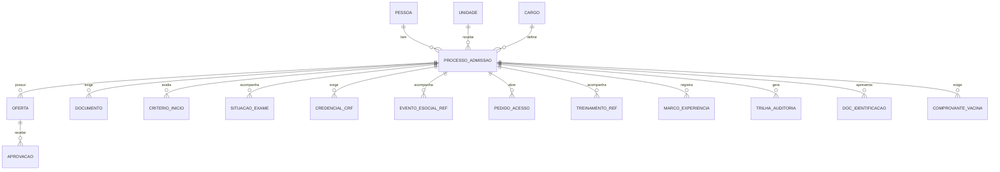

# Dados

## Modelo conceitual

## Dicionário das entidades principais [hipótese de desenho]

| Entidade | Campo | Tipo | Chave ou regra |
|---|---|---|---|
| PESSOA | id | UUID | PK |
| | cpf | char(11) | único, normalizado, dígito válido |
| | nome | texto | identificação |
| | nascimento | data | aprendiz: faixa de RN-008 |
| | contato | texto | só o necessário a cada etapa |
| UNIDADE | codigo_filial | inteiro | PK; `cod_filial` da folha |
| | regional, uf | texto, char(2) | UF define o piso |
| | proprio | booleano | franqueada recusada na primeira fase |
| CARGO | cargo_cod | texto | PK; código da folha |
| | exige_crf | booleano | inclui FARM_RT |
| PROCESSO_ADMISSAO | id | UUID | PK |
| | pessoa_id, unidade, cargo | FK | |
| | modalidade | enum | CLT; aprendiz depois; estágio em Q-016 |
| | data_inicio, estado | data, enum | mudança gera reavaliação (RF-015) |
| OFERTA | valor, piso_referencia, vigencia_piso | decimal, decimal, data | RN-009 |
| | status | enum | PENDENTE, ACEITA, RECUSADA, CANCELADA |
| APROVACAO | papel, autor, data, decisão | enum, texto, data, enum | BP e regional; gerente só indica |
| DOCUMENTO | tipo, estado, motivo_devolucao | enum | lista em Q-036; motivo obrigatório na devolução |
| SITUACAO_EXAME | data_pedido, data_agendada, data_emissao, valido_ate_inicio | datas, booleano | sem CID nem observação; resultado exposto em Q-040 |
| CREDENCIAL_CRF | numero, certidao_ref, conferido_por, data | texto, ref, texto, data | validade em Q-029 |
| EVENTO_ESOCIAL_REF | evento, prazo, envio, recibo | texto, data, data, texto | espelho da folha |
| MARCO_EXPERIENCIA | dia, decisao, autor, data | inteiro, enum, texto, data | 30 e 90 dias; depende de CR-001 |
| VAGA | aplica_injetaveis | booleano | Novo; ativa RN-019 em SP |
| COMPROVANTE_VACINA | tipo, conferido_por, data | enum, texto, data | Só no ambiente do SESMT [hipótese, Q-051]; validade em Q-052 |
| DOC_IDENTIFICACAO | tipo, numero, validade, conferido_por | enum, texto, data, texto | Inclui CRNM; validade obrigatória nesse caso |
| PROCESSO_ADMISSAO | programa | enum | Acolher; visibilidade em Q-054 |
| TRILHA_AUDITORIA | objeto, ação, autor, data, antes, depois | | imutável; sem dado clínico |

## De-para dos legados

| Origem | Campo | Destino | Transformação | Conflito ou cuidado |
|---|---|---|---|---|
| Recruta+ `candidato` | cpf | PESSOA.cpf | Remover máscara | Divergência já vista com a folha |
| FolhaCerta `colaborador` | cpf | PESSOA.cpf | Direto | Prevalece documento conferido, não a folha, em divergência [hipótese] |
| Planilha | cpf | PESSOA.cpf | Normalizar | Formato livre |
| Recruta+ `candidato` | nome, email, telefone, nascimento | PESSOA | Direto | Minimização |
| Recruta+ `candidato` | gestante, antecedentes_ok, antecedentes_obs | **Não migrar** | Descartar | RN-012 |
| Recruta+ `candidato` | pcd, pcd_cid | pcd: área restrita de cota; pcd_cid: **não migrar** | Descartar CID | RN-014, RN-007 |
| Recruta+ `candidato_bkp_2022` | todos | **Não migrar** | Eliminar conforme Q-043 | RN-006 |
| Recruta+ `oferta` | salario, status, aprovador_perfil, dt_aprovacao | OFERTA e APROVACAO | Histórico sem BP | Oferta antiga não tinha BP |
| Recruta+ `tabela_salarial` | valor | **Não usar** | Substituir por `cargo_piso` | RN-009 |
| FolhaCerta `cargo_piso` | piso, vigencia, origem | Consulta | Leitura | Sem aprendiz |
| FolhaCerta `contrato` | status, data_admissao, tipo_contrato | PROCESSO e indicador | Leitura | Tipo não inclui aprendiz |
| FolhaCerta `contrato` | dias_experiencia, fim_experiencia | MARCO_EXPERIENCIA | Novos: 30/90; em curso: Q-027 | Default 45 |
| FolhaCerta `contrato` | crf_numero | CREDENCIAL_CRF | Direto | Ausente em caso de RT |
| FolhaCerta `exame_admissional` | dt_emissao, resultado | SITUACAO_EXAME | Conforme Q-040 | Fica sujeito à decisão |
| FolhaCerta `exame_admissional` | cid_restricao | **Fora; só SESMT** | Remover da folha | RN-007 |
| FolhaCerta `exame_admissional` | observacao_clinica | **Não migrar** até Q-040 | — | Não definido |
| FolhaCerta `evento_esocial` | evento, dt_limite, dt_envio, recibo | EVENTO_ESOCIAL_REF | Leitura | Amostra incompleta? Q-009 |
| Planilha | loja, regional | UNIDADE | Extrair código de "147 - Savassi" | De-para: `LJ-0147`, `147`, `MG-SAV` |
| Planilha | cargo | CARGO | De-para de texto | "Balconista", `BALC`, `BALCONISTA` |
| Planilha | dt_* e situacao | PROCESSO | Converter data | Só casos em andamento |
| Planilha | resultado_aso | **Não migrar** | Descartar | Q-040 |
| Recruta+ `vaga` | sem campo de injetáveis | VAGA.aplica_injetaveis | Novo; preenchimento em Q-052 | Não há origem |
| FolhaCerta `colaborador` e Recruta+ `candidato` | cpf (obrigatório); sem campo de CRNM | DOC_IDENTIFICACAO | CRNM fica no novo sistema; envio em Q-053 | Pessoa sem CPF não entra nos legados |
| Planilha | obs | **Não migrar** | Revisão manual, sem carga | Contém dados de saúde |
| EducaFarma | email, trilha, datas, status | TREINAMENTO_REF | Casar por e-mail conferido | Sem CPF; homônimos |
| EducaFarma trilhas | prazo_dias_apos_inicio | Consulta | Integração = 5 dias | LMS tem 30 |

## Migração e riscos

**Estratégia [hipótese]:** carregar só admissões em andamento nas lojas de cada onda; histórico concluído fica na origem; carga de teste com dados anonimizados; a planilha é aposentada por onda (RF-018).

**Riscos:** CPF divergente, homônimos sem chave no LMS, casos em curso fora da regra (RIS-015), convivência longa (RIS-017), migração de campos vedados e pico de novembro e dezembro.

## Dados pessoais (LGPD)

Finalidade e base legal são **hipóteses para Paula validar**; só o que tem fonte citada está decidido. O inventário por sistema está em `01-diagnostico.md` §7.

| Dado | Finalidade | Base legal [hipótese] | Retenção | Acesso |
|---|---|---|---|---|
| Identificação e contato | Executar a admissão | Procedimentos preliminares de contrato | Não contratado: 6 meses (RN-006). Contratado: a definir, Q-049 | Papéis do processo |
| Documentos | Admissão | Obrigação legal e contrato | A definir, Q-049 | DP, loja no limite necessário |
| ASO: situação | Critério de início | Obrigação legal | A definir | Q-040 |
| CID, restrição, observação clínica | Saúde ocupacional | Tutela da saúde, a validar | A definir | CID só SESMT (RN-007); demais Q-040 |
| Dado PCD | Cota | Obrigação legal, a validar | A definir | Restrito (RN-014) |
| Gravidez, antecedentes | Nenhuma na seleção | Não se aplica | Não guardar (RN-012) | Ninguém |
| Dados de menor de 18 anos | Aprendizagem | A validar, Q-039 | A definir | Restrito |
| Comprovante de vacinação | Exigência da Portaria CVS-SP 88/2026 | Obrigação legal e saúde, a validar | A definir, Q-051 | SESMT [hipótese] |
| CRNM e condição de refugiado ou migrante | Identificação; programa Acolher | Contrato e obrigação legal, a validar | A definir, Q-049 | Q-054 |
| CRF | Regularidade | Obrigação regulatória, a validar | A definir | DP, Regulatório |
