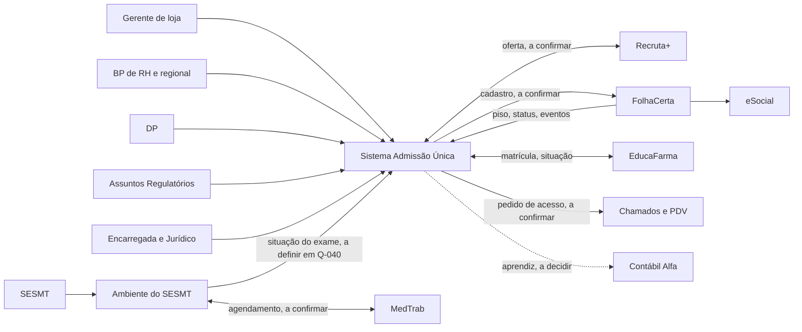
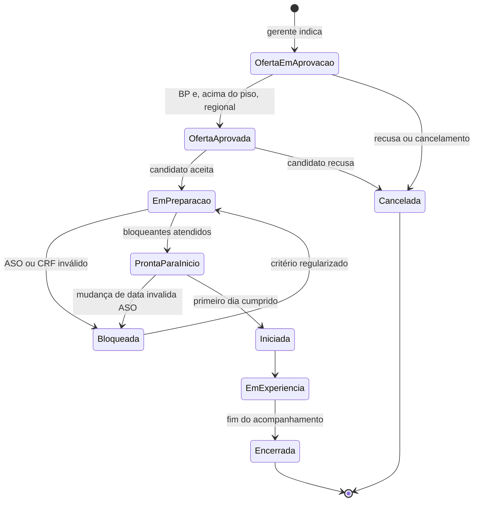
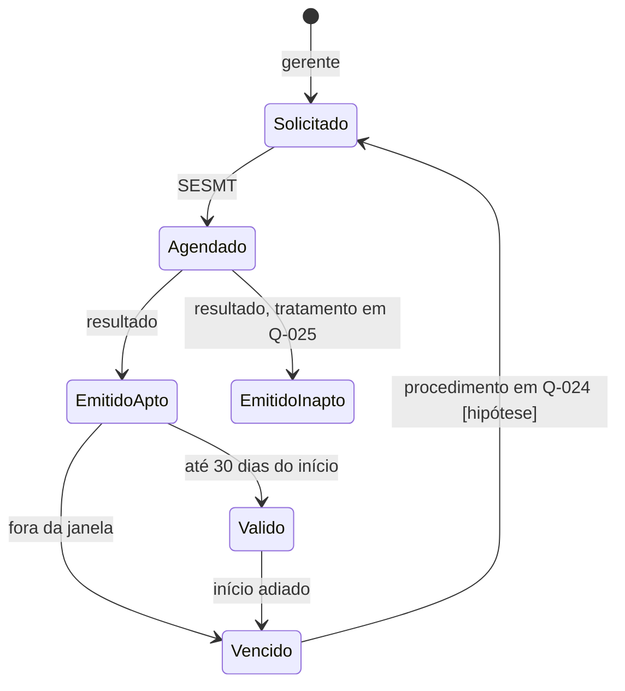
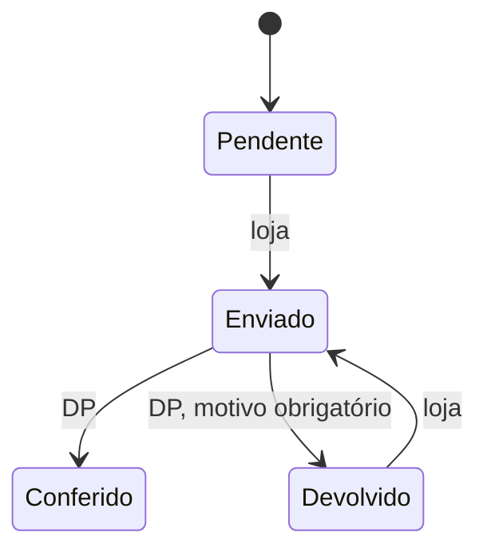
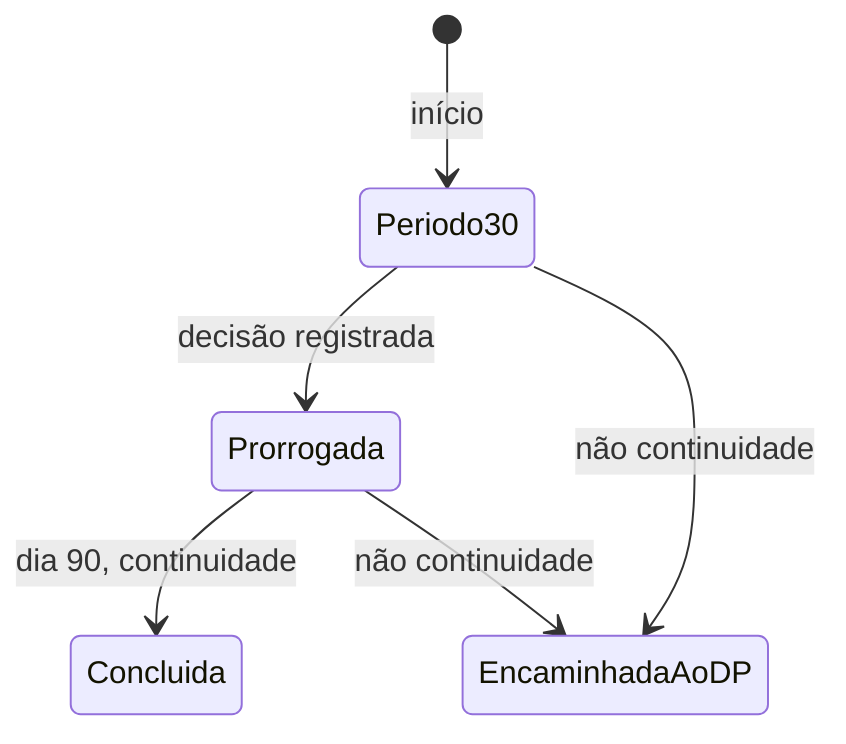
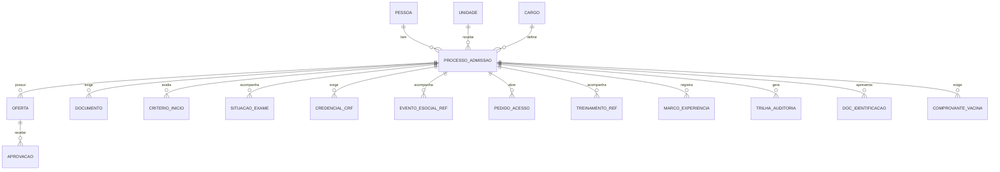

# Documentação técnica

Projeto Admissão Única, Drogarias Caliandra S.A. Data: 04/11/2026. Baseline: sem baseline. Situação: não validado pelas áreas. Atualizado com `mudancas/` (ver `08-mudancas.md`).

Fontes: `escopo.md`; `fontes/geral/` (política RH-012 rev. 4, manual 3.2, comunicado DP 07/2024, fluxo atual, ata de 22/09/2026); SIS-01 FolhaCerta (dump); SIS-02 Recruta+ (dump); SIS-03 planilha e Leia-me; SIS-04 EducaFarma (exportações); `entrega/respostas.md`; `mudancas/` (ata de 28/10/2026 e e-mail de 30/10/2026).

Convenção: itens sem marca estão confirmados por resposta ou evidência; `[hipótese]` é proposta deste levantamento; `[conflito]` aguarda decisão. IDs seguem `.re/modelo/`.

Este documento não decide tecnologia nem entre comprar ou construir (Q-019).

## 1. Introdução

**Propósito.** Especificar o sistema único de admissão e onboarding, base ISO/IEC/IEEE 29148, para validação pelas áreas e para avaliar fornecedores ou construção.

**Escopo.** Ver `02-negocio.md` §4. A primeira fase cobre 184 lojas próprias e CLT de balconista, caixa e farmacêutico (RN-016).

**Definições.** Ver `02-negocio.md` §10.

## 2. Visão geral

**Atores:** gerente de loja, gerente regional, BP de RH, Recrutamento, analista do DP, analista do SESMT, Regulatório, Encarregada de Dados, Jurídico, Coordenação de Operações, TI.

**Restrições:** FolhaCerta segue como folha e origem dos eventos do eSocial; piso vem da FolhaCerta; CID só no ambiente do SESMT.

**Limite importante.** Não se sabe se a FolhaCerta e o Recruta+ aceitam integração (Q-014). Caso não aceitem, RF-002 fica parcial, e isso precisa ser decidido antes de contratar.

## 3. Requisitos funcionais

### Oferta

| ID | Requisito | Prior. | Critérios de aceite |
|---|---|---|---|
| RF-011 | O sistema deve abrir um processo de admissão para cada oferta de candidato aprovado e acompanhá-lo até o fim da experiência. | Must | Dado candidato aprovado, quando a oferta é criada, então nasce um único processo vinculado ao CPF. / Dada segunda oferta para o mesmo candidato e vaga, quando a anterior foi cancelada, então o histórico é mantido sem duplicar o processo. |
| RF-012 | O sistema deve registrar autor, papel, data e valor de cada aprovação de oferta conforme RN-005. | Must | Dada aprovação pelo BP de RH, quando registrada, então autor, data e valor ficam na trilha. / Dado gerente de loja, quando tenta aprovar, então o sistema só permite indicar o candidato. |
| RF-013 | O sistema deve conferir o valor da oferta contra o piso vigente da FolhaCerta antes de ela ser apresentada ao candidato. | Must | Dado piso atualizado na FolhaCerta, quando a oferta é registrada, então o enquadramento usa esse valor. / Dado piso indisponível para cargo e UF, quando a oferta é registrada, então fica retida para o BP de RH. |

### Documentos

| ID | Requisito | Prior. | Critérios de aceite |
|---|---|---|---|
| RF-003 | O sistema deve registrar os documentos exigidos por modalidade, cargo e situação específica, sinalizar faltantes e registrar a conferência ou devolução pelo DP. | Must | Dado checklist com um item faltante, quando a loja envia a pasta, então o sistema aponta o item antes da conferência. / Dado documento ilegível, quando o DP devolve, então o motivo é registrado e a devolução entra no indicador. |
| RF-027 | O sistema deve aceitar a CRNM como documento de identificação no checklist e registrar número e validade. | Must | Dada admissão do programa Acolher, quando o checklist é gerado, então a CRNM aparece como documento de identificação. / Dada CRNM sem data de validade, quando o DP tenta concluir a conferência, então o sistema exige a data. |
| RF-028 | O sistema deve controlar a validade da CRNM e alertar DP e gerente antes do vencimento, com regra de bloqueio e antecedência definidas em Q-053. | Must | Dada CRNM vigente, quando o painel é consultado, então mostra a data de validade e a situação em dia. / Dada CRNM vencida antes do início, quando o painel é consultado, então aparece como pendência; bloquear ou alertar depende de Q-053. |
| RF-029 | O sistema deve tratar a identificação da pessoa com CRNM e o envio à FolhaCerta e ao Recruta+, cujos cadastros exigem CPF e não têm campo de CRNM, conforme a decisão de Q-053. [hipótese] | Must | Dada pessoa com CRNM e CPF, quando enviada à folha, então o CPF permanece como chave e a CRNM fica no novo sistema. / Dada pessoa com CRNM sem CPF, quando se tenta enviar à folha, então o caso fica retido para o DP. |

### Exame

| ID | Requisito | Prior. | Critérios de aceite |
|---|---|---|---|
| RF-005 | O sistema deve acompanhar pedido, agendamento e situação do exame admissional, sem expor dado clínico fora do SESMT. | Must | Dado pedido de exame, quando o SESMT agenda, então gerente e DP veem data e situação. / Dado exame com restrição, quando o gerente consulta, então não vê CID nem observação clínica. |
| RF-019 | O sistema deve agendar o exame pela API da MedTrab, sujeito à verificação do contrato e da API. [hipótese] | Should | Dado pedido de exame, quando há vaga na agenda, então o agendamento retorna data e local. / Dada falha da API, quando a tentativa se esgota, então o pedido vai para a fila manual do SESMT. |

### Contrato e eSocial

| ID | Requisito | Prior. | Critérios de aceite |
|---|---|---|---|
| RF-002 | O sistema deve levar à FolhaCerta os dados já coletados sem nova digitação, usando CPF normalizado de 11 dígitos como chave. | Must | Dado candidato com oferta aceita, quando o DP envia o cadastro, então nenhum campo já coletado é digitado de novo. / Dado CPF com dígito verificador inválido ou diferente entre fontes, quando há envio, então ele é retido para correção. |
| RF-004 | O sistema deve mostrar a situação de geração e assinatura do contrato de cada admissão. | Must | Dado contrato assinado, quando o DP registra ou o sistema recebe a informação, então a situação muda com data e responsável. / Dado contrato não assinado, quando o funil é calculado, então a admissão não conta como concluída. |
| RF-006 | O sistema deve mostrar situação, prazo e recibo dos eventos de admissão gerados pela FolhaCerta. | Must | Dado S-2190 com recibo, quando o painel é consultado, então aparece enviado, com a data. / Dado S-2190 sem envio na véspera do início, quando chega a data limite, então o DP recebe alerta. |

### Prontidão e início

| ID | Requisito | Prior. | Critérios de aceite |
|---|---|---|---|
| RF-001 | O sistema deve mostrar ao gerente de loja, em um só lugar, se o novo colaborador pode começar e quais critérios estão pendentes. | Must | Dada uma admissão com ASO válido e demais bloqueantes atendidos, quando o gerente abre o painel, então vê Pode começar e a data. / Dado ASO vencido, quando o gerente abre o painel, então vê Não pode começar, com a pendência e sem dado clínico. / Dado critério condicional aplicável, como comprovante de vacinação ou CRNM, quando o gerente abre o painel, então vê só a situação do critério, sem dado de saúde. |
| RF-015 | O sistema deve reavaliar os critérios sempre que a data de início mudar e bloquear o início se o ASO deixar de estar válido. | Must | Dado ASO emitido em 18/02/2027 e início adiado de 20/03 para 21/03/2027, quando a data muda, então o critério fica vencido. / Dado adiamento com ASO ainda válido, quando a data muda, então o critério segue atendido e os prazos são recalculados. |
| RF-016 | O sistema deve registrar certidão, número e conferência do CRF para toda função farmacêutica, inclusive RT. | Must | Dado cargo FARM_RT, quando a certidão é conferida, então o critério CRF fica atendido. / Dado cargo FARM_RT sem número de CRF, quando o DP tenta enviar à folha, então o envio é bloqueado. |
| RF-026 | O sistema deve identificar na vaga quem vai aplicar injetáveis e, conforme UF e vigência, incluir o comprovante de vacinação entre os critérios de início. | Must | Dada vaga marcada para aplicar injetáveis em SP, quando o processo é aberto, então o critério aparece. / Dada vaga sem essa marca, quando o processo é aberto, então o critério não aparece. |
| RF-007 | O sistema deve acompanhar o pedido de acesso individual ao PDV a partir da liberação, com meta de estar ativo no primeiro dia. [hipótese] | Must | Dado início marcado, quando a admissão é liberada, então o pedido de acesso é aberto e acompanhado no painel. / Dado acesso não ativo na véspera, quando o gerente consulta, então vê alerta e o responsável pelo chamado. |

### Treinamentos e experiência

| ID | Requisito | Prior. | Critérios de aceite |
|---|---|---|---|
| RF-008 | O sistema deve mostrar por colaborador os treinamentos obrigatórios do cargo, com prazo e situação. | Must | Dado balconista iniciado, quando o gerente consulta, então vê integração com prazo do 5º dia e os demais cursos da trilha. / Dado curso vencido, quando o painel é atualizado, então o caso fica destacado como vencido. |
| RF-014 | O sistema deve matricular o colaborador nas trilhas obrigatórias do cargo pela API do EducaFarma, até o dia do início. [hipótese] | Should | Dado início confirmado de balconista, quando a admissão é liberada, então as três trilhas ficam matriculadas até a data de início. / Dada falha da API, quando as tentativas se esgotam, então há alerta e opção de matrícula manual. |
| RF-022 | O sistema deve indicar ao gerente que o colaborador não pode atender sozinho no balcão até concluir a integração. | Must | Dada integração não concluída, quando o gerente consulta o colaborador, então vê a restrição. / Dada integração concluída, quando o painel é atualizado, então a restrição é retirada com a data. |
| RF-009 | O sistema deve registrar os marcos de 30 e 90 dias e a decisão de prorrogar ou encerrar, com alerta prévio ao gerente e ao DP. [hipótese] | Must | Dado colaborador no 20º dia de experiência, com antecedência de 10 dias [hipótese], quando o alerta roda, então gerente e DP são avisados. / Dado marco de 30 dias sem decisão registrada, quando chega a data, então o caso fica vencido para o responsável. |

### Aprendiz

| ID | Requisito | Prior. | Critérios de aceite |
|---|---|---|---|
| RF-021 | O sistema deve acompanhar aprendiz no fluxo único, com critérios próprios de modalidade, sem a regra de 18 anos da FolhaCerta. | Should | Dado aprendiz de 16 anos, quando a admissão avança, então as etapas ficam visíveis no mesmo painel. / Dado destino do cadastro ainda indefinido, quando o sistema chega nesse passo, então a etapa fica como pendente de decisão de Q-038. |

### Plataforma e transição

| ID | Requisito | Prior. | Critérios de aceite |
|---|---|---|---|
| RF-010 | O sistema deve apresentar por período aceites, admissões concluídas e inícios, com admissão concluída como número oficial. | Must | Dado um mês fechado, quando o funil é gerado, então as três etapas aparecem separadas, com destaque para admissões concluídas. / Dado aprendiz fora da primeira fase, quando o funil é gerado, então o recorte aparece indicado. |
| RF-017 | O sistema deve executar a eliminação dos dados de não contratados no prazo de RN-006 e guardar comprovação sem dados pessoais. | Must | Dado candidato não contratado no 6º mês, quando a rotina diária roda, então os dados são eliminados e a contagem registrada. / Dada falha na eliminação, quando a rotina termina, então a Encarregada recebe alerta. |
| RF-018 | O sistema deve carregar as admissões em andamento e conviver com planilha, Recruta+, FolhaCerta e EducaFarma durante a transição, sem migrar dados vedados. [hipótese] | Must | Dada admissão em andamento na planilha, quando a carga inicial roda, então ela aparece sem a coluna de observações e sem CPF inválido. / Dado campo de gravidez, antecedentes ou CID na origem, quando a carga roda, então o campo não é levado. |
| RF-020 | O sistema deve manter fila de falha e reprocessamento por integração, sem perda de mensagem. [hipótese] | Must | Dada indisponibilidade da FolhaCerta, quando há envio, então a mensagem fica na fila e é reprocessada. / Dada falha definitiva, quando as tentativas se esgotam, então o responsável vê erro e o caso aparece no painel. |
| RF-023 | O projeto deve capacitar gerentes das 184 lojas, DP, SESMT e BPs antes da ativação de cada onda. [hipótese] | Should | Dada uma onda planejada, quando entra em operação, então os usuários previstos concluíram a capacitação. / Dado gerente sem capacitação, quando a loja entra na onda, então a pendência aparece ao coordenador. |
| RF-024 | O projeto deve alinhar à RH-012 o manual, a planilha, a FolhaCerta, o Recruta+ e o EducaFarma, ou desativar a regra divergente. [hipótese] | Must | Dada a janela de ASO de 90 dias na FolhaCerta, quando o ajuste é feito, então a regra efetiva é de 30 dias. / Dado ajuste inviável num legado, quando a viabilidade for avaliada, então o controle fica no novo sistema e a exceção é registrada. |
| RF-025 | O sistema deve medir redigitação, devoluções e motivo, oferta até início e acesso no primeiro dia, para definir a linha de base e as metas. [hipótese] | Should | Dado um mês de operação, quando o relatório é gerado, então mostra os quatro indicadores por regional. / Dada a ausência de meta aprovada, quando o relatório é gerado, então mostra só a medida, sem semáforo. |

## 4. Ciclo de vida das entidades

### Admissão

"Admissão concluída" não é um estado: é um indicador calculado a partir de contrato assinado, ASO apto validado e ATIVO (RN-015), e pode ocorrer antes ou depois do primeiro dia, pois a ordem real depende de Q-009.

### ASO

### Documento

### Experiência

O autor da decisão e a antecedência estão em Q-028. Desligamento está fora do escopo, por isso o ciclo termina no encaminhamento ao DP.

## 5. Requisitos não funcionais

### Segurança

| ID | Requisito e métrica | Prior. | Verificação |
|---|---|---|---|
| RNF-001 | O sistema deve manter 100% dos dados e documentos de admissão em ambiente autenticado, sem link aberto nem anexo de e-mail. [hipótese] | Must | Dado acesso sem login, quando se tenta abrir um documento, então é negado. / Dada a ativação da onda, quando verificada, então 0 documentos da onda circulam por e-mail. |
| RNF-002 | O sistema deve aplicar permissões de acesso por papel, unidade e categoria de dado, com 0 acesso de gerente a dado sensível. | Must | Dado gerente de uma loja, quando busca admissão de outra loja, então é negado. / Dado usuário fora do SESMT, quando tenta acessar CID, então é negado e registrado. |
| RNF-003 | O processo deve garantir que 0 colaborador novo opere o PDV com credencial de outra pessoa. [hipótese] | Must | Dado colaborador iniciado sem login, quando está nesse estado, então o gerente é alertado e o caso aparece no indicador. / Dado acesso ativo, quando verificado, então a credencial é individual. |
| RNF-004 | O sistema deve registrar em trilha de auditoria 100% das aprovações, validações, mudanças de data e acessos a dado sensível, com autor, data, antes e depois. [hipótese] | Must | Dada mudança na data de início, quando salva, então a trilha guarda autor, data e valores. / Dado usuário comum, quando tenta alterar a trilha, então é negado. |
| RNF-010 | O sistema deve verificar diariamente a retenção de dados de candidatos e reportar 100% das pendências, incluindo cópias e backups. | Must | Dado candidato vencido, quando a verificação roda, então é apontado no mesmo dia. / Dado backup com dados vencidos, quando a verificação roda, então a pendência é registrada. |
| RNF-011 | O sistema deve criptografar 100% dos dados pessoais em trânsito (TLS 1.2 ou superior) e em repouso [hipótese]. [hipótese] | Must | Dada conexão sem TLS, quando tentada, então é recusada. / Dado documento armazenado, quando inspecionado, então está criptografado. |

### Desempenho

| ID | Requisito e métrica | Prior. | Verificação |
|---|---|---|---|
| RNF-005 | O sistema deve operar com 320 admissões por mês em novembro e dezembro e responder ao painel em até 3 s no percentil 95 [hipótese de tempo]. | Must | Dada carga equivalente a 320 admissões por mês, quando o teste roda, então o painel fica em até 3 s no p95. / Dado o pico simulado, quando o teste termina, então não há perda de registro. |

### Confiabilidade

| ID | Requisito e métrica | Prior. | Verificação |
|---|---|---|---|
| RNF-006 | O sistema deve ter disponibilidade de 99,5% ao mês [hipótese]. [hipótese] | Should | Dado um mês de operação, quando medido, então a disponibilidade é de pelo menos 99,5%. / Dada queda do sistema, quando ocorre, então há alerta em até 5 min [hipótese]. |
| RNF-007 | O sistema deve alertar o responsável em até 15 min [hipótese] após falha de integração e reprocessar com 0 perda. [hipótese] | Must | Dada falha de integração, quando ocorre, então o alerta sai em até 15 min. / Dada integração restabelecida, quando a fila é processada, então 100% das mensagens são entregues. |

### Usabilidade

| ID | Requisito e métrica | Prior. | Verificação |
|---|---|---|---|
| RNF-008 | O gerente deve identificar em no máximo 1 tela e 30 s [hipótese] se o colaborador pode começar. [hipótese] | Should | Dado gerente em teste, quando procura a situação, então encontra em até 30 s. / Dado critério pendente, quando exibido, então o motivo aparece em linguagem de negócio. |

### Manutenibilidade

| ID | Requisito e métrica | Prior. | Verificação |
|---|---|---|---|
| RNF-009 | O sistema deve permitir alterar prazos e regras por parâmetro com vigência, em até 1 dia útil [hipótese], sem nova versão de software. [hipótese] | Should | Dada revisão da RH-012 aprovada, quando o parâmetro é alterado, então vale a partir da vigência. / Dada admissão anterior à vigência, quando é consultada, então mantém a regra da data aplicável. |

## 6. Interfaces externas

Ver "Integrações" adiante.

## 7. Regras com cálculo e exemplo

| Regra | Cálculo | Exemplo | Limite |
|---|---|---|---|
| RN-001 ASO | início − 30 dias corridos ≤ emissão ≤ véspera ou data do início | Início 20/03/2027: de 18/02/2027 em diante | 17/02/2027 é inválido |
| RN-002 Experiência [conflito, CR-001] | Início + 30 e + 90, seguindo a conta atual da FolhaCerta (`data_admissao + dias`) | Início 01/03/2027: 31/03/2027 e 30/05/2027 | Convenção de contagem a confirmar em Q-028 |
| RN-004 Integração | Início + 5 dias corridos | Início 15/03/2027: até 20/03/2027 | 21/03/2027 está vencido |
| RN-005 e RN-009 Oferta | Valor < piso: recusa; = piso: BP; > piso: BP e regional | Balconista SP, piso R$ 1.820,00 | R$ 1.820,01 exige regional |
| RN-006 Retenção | Encerramento + 6 meses | 10/01/2027: até 10/07/2027 | Inclui cópias e backups |
| RN-008 Aprendiz | 14 ≤ idade ≤ 24 na admissão [hipótese sobre a data de referência] | 16 anos aceito | 13 e 25 fora da faixa |
| RN-010 Documentos | Início − 5 dias úteis | Início 15/03/2027: até 08/03/2027, sem feriados | Calendário de feriados a definir |
| RN-019 Vacinação | UF = SP, vaga de injetáveis e início ≥ 01/02/2027 | Início 01/02/2027 em SP: exige | 31/01/2027 ou MG: não se aplica |
| RF-028 CRNM | Validade ≥ data de referência; alerta com antecedência em Q-053 | Validade 10/03/2027, início 01/03/2027: em dia | Validade 28/02/2027: pendência |
| RN-017 eSocial | S-2190: início − 1 dia; S-2200: dia 15 do mês seguinte | Início 15/03/2027: 14/03 e 15/04/2027 | Evento em adiamento: Q-009 |

## 8. Decisões candidatas a ADR

| Tema | Contexto | Opção proposta [hipótese] | Consequência |
|---|---|---|---|
| Comprar ou construir | Sem critérios (Q-019) | Avaliar produtos contra este documento | Requer orçamento e prazo |
| Fonte da verdade | Cinco cadastros sem chave | CPF normalizado; FolhaCerta para contrato e piso; novo sistema para o processo | Exige de-para |
| Dados de saúde | CID só no SESMT | Ambiente segregado que expõe só a situação do critério | Depende de Q-040 |
| Regras | RH-012 muda por revisão | Parâmetros com vigência (RNF-009) | Regra antiga segue válida para casos antigos |
| Divergências nos legados | Trigger de ASO de 90 dias e 45 dias | Corrigir a origem; se inviável, novo sistema controla e registra exceção (RF-024) | Sem correção, a folha ainda aceita valores fora da regra |
| Critérios condicionais | Vacinação e CRNM surgiram depois | Motor de critérios por UF, cargo, vaga, programa e vigência | Evita mudança de software a cada norma |
| Chave da pessoa | CPF é chave nos legados; CRNM não tem campo | CPF como chave, se confirmado (Q-053); identificador interno no novo sistema | Depende da FolhaCerta |
| Integração | Falha sem tratamento hoje | Fila com reprocessamento (RF-020) | Requer API ou arquivo, Q-014 |

## 9. Pendências técnicas

Q-009, Q-014, Q-024 a Q-026, Q-029, Q-031, Q-036, Q-038, Q-040, Q-043 e Q-050 a Q-055 afetam desenho. A lista completa está em `02-negocio.md` §11.

---

# Dados

## Modelo conceitual

## Dicionário das entidades principais [hipótese de desenho]

| Entidade | Campo | Tipo | Chave ou regra |
|---|---|---|---|
| PESSOA | id | UUID | PK |
| | cpf | char(11) | único, normalizado, dígito válido |
| | nome | texto | identificação |
| | nascimento | data | aprendiz: faixa de RN-008 |
| | contato | texto | só o necessário a cada etapa |
| UNIDADE | codigo_filial | inteiro | PK; `cod_filial` da folha |
| | regional, uf | texto, char(2) | UF define o piso |
| | proprio | booleano | franqueada recusada na primeira fase |
| CARGO | cargo_cod | texto | PK; código da folha |
| | exige_crf | booleano | inclui FARM_RT |
| PROCESSO_ADMISSAO | id | UUID | PK |
| | pessoa_id, unidade, cargo | FK | |
| | modalidade | enum | CLT; aprendiz depois; estágio em Q-016 |
| | data_inicio, estado | data, enum | mudança gera reavaliação (RF-015) |
| OFERTA | valor, piso_referencia, vigencia_piso | decimal, decimal, data | RN-009 |
| | status | enum | PENDENTE, ACEITA, RECUSADA, CANCELADA |
| APROVACAO | papel, autor, data, decisão | enum, texto, data, enum | BP e regional; gerente só indica |
| DOCUMENTO | tipo, estado, motivo_devolucao | enum | lista em Q-036; motivo obrigatório na devolução |
| SITUACAO_EXAME | data_pedido, data_agendada, data_emissao, valido_ate_inicio | datas, booleano | sem CID nem observação; resultado exposto em Q-040 |
| CREDENCIAL_CRF | numero, certidao_ref, conferido_por, data | texto, ref, texto, data | validade em Q-029 |
| EVENTO_ESOCIAL_REF | evento, prazo, envio, recibo | texto, data, data, texto | espelho da folha |
| MARCO_EXPERIENCIA | dia, decisao, autor, data | inteiro, enum, texto, data | 30 e 90 dias; depende de CR-001 |
| VAGA | aplica_injetaveis | booleano | Novo; ativa RN-019 em SP |
| COMPROVANTE_VACINA | tipo, conferido_por, data | enum, texto, data | Só no ambiente do SESMT [hipótese, Q-051]; validade em Q-052 |
| DOC_IDENTIFICACAO | tipo, numero, validade, conferido_por | enum, texto, data, texto | Inclui CRNM; validade obrigatória nesse caso |
| PROCESSO_ADMISSAO | programa | enum | Acolher; visibilidade em Q-054 |
| TRILHA_AUDITORIA | objeto, ação, autor, data, antes, depois | | imutável; sem dado clínico |

## De-para dos legados

| Origem | Campo | Destino | Transformação | Conflito ou cuidado |
|---|---|---|---|---|
| Recruta+ `candidato` | cpf | PESSOA.cpf | Remover máscara | Divergência já vista com a folha |
| FolhaCerta `colaborador` | cpf | PESSOA.cpf | Direto | Prevalece documento conferido, não a folha, em divergência [hipótese] |
| Planilha | cpf | PESSOA.cpf | Normalizar | Formato livre |
| Recruta+ `candidato` | nome, email, telefone, nascimento | PESSOA | Direto | Minimização |
| Recruta+ `candidato` | gestante, antecedentes_ok, antecedentes_obs | **Não migrar** | Descartar | RN-012 |
| Recruta+ `candidato` | pcd, pcd_cid | pcd: área restrita de cota; pcd_cid: **não migrar** | Descartar CID | RN-014, RN-007 |
| Recruta+ `candidato_bkp_2022` | todos | **Não migrar** | Eliminar conforme Q-043 | RN-006 |
| Recruta+ `oferta` | salario, status, aprovador_perfil, dt_aprovacao | OFERTA e APROVACAO | Histórico sem BP | Oferta antiga não tinha BP |
| Recruta+ `tabela_salarial` | valor | **Não usar** | Substituir por `cargo_piso` | RN-009 |
| FolhaCerta `cargo_piso` | piso, vigencia, origem | Consulta | Leitura | Sem aprendiz |
| FolhaCerta `contrato` | status, data_admissao, tipo_contrato | PROCESSO e indicador | Leitura | Tipo não inclui aprendiz |
| FolhaCerta `contrato` | dias_experiencia, fim_experiencia | MARCO_EXPERIENCIA | Novos: 30/90; em curso: Q-027 | Default 45 |
| FolhaCerta `contrato` | crf_numero | CREDENCIAL_CRF | Direto | Ausente em caso de RT |
| FolhaCerta `exame_admissional` | dt_emissao, resultado | SITUACAO_EXAME | Conforme Q-040 | Fica sujeito à decisão |
| FolhaCerta `exame_admissional` | cid_restricao | **Fora; só SESMT** | Remover da folha | RN-007 |
| FolhaCerta `exame_admissional` | observacao_clinica | **Não migrar** até Q-040 | — | Não definido |
| FolhaCerta `evento_esocial` | evento, dt_limite, dt_envio, recibo | EVENTO_ESOCIAL_REF | Leitura | Amostra incompleta? Q-009 |
| Planilha | loja, regional | UNIDADE | Extrair código de "147 - Savassi" | De-para: `LJ-0147`, `147`, `MG-SAV` |
| Planilha | cargo | CARGO | De-para de texto | "Balconista", `BALC`, `BALCONISTA` |
| Planilha | dt_* e situacao | PROCESSO | Converter data | Só casos em andamento |
| Planilha | resultado_aso | **Não migrar** | Descartar | Q-040 |
| Recruta+ `vaga` | sem campo de injetáveis | VAGA.aplica_injetaveis | Novo; preenchimento em Q-052 | Não há origem |
| FolhaCerta `colaborador` e Recruta+ `candidato` | cpf (obrigatório); sem campo de CRNM | DOC_IDENTIFICACAO | CRNM fica no novo sistema; envio em Q-053 | Pessoa sem CPF não entra nos legados |
| Planilha | obs | **Não migrar** | Revisão manual, sem carga | Contém dados de saúde |
| EducaFarma | email, trilha, datas, status | TREINAMENTO_REF | Casar por e-mail conferido | Sem CPF; homônimos |
| EducaFarma trilhas | prazo_dias_apos_inicio | Consulta | Integração = 5 dias | LMS tem 30 |

## Migração e riscos

**Estratégia [hipótese]:** carregar só admissões em andamento nas lojas de cada onda; histórico concluído fica na origem; carga de teste com dados anonimizados; a planilha é aposentada por onda (RF-018).

**Riscos:** CPF divergente, homônimos sem chave no LMS, casos em curso fora da regra (RIS-015), convivência longa (RIS-017), migração de campos vedados e pico de novembro e dezembro.

## Dados pessoais (LGPD)

Finalidade e base legal são **hipóteses para Paula validar**; só o que tem fonte citada está decidido. O inventário por sistema está em `01-diagnostico.md` §7.

| Dado | Finalidade | Base legal [hipótese] | Retenção | Acesso |
|---|---|---|---|---|
| Identificação e contato | Executar a admissão | Procedimentos preliminares de contrato | Não contratado: 6 meses (RN-006). Contratado: a definir, Q-049 | Papéis do processo |
| Documentos | Admissão | Obrigação legal e contrato | A definir, Q-049 | DP, loja no limite necessário |
| ASO: situação | Critério de início | Obrigação legal | A definir | Q-040 |
| CID, restrição, observação clínica | Saúde ocupacional | Tutela da saúde, a validar | A definir | CID só SESMT (RN-007); demais Q-040 |
| Dado PCD | Cota | Obrigação legal, a validar | A definir | Restrito (RN-014) |
| Gravidez, antecedentes | Nenhuma na seleção | Não se aplica | Não guardar (RN-012) | Ninguém |
| Dados de menor de 18 anos | Aprendizagem | A validar, Q-039 | A definir | Restrito |
| Comprovante de vacinação | Exigência da Portaria CVS-SP 88/2026 | Obrigação legal e saúde, a validar | A definir, Q-051 | SESMT [hipótese] |
| CRNM e condição de refugiado ou migrante | Identificação; programa Acolher | Contrato e obrigação legal, a validar | A definir, Q-049 | Q-054 |
| CRF | Regularidade | Obrigação regulatória, a validar | A definir | DP, Regulatório |

---

# Integrações

Todas as linhas abaixo são **proposta [hipótese]**, porque Igor Melo não soube informar (Q-014). Os únicos fatos das fontes são: EducaFarma tem API REST; MedTrab oferece API de agendamento; e a FolhaCerta valida piso e gera eventos.

| Integração | Direção | Meio | Frequência e volume | Contrato ou dados | Falha | Monitoramento | Responsável |
|---|---|---|---|---|---|---|---|
| Recruta+ → sistema | Entrada | API ou arquivo, a confirmar | Por oferta; até 320 admissões por mês | Candidato sem campos vedados, oferta, vaga | Fila; alerta ao BP | RNF-007 | A definir, Q-035 |
| FolhaCerta → sistema | Entrada | A confirmar | Diário para piso; por mudança para status | Piso, contrato, evento, recibo | Reprocessar; usar último piso com aviso | RNF-007 | Igor, Rogério |
| Sistema → FolhaCerta | Saída | A confirmar | Por admissão | Colaborador e contrato | Fila; sem perda; retido se inválido | RNF-007 | Igor, Rogério |
| Comprovante de vacinação | Entrada no SESMT | Upload no ambiente do SESMT | Só SP, por admissão | Tipo e conferência | Critério pendente | RNF-007 | Fábio |
| MedTrab ↔ SESMT | Ambos | API, se o contrato permitir (Q-026) | Por exame; pico equivalente a 320 por mês | Agendamento; retorno a definir | Fila manual no SESMT | RNF-007 | Fábio |
| SESMT → sistema | Entrada | Interna | Por mudança | Situação, conforme Q-040 | Critério pendente | RNF-007 | Fábio, Paula |
| Sistema ↔ EducaFarma | Ambos | API REST | Por início e diário | Matrícula, conclusão, prazo | Alerta e matrícula manual | RNF-007 | Beatriz, TI |
| Sistema → chamados e PDV | Saída | A confirmar | Por início | Pedido de acesso | Alerta ao gerente e à TI | RNF-007 | Igor |
| Contábil Alfa | A decidir | Hoje, lote quinzenal | Cerca de 40 por ano | A definir, Q-038 | A definir | A definir | Rogério |
| eSocial | Via FolhaCerta | Não integra diretamente | Por evento | Evento e recibo | Conforme Q-009 | Painel do DP | Rogério |

## Ajustes nos legados (RF-024)

| Sistema | Hoje | Necessário |
|---|---|---|
| FolhaCerta | ASO 90 dias, sem limite superior | 30 dias e não posterior ao início |
| FolhaCerta | Default 45 dias | 30, com prorrogação até 90, salvo decisão de CR-001 |
| FolhaCerta e Recruta+ | CPF obrigatório, sem CRNM | Tratamento em Q-053 |
| Recruta+ | Vaga sem marca de injetáveis | Marca no novo sistema ou no Recruta+ |
| FolhaCerta | CRF só FARM, número | Toda função farmacêutica; certidão no novo sistema |
| FolhaCerta | CID e acesso de rh_loja | Sem CID; revisar acesso |
| FolhaCerta | Mínimo de 18 e sem tipo aprendiz | Decisão em Q-038 |
| FolhaCerta | Evento não recalcula quando a data muda | Verificar em Q-009 |
| Recruta+ | Tabela sem CCT 2026 em SP; sem BP; 24 meses; campos vedados; backup | Alinhar ou deixar de usar; eliminar |
| EducaFarma | Integração em 30 dias; sem trilha de aprendiz e RT | 5 dias; trilhas em Q-046 |
| Planilha | Link aberto; regras 2, 3 e 4 | Restringir; revisar; aposentar |
| Manual 3.2 | Valores vencidos | Nova versão ou retirada |

Para FolhaCerta e Recruta+, a viabilidade de alteração não é conhecida (Q-014).
