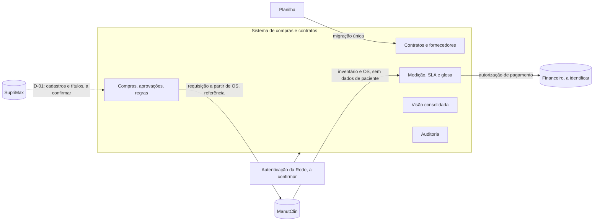
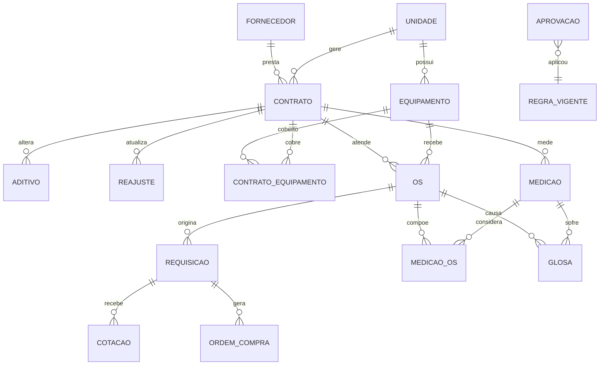
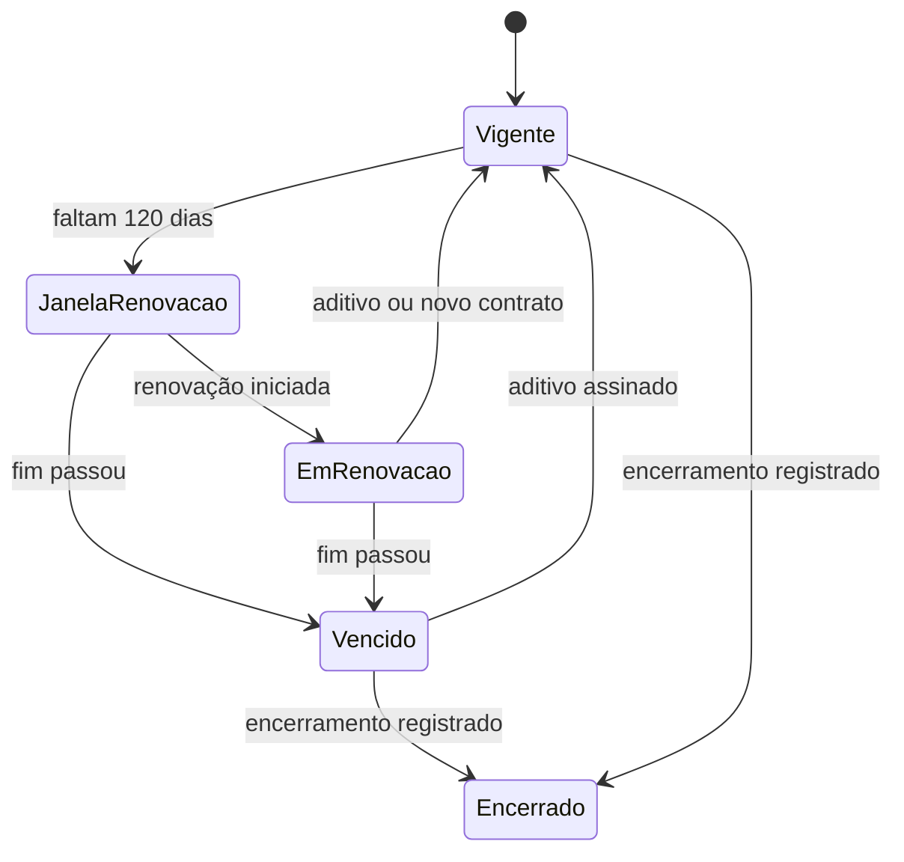

# 03. Documentação técnica

Especificação técnica da primeira fase, independente de produto: as respostas não definem comprar ou desenvolver (D-04), tecnologia ou padrão de hospedagem. Decisões D-*n* estão em `02-negocio.md`, seção 9.

## 1. Situação atual dos sistemas

| Sistema | Tecnologia | Papel | Observações |
|---|---|---|---|
| SupriMax | PostgreSQL | Requisição, cotação, OC, contrato, medição; atende outras categorias | Regras em gatilhos com valores antigos, nunca revistos após a rev. 3 (R3) |
| ManutClin 4.2 | MySQL | OS, inventário, plano preventivo, SLA | Fecha a OS sem verificar teste; guarda dados de paciente; acesso de prestador |
| Planilha | CSV na pasta do Jurídico | Controle de contratos | Uma editora, sem histórico |
| Sistema financeiro | **Desconhecido** | Títulos e pagamentos | R12 sem resposta |

## 2. Arquitetura proposta

Com base em D-01. Não há informação sobre APIs (R15); a integração será definida com o coordenador de TI.

Princípios:

- O novo sistema é a **fonte única** de contrato, fornecedor de manutenção, aditivo, reajuste, aprovação, medição e glosa.
- O ManutClin continua sendo a fonte de OS, inventário, calibração, teste e liberação.
- Regras ficam em parâmetros com vigência, nunca fixas no código ou em gatilhos, para evitar a defasagem atual do ERP.
- O campo de equipamento fica na requisição desde a fase 1, para viabilizar o custo por equipamento na fase 2.

**Se D-01 mudar:** substituir o ManutClin acrescenta OS, preventiva, calibração e inventário ao escopo. Manter os contratos no SupriMax transfere as regras para o ERP e depende do fornecedor. Os dois casos exigem reavaliar a data de 30/06/2027.

## 3. Modelo conceitual

| Entidade | Atributos relevantes |
|---|---|
| Contrato | Número (chave de negócio), unidade, fornecedor, objeto, início, fim, moeda, valor mensal, valor global, índice, data-base de reajuste, SLA de atendimento e de solução (h), preventiva, gestor, documento |
| Fornecedor | CNPJ (único, 14 dígitos), razão social, nome fantasia, ativo |
| Aditivo | Sequência, data de assinatura, campos alterados, valores antes e depois, documento, aprovação |
| Reajuste | Data, índice, percentual, valor antes e depois |
| Contrato em moeda estrangeira | Valor em moeda original, câmbio de referência com vigência e autor; câmbio de pagamento, se informado |
| Equipamento (cópia do ManutClin) | Etiqueta, unidade, classe, nível de criticidade (1 a 4), situação, validade da calibração |
| OS (cópia do ManutClin) | Id, etiqueta, tipo, abertura, atendimento, fechamento, status, contrato, teste, liberação, indicador de evento adverso |
| Medição | Contrato, competência, valor, moeda, glosa, ateste (autor, data), situação |
| Glosa | Evento, OS, tipo de SLA, valor sugerido, valor decidido, autor, justificativa |
| Regra | Tipo, limites, início e fim de vigência, ato normativo |

Situação do contrato: **calculada**, nunca digitada.

Diferente da planilha, "Em renovação" não esconde o vencimento: CT-2022-0055 ficaria **Vencido**, com renovação em andamento.

## 4. Parâmetros de regra

Valores iniciais. Mudança gera nova versão, sem efeito sobre processos já aprovados.

| Parâmetro | Valor | Situação no ERP hoje |
|---|---|---|
| Faixas de alçada | 50.000,00 / 250.000,00 | 80.000 / 250.000 |
| Base de alçada de contrato | Valor global, com câmbio de referência em moeda estrangeira | `valor_mensal`, sem conversão |
| Faixas de cotação | 5.000,00 / 15.000,00 | Só 25.000, só REGULAR |
| Limite de parecer | 30.000,00 (proposta de 200.000,00 não aprovada) | Inexistente |
| Antecedência de renovação | 120 dias | Inexistente |
| Prazo de pagamento | 45 dias da emissão; mínimo 30; emergencial sem mínimo | CHECK de 15 a 30 |
| Emergencial | 100.000,00; 72 h; Diretor Técnico | Só isenta o gatilho |
| Glosa | 2% por evento; teto de 10% (D-08) | Inexistente |
| Janela de fracionamento | 30 dias (D-05) | Inexistente |
| Periodicidade de reajuste | 12 meses (D-11) | Inexistente |

Os testes de aceitação devem cobrir os valores exatos de fronteira (por exemplo, R$ 50.000,00 e R$ 50.000,01; R$ 30.000,00 e R$ 30.000,01).

## 5. Integrações

| Integração | Sentido | Dados | Requisito | Situação |
|---|---|---|---|---|
| ManutClin, inventário | Entrada | Etiqueta, unidade, descrição, classe, criticidade, situação, calibração, contrato | RF-18 | Mecanismo a definir (R15) |
| ManutClin, OS | Entrada | Colunas listadas na seção 7, sem `paciente_*` e sem `descricao` livre | RF-18, RF-25 | Mecanismo a definir |
| ManutClin, requisição | Saída | Referência da requisição na OS; hoje `requisicao_erp` é texto livre | RF-19 | Pode exigir mudança no ManutClin |
| Financeiro | Saída | Autorização, fornecedor, valor líquido, moeda, vencimento | RF-23 | **Sistema desconhecido** (R12) |
| SupriMax | A definir | Cadastros de fornecedor, títulos | D-01 | A definir |

Requisitos para qualquer mecanismo: execução idempotente; identificação de última sincronização; alerta em falha; registro de alteração de `atendimento` entre leituras (RNF-05).

**Contingência:** sem API, leitura periódica de uma visão restrita do banco, que contenha somente as colunas permitidas.

## 6. Migração

### 6.1 Contratos: valores de carga

Valor em BRL, salvo indicação. "Fonte" indica o que prevaleceu.

| Contrato | Fornecedor (fantasia) | Unidade | Início | Fim | Mensal | Índice | Atend./Sol. (h) | Preventiva | Fonte e pendência |
|---|---|---|---|---|---:|---|---|---|---|
| CT-2022-0055 | Litoral Eletromédica | Litoral | 01/09/2022 | 31/08/2025 | 7.480,00 | IGP-M | 12 / 72 | Semestral | Carrega como **Vencido**, com renovação em andamento |
| CT-2023-0019 | Clarivent | Central | 01/03/2023 | 28/02/2027 | 31.500,00 | IGP-M | 4 / 24 | Semestral (R4) | Plano do ManutClin (365 dias) a corrigir |
| CT-2023-0088 | BioVolt | Central | 01/07/2023 | 31/12/2026 (R4) | 14.200,00 | IGP-M | 8 / 48 | Semestral | Falta documento e aprovador do aditivo 2; aditivo 1 sem dados |
| CT-2024-0117 | BioVolt | Norte | 01/05/2024 | 30/04/2027 | 11.040,00 (R4) | IPCA | 4 (R4) / 48 | Semestral | Conferir SLA de solução, pois o atendimento do ManutClin estava errado |
| CT-2025-0031 | Helvion | Central | 01/04/2025 | 31/03/2028 | US$ 9.800,00 | Sem índice | 6 / 48 | Trimestral | Câmbio de referência 5,40 |
| CT-2025-0064 | NorteGás | Norte | 01/02/2025 | 31/01/2027 | 22.000,00 | IPCA (R4) | 2 / 12 | Trimestral | Corrigir ERP; renovação não iniciada |
| CT-2025-0102 | Termolab | Central | 01/03/2025 | 28/02/2027 | 6.800,00 | IPCA | 48 / 120 | Anual | 0 equipamentos: instrumentos sem vínculo |
| CT-2026-0021 | Hemofix | Litoral | 15/02/2026 | 14/02/2027 | 4.900,00 | IPCA | 24 / 72 | Trimestral | Sem registro no ERP (R6); carga vem da planilha; aprovação e parecer a regularizar |

Os contratos renovados até o corte de migração precisam ser recarregados: 6 dos 8 terminam antes de 30/06/2027.

### 6.2 De-para

| Conceito | SupriMax | ManutClin | Planilha | Novo |
|---|---|---|---|---|
| Unidade | 01, 02, 03, 04 | CEN, NOR, LIT, SUL | Texto | Cadastro, incluindo Aurora Serra quando houver código |
| Fornecedor | CNPJ, razão social | CNPJ, nome | CNPJ com máscara, nome | CNPJ de 14 dígitos; razão social e fantasia |
| Índice | IGPM, IPCA, NENHUM | | IGP-M, IPCA, - | IGP-M, IPCA, Sem índice |
| Criticidade | | A, B, C | Crítico, Não crítico, por contrato | 1 a 4, por equipamento |

**Criticidade:** A vai para 1 e C vai para 4, mas B **não se resolve automaticamente** entre 2 e 3 (R11). A Engenharia Clínica precisa classificar os equipamentos B; até lá, entram como "2 ou 3, a classificar" e são tratados como nível 2, o mais conservador. Crítico/Não crítico não tem correspondência confirmada e não é migrado como dado de equipamento.

### 6.3 Regras de corte

1. O Jurídico valida cada contrato contra o documento assinado.
2. Reconciliação: 8 contratos; carteira anual esperada de R$ 1.810.080,00 (R$ 1.803.600,00 da planilha, mais a correção de R$ 6.480,00 do CT-2024-0117, com USD a câmbio 5,40), a atualizar pelas renovações.
3. Nenhum dado de paciente na carga (verificação automática de colunas e amostragem manual).
4. Planilha fica somente leitura no corte; não há dupla manutenção.
5. Histórico: 24 meses para consulta (D-14).

## 7. Segurança e privacidade

- **Colunas do ManutClin nunca lidas:** `paciente_nome`, `paciente_prontuario`.
- **`descricao` não é importada**, pois texto livre pode conter informação clínica (ex.: OS 88213). A conferência abre a OS no ManutClin, ou usa tipo e categoria da falha.
- `evento_adverso` é importado só como indicador, para sinalizar a RF-24.
- A conta de integração deve ter o menor acesso possível, de preferência uma visão, e não a tabela.
- Fornecedor não tem acesso ao novo sistema na primeira fase (R14). O `prestador_portal` continua existindo no ManutClin e precisa ser corrigido à parte (`02-negocio.md`, seção 10).
- Base legal, retenção e tratamento do legado aguardam o encarregado de dados (R14).

### Perfis

| Perfil | Pode | Não pode |
|---|---|---|
| Solicitante (unidade, Eng. Clínica) | Criar requisição | Aprovar o que solicitou |
| Comprador (Suprimentos) | Cotar, emitir OC, registrar aditivo | Aprovar acima da alçada |
| Gerente de Suprimentos | Aprovar até R$ 50.000,00 | |
| Diretor Financeiro | Aprovar até R$ 250.000,00; definir câmbio de referência | |
| Diretora Geral | Aprovar acima de R$ 250.000,00; aprovar exceção de contrato vencido (D-06) | |
| Diretor Técnico | Aprovar emergencial | Aprovar compra regular por esse perfil |
| Jurídico | Emitir parecer; validar contrato; conduzir renovação | Aprovar compra |
| Atestador (Eng. Clínica) | Atestar; decidir glosa | Atestar o que solicitou |
| Financeiro | Consultar autorizações | Alterar medição atestada |
| Comitê, consulta | Visão consolidada | Alterar |
| Administrador | Parâmetros e cadastros, com auditoria | Aprovar |

## 8. Requisitos não funcionais

Valores numéricos são propostas para validação; as fontes não trazem metas.

| ID | Requisito | Critério |
|---|---|---|
| RNF-01 | Auditabilidade | Aprovação, parecer, ateste, glosa, parâmetro e exceção guardam autor, data, valores antes e depois e versão da regra; registros não editáveis |
| RNF-02 | Privacidade | Nenhum dado de paciente armazenado, em log ou em carga; conferência automática |
| RNF-03 | Controle de acesso | Por perfil e unidade; autenticação única, se houver padrão na Rede; autenticação forte para aprovadores |
| RNF-04 | Parametrização | Regras alteradas sem nova versão do software; novas unidades por cadastro |
| RNF-05 | Integridade das integrações | Reprocessamento sem duplicidade; alerta em falha; registro de alterações em dados de SLA |
| RNF-06 | Moeda | Valores monetários sempre com moeda; somas nunca misturam moedas sem câmbio explícito; precisão decimal |
| RNF-07 | Capacidade | Referência: 4.812 equipamentos, cerca de 640 OS por mês, 1.460 OC por ano, mais unidade nova; proposta: folga de 2× |
| RNF-08 | Disponibilidade e recuperação | Proposta: horário comercial com alerta fora dele; cópia diária; meta a validar com TI |
| RNF-09 | Usabilidade da aprovação | Proposta: aprovação emergencial acessível por dispositivo móvel, dado o prazo de 72 h |
| RNF-10 | Tempo e fuso | Datas de SLA armazenadas com fuso definido; regra de horas configurável (D-08) |

## 9. Riscos técnicos

| Risco | Mitigação |
|---|---|
| ManutClin sem API | Visão restrita de leitura; definir com TI cedo |
| Fechamento da OS sem teste continua no legado | Corrigir o gatilho à parte; RF-24 sinaliza, mas não impede |
| Atendimento alterável pelo prestador | HU-033; rever o grant |
| Financeiro desconhecido | Autorização em formato neutro, com exportação como contingência |
| Aurora Serra com códigos e sistema desconhecidos | Cadastro; carga por planilha-padrão, se necessário |
| Cálculo de SLA depende de `atendimento` e `fechamento` preenchidos | Validar qualidade dos dados antes de ligar a glosa |
| OC sem vínculo com equipamento no histórico | Custo por equipamento só vale do corte em diante, salvo rateio |
