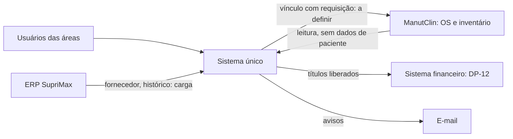
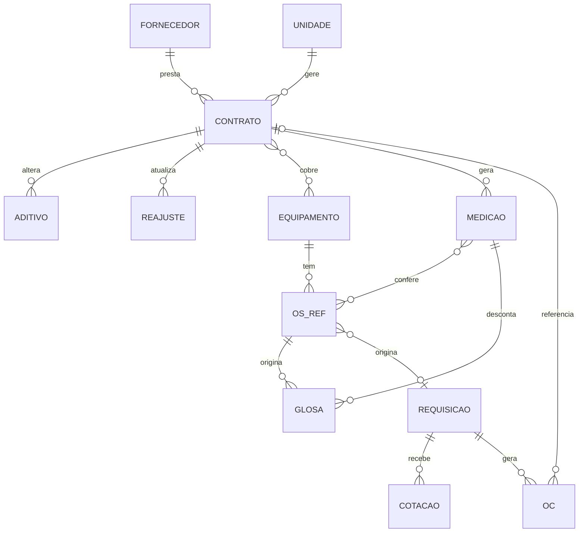
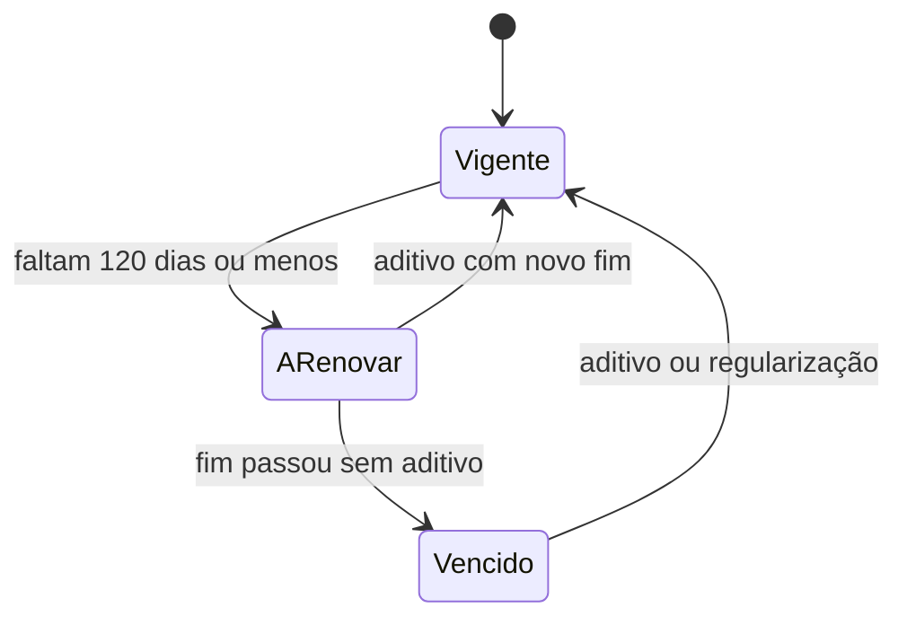

# Documentação técnica: sistema único de compras e contratos de manutenção de equipamentos

**Situação:** a arquitetura alvo e a tecnologia **não estão definidas**. A pergunta sobre o que o sistema substitui e sobre comprar ou desenvolver ficou sem resposta (DP-01). Este documento registra o que vale em qualquer cenário e não escolhe tecnologia. IDs de regras e decisões: `02-negocio.md`.

## 1. Sistemas atuais

| Sistema | Tecnologia | Conteúdo | Limitações relevantes |
|---|---|---|---|
| ERP SupriMax | PostgreSQL | Requisição, cotação, OC, contrato, medição | Regras em triggers defasadas; sem aditivo, câmbio ou SLA |
| ManutClin 4.2 | MySQL | OS, inventário, plano preventivo, SLA | Sem histórico de status; dados de paciente em OS; `CT-2024-0117` com SLA incorreto |
| Planilha | Arquivo em pasta de rede | Controle do Jurídico | Sem histórico; editor único |
| Financeiro | Não informado (DP-12) | Recebe títulos do ERP | Desconhecido |

### Defeitos a não reproduzir

| Local | Defeito | Regra |
|---|---|---|
| `fn_valida_alcada_oc` | Limite de R$ 80 mil; aceita aprovador nulo | RN-01 |
| `fn_valida_cotacoes` | R$ 25 mil; sem faixa de duas cotações | RN-04 |
| `fn_valida_alcada_contrato` | Usa `valor_mensal`, sem moeda | RN-02 |
| `chk_prazo_pagamento` | 15 a 30 dias; 45 é impossível | RN-12 |
| `contrato.indice_reajuste` | Padrão IGPM | RN-10 |
| `contrato.status` | Digitado, não deriva de data | RN-09 |
| `fn_libera_medicao` | Não confere ateste nem vigência | RN-13 |
| `trg_oc_alcada` | Não reavalia se o valor muda depois | RN-01 |
| `medicao` | Sem unicidade de contrato e competência | RF-24 |
| `trg_os_fecha` | Volta a `EM_USO` sem teste nem liberação | RN-15 |
| `equipamento.contrato_numero` | Apenas um contrato por equipamento | RF-03 |
| `requisicao_erp`, `origem_os` | Texto livre | RF-23 |
| `GRANT` a `prestador_portal` | Lê paciente; edita `atendimento` | RN-21 |

## 2. Opções de arquitetura (decisão pendente)

| Opção | Descrição | A favor | Contra |
|---|---|---|---|
| A | Novo sistema para `MANUT_EQUIP`; ManutClin mantido e integrado; ERP segue para as demais categorias; Financeiro recebe títulos | Coerente com o escopo ("relacionar-se" com OS e inventário) e com R13 (criticidade no sistema novo). Menor mudança para a Eng. Clínica | Convivência com o ERP; integrações |
| B | Corrigir e estender o SupriMax, com integração ao ManutClin | Aproveita a base transacional | Sem informação do fornecedor; o modelo requer muitas mudanças; "único" só em parte |
| C | Novo sistema substitui também o ManutClin | Unificação total | Fora do que o escopo pede; aumenta muito o risco para 30/06/2027 |

**Hipótese de trabalho, não aprovada: opção A.** O backlog foi escrito de forma a valer em A ou B, salvo as histórias de integração. Decidir comprar ou desenvolver cabe a DP-01; a stack será registrada em `.product-team/knowledge/STACK.md` depois disso.

### Contexto na opção A

## 3. Modelo conceitual

| Entidade | Dados principais | Restrições |
|---|---|---|
| Contrato | Número (único), unidade, fornecedor, objeto, início, fim vigente, moeda, valor mensal, valor global, índice, SLA de atendimento e de solução, preventiva, aprovador, parecer, documento, origem e confirmação dos dados | Fim após início. Status é calculado |
| Aditivo | Número sequencial, data de assinatura, novo fim, novo valor, parecer, documento | Valores ausentes ficam nulos e sinalizados, nunca inferidos |
| Reajuste | Data, índice, percentual, valor anterior e novo | Moeda estrangeira não tem índice |
| Fornecedor | CNPJ (único), razão social, nomes alternativos | |
| Unidade | Nome oficial, código do ERP, código do ManutClin | Tabela de equivalência |
| Equipamento (referência) | Patrimônio, descrição, classe, unidade, status, validade de calibração, criticidade legada, **nível oficial** | ManutClin como origem, salvo nível oficial |
| OS (referência) | Número, patrimônio, tipo, abertura, atendimento, fechamento, status, contrato, teste, liberação, indicador de evento adverso | Lista positiva de campos: paciente e descrição excluídos (seção 6) |
| Requisição | Área demandante, digitador, unidade, patrimônio, OS de origem, valor estimado | Solicitante é a área (provisório, DP-11) |
| OC | Número, tipo, requisição, fornecedor, contrato, valor total, aprovador, datas | Valor alterado reabre aprovação |
| Medição | Contrato, competência, valor, moeda, status, ateste | Única por contrato e competência |
| Glosa | Medição, OS, percentual, valor sugerido, decisão, justificativa | Decisão sempre humana |
| Parâmetro | Nome, valor, início e fim de vigência | Uma tabela simples, sem motor de regras |
| Registro de auditoria | Quem, quando, ação, objeto, antes e depois, justificativa | Só inclusão |

### Vigência do contrato

Calculada a cada consulta a partir do fim vigente e do parâmetro de 120 dias. O andamento da renovação fica em campo separado, para que "Em renovação" nunca esconda um vencimento, como no CT-2022-0055.

### Decisão de alçada

- O valor de referência é o total da OC ou o global do contrato.
- Contrato em moeda estrangeira usa o câmbio de referência para achar a alçada (suposição, sem regra escrita; o CT-2025-0031 cai na Diretora Geral em qualquer cenário realista).
- O aprovador precisa ter a função exigida e não pode ser o solicitante.
- Compra emergencial segue a Portaria, com checagem do limite de R$ 100 mil e prazo de 72 h. Vencido o prazo, gera alerta (a Portaria não diz o que acontece).

### Parâmetros iniciais

| Parâmetro | Valor | Fonte |
|---|---|---|
| Alçadas | R$ 50.000,00 e R$ 250.000,00 | RN-01 |
| Cotações | R$ 5.000,00 e R$ 15.000,00 | RN-04 |
| Parecer | R$ 30.000,00 | RN-07 |
| Início da renovação | 120 dias | RN-09 |
| Pagamento | 45 dias; mínimo de 30 | RN-12 |
| Glosa | 2% do valor mensal | RN-14 |
| Emergencial | R$ 100.000,00; 72 h | RN-06 |

## 4. Integrações

Todas dependem de DP-01. Os mecanismos só podem ser definidos com o responsável técnico.

| Integração | Sentido | Dados | Situação |
|---|---|---|---|
| ManutClin: OS | Leitura | Lista positiva de campos | Sem acesso definido. Não reaproveitar a conta do portal |
| ManutClin: inventário | Leitura | Patrimônio, unidade, classe, status, calibração | Idem |
| ManutClin: vínculo de requisição | Escrita, a confirmar | Número da requisição na OS | Hoje é texto livre e redigitado; verificar viabilidade com o fornecedor do ManutClin |
| Financeiro | Saída | Título liberado, vencimento, valor líquido de glosa | Sistema desconhecido (DP-12). Contingência: arquivo ou conferência manual |
| ERP SupriMax | Carga e, na opção A, convivência | Fornecedor, histórico | Evitar registrar a mesma OC em dois lugares |
| E-mail | Saída | Alertas | Conteúdo sem dados de paciente |

**Requisitos de qualquer integração:** reprocessar sem duplicar, registrar falhas de forma visível, conciliar periodicamente e mostrar a data da última sincronização. Se a integração falhar, a medição continua, com a conferência indicada como incompleta.

## 5. Requisitos não funcionais

Os valores de disponibilidade, tempo de resposta e recuperação não constam das fontes; serão definidos com TI (DP-01), e não os invento aqui.

| ID | Requisito | Base |
|---|---|---|
| RNF-01 | Trilha de auditoria somente de inclusão: autor, data e hora, ação, valores anterior e novo, justificativa | R2, R15 |
| RNF-02 | Minimização: nenhum dado de paciente armazenado, exibido, transmitido ou registrado em log | RN-21, RIS-02 |
| RNF-03 | Acesso por usuário individual, com menor privilégio por função e unidade | RIS-02, P9 |
| RNF-04 | Integridade da evidência de SLA: guardar tempos e origem da leitura; registrar quando o dado na origem mudou depois | RIS-03 |
| RNF-05 | Capacidade para os volumes atuais: cerca de 640 OS/mês, 1.460 OC/ano, 4.812 equipamentos, 4 unidades | Indicadores |
| RNF-06 | Integrações resilientes e conciliáveis (seção 4) | RIS-07 |
| RNF-07 | Disponibilidade, desempenho, cópias de segurança e recuperação: metas a definir | DP-01 |
| RNF-08 | Retenção e exclusão de dados: a definir com o DPO | DP-18 |
| RNF-09 | Valores sempre com moeda; o câmbio de referência sempre rotulado como tal | RN-11, RIS-10 |
| RNF-10 | Interface em pt-BR, com datas e valores no padrão brasileiro e acessível por teclado | Público interno |
| RNF-11 | Entrada em operação até 30/06/2027 | Escopo |

## 6. Privacidade e segurança

- **Lista positiva:** a integração lê só os campos necessários. `paciente_nome` e `paciente_prontuario` nunca são lidos.
- **`ordem_servico.descricao` não é trazida por padrão:** é texto livre e pode citar paciente ou situação clínica (a OS 88213 o faz, sem nome). Se a Eng. Clínica precisar, será decisão com o DPO (DP-18).
- **Evento adverso:** apenas o indicador `evento_adverso`, de acesso restrito. A forma de tratamento fica com a Gerência de Qualidade e Segurança do Paciente (DP-17).
- **Legado:** o novo sistema não corrige a conta `prestador_portal`; isso é ação separada (`02-negocio.md`, seção 9).
- **Prestador:** sem acesso na fase 1.
- **Entregas e carga:** nenhum dado de paciente em extrações, testes ou homologação.

## 7. Migração

### Situação de cada contrato para a carga

**Confirmado** significa respondido pelo Jurídico com base no contrato assinado. **Não confirmado** significa valor de sistema, a conferir com o documento (DP-08). Os valores mensais vêm do ERP.

| Contrato | Fim | Valor | Índice | SLA atend./solução (h) | Situação |
|---|---|---|---|---|---|
| CT-2022-0055 | 31/08/2025 | R$ 7.480,00/mês | IGP-M | 12 / 72 | Não confirmado. **Carregar como vencido**; depende de DP-09 |
| CT-2023-0019 | 28/02/2027 | R$ 31.500,00/mês | IGP-M | 4 / 24 | Preventiva semestral **confirmada**; resto não confirmado |
| CT-2023-0088 | 31/12/2026 **confirmado** | R$ 14.200,00/mês | IGP-M | 8 / 48 | Aditivo 2 de 20/05/2026 **confirmado**; valor e parecer desconhecidos; aditivo 1 sem dados. Pode já ter sido renovado na data da carga |
| CT-2024-0117 | 30/04/2027 | R$ 11.040,00/mês **confirmado** | IPCA | **4 confirmado** / 48 | Corrige planilha (valor) e ManutClin (SLA). Solução de 48 h não confirmada |
| CT-2025-0031 | 31/03/2028 | USD 9.800,00/mês; ref. R$ 5,40 **confirmado** | Sem índice | 6 / 48 | Fim e SLA não confirmados |
| CT-2025-0064 | 31/01/2027 | R$ 22.000,00/mês | **IPCA confirmado** | 2 / 12 | Corrige ERP. Depende de DP-04 |
| CT-2025-0102 | 28/02/2027 | R$ 6.800,00/mês | IPCA | 48 / 120 | Não confirmado. Cobre instrumentos: lista de itens não existe |
| CT-2026-0021 | 14/02/2027 | R$ 4.900,00/mês (R$ 58.800,00/ano) | IPCA | 24 / 72 | **Contrato inexistente no ERP, assinado localmente (confirmado).** Dados da planilha e do ManutClin; parecer e alçada desconhecidos |

**Atenção:** a única divergência de SLA conferida com o contrato estava errada no ManutClin; portanto os demais SLAs não devem ser tratados como certos só porque a planilha e o ManutClin coincidem.

### Passos

1. Levantar os documentos e identificar contratos não registrados, inclusive por OCs avulsas recorrentes (RF-11).
2. Sanear, marcando origem e confirmação por campo.
3. Carregar fornecedor por CNPJ, unindo MTS e BioVolt. Tabela de unidades: 01/CEN/Central, 02/NOR/Norte, 03/LIT/Litoral, 04/SUL/CDI Aurora Sul.
4. Carregar vínculos de equipamentos: `contrato_item` tem só amostra nesta análise; pedir extração completa.
5. Criticidade: A vira nível 1; C, nível 4; B fica **pendente de reclassificação** em 2 ou 3 pela Eng. Clínica, sem valor padrão. Crítico/Não crítico da planilha é mantido só como dado histórico do contrato (DP-15).
6. Conciliar totais: 393 equipamentos sob contrato e os valores com a Controladoria.
7. Período de convivência e desligamento da planilha: dependem de DP-07. Após a entrada, a planilha vira somente leitura.

Não migrar: dados de paciente, regras dos triggers, status digitado, manual de 2019. O histórico de OC e medição necessário à fase 2 depende de DP-14.

## 8. Testes de aceitação baseados em casos reais

Os dados abaixo são fictícios, como toda a base. Podem ser usados, depois de anonimizados de pacientes, como casos de regressão.

| Caso | Entrada | Resultado esperado |
|---|---|---|
| Limites de alçada | OC de R$ 50.000,00 e de R$ 50.000,01; R$ 250.000,00 e R$ 250.000,01 | Gerente; Dir. Financeiro; Dir. Financeiro; Dir. Geral |
| OC-2026-00388 | R$ 72.500,00 aprovada pela Gerente | Rejeitada; exige Dir. Financeiro |
| OC-2026-00301/302/303 | Mesma requisição; soma R$ 149.300,00 | Alerta de fracionamento; alçada da soma |
| OC-2026-00420 | Solicitante igual a aprovador | Impedida |
| OC-2026-00440 | R$ 19.800,00 com uma cotação | Impedida; exige três |
| Limites de cotação | R$ 5.000,00; R$ 5.000,01; R$ 15.000,00; R$ 15.000,01 | 0, 2, 2, 3 |
| OC-2026-00412 | Emergencial R$ 92.000,00, Dir. Técnico, 2 dias, uma proposta | Aceita; entra no relatório ao Comitê |
| Emergencial acima do limite | R$ 100.000,01 | Rejeitada como emergencial |
| Parecer | Global de R$ 30.000,00 e R$ 30.000,01 | Dispensado; exigido |
| CT-2025-0064 | Global de R$ 528.000,00 | Exige Diretora Geral |
| CT-2025-0102 | Global de R$ 163.200,00 | Exige Dir. Financeiro |
| CT-2026-0021 | Global de R$ 58.800,00 | Exige parecer e Dir. Financeiro |
| Valor em OCs recorrentes | OCs de R$ 4.900,00 mensais ao mesmo fornecedor | Alerta de recorrência |
| CT-2022-0055 | Consulta após 31/08/2025 com renovação em andamento | Mostra Vencido **e** Em renovação |
| CT-2023-0088 | Consulta em 30/09/2026 | A renovar (fim em 31/12/2026, aditivo 2); não Vencido |
| Medição 9002 | Sem ateste | Liberação impedida |
| Duplicidade | Segunda medição para o mesmo contrato e competência | Impedida |
| OS 88170 | Atendimento em 14h10; SLA de 4 h | Violação; glosa sugerida de R$ 220,80 (depende de DP-13) |
| OS 88190 | 533,7 h aguardando peça | Marcada para decisão humana (DP-13) |
| OS 88213 | Fechada sem teste nem liberação; calibração vencida | Aparece no painel de exceções; sem dados de paciente |
| Privacidade | Inspeção da carga, das telas, dos logs e dos avisos | Nenhum nome ou prontuário de paciente |
| Trilha | Qualquer aprovação ou alteração de contrato | Registro não alterável |
| Moeda | CT-2025-0031 em visão consolidada | USD e R$ de referência, rotulados |

## 9. Riscos técnicos

| Risco | Tratamento |
|---|---|
| Sem responsável técnico nem acesso a ManutClin e Financeiro | Prova de integração logo após DP-01 |
| Convivência entre ERP e novo sistema gerando duas fontes para o mesmo dado | Definir dono por entidade e data de corte |
| `atendimento` editável pelo prestador | RNF-04; decisão de glosa humana; correção do acesso |
| Sem histórico de status no ManutClin para medir tempo em AGUARDANDO_COMPRA | Guardar as mudanças observadas a partir da integração; sem cálculo retroativo |
| Carga com dados não confirmados | Marcação por campo; lista de pendências visível |
