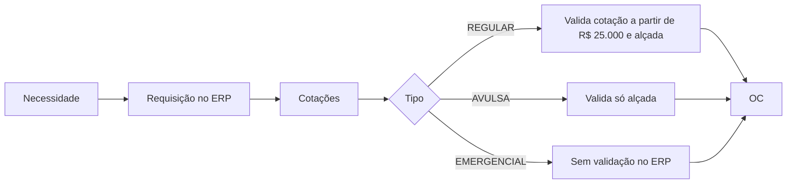
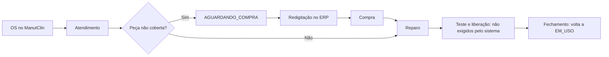

# Diagnóstico do cenário atual

**Projeto:** sistema único de compras e contratos de manutenção de equipamentos, Rede Hospitalar Aurora do Vale.
**Data:** 04/11/2026, atualizado após `respostas.md`. **Baseline:** sem baseline. **Base dos dados:** dumps de 30/09/2026 e planilha de 25/09/2026.
**Legenda:** [F] fato com fonte; [I] inferência a partir dos fatos citados; [H] hipótese ou proposta.

**Fontes:** `erp_suprimax_dump.sql` (SIS-01); `manutclin_dump.sql` (SIS-02); `controle_contratos.csv` e `regras_da_planilha.md` (SIS-03); em `fontes/geral`, `politica_compras_POL-SUP-004_rev3.md`, `portaria_DG-017-2025_compras_emergenciais.md`, `manual_processo_compras_v2_2019.md`, `fluxo_contratacao_manutencao.md`, `indicadores_manutencao_2025.md` e `ata_comite_contratos_2026-08-19.md`; `escopo.md`.

**Limites:** os dumps são recortes, e requisição, OC, medição, itens de contrato, equipamentos e OS são amostras. Os casos provam que a falha pode ocorrer, mas não medem frequência. Não há contratos originais nem o sistema financeiro nas fontes (RIS-012). Dados de pessoas e de pacientes dos registros não foram copiados; os papéis são citados por cargo.

## 0. O que mudou com as respostas

| Achado | Resposta | Efeito |
|---|---|---|
| DIV-001, DIV-002, DIV-003, DIV-004 | Q-003: vale a Política; a configuração do ERP é antiga e não foi revista | Tratados. A alçada por valor global vale para contratos assinados desde 01/01/2025; contratos anteriores não entram |
| DIV-005 | Q-006: acima de R$ 30.000,00 | Tratado. O fluxo está errado. Pode aumentar a fila de GAR-001 |
| DIV-011 | Q-009: 4 horas, como no contrato assinado | Tratado. O ManutClin está errado; a OS 88170 descumpre o SLA de 4 horas |
| DIV-013 | Q-012: semestral | Tratado. O plano do ManutClin está errado |
| DIV-016 | Q-013: teste e assinatura obrigatórios | Tratado como regra; alerta ou bloqueio segue aberto |
| DIV-012 | Q-011: A = 1, B = 2 e 3, C = 4, provisório | Aberto: B não converte de forma unívoca, e Crítico/Não crítico segue sem equivalência |
| RIS-001 | Q-011 | PAT-004512, de criticidade A, é nível 1 (Suporte à vida) |
| DIV-007, DIV-017, DIV-018 | Sem pergunta específica | Tratados por evidência da política e da coluna `indice` (previsto em contrato); não contestados |
| DIV-006, DIV-009, DIV-010, RIS-004 | Q-007 e Q-008: não sei | Abertos, com premissa |
| RIS-002 | Q-014: encaminhada ao DPO e à Qualidade | Aberto (Q-016, Q-017) |
| Novo: RIS-016 | 8 das 15 perguntas sem decisão, e 3 parciais | Risco de projeto |
| RIS-007 | Reanálise | [I] O Diretor Técnico tem nível 2 no ERP e poderia aprovar OC regular; a política só lhe dá alçada emergencial |

As seções abaixo mantêm o cenário encontrado nas fontes; o status de cada achado está aqui e em `.re/achados.md`.

## 1. Resumo executivo

Hoje a contratação de manutenção passa por três bases sem integração, e a regra formal (POL-SUP-004 rev. 3) não é a mesma que os sistemas aplicam. Em 2025, o gasto foi de R$ 3.025.880,00, dos quais R$ 1.550.440,00 em contratos. Os achados mais críticos são:

1. **Segurança do paciente (RIS-001, DIV-016):** um ventilador de criticidade A consta `EM_USO` com calibração vencida há 183 dias na extração, e uma OS com evento adverso nesse equipamento foi fechada sem teste nem liberação.
2. **Dados de paciente (RIS-002):** a tabela de OS guarda nome e prontuário, e o usuário do portal de prestadores pode ler a tabela inteira.
3. **Pagamento sem cobertura (DIV-009, DIV-010, RIS-004):** CT-2022-0055 venceu em 31/08/2025 e segue em pagamento; CT-2026-0021 não está no ERP e parece ser pago por OCs avulsas.

Os controles financeiros também têm falhas: alçadas, cotações e prazos do ERP diferem da política, há indício de fracionamento de R$ 149.300,00 e a glosa não é aplicada. Pelo lado positivo, as chaves entre as bases são boas (patrimônio, número de contrato, CNPJ), e os indicadores fecham com as fontes. Seis contratos terminam antes da entrada em operação de 30/06/2027 (RIS-009).

**Ações que não deveriam esperar o projeto [H]:** verificar PAT-004512 e sua liberação; rever o acesso `prestador_portal`; decidir a cobertura de CT-2022-0055.

## 2. Mapa dos sistemas

| Sistema | Papel | Processos | Entidades | Observação |
|---|---|---|---|---|
| SIS-01 SupriMax ERP | Legado principal de compras | Requisição, cotação, OC, contrato, medição, pagamento (status) | filial, usuario, fornecedor, contrato, contrato_item, medicao, requisicao, cotacao, ordem_compra | Sem SLA, câmbio, criticidade e histórico de aditivos |
| SIS-02 ManutClin 4.2 | Legado principal da Eng. Clínica | OS, inventário, calibração, preventiva | site, prestador, contrato_ref, equipamento, plano_preventivo, ordem_servico | Sem valores e vigência de contrato; acesso de prestadores |
| SIS-03 Planilha | Controle do Jurídico | Vigência, SLA, valor anual, renovação | Contrato em 16 colunas | Sem histórico; só uma pessoa edita |
| Não identificado | Pagamento | Recebe títulos do ERP | Título | Sistema ausente das fontes (Q-004) |

## 3. Cenário por processo

### 3.1 Requisição, cotação e aprovação

- [F] O ERP tem níveis de alçada coerentes com a política, mas com limite e base errados (DIV-001, DIV-002) e cotações em desacordo (DIV-003). `erp_suprimax_dump.sql`, `fn_valida_alcada_oc`, `fn_valida_alcada_contrato`, `fn_valida_cotacoes`.
- [F] OC-2026-00388 (R$ 72.500,00) foi aprovada por nível 1, e OC-2026-00440 (R$ 19.800,00) tem uma cotação.
- [F] OC-2026-00301, 00302 e 00303 somam R$ 149.300,00, com a mesma requisição, o mesmo fornecedor e o mesmo dia, cada uma abaixo de R$ 50.000,00. [I] É indício de fracionamento, vedado no §3.1 (RIS-005).
- [F] OC-2026-00420 tem o mesmo usuário como solicitante e aprovador, contra o §2.3 (DIV-018).
- [F] Aprovador nulo e alteração posterior de valor escapam da validação, e `AVULSA` não existe na política (RIS-007).

### 3.2 Contrato, aditivo e renovação

| Contrato | Fim no ERP | Status no ERP | Fim e status na planilha | Início dos 120 dias | Situação |
|---|---|---|---|---|---|
| CT-2022-0055 | 31/08/2025 | ATIVO | 31/08/2025, Em renovação | 03/05/2025 | Vencido há 395 dias na extração; minuta em discussão |
| CT-2023-0088 | 31/12/2026 | ATIVO (aditivo em 20/05/2026) | 30/06/2026, Vencido | 02/09/2026 | Divergente; janela aberta pelo ERP |
| CT-2025-0064 | 31/01/2027 | ATIVO | 31/01/2027, Vigente | 03/10/2026 | Janela aberta |
| CT-2026-0021 | Ausente | Ausente | 14/02/2027, Vigente | 17/10/2026 | Janela aberta; sem registro no ERP |
| CT-2023-0019 | 28/02/2027 | ATIVO | 28/02/2027, Vigente | 31/10/2026 | Janela aberta |
| CT-2025-0102 | 28/02/2027 | ATIVO | 28/02/2027, Vigente | 31/10/2026 | Janela aberta |
| CT-2024-0117 | 30/04/2027 | ATIVO | 30/04/2027, Vigente | 31/12/2026 | Antes da entrada em operação |
| CT-2025-0031 | 31/03/2028 | ATIVO | 31/03/2028, Vigente | 02/12/2027 | Depois da entrada em operação |

- [F] A política determina 120 dias; o fluxo, 90; a planilha só avisa a 60 ou menos (DIV-006). Com isso, o aviso da planilha chega 60 dias depois do início definido pela política.
- [F] O status `Em renovação` da planilha não mostra que a vigência acabou, e o ERP não considera `data_fim` (DIV-009).
- [F] O ERP guarda só `ultimo_aditivo_em`, e o Jurídico depende de alguém informar o aditivo. [I] Isso explica DIV-008.
- [F] A planilha só é alterada por uma pessoa, normalmente às sextas, sem histórico, e fica parada nas férias (GAR-005, RIS-008).
- [I] CT-2024-0117 está com R$ 132.480,00 por ano no ERP e R$ 126.000,00 na planilha, que parece não ter recebido o reajuste de 01/05/2026 (DIV-014).
- [F] CT-2025-0064 tem IGP-M no ERP e IPCA na planilha; a política determina IPCA, e o padrão da coluna no ERP é IGPM (DIV-007). Esse erro afetaria o valor no próximo reajuste.
- [F] O ERP indica último reajuste em 2024 em três contratos e nenhum em outros dois; a periodicidade não consta nas fontes, por isso não se afirma atraso (RIS-014).

### 3.3 Manutenção corretiva e compra de peça

- [F] OS corretiva fica em média 21 dias em `AGUARDANDO_COMPRA`, e a requisição é redigitada (GAR-002). `indicadores_manutencao_2025.md`; ata, item 5.
- [F] O vínculo é texto livre nos dois lados (`origem_os`, `requisicao_erp`). A OS 88190 ficou 533,7 horas aberta aguardando placa.
- [F] `trg_os_fecha` devolve o equipamento a `EM_USO` sem conferir teste ou liberação (DIV-016). A OS 88213 foi fechada sem esses dois registros.

### 3.4 Medição, ateste, glosa e pagamento

- [F] Duas analistas levam cerca de 6 dias úteis por mês conferindo OS contra medições, e o trabalho raramente termina antes do pagamento (GAR-003; ata, item 4). [I] São cerca de 12 analista-dias por mês.
- [F] A medição de CT-2023-0088 da competência 2026-08 foi paga sem ateste; `fn_libera_medicao` só confere contrato ATIVO (DIV-017).
- [F] A política prevê glosa de 2% por evento; em 2025, as glosas foram de R$ 0,00. [I] Na OS 88170, o atendimento levou 14,2 horas, acima do SLA de 4 horas (Q-009), e a medição correspondente tem glosa 0; a glosa seria de R$ 220,80 (RIS-006).
- [F] O prestador pode alterar a hora de atendimento, que é a base do SLA (RIS-003).
- [F] O ERP limita o prazo a 15-30 dias, contra 45 da política (DIV-004). O Financeiro altera cerca de 140 títulos por mês (GAR-004). [I] O limite é causa provável, não confirmada; o número é maior que a média de 121,7 OCs por mês, então deve incluir medições.

### 3.5 Compra emergencial

- [F] OC-2026-00412 cumpre a Portaria DG-017/2025 (APO-003): R$ 92.000,00, uma proposta, aprovação pelo Diretor Técnico em 16/07 para emissão em 14/07, prazo de 15 dias e comunicação ao Comitê em 19/08.
- [F] O ERP não valida limite, prazo de 72 horas nem aprovador nesse tipo (RIS-007).

### 3.6 Inventário, preventiva e calibração

- [F] O inventário tem 4.812 equipamentos etiquetados, 393 sob contrato (8,2%). Os demais ficam com a equipe própria ou chamado avulso.
- [F] PAT-004512 está `EM_USO` com validade em 31/03/2026, contra o §6.3 (RIS-001). A OS 88213 ocorreu 142 dias depois do vencimento; as fontes não estabelecem causa. PAT-016002 está `EM_USO` sem data de calibração, e não se sabe se a exigência se aplica.
- [F] Ventiladores da Central têm plano de 365 dias e contrato semestral (DIV-013). Outras sete combinações comparáveis coincidem.
- [F] O plano não traz DEF em CEN e LIT nem a unidade SUL. Não se sabe se o dump está completo (RIS-015).
- [F] Há três escalas de criticidade sem equivalência (DIV-012).

### 3.7 Visão consolidada e custo por equipamento

- [F] A Diretora Geral pediu o custo por equipamento para decidir entre manter e substituir (ata, item 1). Hoje ele não sai: OC não tem patrimônio, e o vínculo com OS é texto livre (RIS-011).
- [F] Chamados avulsos e peças somam R$ 1.475.440,00, ou 48,8% do gasto. Portanto, olhar só contratos deixa quase metade de fora.
- [F] Somar `valor_mensal` x 12 no ERP sem conversão daria R$ 117.600,00 para CT-2025-0031, contra R$ 635.040,00 na planilha, subestimando em R$ 517.440,00 (RIS-010).

## 4. Matriz de divergências

| ID | Regra | ERP | ManutClin | Planilha | Documento | Sev. |
|---|---|---|---|---|---|---|
| DIV-001 | Alçada de OC | Nível 2 acima de R$ 80.000; nível 3 acima de R$ 250.000 (`fn_valida_alcada_oc`) | n/a | n/a | Diretor Financeiro acima de R$ 50.000,00; Diretora Geral acima de R$ 250.000,00 (POL §2) | Alta |
| DIV-002 | Base da alçada de contrato | `valor_mensal` (`fn_valida_alcada_contrato`) | n/a | n/a | Valor global (POL §2.2) | Alta |
| DIV-003 | Cotações | 3 se REGULAR e a partir de R$ 25.000 (`fn_valida_cotacoes`) | n/a | n/a | 2 acima de R$ 5.000,00; 3 acima de R$ 15.000,00 (POL §3) | Alta |
| DIV-004 | Prazo de pagamento | 15-30 dias, padrão 30 (`chk_prazo_pagamento`) | n/a | n/a | 45 dias, mínimo 30 (POL §5.1) | Alta |
| DIV-005 | Limite do parecer | n/a | n/a | n/a | R$ 30.000,00 (POL §4.5) x R$ 100.000 (fluxo) | Alta |
| DIV-006 | Início da renovação | Sem regra | n/a | Aviso com 60 dias ou menos (regras, Status) | 120 dias (POL §4.2) x 90 dias (fluxo) | Alta |
| DIV-007 | Índice de CT-2025-0064 | IGPM | n/a | IPCA | IPCA (POL §4.3) | Alta |
| DIV-008 | Fim de CT-2023-0088 | 31/12/2026, aditivo | n/a | 30/06/2026, Vencido | n/a | Alta |
| DIV-009 | Status de CT-2022-0055 | ATIVO | n/a | Em renovação | Minuta em discussão (ata, item 7) | Crítica |
| DIV-010 | Registro de CT-2026-0021 | Ausente | Presente | Presente | Registro obrigatório (POL §4.1) | Alta |
| DIV-011 | SLA de atendimento de CT-2024-0117 | n/a | 8 h (`contrato_ref`) | 4 h | 4 horas, contrato assinado (Q-009) | Alta, tratado |
| DIV-012 | Criticidade | n/a | A/B/C por equipamento | Crítico/Não crítico por contrato | 4 níveis (POL §6.2) | Alta |
| DIV-013 | Preventiva de ventiladores (Central) | n/a | 365 dias (`plano_preventivo`) | Semestral | n/a | Alta |
| DIV-014 | Valor anual de CT-2024-0117 | R$ 132.480,00 (R$ 11.040,00 x 12) | n/a | R$ 126.000,00 | n/a | Média |
| DIV-015 | Nome do fornecedor de mesmo CNPJ | MTS | BioVolt | BioVolt | n/a | Baixa |
| DIV-016 | Retorno ao uso | n/a | Não exige (`trg_os_fecha`) | n/a | Teste e liberação obrigatórios (fluxo) | Crítica |
| DIV-017 | Ateste para pagar | Não exige (`fn_libera_medicao`) | n/a | n/a | Obrigatório (POL §5.2) | Alta |
| DIV-018 | Solicitante aprovar | Não impede | n/a | n/a | Vedado (POL §2.3) | Média |

Cada divergência passou pela checagem de vigência, abrangência e definição, registrada em `.re/modelo/achados.json`.

### Diferenças analisadas que não são divergência

| Diferença aparente | Explicação | Fonte |
|---|---|---|
| Alçadas de R$ 20.000,00 e R$ 100.000,00, três cotações acima de R$ 8.000,00, aviso de 30 dias e pagamento em 28 dias no manual | Capítulos 4 e 5 revogados | POL §1.3 (EL-015) |
| R$ 1,55 milhão na ata x R$ 3,03 milhões nos indicadores | A ata cita só contratos; o total inclui chamados e peças | Ata, item 1; indicadores (EL-013) |
| 48 horas na ata x 6 horas na planilha para a Helvion | Solução x início de atendimento; o ManutClin tem os dois | `contrato_ref` (EL-014) |
| R$ 1.803.600,00 na planilha x R$ 1.550.440,00 em 2025 | Valor anualizado com contrato de 2026 x proporcional aos meses de 2025 | Conta conferida (EL-019) |
| IGP-M em CT-2022-0055, CT-2023-0019 e CT-2023-0088 | Assinados antes de 2024, mantêm o índice original | POL §4.3 (EL-016) |
| CT-2025-0031 sem índice; 9.800 USD x R$ 635.040,00 | Regra de moeda estrangeira: 9.800 x 12 x 5,40 | POL §4.4; regras da planilha (EL-017) |
| OC-2026-00412 aprovada pelo Diretor Técnico, uma proposta, 15 dias | Conforme Portaria DG-017/2025 | APO-003 |
| CT-2025-0102 com zero equipamentos | Regra da planilha para calibração; 393 é a soma exata | Regras; indicadores (EL-018) |
| 8 linhas em `contrato_item` x 393 equipamentos | `contrato_item` é amostra | Cabeçalho do dump (EL-020) |

## 5. Gargalos

| ID | Gargalo | Tamanho | Efeito |
|---|---|---|---|
| GAR-001 | Espera por parecer jurídico | 23 de 38 dias (60,5%) | Atrasa contratação; o limite correto pode ampliar a fila |
| GAR-002 | OS redigitada; espera de compra | 21 dias em média; cerca de 640 OS/mês no total | Equipamento parado |
| GAR-003 | Conferência de medição | 2 analistas, cerca de 6 dias úteis/mês | Pagamento antes do fim da conferência |
| GAR-004 | Ajuste de vencimento de títulos | Cerca de 140/mês | Retrabalho do Financeiro |
| GAR-005 | Planilha centralizada | Uma pessoa, normalmente às sextas | Informação atrasada para as áreas |

## 6. Riscos

| ID | Risco | Prob. | Impacto | Sev. | Mitigação sugerida [H] |
|---|---|---|---|---|---|
| RIS-001 | Uso com calibração vencida | Alta | Crítico | Crítica | Verificar já; alerta no sistema (RN-015) |
| RIS-002 | Dados de paciente no portal | Média | Crítico | Crítica | Rever acesso; não importar os campos (RNF-001) |
| RIS-004 | Pagamento com contrato vencido; estimativa de até R$ 97.240,00 (13 x R$ 7.480,00, se todos os meses foram pagos) | Alta | Alto | Crítica | Regularizar; bloqueio com exceção (RN-008) |
| RIS-003 | Prestador edita hora base do SLA | Média | Alto | Alta | Trilha e hora registrada pelo sistema (RNF-002) |
| RIS-005 | Indício de fracionamento | Média | Alto | Alta | Soma por necessidade (RN-016) |
| RIS-006 | Glosa não aplicada | Alta | Médio | Alta | Proposta automática (RN-017) |
| RIS-007 | Controles do ERP contornáveis | Média | Alto | Alta | Validação no novo fluxo (RN-018, RN-016) |
| RIS-008 | Dependência de uma pessoa | Alta | Médio | Alta | Cadastro único (RF-001) |
| RIS-009 | Seis contratos terminam antes de 30/06/2027 | Alta | Alto | Alta | Calendário e importação na transição (RF-008) |
| RIS-011 | Sem custo por equipamento | Alta | Alto | Alta | Patrimônio na compra e regra de rateio (RF-010) |
| RIS-010 | Soma com moedas misturadas | Alta | Médio | Média | Moeda e câmbio no cadastro (RN-019) |
| RIS-012 | Fontes parciais | Alta | Médio | Média | Validar com perguntas; pedir dados completos |
| RIS-014 | Reajuste possivelmente sem controle | Média | Médio | Média | Conferir contratos (RN-007) |
| RIS-015 | Possíveis lacunas no plano preventivo | Média | Alto | Média | Conferir com a Eng. Clínica (RN-011) |
| RIS-013 | Manual antigo ainda não revogado por inteiro | Baixa | Baixo | Baixa | Revogar ou atualizar (RNF-006) |
| RIS-016 | Decisões estruturais sem dono: Q-001, Q-004, Q-007, Q-008, Q-010, Q-018 | Alta | Alto | Alta | Levar ao Comitê de Contratos |

## 7. Pontos de apoio e oportunidades

**Pontos de apoio**

- **APO-001:** etiqueta patrimonial em todos os 4.812 itens, com mesma chave no ERP e no ManutClin.
- **APO-002:** número de contrato, CNPJ e unidade permitem de-para direto.
- **APO-003:** o fluxo emergencial funcionou no caso observado.
- **APO-004:** indicadores fecham: componentes, 393 equipamentos e R$ 1.550.440,00 proporcional. [I] Esse valor pode ser calculado, não extraído de pagamentos (Q-005).
- **APO-005:** a mecânica de alçada, cotação, ateste e glosa do ERP pode ser reaproveitada como regra, com novos parâmetros.
- **APO-006:** o ManutClin tem horários, SLA, teste e liberação para apurar desempenho.
- **APO-007:** a política é versionada, e o Comitê de Contratos reúne as áreas do projeto.

**Oportunidades**

- **OPO-001:** gerar requisição a partir da OS.
- **OPO-002:** conferência assistida de medição e proposta de glosa.
- **OPO-003:** custo total por equipamento para decidir manter ou substituir.
- **OPO-004:** título com vencimento correto na origem.
- **OPO-005:** cadastro único de contratos, com aditivos, histórico e alertas.
- **OPO-006:** fila de parecer com visibilidade e prioridade por vencimento.
- **OPO-007:** visão consolidada por contrato, fornecedor, equipamento e unidade.

Os requisitos derivados estão em `.re/requisitos.md`, com o status atual de cada um.

## 8. Perguntas para validar o diagnóstico

As 15 perguntas estão em `perguntas.md`, e as respostas, em `respostas.md`. Foram abertas Q-016 (DPO), Q-017 (Qualidade) e Q-018 (coordenador de TI), para onde as áreas encaminharam Q-014 e Q-015.

| Perfil | Perguntas |
|---|---|
| Negócio (Diretora Geral) | Q-001, Q-002 |
| Financeiro | Q-003, Q-004, Q-005 |
| Jurídico | Q-006, Q-007, Q-009, Q-014 |
| Suprimentos | Q-008 |
| Engenharia Clínica | Q-010, Q-011, Q-012, Q-013 |
| TI / PMO | Q-015 |

## 9. Decisões registradas

- **Modo de leitura direto**, sem RAG: as fontes somam 30 KB, abaixo do limite de 300 KB da skill. Os dumps foram lidos sem copiar dados pessoais.
- **Entrevista delegada**: ninguém disponível durante a execução; perguntas e premissas em `perguntas.md`.
- **Validação dos achados:** feita só nos pontos respondidos. "Não sei" não vira decisão: a premissa fica marcada como hipótese.
