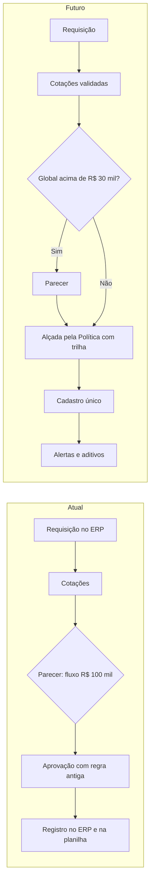
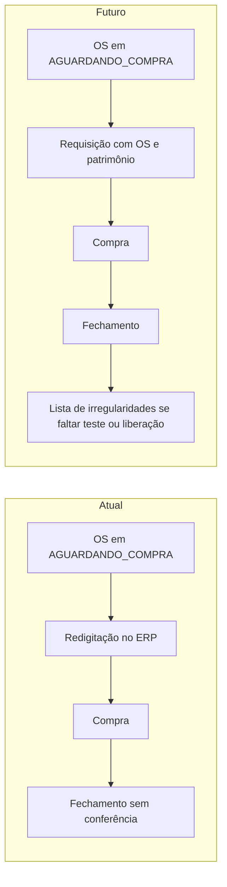
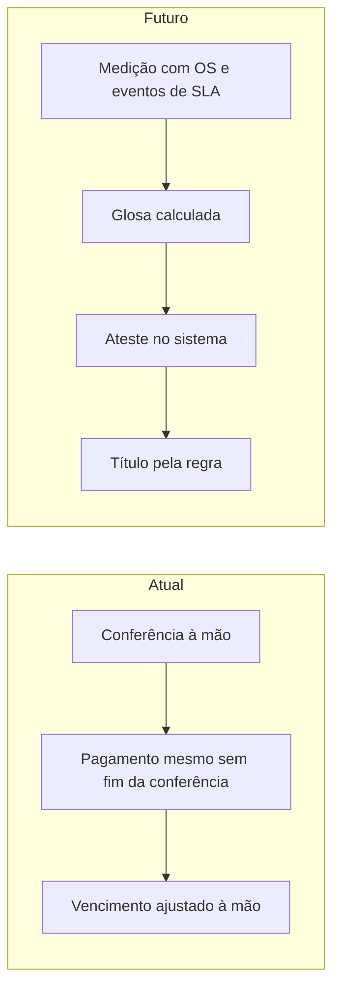

# Documentação de negócio

**Projeto:** sistema único de compras e contratos de manutenção de equipamentos, Rede Hospitalar Aurora do Vale.
**Data:** 04/11/2026. **Baseline:** sem baseline (requisitos ainda não validados pelas áreas).
**Fontes:** `escopo.md`; `erp_suprimax_dump.sql`; `manutclin_dump.sql`; `controle_contratos.csv`; `regras_da_planilha.md`; `politica_compras_POL-SUP-004_rev3.md`; `portaria_DG-017-2025_compras_emergenciais.md`; `manual_processo_compras_v2_2019.md`; `fluxo_contratacao_manutencao.md`; `indicadores_manutencao_2025.md`; `ata_comite_contratos_2026-08-19.md`; `respostas.md`.
**Legenda:** [F] fato com fonte; [I] inferência; [H] hipótese ou proposta. Requisito sem marca está confirmado; `[hipótese]` depende de resposta.

## 1. Resumo executivo

**Situação.** [F] Em 2025, a Rede gastou R$ 3.025.880,00 com manutenção de equipamentos, em três bases sem integração: ERP, ManutClin e uma planilha mantida por uma só pessoa. O ERP segue regras antigas: ninguém revisou sua configuração após a POL-SUP-004 rev. 3 (Q-003). A contratação leva 38 dias, a OS espera 21 dias por compra, a conferência de medição não termina antes do pagamento e nenhuma glosa foi aplicada em 2025.

**Proposta.** Um sistema único, cuja fase 1 entra em operação até 30/06/2027, com o mínimo definido pela Diretora Geral (Q-002), nesta ordem: cadastro único de contratos com alertas; aprovações conforme a Política com trilha; ligação entre OS, requisição e medição com ateste; cálculo de glosa por SLA. Custo por equipamento fica para a segunda fase.

**Os três maiores riscos.**

1. **Segurança e privacidade (RIS-001, RIS-002):** ventilador de nível 1 consta em uso com calibração vencida, e dados de paciente podem ser lidos pelo portal de prestadores. Não depende do projeto: exige ação agora.
2. **Pagamento sem cobertura (RIS-004, DIV-010):** contrato vencido segue em pagamento, e outro não está no ERP. Ninguém soube dizer quem decide a exceção (Q-007).
3. **Decisões estruturais sem dono (RIS-016):** das 15 perguntas, 8 voltaram integralmente sem decisão. Não se sabe se ERP e ManutClin ficam, nem onde o título é pago, nem como integrar.

**O que precisa ser decidido agora:** a fronteira dos sistemas (Q-001), o meio de integração (Q-018) e o pagamento (Q-004). Sem elas, a arquitetura é uma premissa, e a viabilidade de 30/06/2027 não pode ser afirmada. Orçamento e equipe também não constam nas fontes.

## 2. Problema e objetivos

| Objetivo | Indicador | Valor atual | Meta | Fonte |
|---|---|---|---|---|
| Reduzir o ciclo de contratação | Requisição à assinatura | 38 dias (23 no Jurídico) | A definir (Q-002) | `indicadores_manutencao_2025.md` |
| Reduzir espera de compra | Tempo em `AGUARDANDO_COMPRA` | 21 dias | A definir (Q-002) | `indicadores_manutencao_2025.md` |
| Conferir antes de pagar | Esforço de conferência | 2 analistas, cerca de 6 dias úteis/mês | A definir (Q-002) | Ata, item 4 |
| Eliminar ajuste manual de títulos | Títulos alterados | Cerca de 140/mês | A definir (Q-002) | Ata, item 6 |
| Aplicar a glosa contratual | Glosas aplicadas | R$ 0,00 em 2025 | A definir (Q-002) | `indicadores_manutencao_2025.md` |
| Saber o custo de manter cada equipamento (fase 2) | Custo por equipamento | Indisponível | A definir | Ata, item 1 |

A Diretora Geral não definiu qual número mede o sucesso. Nenhuma meta é proposta aqui, para não atribuir a ela uma decisão que não tomou.

## 3. Escopo

**Dentro (`escopo.md`):** requisição, cotação, aprovação, contrato, aditivo, renovação, medição e pagamento; relação com OS e inventário; visão consolidada por contrato, fornecedor, equipamento e unidade; quatro unidades.

**Na fase 1, por ordem de prioridade (Q-002):** contratos e alertas; aprovações e trilha; OS, requisição, medição e ateste; glosa. [I] Cotação entra por ser parte das aprovações. Pagamento e visão consolidada estão no escopo, mas fora da lista mínima, e ficam como Should.

**Na fase 2:** custo por equipamento (RF-010). A fase 1 já guarda o patrimônio na requisição (RF-017), para não perder dados.

**Fora:**

| Item | Motivo |
|---|---|
| Medicamentos e OPME | Fora do escopo; regidos pela POL-FAR-002 |
| Obras prediais | Fora do escopo |
| Prontuário eletrônico | Fora do escopo; por isso dados de paciente tendem a não entrar (Q-016) |
| Notificação de evento adverso | [H] Premissa, a confirmar com Qualidade (Q-017) |

## 4. Partes interessadas (RACI proposto [H])

| Atividade | Eng. Clínica | Suprimentos | Jurídico | Financeiro | Diretor Técnico | Diretora Geral | TI |
|---|---|---|---|---|---|---|---|
| Cadastro de contratos | C | C | R/A | C | I | I | I |
| Requisição e cotação | R | R/A | I | I | I | I | I |
| Aprovação por alçada | I | R até R$ 50.000,00 | C | R acima de R$ 50.000,00 | I | A acima de R$ 250.000,00 | I |
| Parecer acima de R$ 30.000,00 | I | I | R/A | I | I | I | I |
| Renovação (Q-008) | R | C | R | I | I | I | I |
| Ateste e glosa (Q-010) | R/A | I | C | C | I | I | I |
| Emergencial | C | R | I | I | A | I | I |
| Integração e migração | C | C | C | C | I | I | R/A (Q-018) |

## 5. O que foi decidido e o que é premissa

| Item | Decisão | Por quem | Fonte | Natureza |
|---|---|---|---|---|
| Mínimo da fase 1 e ordem | Quatro itens; custo na fase 2 | Diretora Geral | Q-002 | Decidido |
| Alçada de OC | R$ 50 mil e R$ 250 mil | Diretor Financeiro e Suprimentos | Q-003 | Decidido |
| Alçada de contrato | Valor global, assinados desde 01/01/2025 | Diretor Financeiro e Suprimentos | Q-003 | Decidido |
| Cotações | Duas de R$ 5.000,01 a R$ 15.000,00; três acima | Diretor Financeiro e Suprimentos | Q-003 | Decidido |
| Prazo de pagamento | 45 dias; mínimo 30, salvo emergencial | Diretor Financeiro e Suprimentos | Q-003 | Decidido |
| Parecer jurídico | Acima de R$ 30.000,00 de valor global | Jurídico | Q-006 | Decidido |
| SLA de CT-2024-0117 | 4 horas | Jurídico | Q-009 | Decidido |
| A, B, C | A = 1; B = 2 e 3; C = 4, enquanto o sistema novo não chega | Eng. Clínica | Q-011 | Decidido |
| Preventiva de ventiladores (CT-2023-0019) | Semestral | Eng. Clínica | Q-012 | Decidido |
| Liberação após reparo | Teste e assinatura obrigatórios | Eng. Clínica e Diretor Técnico | Q-013 | Decidido |
| Fronteira dos sistemas | Planilha substituída; ERP mantido em outras categorias; ManutClin integrado | Sem decisor | Q-001 | Premissa |
| Pagamento | Novo sistema gera título; baixa no sistema atual | Sem decisor | Q-004 | Premissa |
| Rateio | Igual, configurável | Sem decisor | Q-005 | Premissa (fase 2) |
| Contrato vencido | Bloqueia, com exceção do Diretor Financeiro | Sem decisor | Q-007 | Premissa |
| Renovação | 120 dias; Eng. Clínica como área gestora | Sem decisor | Q-008 | Premissa |
| Relógio de SLA e glosa | Pausa em item não coberto; glosa proposta e aceita no ateste | Sem decisor | Q-010 | Premissa |
| Calibração e liberação | Alerta e relatório; sem bloqueio | Sem decisor | Q-013 | Premissa |
| Paciente e evento adverso | Sem identificação; só indicador | Encaminhado | Q-016, Q-017 | Premissa |
| Integração | Extração controlada, somente leitura no ManutClin | Encaminhado | Q-018 | Premissa |

Exceções além da Política: o Diretor Financeiro e Suprimentos não souberam indicar outras (Q-003). O sistema não prevê nenhuma, mas isso não prova que não existam.

## 6. Processo atual e futuro

### 6.1 Contratação, renovação e aprovação

Gargalos atacados: GAR-001 (visibilidade, sem garantia de redução; o limite correto pode aumentar a fila), GAR-005. Papéis: Suprimentos, Jurídico, aprovadores. Regras: RN-001, RN-002, RN-003, RN-005, RN-006. Indicador: 38 dias de ciclo.

### 6.2 Corretiva, compra de peça e liberação

Gargalo atacado: GAR-002. Papéis: Eng. Clínica, Suprimentos. Regras: RN-012, RN-015. Indicador: 21 dias.

### 6.3 Medição, glosa e pagamento

Gargalos atacados: GAR-003, GAR-004. Papéis: Eng. Clínica, Financeiro. Regras: RN-004, RN-013, RN-017, RN-021, RN-008. Indicadores: 6 dias úteis, 140 títulos, R$ 0,00 de glosa.

### 6.4 Compra emergencial

Mantém o fluxo que funcionou em OC-2026-00412 (APO-003), com validação de R$ 100.000,00, alerta nas 72 horas e lista para o Comitê (RN-018, RF-020).

## 7. Regras de negócio, com exemplo

| ID | Regra | Exemplo | Status |
|---|---|---|---|
| RN-001 | Alçada de OC: até R$ 50.000,00, Gerente de Suprimentos; até R$ 250.000,00, Diretor Financeiro; acima, Diretora Geral | OC-2026-00388, de R$ 72.500,00, exigiria o Diretor Financeiro | Confirmado |
| RN-002 | Alçada de contrato pelo valor global, assinados desde 01/01/2025 | R$ 22.000,00 x 24 meses = R$ 528.000,00: Diretora Geral | Confirmado |
| RN-003 | Cotações: nenhuma até R$ 5.000,00; duas até R$ 15.000,00; três acima | OC-2026-00440, de R$ 19.800,00, exigiria três | Confirmado |
| RN-004 | Pagamento: 45 dias da nota; mínimo 30, salvo emergencial | OC-2026-00440, com 28 dias, seria recusada | Confirmado |
| RN-005 | Parecer acima de R$ 30.000,00 | CT-2026-0021, de R$ 58.800,00, exige parecer | Confirmado |
| RN-006 | Renovação 120 dias antes | CT-2025-0064: 03/10/2026 | `[hipótese]` Q-008 |
| RN-007 | IPCA desde 01/01/2024; anteriores mantêm índice | CT-2025-0064 em IPCA, não IGP-M | Confirmado |
| RN-008 | Bloqueio de medição após a vigência | CT-2022-0055 | `[hipótese]` Q-007 |
| RN-021 | Registro antes do primeiro pagamento | CT-2026-0021 | Confirmado |
| RN-009 | SLA do contrato assinado, em cadastro único | CT-2024-0117: 4 horas | Confirmado |
| RN-010, RN-023 | Quatro níveis; A = 1, C = 4, B pendente entre 2 e 3 | Tomógrafo (B) precisa de escolha | Confirmado |
| RN-011 | Preventiva semestral em CT-2023-0019 | Plano do ManutClin (365 dias) está errado | Confirmado |
| RN-012 | OS corretiva precisa de teste e liberação | OS 88213 é irregular | Confirmado |
| RN-013 | Pagamento só com ateste | Medição de 2026-08 de CT-2023-0088 | Confirmado |
| RN-014 | Solicitante não aprova | OC-2026-00420 | Confirmado |
| RN-016 | Soma das ordens da mesma requisição | OC 00301 a 00303: R$ 149.300,00 | Confirmado |
| RN-017 | Glosa de 2% do valor mensal por evento | OS 88170 em CT-2024-0117: R$ 220,80 | Confirmado |
| RN-018 | Emergencial: até R$ 100.000,00; Diretor Técnico em até 72 horas | OC-2026-00412 é conforme | Confirmado |
| RN-019 | Moeda original e câmbio de referência | 9.800 USD x 12 x 5,40 = R$ 635.040,00 | Confirmado |

## 8. Requisitos por área

| Área | Confirmados | Hipóteses |
|---|---|---|
| Financeiro | RN-001, RN-002, RN-004, RN-007, RN-013, RN-016, RN-017, RN-019, RF-010, RN-021, RF-016 | RN-008, RF-006, RNF-006, RN-020, RN-026, RN-027 |
| Jurídico | RN-002, RN-005, RN-007, RN-009, RF-001, RF-008, RNF-002, RN-021, RF-015, RF-018 | RN-006, RN-008, RF-003, RNF-001, RF-014 |
| Suprimentos | RN-003, RN-014, RN-016, RN-018, RF-004, RF-016, RF-017, RF-020 | RN-006, RNF-006, RN-025 |
| Engenharia Clínica | RN-009, RN-010, RN-011, RN-012, RN-013, RN-017, RF-004, RF-005, RN-023 | RN-006, RN-015, RF-007, RN-022, RN-024, RN-026, RF-013 |
| PMO e transição | RF-008 | RF-002, RF-011, RF-012, RNF-003, RNF-005, RF-014 |
| Diretoria | RF-009, RF-010 | RF-019 |
| Segurança e TI | RNF-002 | RNF-001, RNF-004, RNF-007, RNF-008, RNF-009, RNF-010, RNF-011 |

Enunciados completos: `03-tecnico.md`, seções 3, 5 e 7.

## 9. Pendências

Os prazos são propostas [H] para proteger 30/06/2027.

| Pergunta | Decisão | Responsável | Prazo [H] | O que trava | Efeito se não houver resposta |
|---|---|---|---|---|---|
| Q-001 | Destino de ERP e ManutClin | Diretora Geral não soube; levar ao Comitê de Contratos, com TI | 30/11/2026 | Arquitetura, integrações, migração (US-022) | Premissa vira risco de retrabalho estrutural |
| Q-018 | Meios de integração | Coordenador de TI, Rafael Couto (encaminhado pela TI) | 30/11/2026 | US-022, US-023, US-024, US-042 | Sem OS e inventário, EP-003 e EP-004 não rodam |
| Q-004 | Onde o título é pago; motivo das alterações | Diretor Financeiro não soube; indicar quem opera a tesouraria | 15/12/2026 | US-034 | Ajuste manual pode continuar |
| Q-007 | Bloqueio e exceção de contrato vencido | Jurídico e Diretor Financeiro não souberam; levar à Diretora Geral | 15/12/2026 | US-006 | Pagamentos sem cobertura podem continuar, ou bloquear serviço assistencial |
| Q-008 | Área gestora da renovação | Suprimentos não soube; levar ao Comitê | 15/12/2026 | US-007 | Alerta sem responsável claro; fluxo de 90 dias segue em uso |
| Q-010 | Relógio do SLA e aceite da glosa | Eng. Clínica não soube; levar a Jurídico e Financeiro | 31/01/2027 | US-033 | Glosa só calculada, sem aplicação definida |
| Q-013 | Alerta ou bloqueio no ManutClin | Eng. Clínica e Diretor Técnico não souberam (parte) | 15/12/2026 | RN-024 | Só alerta; risco assistencial continua no sistema de origem |
| Q-016 | Identificação de paciente | Encarregado de dados (DPO), Gustavo Leme | 30/11/2026 | US-038, migração | Dados não entram até decisão |
| Q-017 | Evento adverso e notificação | Gerência de Qualidade e Segurança do Paciente, Dra. Ana Prado | 15/12/2026 | US-038 | Fica fora do sistema; só indicador |
| Q-002 | Número e meta de sucesso | Diretora Geral (parte) | 15/12/2026 | US-036 | Sem como declarar sucesso da fase 1 |
| Q-005 | Rateio do contrato | Diretor Financeiro, com Controladoria | Antes da fase 2 | US-037 | Sem bloqueio na fase 1 |

Ainda abertos, sem pergunta adicional: orçamento e equipe; exceções à Política além das citadas; regularização dos casos passados; retenção de registros; DIV-006, DIV-008, DIV-009, DIV-010, DIV-012, DIV-014 e DIV-015.

## 10. Riscos para o patrocinador

| ID | Causa | Efeito | Prob. | Impacto | Mitigação | Responsável [H] |
|---|---|---|---|---|---|---|
| RIS-001 | ManutClin não bloqueia calibração vencida | Uso assistencial de equipamento de nível 1 fora da política | Alta | Crítico | Verificar PAT-004512 já; US-028 | Eng. Clínica, Diretor Técnico |
| RIS-002 | OS com dado de paciente e acesso amplo | Exposição de dado de saúde | Média | Crítico | Rever acesso já; Q-016; US-038 | DPO, TI |
| RIS-004 | ERP não confere fim da vigência | Pagamento sem cobertura; estimativa de até R$ 97.240,00 se todos os 13 meses foram pagos | Alta | Alto | Regularizar CT-2022-0055; Q-007 | Jurídico, Diretor Financeiro |
| RIS-016 | Sem decisor | Arquitetura e prazo incertos | Alta | Alto | Levar pendências ao Comitê | Diretora Geral |
| RIS-009 | Seis contratos acabam antes de 30/06/2027 | Renovações no processo antigo | Alta | Alto | Calendário; US-010 | Jurídico |
| RIS-005 | ERP não soma ordens | Fracionamento (R$ 149.300,00) | Média | Alto | US-017; levar ao Comitê | Diretor Financeiro |
| RIS-006 | Sem apuração automática | Glosa não aplicada | Alta | Médio | US-031, US-032 | Eng. Clínica, Financeiro |
| RIS-003 | Prestador edita hora base | SLA pouco confiável | Média | Alto | Trilha; rever acesso | TI |
| RIS-011 | OC sem patrimônio | Sem custo por equipamento | Alta | Alto (fase 2) | Patrimônio já na fase 1 | Financeiro |
| RIS-008 | Uma pessoa na planilha | Dado parado nas férias | Alta | Médio | US-002 | Jurídico |

**Ações que não devem esperar o sistema [H]:** verificar PAT-004512 e OS 88213; rever `prestador_portal`; decidir CT-2022-0055 e CT-2026-0021; corrigir CT-2024-0117 e a preventiva de ventiladores no ManutClin; ajustar os parâmetros do ERP, que seguem valendo enquanto ele estiver em uso.

## 11. Validação por área

| Área | O que confirmar |
|---|---|
| Diretora Geral | Ordem do mínimo; fronteira (Q-001); meta (Q-002); ações imediatas |
| Financeiro | RN-001 a RN-004, RN-017, RN-019, RN-020; premissas de pagamento (Q-004) |
| Suprimentos | RN-003, RN-014, RN-016, RN-018, RN-025; Q-008 |
| Jurídico | RN-005, RN-007, RN-009, RN-021; RF-001, RF-018; Q-007 |
| Eng. Clínica | RN-010 a RN-013, RN-015, RN-023; lista de equipamentos B; Q-010, Q-013 |
| Diretor Técnico | RN-012, RN-018; Q-013 |
| DPO e Qualidade | RNF-001; Q-016; Q-017 |
| TI | Seção de integrações do documento técnico; RNF-008 a RNF-011; Q-018 |

## 12. Glossário

| Termo | Definição | Fonte |
|---|---|---|
| OS | Ordem de serviço no ManutClin | `manutclin_dump.sql` |
| OC | Ordem de compra: REGULAR, EMERGENCIAL ou AVULSA | `erp_suprimax_dump.sql` |
| Medição | Valor mensal de contrato sujeito a ateste, glosa e pagamento | `erp_suprimax_dump.sql` |
| Ateste | Confirmação da Engenharia Clínica para pagar | POL-SUP-004 §5.2 |
| Glosa | Desconto de 2% do valor mensal por evento | POL-SUP-004 §5.3 |
| SLA de atendimento / solução | Horas até iniciar / até resolver | `regras_da_planilha.md`; `manutclin_dump.sql` |
| Valor global | Valor durante toda a vigência | POL-SUP-004 §2.2 |
| Área gestora | Citada na POL-SUP-004 §4.2, sem definição (Q-008) | POL-SUP-004 |
| Níveis de criticidade | 1 Suporte à vida, 2 Alto, 3 Médio, 4 Baixo | POL-SUP-004 §6.2 |

## 13. Histórico de mudanças

| Versão | Data | Mudança |
|---|---|---|
| 1 | 04/11/2026 | Primeira versão, após as respostas de `respostas.md`. |
