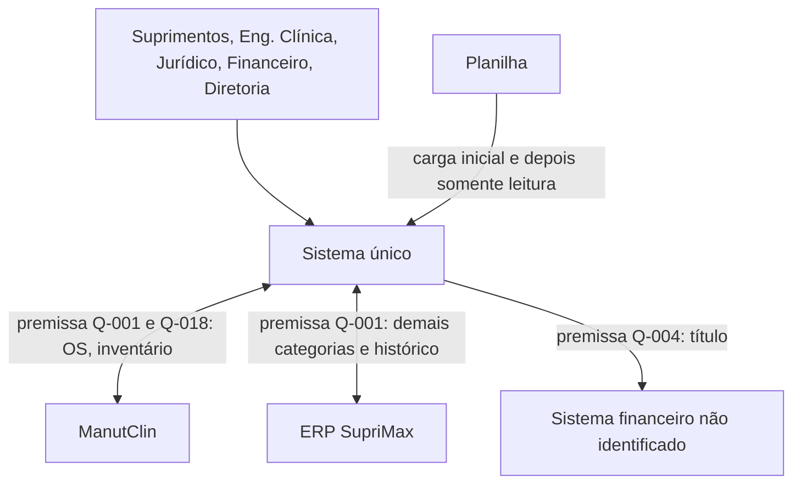
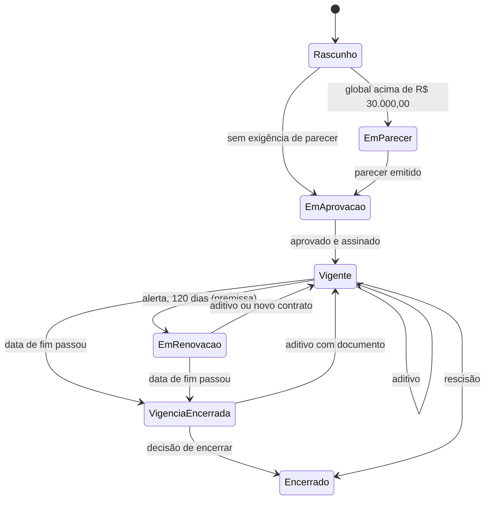
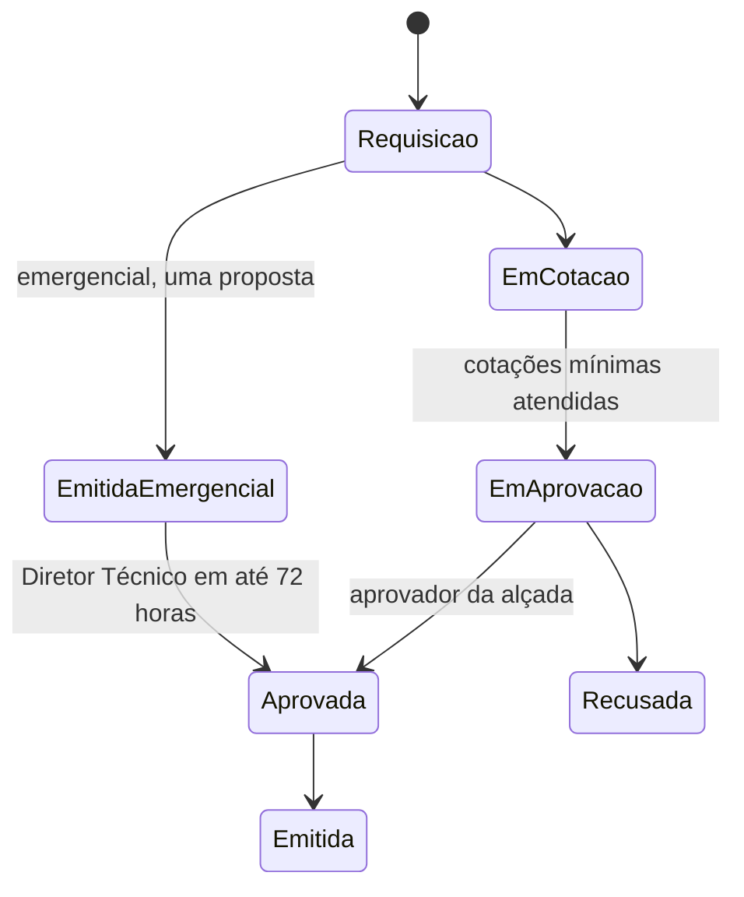
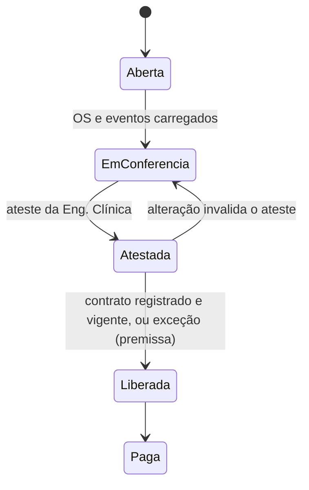
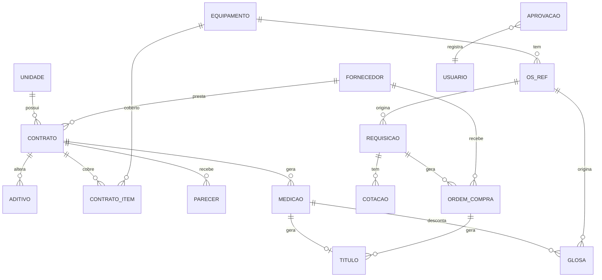

# Documentação técnica

**Projeto:** sistema único de compras e contratos de manutenção de equipamentos, Rede Hospitalar Aurora do Vale.
**Data:** 04/11/2026. **Baseline:** sem baseline. Base: ISO/IEC/IEEE 29148.
**Fontes:** `erp_suprimax_dump.sql`; `manutclin_dump.sql`; `controle_contratos.csv`; `regras_da_planilha.md`; documentos de `fontes/geral`; `respostas.md`.
**Legenda:** [F] fato; [I] inferência; [H] hipótese ou proposta. Nenhuma tecnologia é prescrita: as fontes não trazem restrição, e TI ainda não respondeu (Q-018).

## 1. Introdução

**Propósito:** especificar a fase 1, com entrada em operação até 30/06/2027. **Escopo:** contratos, aprovações, ligação entre OS, requisição e medição, glosa e, como Should, pagamento e visão consolidada. **Fora:** medicamentos, OPME, obras prediais e prontuário. Definições: seção 12 do documento de negócio (`02-negocio.md`).

## 2. Visão geral

**Atores:** Analista de Compras, Gerente de Suprimentos, Diretor Financeiro, Diretora Geral, Diretor Técnico, Gerente e analistas da Eng. Clínica, Jurídico, Financeiro, administrador. Prestadores não usam o novo sistema na fase 1 [H].

**Premissas:** todas as da seção 5 do documento de negócio marcadas como premissa. A arquitetura muda se Q-001 for respondida de outro modo; por isso, a integração fica isolada (ADR-1 e ADR-2).

**Restrições:** prazo de 30/06/2027; regras de POL-SUP-004 rev. 3 e Portaria DG-017/2025; RDC Anvisa 509/2021, citada pela política §6.1 e não detalhada nas fontes.

## 3. Requisitos funcionais

Status: confirmado, ou `[hipótese]`. Critérios de aceite completos em `04-backlog.md`.

| ID | Título | Enunciado | Prior. | Status |
|---|---|---|---|---|
| RF-001 | Cadastro único de contratos | O sistema deve manter um cadastro único de contratos com aditivos, vigência, valor, SLA, índice e status calculado. | Must | Confirmado |
| RF-002 | Migração e de-para de chaves | O sistema deve fazer a carga inicial e o de-para de legado usando número do contrato, CNPJ, patrimônio e unidade. | Must | `[hipótese]` |
| RF-003 | Fila de parecer | O sistema deve registrar entrada, saída e responsável de cada parecer jurídico e mostrar a fila. | Should | `[hipótese]` |
| RF-004 | Requisição a partir de OS | O sistema deve ligar OS, requisição e medição e criar requisição a partir de OS em AGUARDANDO_COMPRA, sem redigitação. | Must | Confirmado |
| RF-005 | Conferência assistida de medição | O sistema deve cruzar medição com OS e SLA, apresentar divergências e registrar o ateste da Engenharia Clínica. | Must | Confirmado |
| RF-006 | Título com vencimento correto | O sistema deve gerar o título com vencimento calculado pela regra vigente e registrar alterações com motivo. | Should | `[hipótese]` |
| RF-007 | Consulta de inventário e calibração | O sistema deve receber do ManutClin patrimônio, unidade, status, criticidade e validade de calibração. | Must | `[hipótese]` |
| RF-008 | Alertas de renovação | O sistema deve enviar alertas de renovação de contrato aos responsáveis. | Must | Confirmado |
| RF-009 | Visão consolidada | O sistema deve apresentar painel consolidado por contrato, fornecedor, equipamento e unidade, em reais e na moeda original. | Should | Confirmado |
| RF-010 | Custo por equipamento | O sistema deve calcular custo por equipamento somando contrato, chamados e peças. | Could | Confirmado |
| RF-011 | Integração com sistemas mantidos | O sistema deve integrar com os sistemas mantidos, com monitoramento, tratamento de falha e reprocessamento. | Must | `[hipótese]` |
| RF-012 | Convivência e treinamento | O sistema deve ter plano de transição com convivência, treinamento das áreas e desligamento da planilha. | Should | `[hipótese]` |
| RF-013 | Conciliação contrato x plano preventivo | O sistema deve sinalizar diferença entre a periodicidade contratada e a do plano preventivo. | Should | `[hipótese]` |
| RF-014 | Importação de renovações do legado | O sistema deve permitir a importação das renovações feitas no legado durante a transição. | Must | `[hipótese]` |
| RF-015 | Fluxo de renovação | O sistema deve conduzir a renovação de contrato até a assinatura, com status e responsável. | Should | Confirmado |
| RF-016 | Fluxo de aprovação | O sistema deve encaminhar OC e contrato ao aprovador da alçada e registrar a decisão. | Must | Confirmado |
| RF-017 | Requisição e cotações | O sistema deve registrar requisição, unidade, patrimônio quando houver e cotações. | Must | Confirmado |
| RF-018 | Aditivos com histórico | O sistema deve registrar cada aditivo com vigência e valor anteriores e novos e avisar o Jurídico. | Must | Confirmado |
| RF-019 | Linha de base de indicadores | O sistema deve apresentar os indicadores de ciclo de contratação, espera de compra, conferência, títulos alterados e glosas. | Should | `[hipótese]` |
| RF-020 | Registro de compra emergencial | O sistema deve registrar compra emergencial com proposta, aprovação posterior do Diretor Técnico e lista para o Comitê. | Must | Confirmado |

Regras (enunciados):

| ID | Título | Enunciado | Prior. | Status |
|---|---|---|---|---|
| RN-001 | Alçada de OC pela política | O sistema deve exigir aprovador Gerente de Suprimentos até R$ 50.000,00, Diretor Financeiro de R$ 50.000,01 a R$ 250.000,00 e Diretora Geral acima de R$ 250.000,00. | Must | Confirmado |
| RN-002 | Alçada de contrato pelo valor global | O sistema deve definir a alçada de contrato assinado desde 01/01/2025 pelo valor global durante toda a vigência. | Must | Confirmado |
| RN-003 | Cotações pela política | O sistema deve exigir zero cotação até R$ 5.000,00, duas de R$ 5.000,01 a R$ 15.000,00 e três acima de R$ 15.000,00, salvo emergencial. | Must | Confirmado |
| RN-004 | Prazo de pagamento | O sistema deve usar prazo padrão de 45 dias da emissão da nota, com mínimo de 30 dias, salvo compra emergencial. | Must | Confirmado |
| RN-005 | Parecer jurídico por valor | O sistema deve exigir parecer jurídico antes da aprovação de contrato com valor global acima de R$ 30.000,00. | Must | Confirmado |
| RN-006 | Início da renovação | O sistema deve abrir a renovação 120 dias antes do fim da vigência para a área gestora e o Jurídico. | Must | `[hipótese]` |
| RN-007 | Índice de reajuste | O sistema deve aplicar IPCA a contrato assinado desde 01/01/2024, manter o índice original nos anteriores até o fim da vigência e não aplicar índice a contrato em moeda estrangeira. | Must | Confirmado |
| RN-008 | Pagamento depende de contrato vigente e registrado | O sistema deve bloquear a liberação de medição de contrato com vigência encerrada, salvo exceção aprovada com justificativa. | Must | `[hipótese]` |
| RN-009 | Fonte única do SLA | O sistema deve guardar SLA de atendimento e de solução em um único cadastro por contrato, com o valor do contrato assinado; em CT-2024-0117, o atendimento é de 4 horas. | Must | Confirmado |
| RN-010 | Criticidade única | O sistema deve classificar cada equipamento nos quatro níveis da política: 1 Suporte à vida, 2 Alto, 3 Médio, 4 Baixo. | Must | Confirmado |
| RN-011 | Preventiva de ventiladores da Central | O sistema deve registrar preventiva semestral para os ventiladores de CT-2023-0019, conforme o contrato assinado. | Should | Confirmado |
| RN-012 | Retorno ao uso depende de teste e liberação | O sistema deve identificar como irregular toda OS corretiva fechada sem teste aprovado e liberação assinada. | Must | Confirmado |
| RN-013 | Pagamento depende de ateste | O sistema deve bloquear o pagamento de medição sem ateste da Engenharia Clínica. | Must | Confirmado |
| RN-014 | Segregação de funções | O sistema deve impedir que o solicitante aprove a própria compra. | Must | Confirmado |
| RN-015 | Calibração vencida | O sistema deve alertar a Engenharia Clínica sobre equipamento em uso com calibração vencida. | Must | `[hipótese]` |
| RN-016 | Detecção de fracionamento | O sistema deve somar as ordens da mesma requisição para definir alçada e cotações. | Must | Confirmado |
| RN-017 | Glosa por descumprimento de SLA | O sistema deve calcular glosa de 2% do valor mensal por evento de descumprimento de SLA. | Must | Confirmado |
| RN-018 | Compra emergencial | O sistema deve limitar a compra emergencial a R$ 100.000,00 por ocorrência, com aprovação do Diretor Técnico em até 72 horas e comunicação ao Comitê. | Must | Confirmado |
| RN-019 | Moeda estrangeira | O sistema deve guardar contrato na moeda original e o câmbio de referência definido pelo Financeiro para consolidação. | Must | Confirmado |
| RN-020 | Valor global com aditivo e moeda | O sistema deve somar aditivos ao valor global e converter moeda estrangeira pelo câmbio de referência ao definir alçada e parecer. | Should | `[hipótese]` |
| RN-021 | Registro antes do primeiro pagamento | O sistema deve impedir o primeiro pagamento de contrato não registrado. | Must | Confirmado |
| RN-022 | Criticidade do contrato | O sistema deve derivar a criticidade do contrato do maior nível dos equipamentos cobertos. | Could | `[hipótese]` |
| RN-023 | Conversão de A, B, C | O sistema deve converter A para nível 1 e C para nível 4 e deixar B pendente de escolha entre níveis 2 e 3 pela Engenharia Clínica. | Must | Confirmado |
| RN-024 | Bloqueio operacional | O ManutClin deve bloquear o retorno ao uso sem liberação e o uso com calibração vencida. | Should | `[hipótese]` |
| RN-025 | Alerta de recorrência | O sistema deve alertar sobre OCs recorrentes do mesmo fornecedor e unidade sem contrato vinculado. | Should | `[hipótese]` |
| RN-026 | Relógio do SLA e aceite da glosa | O sistema deve pausar o relógio em espera de item não coberto e submeter a glosa proposta ao aceite no ateste. | Should | `[hipótese]` |
| RN-027 | Rateio do contrato | O sistema deve ratear o valor do contrato igualmente entre os equipamentos cobertos, com critério configurável. | Could | `[hipótese]` |

## 4. Ciclo de vida das entidades centrais

### 4.1 Contrato

A vigência é **calculada** pelas datas, nunca digitada. "Em renovação" é indicador paralelo, para não esconder o vencimento (DIV-009).

### 4.2 Requisição e OC

### 4.3 Medição

### 4.4 Equipamento (espelho do ManutClin)

Somente leitura pela premissa Q-001. Status de origem: `EM_USO`, `MANUTENCAO`, `RESERVA`, `BAIXADO`. O novo sistema acrescenta nível de criticidade e irregularidades, sem alterar o status na origem.

## 5. Requisitos não funcionais (ISO/IEC 25010)

Valores marcados `[hipótese]` são propostas, não vieram das áreas.

| ID | Título | Enunciado | Prior. | Status | Categoria |
|---|---|---|---|---|---|
| RNF-001 | Dados de paciente fora do sistema | O sistema deve receber 0 campo identificador de paciente das OS (premissa; confirmar com o DPO). | Must | `[hipótese]` | segurança |
| RNF-002 | Trilha de auditoria | O sistema deve gravar 1 registro de auditoria por aprovação, com usuário, data, valor anterior e valor novo. | Must | Confirmado | segurança |
| RNF-003 | Atualização da integração | O sistema deve refletir OS e inventário em até 24 horas (valor proposto; confirmar com TI e Engenharia Clínica). | Should | `[hipótese]` | desempenho |
| RNF-004 | Permissões por papel | O sistema deve conceder acesso por papel e unidade, com 0 acesso externo a dados de pagamento. | Must | `[hipótese]` | segurança |
| RNF-005 | Capacidade inicial | O sistema deve suportar pelo menos 4.812 equipamentos, 640 OS por mês e 1.460 OCs por ano sem perda de registros. | Should | `[hipótese]` | desempenho |
| RNF-006 | Parâmetros versionados | O sistema deve manter 100% dos limites de alçada, cotação e prazo como parâmetros com vigência, sem exigir nova versão do software. | Should | `[hipótese]` | manutenibilidade |
| RNF-007 | Auditoria de demais objetos | O sistema deve registrar trilha em 100% das alterações de contrato, medição e título (valor proposto). | Must | `[hipótese]` | segurança |
| RNF-008 | Disponibilidade | O sistema deve ter disponibilidade mensal de 99,5% em horário comercial (valor proposto; confirmar com TI). | Should | `[hipótese]` | confiabilidade |
| RNF-009 | Tempo de resposta | O sistema deve abrir consultas e painéis em até 3 s em 95% das requisições (valor proposto; confirmar com TI). | Should | `[hipótese]` | desempenho |
| RNF-010 | Recuperação | O sistema deve ter backup diário e restauração em até 8 horas (valor proposto; confirmar com TI). | Should | `[hipótese]` | confiabilidade |
| RNF-011 | Monitoramento de integração | O sistema deve alertar falha de integração em até 15 min (valor proposto; confirmar com TI). | Must | `[hipótese]` | confiabilidade |

## 6. Interfaces externas

Ver seção 15. Interface de usuário em navegador [H]. Autenticação: a definir com TI, sem fonte.

## 7. Regras de negócio, com cálculo e limites

| ID | Cálculo | Limite | Exemplo |
|---|---|---|---|
| RN-001 | Valor total da OC | R$ 50.000,00 e R$ 250.000,00 são inclusive na faixa inferior | R$ 50.000,01 vai ao Diretor Financeiro |
| RN-002 | Valor mensal x meses de vigência, para assinados desde 01/01/2025 | Contrato anterior não é reavaliado | R$ 6.800,00 x 24 = R$ 163.200,00 |
| RN-020 `[hipótese]` | Global + aditivos; moeda x câmbio de referência | Câmbio definido na assinatura | 9.800 x 36 x 5,40 = R$ 1.905.120,00 |
| RN-003 | Quantidade de cotações pela faixa do total | R$ 5.000,00 dispensa; R$ 15.000,00 pede duas; R$ 15.000,01 pede três | R$ 19.800,00 pede três |
| RN-004 | Vencimento = emissão da nota + 45 dias | 30 dias aceita; 29 recusa, salvo emergencial | Emergencial com 15 dias aceita |
| RN-005 | Global acima de R$ 30.000,00 | Exatamente R$ 30.000,00 não exige | R$ 58.800,00 exige |
| RN-006 `[hipótese]` | Fim da vigência − 120 dias | 121 dias sem alerta | 31/01/2027 → 03/10/2026 |
| RN-016 | Soma das ordens da mesma requisição | "Mesma necessidade" além da requisição: RN-025 | R$ 49.800,00 + R$ 49.700,00 + R$ 49.800,00 = R$ 149.300,00 |
| RN-017 | Glosa = 2% x valor mensal x eventos | Na moeda do contrato [I] | R$ 11.040,00 x 2% = R$ 220,80 |
| RN-026 `[hipótese]` | SLA = atendimento − abertura; solução exclui espera de item não coberto | No limite está dentro [H] | OS 88170: 14,2 horas contra 4 horas |
| RN-018 | Emergencial até R$ 100.000,00; aprovação até emissão + 72 horas | R$ 100.000,00 aceita | OC-2026-00412: R$ 92.000,00 |
| RN-023 | A → 1; C → 4; B → pendente | Sem conversão automática de B | Volta ao ManutClin: 1 → A; 2 e 3 → B; 4 → C [I] |

## 8. Mudanças necessárias nos sistemas atuais

Valem **enquanto o legado estiver em uso** e independem do novo sistema, salvo indicação. Nenhuma foi executada.

| Sistema | Objeto | Mudança | Motivo | Fonte |
|---|---|---|---|---|
| ERP | `fn_valida_alcada_oc` | Trocar R$ 80.000 por R$ 50.000,00; recusar aprovação sem aprovador quando houver aprovação; rever exceção de EMERGENCIAL | DIV-001, RIS-007 | Q-003 |
| ERP | `fn_valida_alcada_contrato` | Usar valor global para assinados desde 01/01/2025 | DIV-002 | Q-003 |
| ERP | `fn_valida_cotacoes` | Duas acima de R$ 5.000,00; três acima de R$ 15.000,00; incluir AVULSA | DIV-003 | Q-003 |
| ERP | `chk_prazo_pagamento` e padrão de `prazo_pagamento_dias` | Permitir 45 dias, padrão 45, mínimo 30; menos só em EMERGENCIAL | DIV-004 | Q-003 |
| ERP | `fn_libera_medicao` | Exigir ateste e conferir vigência (a segunda depende de Q-007) | DIV-017, RIS-004 | POL §5.2 |
| ERP | `contrato.indice_reajuste` | Padrão IPCA; corrigir CT-2025-0064 | DIV-007 | POL §4.3 |
| ERP | Triggers de OC | Bloquear solicitante = aprovador; reavaliar alçada se o valor mudar | DIV-018, RIS-007 | POL §2.3 |
| ERP | `usuario.nivel_alcada` | Rever nível 2 do Diretor Técnico: a política só lhe dá alçada emergencial [I] | RIS-007 | POL §2; Portaria |
| ERP | `contrato` | Registrar CT-2026-0021 depois de regularizado | DIV-010 | POL §4.1 |
| ManutClin | `contrato_ref` | CT-2024-0117: atendimento 8 → 4 horas | DIV-011 | Q-009 |
| ManutClin | `plano_preventivo` | VEN em CEN: 365 → 180 dias [I: 180 é o valor usado nos outros contratos semestrais] | DIV-013 | Q-012 |
| ManutClin | `trg_os_fecha` | Exigir teste e liberação (depende de Q-013) | DIV-016 | Q-013 |
| ManutClin | Permissão `prestador_portal` | Restringir colunas e origem; rever UPDATE de `atendimento` | RIS-002, RIS-003 | Recomendação; Q-016 |
| ManutClin | `paciente_nome`, `paciente_prontuario` | Avaliar remoção ou mascaramento | RIS-002 | Q-016 |
| Documento | Fluxo de contratação | Corrigir parecer para R$ 30.000,00; renovação após Q-008 | DIV-005 | Q-006 |
| Documento | Manual v2 (2019) | Revogar ou atualizar capítulos restantes | RIS-013 | POL §1.3 |

## 9. Matriz de acesso [H]

C consultar; I incluir ou alterar; A aprovar; — sem acesso.

| Papel | Contrato | Requisição e cotação | OC | Parecer | Medição | Glosa | Título | Equipamento e OS | Trilha |
|---|---|---|---|---|---|---|---|---|---|
| Analista de Compras | C | I | I | — | — | — | — | C | — |
| Gerente de Suprimentos | C | A | A até R$ 50.000,00 | C | C | — | — | C | C |
| Diretor Financeiro | C | C | A até R$ 250.000,00 | C | C | C | C | C | C |
| Diretora Geral | C | C | A acima | C | C | C | C | C | C |
| Diretor Técnico | C | C | A emergencial | — | C | C | — | C | C |
| Eng. Clínica | C | I | C | — | I, A (ateste) | I | — | C | — |
| Jurídico | I | — | C | I, A | C | C | — | — | C |
| Financeiro | C, I (câmbio) | — | C | — | C | C | I | — | C |
| Administrador | Parâmetros | — | — | — | — | — | — | — | C |

Dados de paciente não entram: não há papel com acesso (RNF-001, premissa até Q-016). Trilha nunca é alterável.

## 10. Cenários de teste de referência

Derivados de casos reais, sem dados pessoais. Lista completa, por critério: `.re/cenarios.md`.

| # | Caso | Entrada | Resultado esperado | Requisito |
|---|---|---|---|---|
| 1 | OC-2026-00388 | R$ 72.500,00, Gerente de Suprimentos | Recusa; vai ao Diretor Financeiro | RN-001 |
| 2 | Limite de alçada | R$ 50.000,00 | Gerente de Suprimentos aprova | RN-001 |
| 3 | Limite de alçada | R$ 250.000,01 | Diretora Geral | RN-001 |
| 4 | CT-2025-0064 | R$ 22.000,00 x 24, assinado desde 2025 | Base R$ 528.000,00; Diretora Geral | RN-002 |
| 5 | CT-2025-0102 | R$ 6.800,00 x 24 | Base R$ 163.200,00; Diretor Financeiro | RN-002 |
| 6 | CT-2025-0031 | 9.800 USD x 36 x 5,40 | Base R$ 1.905.120,00 | RN-020 |
| 7 | OC-2026-00440 | R$ 19.800,00, uma cotação | Recusa | RN-003 |
| 8 | Limite de cotação | R$ 15.000,00 com duas | Aceita | RN-003 |
| 9 | OC-2026-00440 | Prazo de 28 dias | Recusa | RN-004 |
| 10 | OC-2026-00412 | Emergencial, 15 dias, uma proposta, R$ 92.000,00 | Aceita | RN-018, RN-004 |
| 11 | Limite emergencial | R$ 100.000,01 | Recusa como emergencial | RN-018 |
| 12 | OC-2026-00301 a 00303 | Soma R$ 149.300,00 | Alçada do Diretor Financeiro | RN-016 |
| 13 | OC-2026-00420 | Solicitante = aprovador | Recusa | RN-014 |
| 14 | CT-2026-0021 | R$ 58.800,00 sem parecer | Recusa | RN-005 |
| 15 | Limite de parecer | R$ 30.000,00 | Não exige | RN-005 |
| 16 | CT-2026-0021 | Pagamento sem registro | Recusa | RN-021 |
| 17 | CT-2022-0055 | Medição 2026-08 sem exceção | Recusa (premissa) | RN-008 |
| 18 | CT-2023-0088 | Aditivo para 31/12/2026 | Vigência nova; histórico; aviso ao Jurídico | RF-018 |
| 19 | CT-2023-0088 | Medição 2026-08 sem ateste | Recusa | RN-013 |
| 20 | CT-2025-0064 | Cadastro com IGP-M | Recusa | RN-007 |
| 21 | CT-2024-0117 | Migração de SLA | 4 horas | RN-009 |
| 22 | OS 88170 | 14,2 horas com SLA de 4 horas | Evento; glosa R$ 220,80 | RN-017 |
| 23 | OS 88213 | 3,4 horas com SLA de 4 horas | Dentro do SLA | RN-009 |
| 24 | OS 88213 | Fechada sem teste e liberação | Lista de irregularidades | RN-012 |
| 25 | PAT-004512 | `EM_USO`, validade 31/03/2026 | Alerta | RN-015 |
| 26 | PAT-016002 | Sem validade | Sem informação, não conforme | RN-015 |
| 27 | CT-2023-0019 | Contrato semestral, plano 365 dias | Diferença sinalizada | RF-013 |
| 28 | Equipamento B | Carga | Pendente entre níveis 2 e 3 | RN-023 |
| 29 | OS 88190 | Criar requisição | Vínculo com OS e patrimônio, sem redigitação | RF-004 |
| 30 | Fornecedor com mesmo CNPJ e dois nomes | Migração | Um cadastro | RF-002 |
| 31 | OS com nome de paciente | Integração | Campo não armazenado | RNF-001 |
| 32 | Consolidação | CT-2025-0031 | R$ 635.040,00, não R$ 117.600,00 | RN-019 |

## 11. Migração e transição

1. **Saneamento antes da carga [H]:** conferir no documento assinado os oito contratos, com atenção a CT-2022-0055, CT-2023-0088, CT-2024-0117 e CT-2026-0021.
2. **Carga:** contratos (ERP + planilha, após conferência); fornecedores por CNPJ; equipamentos do ManutClin, sem campos de paciente; reclassificação dos equipamentos B pela Eng. Clínica.
3. **Convivência:** seis contratos vencem antes de 30/06/2027; as renovações no legado são importadas (RF-014). Planilha fica somente leitura após a entrada em operação (RF-012).
4. **Histórico:** escopo a definir com Q-001 e Q-018. Sem dados de paciente até Q-016.
5. **Treinamento:** por área, antes da entrada de cada onda.

**Riscos:** amostras nos dumps, então a qualidade real é desconhecida (RIS-012); B sem conversão automática; 4.812 equipamentos a sincronizar.

## 12. Decisões candidatas a ADR

| # | Contexto | Opção proposta [H] | Consequência |
|---|---|---|---|
| ADR-1 | Fronteira com ERP e ManutClin indefinida (Q-001) | Isolar integração em uma camada própria | Muda pouco se a resposta mudar |
| ADR-2 | Meios de integração desconhecidos (Q-018) | Extração periódica com carga idempotente; leitura no ManutClin | Latência de até 24 horas |
| ADR-3 | Vigência digitada gera erro (DIV-009) | Status calculado | Sem status manual de vigência |
| ADR-4 | Regras mudam com a política (RIS-013) | Parâmetros com vigência | Exige administração de parâmetros |
| ADR-5 | Patrimônio já é chave (APO-001) | Patrimônio e CNPJ como chaves naturais de integração | Depende da qualidade da etiqueta |
| ADR-6 | Dado de saúde na OS (RIS-002) | Lista de campos permitidos na integração, em vez de lista de bloqueados | Campo novo não entra sem revisão |

## 13. Pendências técnicas

Q-001, Q-004, Q-007, Q-010, Q-013, Q-016, Q-017 e Q-018. Detalhes na seção 9 do documento de negócio. Sem fonte e a definir: autenticação, hospedagem, tecnologia, retenção, carga horária de disponibilidade.

## 14. Modelo de dados

### Dicionário das entidades principais

| Entidade | Campo | Tipo | Chave ou regra |
|---|---|---|---|
| CONTRATO | numero | texto(12) | Chave natural, formato CT-AAAA-NNNN |
| | unidade_id, fornecedor_id | referência | FK |
| | objeto | texto(120) | Obrigatório |
| | assinatura, inicio, fim | data | `assinatura` é nova: define RN-002 e RN-007 |
| | moeda | BRL ou USD | Hoje no ERP |
| | valor_mensal | decimal(12,2) | Na moeda do contrato |
| | valor_global | decimal(14,2) | Calculado; soma aditivos [H] |
| | cambio_ref | decimal(8,4) | Obrigatório se moeda ≠ BRL |
| | indice | IPCA, IGPM, NENHUM | RN-007 |
| | sla_atendimento_h, sla_solucao_h | inteiro | RN-009 |
| | preventiva | periodicidade | Do contrato |
| | indicador_renovacao | booleano | Vigência é calculada |
| ADITIVO | contrato, data, fim_anterior, fim_novo, valor_anterior, valor_novo, documento | diversos | Histórico imutável |
| EQUIPAMENTO | patrimonio | texto(10) | Chave natural |
| | unidade, descricao, classe, status, validade_calibracao | diversos | Espelho do ManutClin |
| | nivel_criticidade | 1 a 4, ou pendente | RN-010, RN-023 |
| OS_REF | id_origem | inteiro | Chave do ManutClin |
| | patrimonio, tipo, abertura, atendimento, fechamento, status, contrato, teste, liberado, evento_adverso | diversos | Sem identificação de paciente; `evento_adverso` depende de Q-017 |
| REQUISICAO | id, unidade, solicitante, descricao, valor_estimado, os_id, patrimonio | diversos | `os_id` e `patrimonio` substituem texto livre |
| ORDEM_COMPRA | numero, requisicao, fornecedor, contrato, tipo, valor_total, solicitante, aprovador, emitida_em, aprovada_em, prazo_pagamento_dias | diversos | Validações RN-001, RN-003, RN-004, RN-014, RN-016, RN-018 |
| MEDICAO | id, contrato, competencia, valor, ateste_por, ateste_em, status, pago_em | diversos | RN-013, RN-021 |
| GLOSA | medicao, os_ref, valor, situacao, justificativa | diversos | RN-017, RN-026 |
| TITULO | origem, emissao_nota, vencimento, motivo_alteracao | diversos | RF-006, Q-004 |
| APROVACAO | objeto, usuario, data, decisao, valor_anterior, valor_novo | diversos | RNF-002; imutável |
| PARAMETRO | chave, valor, inicio_vigencia | diversos | RNF-006 |

### De-para dos sistemas legados

| Origem | Campo | Destino | Transformação | Conflito ou cuidado |
|---|---|---|---|---|
| ERP `contrato` | numero | CONTRATO.numero | Direta | CT-2026-0021 só na planilha e no ManutClin |
| ERP `contrato`; planilha | data_fim; fim | CONTRATO.fim | Conferir com documento | CT-2023-0088 diverge |
| ERP `contrato` | valor_mensal, moeda | CONTRATO | Direta | CT-2024-0117: R$ 11.040,00 x planilha R$ 10.500,00 por mês [I] |
| Planilha | cambio_ref | CONTRATO.cambio_ref | Direta | Só a planilha tem |
| ERP; planilha | indice_reajuste; indice | CONTRATO.indice | IGPM ↔ IGP-M | CT-2025-0064: usar IPCA |
| ERP `contrato` | status | Não migra | Vigência calculada | ATIVO em contrato vencido |
| Planilha | status | indicador_renovacao | Só `Em renovação` | Demais são calculados |
| ManutClin `contrato_ref`; planilha | sla_* | CONTRATO.sla_* | Direta | CT-2024-0117: 4 horas |
| Planilha | preventiva | CONTRATO.preventiva | Direta | Plano de ventiladores diverge |
| Planilha | criticidade | Não migra | Derivada (RN-022, hipótese) | Sem equivalência |
| Planilha | qtd_equip | Calculado de CONTRATO_ITEM | Conferir | Soma atual 393; calibração é 0 |
| ERP `fornecedor`; ManutClin `prestador`; planilha | cnpj | FORNECEDOR.cnpj | Só dígitos | Planilha com máscara; MTS e BioVolt |
| ERP `filial`; ManutClin `site`; planilha | código ou nome | UNIDADE | 01=CEN=Central; 02=NOR=Norte; 03=LIT=Litoral; 04=SUL=CDI | Nomes variam |
| ManutClin `equipamento` | tag | EQUIPAMENTO.patrimonio | Direta | ERP usa o mesmo em `contrato_item` |
| ManutClin `equipamento` | criticidade | nivel_criticidade | RN-023 | B pendente |
| ManutClin `ordem_servico` | paciente_nome, paciente_prontuario | **Não migra** | Excluir | Q-016 |
| ManutClin; ERP | requisicao_erp; origem_os | REQUISICAO.os_id | Extrair número do texto | `REQ 507`, `OS 88190`; pode haver falhas |
| ERP `ordem_compra` | tipo AVULSA | ORDEM_COMPRA.tipo | Direta | Sem base na política; casos recorrentes (DIV-010) |
| ERP `medicao` | ateste_*, glosa | MEDICAO, GLOSA | Direta | Medições sem ateste ficam marcadas |

### Dados pessoais (LGPD)

As fontes não tratam de LGPD. Os itens a seguir são propostas a confirmar com o DPO.

| Dado | Finalidade | Base legal | Retenção | Tratamento |
|---|---|---|---|---|
| Nome e prontuário de paciente na OS | Nenhuma no sistema | Não se aplica se não entrar | Não se aplica | Excluído (Q-016) |
| Evento adverso sem identificação | Sinalização | A definir (Q-016, Q-017) | A definir | Só indicador |
| Usuários internos | Autenticação e trilha | A definir (DPO) | A definir | Acesso restrito |
| Contato de representante de fornecedor | Contrato | A definir (DPO) | A definir | Mínimo necessário |

## 15. Integrações

Todas as linhas são **premissa** até Q-001 e Q-018. Frequências são valores propostos [H].

| Integração | Direção | Meio [H] | Frequência [H] | Conteúdo | Volume | Falha | Monitoramento | Responsável |
|---|---|---|---|---|---|---|---|---|
| ManutClin → novo: inventário | Entrada | Extração controlada | Diária | Equipamento, status, criticidade, calibração | 4.812 itens | Reprocessar sem duplicar | Alerta em até 15 min | Coordenador de TI (Q-018) |
| ManutClin → novo: OS | Entrada | Extração controlada, lista de campos permitidos | Em até 24 horas | Tempos, status, contrato, teste, liberação | Cerca de 640/mês | Idem; registro rejeitado com motivo | Idem | Coordenador de TI |
| Novo → ManutClin: requisição | Saída | A definir | Por evento ou lote | Número da requisição na OS | Parte das OS | Fila com reenvio | Idem | Coordenador de TI |
| ERP ↔ novo: compras e contratos | Carga e, se mantido, consulta | A definir | Única, ou diária na convivência | Contratos, OCs, medições | 1.460 OCs/ano | Conciliação por número | Idem | Coordenador de TI |
| Novo → sistema financeiro: título | Saída | A definir | Por lote | Título com vencimento | Cerca de 140 alterações/mês hoje | Fila e confirmação | Idem | Financeiro (Q-004) |
| Planilha → novo | Carga inicial | Arquivo | Única | Contratos | 8 linhas | Conferência manual | Relatório de carga | Jurídico |
