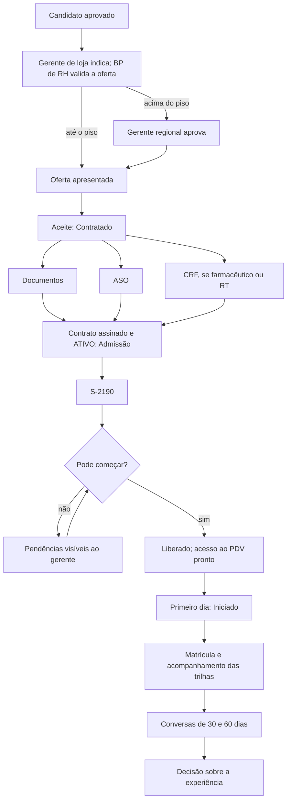

# Documentação de negócio — Projeto Admissão Única

Drogarias Caliandra S.A. · Patrocinadora: Helena Vasconcelos, Diretora de Gente & Gestão
Versão 1 · Base: fontes, `01-diagnostico.md` e `respostas.md` · Situação: **para validação das áreas**

## 1. Resumo

A Rede quer um único sistema de admissão e onboarding, do candidato aprovado até o fim do período de experiência. O sistema precisa dar ao gerente de loja uma resposta única sobre quando alguém pode começar, livrar o DP da redigitação e dar ao Jurídico segurança sobre o cumprimento das regras.

As respostas fecharam as regras mais críticas: ASO, CRF, experiência, aprovação da oferta e dados sensíveis. **Muita coisa continua sem resposta**, inclusive metas, prazo, orçamento, dono do sistema e meios de integração. Por isso, este documento separa o que foi decidido do que é apenas premissa. **Ainda não é possível escolher nem construir a solução**; as decisões da seção 9 vêm antes.

## 2. Problema e objetivos

| Problema | Evidência | Objetivo |
|---|---|---|
| Redigitação no DP | Cerca de 25 min por admissão, cerca de 79 h/mês (ata) | Reaproveitar os dados conferidos, sem nova digitação |
| Pastas devolvidas | Cerca de 30% (ata) | Tornar a pendência visível e padronizar a conferência |
| Gerente sem resposta única | Planilha, e-mail e marca manual de `Liberado` | Um só lugar para saber quem pode começar e o que falta |
| Início fora das regras | ASO vencido ou posterior ao início; RT só com protocolo (amostra) | Impedir a liberação sem ASO válido e sem CRF ativo |
| Regras conflitantes | Política, Manual, Leia-me e sistemas divergem | Um catálogo único, com dono por regra |
| Dados pessoais expostos | Planilha aberta; dados sensíveis acessíveis a gerentes | Acesso mínimo por perfil e retenção cumprida |
| Números que não fecham | 214, 188 e 176 na projeção de setembro | Etapas com definição única |
| Login compartilhado no PDV | Cerca de 3 dias, inclusive em venda com receita (ata) | Acesso individual pronto no primeiro dia |
| Pós-início sem acompanhamento | A planilha para em `Iniciado` | Prazos e treinamentos acompanhados até o fim da experiência |

## 3. Escopo

**Dentro, na primeira fase** (confirmado por Helena)

- 184 lojas próprias.
- CLT de loja: balconista, caixa e farmacêutico, inclusive RT.
- Oferta, documentos, exame admissional, contrato, acompanhamento do eSocial, acessos, treinamentos obrigatórios e experiência.

**Depois**

- Jovem Aprendiz entra no fluxo único como prioridade 5.

**Fora**

- 28 lojas franqueadas.
- CD e escritório central, nesta fase.
- Folha de pagamento, que permanece na FolhaCerta.
- Desligamento.
- Seleção de candidatos até a aprovação; o processo começa no candidato aprovado.
- Benefícios: **premissa**, pois não constam da lista do escopo. As regras atuais estão coerentes e permanecem onde estão.

**Indefinido**

- Estágio: fica fora até a decisão (PD-13).

## 4. Partes interessadas

| Pessoa | Papel | Interesse |
|---|---|---|
| Helena Vasconcelos | Diretora de Gente & Gestão, patrocinadora | Resultado, escopo |
| Vera Castro | CFO | Indicada por Helena para metas, prazo e orçamento; **ainda não consultada** |
| Rogério Tavares | Gerência do DP | Fim da redigitação; definição de Admissão |
| Marina Quintela | Jurídico Trabalhista | Cumprimento das regras |
| Paula Nogueira | Encarregada de Dados | Dados pessoais, inventário e retenção |
| Sérgio Antunes | Diretor de Operações de Loja | Loja sem desfalque |
| Cláudia Reis | Coordenação de Operações de Loja | Rotina do gerente, planilha |
| Fábio Arantes | Médico coordenador do SESMT | ASO e dados de saúde |
| Beatriz Lobo | **Função não informada** (PD-25) | Respondeu sobre CRF |
| Igor Melo | TI, apoio | Integrações e acessos |
| BPs de RH, gerentes regionais, gerentes de loja, analistas do DP e do SESMT, Recrutamento | Usuários | Não ouvidos diretamente até aqui |

## 5. O que foi decidido

| Tema | Decisão | Quem | Efeito sobre a prática atual |
|---|---|---|---|
| Abrangência | Lojas próprias; franqueadas fora; CD e escritório fora na primeira fase | Helena | Os 212 do escopo viram 184 |
| Definição de Admissão | Contrato assinado, ASO apto validado e `ATIVO` na FolhaCerta | Rogério | Substitui a premissa que propusemos (primeiro dia). Contratado e Iniciado continuam como etapas |
| Experiência | 30+60 | Marina | Os 8 contratos da amostra e o padrão do sistema usam 45+45 |
| ASO | Apto, até 30 dias corridos antes do início, sem exceção, mesmo com loja desfalcada; adiamento além disso invalida | Fábio, Marina | Planilha aceita 60; folha aceita 90 |
| CRF | CRF ativo antes do início, inclusive RT; protocolo não vale | Beatriz | Leia-me permite protocolo; folha não trava RT |
| Oferta | BP valida sempre; regional acima do piso; gerente de loja indica, mas não aprova sozinho | Marina | Sem BP no Recruta+ e no fluxo |
| Gravidez e antecedentes | Não perguntar nem guardar na seleção | Paula | Campos existem no Recruta+ |
| CID | Só no ambiente do SESMT | Paula | Está na FolhaCerta e no Recruta+ |
| PCD | Só para cota, com finalidade clara e acesso restrito | Paula | Hoje legível por gerente |
| Retenção | 6 meses para não contratados, inclusive cópias e backups | Paula | Rotina de 24 meses; backup de 2022 |
| Manual | Só a seção 4 da v3.2 foi revogada formalmente; será substituído quando o sistema vier | Rogério | **As lojas ainda o consultam: ver risco na seção 10** |

## 6. Processo proposto

Este é um desenho de negócio para validação, não uma escolha de solução.

`Liberado` deixa de ser marca manual e passa a resultar das condições. Adiamento e desistência são possíveis em qualquer etapa antes do início.

**Condições para começar**

| Condição | Tipo | Situação |
|---|---|---|
| ASO apto até 30 dias | Impede, sem exceção | Confirmado |
| CRF ativo (farmacêutico, RT) | Impede | Confirmado; exceção não é admitida quanto ao protocolo |
| Documentos completos | Impede | **Premissa** (PD-08) |
| Contrato assinado | Impede | **Premissa** (PD-08), coerente com a definição de Admissão |
| S-2190 enviado | Impede | **Premissa** (PD-08), com apoio na RH-012 §10 e na ata |
| Documentos dentro dos 5 dias úteis | Alerta | **Premissa** (PD-08) |
| Acesso ao PDV | Alerta | **Premissa** (PD-17) |

## 7. Regras de negócio

**Como ler a situação:** *Confirmado* foi afirmado na resposta de uma área. *Fonte* está escrito ou implementado nas fontes, sem contestação. *Premissa* é a nossa hipótese de trabalho, sem validação. *Pendente* não tem resposta.

| ID | Descrição | Situação | Fontes | Pergunta |
|---|---|---|---|---|
| RN-01 | Abrangência da primeira fase: 184 lojas próprias. Franqueadas (28) ficam fora; CD e escritório central ficam fora nesta fase. | Confirmado | Escopo; RH-012 §1; Ata | P1 |
| RN-02 | Modalidades: CLT de loja (balconista, caixa e farmacêutico, inclusive RT) vem primeiro; Jovem Aprendiz entra no fluxo único como prioridade 5. Estágio segue indefinido e fica fora até decisão. | Confirmado | RH-012 §4; P1 | P1, P8 |
| RN-03 | Admissão, para indicadores oficiais, é o conceito do DP: contrato assinado, ASO apto validado e status ATIVO na FolhaCerta. Contratado (oferta aceita) e Iniciado (primeiro dia cumprido) permanecem como etapas distintas. | Confirmado | FolhaCerta; Recruta+; Leia-me; Ata | P3 |
| RN-04 | Toda oferta é validada pelo BP de RH da regional antes de ser apresentada ao candidato. | Confirmado | RH-012 §3; Recruta+ | P7 |
| RN-05 | Oferta acima do piso exige também a aprovação do gerente regional. O gerente de loja indica o candidato, mas não aprova sozinho. | Confirmado | RH-012 §3; Manual §2; Fluxo | P7 |
| RN-06 | O piso de referência é o da FolhaCerta, por cargo, UF e vigência (origem CCT). Oferta abaixo do piso não segue adiante. | Fonte | FolhaCerta; Recruta+; Ata | P7 |
| RN-07 | Documentos completos no DP até 5 dias úteis antes do início. | Fonte | RH-012 §2; Comunicado 07/2024; Leia-me | P4, P9 |
| RN-08 | Lista de documentos: vale a do Manual §4, inclusive por cargo, até revisão pelo DP e pelo Jurídico, respeitando a coleta mínima. | Premissa | Manual §4, §7; RH-012 §11.1 | P9 |
| RN-09 | Ninguém inicia sem ASO apto emitido até 30 dias corridos antes do início. Não há exceção, mesmo com a loja desfalcada. ASO emitido depois do início não atende. | Confirmado | RH-012 §6; FolhaCerta; Leia-me | P5 |
| RN-10 | Se o início for adiado e o ASO passar de 30 dias, ele deixa de valer para aquele início. | Confirmado | RH-012 §6 | P5 |
| RN-11 | Toda função farmacêutica, inclusive RT, exige CRF ativo, com certidão de regularidade, antes do início. Protocolo não vale. | Confirmado | RH-012 §7; FolhaCerta; Leia-me | P5, P6 |
| RN-12 | O DP verifica a certidão do CRF antes do início. Controle de validade da certidão a definir. | Premissa | RH-012 §7 | P6 |
| RN-13 | Contrato de experiência CLT: 30 dias, prorrogável por mais 60, total de 90. Contratos em curso e contagem do primeiro dia aguardam o Jurídico. | Confirmado | RH-012 §4.1; Manual §6; FolhaCerta; Leia-me | P4 |
| RN-14 | A intenção de não continuar é avisada ao DP com 10 dias de antecedência. | Premissa | Manual §6 | P10 |
| RN-15 | S-2190 antes do início e S-2200 até o dia 15 do mês seguinte à admissão. A FolhaCerta continua gerando os eventos. | Fonte | RH-012 §10; FolhaCerta; Ata | P10 |
| RN-16 | Documentos completos, contrato assinado e S-2190 impedem o início, sem exceção, até decisão das áreas. Entrega fora dos 5 dias úteis gera alerta, não bloqueio. | Premissa | RH-012 §2, §10; Ata; Fluxo | P5 |
| RN-17 | O treinamento Integração e Boas Práticas Farmacêuticas é concluído até o 5º dia corrido e antes de atender no balcão sem acompanhamento. Manual (15 dias) e EducaFarma (30 dias) divergem; ninguém arbitrou ainda. | Premissa | RH-012 §9; Manual §9; LMS | P13 |
| RN-18 | Demais trilhas obrigatórias seguem cargo e prazo cadastrados no EducaFarma. | Fonte | LMS | P13 |
| RN-19 | Gravidez e antecedentes não são perguntados nem guardados na seleção. | Confirmado | Recruta+; Planilha | P14, P15 |
| RN-20 | CID só pode existir no ambiente do SESMT. Dados de saúde são acessados exclusivamente pelo SESMT. | Confirmado | RH-012 §11.2; FolhaCerta; Recruta+ | P11, P14, P15 |
| RN-21 | Dado de pessoa com deficiência só com finalidade clara de cota e acesso restrito. | Confirmado | Recruta+ | P14, P15 |
| RN-22 | Dados de candidatos não contratados são eliminados em até 6 meses após o encerramento do processo seletivo, inclusive cópias e backups. | Confirmado | RH-012 §11.3; Recruta+ | P14 |
| RN-23 | Coletam-se apenas os dados necessários a cada etapa. Fora do SESMT, DP e lojas veem só resultado e data do ASO; demais campos por perfil a definir. | Premissa | RH-012 §11.1; Planilha; FolhaCerta | P11, P14 |
| RN-24 | Metas, prazo, orçamento e dono do sistema aguardam definição; Vera Castro (CFO) foi indicada para metas, prazo e orçamento. | Pendente | P2 | P2 |

## 8. Requisitos

### 8.1 Funcionais

| ID | Descrição | Situação | Fontes | Pergunta |
|---|---|---|---|---|
| RF-01 | Abrir um único registro de Admissão por candidato aprovado, acompanhando oferta, documentos, ASO, contrato, eSocial, acessos e treinamentos. | Fonte | Escopo; Fluxo | P12 |
| RF-02 | Registrar validação do BP de RH e aprovação do gerente regional, com autor, data e valor. | Confirmado | RH-012 §3; Recruta+ | P7 |
| RF-03 | Conferir a oferta contra o piso vigente antes de apresentá-la ao candidato. | Fonte | FolhaCerta; Recruta+; Planilha | P7, P12 |
| RF-04 | Manter cadastro de lojas, regionais, BP de RH, cargos e a correspondência de códigos entre os sistemas. | Fonte | FolhaCerta; Recruta+; Planilha; LMS | P7, P12 |
| RF-05 | Registrar recebimento, conferência e devolução de documentos, com data e motivo, e alertar sobre o prazo de 5 dias úteis. | Fonte | Ata; Planilha; Fluxo | P9 |
| RF-06 | Registrar pedido, agendamento e situação do ASO, calcular a validade e invalidá-lo quando a data de início mudar além do limite. | Confirmado | RH-012 §6; Ata; Fluxo | P5, P11 |
| RF-07 | Registrar a verificação de CRF das funções farmacêuticas, inclusive RT. | Confirmado | RH-012 §7; FolhaCerta | P5, P6 |
| RF-08 | Levar à FolhaCerta os dados já registrados, sem nova digitação pelo DP, e respeitando que ela segue como folha. | Premissa | Escopo; Ata; FolhaCerta | P12 |
| RF-09 | Mostrar assinatura e status do contrato e os eventos S-2190 e S-2200, com prazo, envio e recibo. | Fonte | Escopo; FolhaCerta; Ata | P9, P10 |
| RF-10 | Mostrar ao gerente de loja, em um só lugar, se e quando o novo colaborador pode começar e o que falta. | Fonte | Escopo; Ata | P5, P13 |
| RF-11 | Impedir a liberação quando faltar ASO válido ou CRF ativo, sem caminho de exceção, e sinalizar início registrado em desacordo. | Confirmado | RH-012 §6, §7; Ata | P5 |
| RF-12 | Registrar adiamento e desistência, com recálculo das validades e reflexo nos indicadores. | Premissa | Planilha; Recruta+; FolhaCerta | P3, P10 |
| RF-13 | Acompanhar o pedido de acesso ao PDV para que esteja pronto no primeiro dia, com login individual. | Premissa | Escopo; Ata; Manual §8; Fluxo | P12 |
| RF-14 | Registrar o primeiro dia (Iniciado) e o checklist de recebimento. | Fonte | Leia-me; Fluxo | P13 |
| RF-15 | Matricular nas trilhas obrigatórias do cargo a partir da data de início e alertar sobre os prazos. | Fonte | Ata; LMS; RH-012 §9 | P12, P13 |
| RF-16 | Acompanhar a experiência até o fim, com alertas de prazo, conversas de 30 e 60 dias e decisão registrada. | Premissa | Escopo; Leia-me; Fluxo; RH-012 §4.1 | P4, P10, P13 |
| RF-17 | Apresentar funil Contratado, Admissão e Iniciado, além de desistências e tempos por etapa. | Confirmado | Ata; Escopo | P2, P3 |
| RF-18 | Permitir a transição das admissões em curso e substituir a planilha e o Manual vigente por versão alinhada às regras. | Premissa | Planilha; Manual; P4 | P4, P13 |
| RF-19 | Tratar o Jovem Aprendiz no fluxo único, de 14 a 24 anos, incluindo o caminho de cadastro que vier a ser definido. | Confirmado | RH-012 §4.2; FolhaCerta; Ata | P1, P8 |

### 8.2 Não funcionais de interesse do negócio

| ID | Descrição | Situação | Fontes | Pergunta |
|---|---|---|---|---|
| RNF-01 | Controle de acesso por perfil e por loja/regional, com o mínimo necessário por etapa. | Confirmado | RH-012 §11; Planilha; FolhaCerta; Recruta+ | P14 |
| RNF-02 | Trilha de auditoria de aprovações, liberações e acessos a dados sensíveis. | Premissa | Escopo; Ata | P14 |
| RNF-03 | Retenção e eliminação automáticas conforme RN-22 e os prazos ainda a definir. | Confirmado | RH-012 §11.3 | P14 |
| RNF-04 | Inventário de dados pessoais mantido por sistema. | Fonte | Ata | P14 |
| RNF-05 | Suportar cerca de 190 admissões por mês em 184 lojas de MG e SP. Disponibilidade e desempenho a definir. | Fonte | Ata; RH-012 §1 | P2 |
| RNF-06 | Solução neutra até a decisão de construir ou comprar; integrações tratadas como hipótese até confirmação. | Fonte | Escopo; Ata | P12 |

## 9. Pendências

"Não sei" não foi tratado como decisão. Onde a pessoa consultada não soube, indicamos a próxima a procurar; **esses nomes são sugestão nossa**, exceto Vera Castro, indicada por Helena.

| ID | Pendência | Pergunta | Próximo a procurar | Efeito até a resposta |
|---|---|---|---|---|
| PD-01 | Metas de sucesso | P2 | Vera Castro (CFO), indicada por Helena | Indicadores sem meta |
| PD-02 | Prazo e orçamento | P2 | Vera Castro (CFO), indicada por Helena | Sem limites; decisão de construir ou comprar depende disso |
| PD-03 | Dono do sistema e das regras | P2 | Helena Vasconcelos / comitê | Sem dono após entrega; premissa de trabalho: Gente & Gestão |
| PD-04 | Decisões do comitê de 28/10 | P2 | Helena Vasconcelos / secretaria do comitê | Podem alterar este documento |
| PD-05 | Decomposição de 214, 188 e 176 | P3 | Recrutamento, DP e Operações | Etapas distintas explicam a diferença, mas não a quantificam |
| PD-06 | Prevalência geral da RH-012 sobre Comunicado e Leia-me; seções do Manual ainda formalmente vigentes | P4 | Marina Quintela | Regras aceitas caso a caso; prazo de integração segue sem arbitragem |
| PD-07 | Contratos em curso e contagem do primeiro dia | P4 | Marina Quintela | 45+45 em curso; prazos da experiência |
| PD-08 | Se documentos, contrato e S-2190 impedem o início e admitem exceção | P5 | Marina Quintela e Rogério Tavares (Sérgio não soube) | Premissa: bloqueiam, sem exceção |
| PD-09 | Quem verifica a certidão, validade, e quem já começou só com protocolo | P6 | Beatriz Lobo, Marina Quintela e Rogério Tavares | Premissa: DP verifica; casos ao Jurídico |
| PD-10 | Prática atual do BP, aprovadores reais, regional em oferta de farmacêutico no piso, BP por regional | P7 | BPs de RH, Recrutamento e Sérgio Antunes | Cadastro e transição da aprovação |
| PD-11 | Vaga com mais de uma contratação | P7 | Recrutamento | Regra de duplicidade |
| PD-12 | Contábil Alfa: continuidade, dados, eventos, lote; marco final do aprendiz | P8 | Rogério Tavares e Contábil Alfa | Bloqueia especificação do aprendiz |
| PD-13 | Estágio | P1, P8 | Helena Vasconcelos | Fora até decisão |
| PD-14 | Lista de documentos, motivos de devolução, geração e assinatura do contrato | P9 | Rogério Tavares e analistas do DP | Premissa: Manual §4 |
| PD-15 | Operação do eSocial: quem transmite, mudança de data, desistência, eventos ausentes, prorrogação | P10 | Rogério Tavares e analistas do DP | Acompanhamento de eventos |
| PD-16 | MedTrab: cobertura e API; inapto e complementares; quem vê e registra o ASO | P11 | Fábio Arantes e MedTrab | Agendamento fica em fila manual; premissa: DP e lojas veem resultado e data |
| PD-17 | Meios de integração e permissão de mudança em FolhaCerta e Recruta+; PDV | P12 | Igor Melo e fornecedores | Maior incerteza técnica; meta de não redigitar depende disso |
| PD-18 | Necessidades do gerente, viabilidade da integração em 5 dias, conversas 30/60 e transição | P13 | Cláudia Reis e Sérgio Antunes, com gerentes | Premissas do painel e da virada |
| PD-19 | Campos por perfil, exceto os já definidos | P14 | Paula Nogueira | Matriz é proposta |
| PD-20 | Retenção de documentos de contratados e ASO | P14 | Paula Nogueira e Marina Quintela | Eliminação automática não roda para esses dados |
| PD-21 | Contratos de tratamento com Recruta+, MedTrab e Contábil Alfa | P14 | Paula Nogueira e Jurídico | Risco aberto |
| PD-22 | Contenção imediata da planilha aberta e do backup de 2022 | P14 | Paula Nogueira e Helena Vasconcelos | Risco crítico segue ativo |
| PD-23 | Fundamento da coleta, casos de gestação e antecedentes, e responsável | P15 | Marina Quintela e Helena Vasconcelos | Risco crítico sem dono |
| PD-24 | Significado de 'prioridade 5' do Jovem Aprendiz | P1 | Helena Vasconcelos | Lida como quinta posição na ordem, com 1 como mais alta |
| PD-25 | Função de Beatriz Lobo, que respondeu sobre CRF e não consta da ata | P5, P6 | Helena Vasconcelos | Registrada sem função |

**Decisões que vêm antes de escolher ou construir:** PD-01, PD-02, PD-03, PD-08 e PD-17.

**Não dependem do sistema e têm urgência:** PD-09, PD-22 e PD-23.

## 10. Riscos para a patrocinadora

| Risco | Por que importa | Próximo passo |
|---|---|---|
| Riscos críticos sem responsável | Planilha aberta, casos de gestação e antecedentes, e farmacêuticos só com protocolo seguem sem dono ou decisão nas respostas | Helena nomeia responsáveis agora |
| Regras antigas vigentes até o sistema chegar | Só a seção 4 do Manual foi revogada, as lojas o consultam e a troca ficou para "quando o sistema vier". ASO, CRF, 45+45 e gerente aprovando continuam sendo orientados | Comunicado às lojas já (US-09), sem esperar o sistema |
| Benefício central depende de integração desconhecida | Sem meio de levar dados à FolhaCerta, a redigitação não acaba | Levantamento técnico (US-20) antes de decidir |
| Projeto sem meta, prazo, orçamento e dono | Impossível avaliar retorno ou escolher entre alternativas | Conversa com Vera Castro; nomeação do dono |
| Reproduzir erros no sistema novo | ASO de 90 dias, CRF sem RT e 45 dias estão gravados nos sistemas atuais | Migrar só regras validadas |
| Trava contornada na loja | O sistema não impede fisicamente alguém de trabalhar; a pressão é real (ata) | Aviso imediato a Jurídico, DP e regional (US-36) e envolvimento de Operações |
| Definição de Admissão antes do primeiro dia | `ATIVO` pode ocorrer e a pessoa não comparecer; nenhum sistema registra desistência | Registrar desistência e manter o funil com as três etapas |
| Usuários ainda não ouvidos | Gerentes, BPs e analistas não responderam; P9, P10, P12 e P13 ficaram sem resposta alguma | Sessão de validação com representantes |

Os riscos completos estão em `01-diagnostico.md`.

## 11. Indicadores

**Metas não definidas** (PD-01). A tabela traz só o ponto de partida conhecido. Os valores relatados precisam de medição (US-22).

| Indicador | Ponto de partida | Origem | Meta |
|---|---|---|---|
| Admissões por mês (definição do DP) | Cerca de 190 | Ata, média anual | A definir |
| Contratado → Admissão → Iniciado | 214 → 188 → 176 | Ata, projeção de setembro | A definir |
| Tempo de digitação por admissão | Cerca de 25 min | Ata, relato | A definir |
| Pastas devolvidas | Cerca de 30% | Ata, relato | A definir |
| Pedido → emissão do ASO | 6,8 dias | Amostra de 9 | A definir |
| Dias sem login no PDV | Cerca de 3 | Ata, relato | A definir |
| Integração até o 5º dia | 0 de 4 concluídas | Amostra | Depende de PD-18 |
| Início sem ASO válido | 3 de 9 | Amostra | Zero, pois a regra não admite exceção |
| Função farmacêutica iniciada sem CRF ativo | 1 de 2 | Amostra | Zero, pela regra |
| Ofertas com validação do BP registrada | 0 de 11 | Amostra | Todas, pela regra |

Os valores de amostra mostram tipos de falha, não a frequência na rede.

## 12. Validação pelas áreas

Cada área confirma, corrige ou recusa os itens abaixo. Os itens em *Premissa* são os que mais precisam de atenção.

| Área | Responsável | Itens |
|---|---|---|
| Gente & Gestão | Helena Vasconcelos | RN-01, RN-02, RN-17, RN-24, RF-01, RF-17, seções 3, 9 e 11 |
| DP | Rogério Tavares | RN-03, RN-07, RN-08, RN-12, RN-14, RN-15, RF-05, RF-08, RF-09, RF-12 |
| Jurídico | Marina Quintela | RN-04, RN-05, RN-09, RN-10, RN-11, RN-13, RN-16, RF-11, RNF-02 |
| Dados | Paula Nogueira | RN-19 a RN-23, RNF-01, RNF-03, RNF-04 |
| SESMT | Fábio Arantes | RN-09, RN-10, RN-20, RN-23, RF-06 |
| Regulação do CRF | Beatriz Lobo | RN-11, RN-12, RF-07 |
| Operações de Loja | Sérgio Antunes, Cláudia Reis | RN-16, RN-17, RF-10, RF-13, RF-14, RF-16, RF-18 |
| Recrutamento e BPs | A indicar | RN-04, RN-05, RN-06, RF-02, RF-03, RF-04 |
| TI, apoio | Igor Melo | RF-08, RF-13, RF-15, RNF-05, RNF-06 |
| Finanças | Vera Castro | RN-24, seção 11 |
