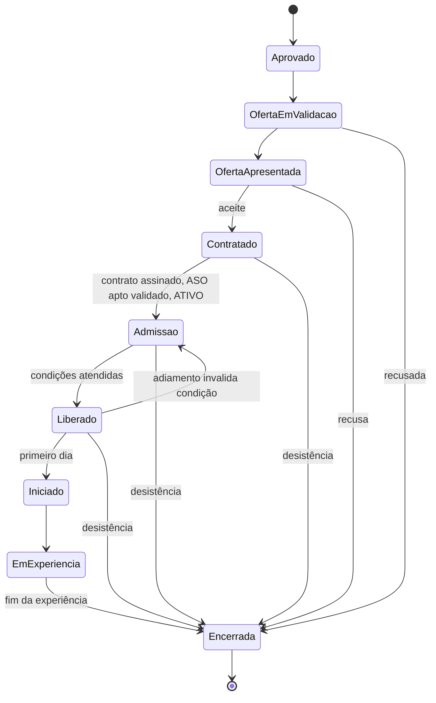

# Documentação técnica — Projeto Admissão Única

Versão 1 · Para TI, arquitetura e dados · Complementa `02-negocio.md`

## 1. Posição técnica

**Nenhuma tecnologia nem fornecedor foi escolhido.** A patrocinadora pediu entendimento antes de escolher ou construir, e a pergunta sobre integrações (P12) ficou sem resposta. Este documento define **o que a solução precisa fazer**, seja construída, comprada ou configurada.

Convenção: **[F]** fato observado nas fontes; **[C]** confirmado por área; **[P]** premissa; **[A]** em aberto.

## 2. Contexto

```mermaid
flowchart LR
    R[Recruta+ externo] -->|candidato aprovado, oferta [A]| N[Solução Admissão Única]
    N -->|dados conferidos [A]| F[FolhaCerta]
    F -->|piso, status, eventos, recibos [A]| N
    F --> E[eSocial]
    N <-->|pedido e situação| S[Ambiente do SESMT]
    S <-->|agendamento: API [A] ou e-mail| M[MedTrab]
    N -->|matrícula| L[EducaFarma: API REST, segundo a ata]
    L -->|progresso| N
    N -->|pedido de acesso [A]| T[Chamados e PDV]
    N -.->|prioridade 5 [A]| C[Contábil Alfa]
```

| Sistema | Papel futuro | Situação |
|---|---|---|
| FolhaCerta | Mantida como folha e geradora dos eventos | [F] [C] Regras internas exigem ajustes; não se sabe quem pode alterá-las |
| Recruta+ | Mantido na seleção | [P] Fornecedor externo; alterações dependem dele |
| Planilha | Desativada na virada | [P] |
| EducaFarma | Mantido | [F] API REST e trilhas por cargo, segundo a ata; contrato da API não examinado |
| MedTrab | Mantida | [F] Portal com API, segundo a ata; cobertura e contrato [A] |
| Contábil Alfa | Indefinida | [A] |
| Chamados, PDV, portal do gestor | Indefinidos | [A] Sem fonte |

## 3. Modelo lógico

Entidades mínimas, sem definição de banco:

| Entidade | Atributos principais | Observação |
|---|---|---|
| Admissão | Pessoa, loja, cargo, modalidade, situação, data de início prevista, motivo de encerramento | Registro único; núcleo do processo |
| Pessoa | CPF normalizado, nome, contato | Sem gravidez e sem antecedentes [C] |
| Oferta | Valor, piso aplicado, indicação do gerente, validação do BP, aprovação regional | Autor e data em cada decisão [C] |
| Documento | Tipo, situação, data de recebimento, motivo de devolução | Hoje a data não existe em nenhum sistema [F] |
| ASO (visão geral) | Resultado, data de emissão, validade para o início | Sem CID e sem observação [C] |
| Exame (ambiente do SESMT) | Conteúdo clínico, agendamento | Acesso exclusivo do SESMT [C] |
| Verificação de CRF | Número, certidão, verificador, data | Validade a definir [A] |
| Contrato (visão) | Assinatura, status na folha, prazo de experiência, prorrogação | FolhaCerta é a origem do status |
| Evento eSocial (visão) | Evento, prazo, envio, recibo | FolhaCerta é a origem |
| Acesso | Sistema, chamado, situação, data | Só PDV por ora [P] |
| Treinamento | Trilha, matrícula, prazo, conclusão | EducaFarma é a origem |
| Acompanhamento | Conversas 30/60, decisão sobre experiência | Sem dados de saúde |
| Unidade e correspondências | Loja, regional, BP, própria ou franqueada, códigos | Regional hoje só na planilha [F] |
| Registro de auditoria | Autor, data, ação, objeto | Não alterável [P] |

### Situações da Admissão



A desistência após `ATIVO` exige tratamento na folha, e a FolhaCerta só oferece `PRE`, `ATIVO` e `DESLIGADO` [F]. Como tratar isso sem invadir o desligamento depende de PD-15.

## 4. Regra de liberação

Calcula-se sempre pelos dados, sem marca manual. `dias_aso = data_início - data_emissão`.

| Condição | Teste | Resultado se falhar | Situação |
|---|---|---|---|
| ASO | resultado apto e `0 <= dias_aso <= 30` | Impede, sem exceção | [C] |
| CRF | se o cargo exige CRF: verificação com CRF ativo; protocolo não atende | Impede | [C] |
| Documentos | todos os itens obrigatórios conferidos | Impede | [P] PD-08 |
| Contrato | assinado e `ATIVO` | Impede | [P] PD-08 |
| S-2190 | envio com recibo | Impede | [P] PD-08 |
| Prazo de documentos | completos até 5 dias úteis antes | Alerta | [P] PD-08 |
| Acesso ao PDV | pronto até o início | Alerta | [P] PD-17 |

- Mudança de data de início recalcula tudo.
- Só as condições com exceção aprovada por decisão futura poderão ter caminho de exceção; **ASO e CRF não têm**.
- O início é um ato físico que o sistema não impede. `Iniciado` sem as condições gera aviso a Jurídico, DP e regional.
- O calendário de dias úteis precisa considerar feriados. Se a contagem é nacional ou por local está em aberto.

## 5. Integrações

| ID | Com | Direção | Dados | Meio | Situação | Sem o meio ideal |
|---|---|---|---|---|---|---|
| INT-01 | Recruta+ | Entrada | Aprovado, vaga, oferta | Desconhecido | [A] PD-17 | Cadastro manual inicial pelo Recrutamento |
| INT-02 | FolhaCerta | Saída | Colaborador, contrato | Desconhecido | [A] PD-17 | **Redigitação continua; objetivo do DP comprometido** |
| INT-03 | FolhaCerta | Entrada | Piso, status, eventos, recibos | Só dump noturno conhecido [F] | [A] PD-17 | Atualização diária, sem tempo real; registro manual do recibo |
| INT-04 | EducaFarma | Ambas | Matrícula, progresso | API REST, segundo a ata | [A] contrato | Lista para matrícula manual |
| INT-05 | MedTrab | Ambas | Agendamento | API, segundo a ata | [A] PD-16 | Fila do SESMT e e-mail |
| INT-06 | Chamados/PDV | Saída | Pedido de acesso | Sem fonte | [A] PD-17 | Lembrete ao gerente para abrir o chamado |
| INT-07 | Contábil Alfa | A definir | Dados do aprendiz | E-mail/lote [F] | [A] PD-12 | Mantém o atual |

Requisitos comuns: reenvio sem duplicar, erro visível para correção, nenhuma perda em caso de falha, credenciais fora de código e dados mínimos por chamada.

**Atenção em INT-02:** uma integração que grave na FolhaCerta passa pelas travas descritas na seção 7, inclusive a de 18 anos. Validar antes reduz recusas, mas o sistema precisa exibir toda recusa.

## 6. Identidade e correspondências

| Conceito | FolhaCerta | Recruta+ | Planilha | EducaFarma | Tratamento |
|---|---|---|---|---|---|
| Pessoa | `cpf` só dígitos; `matricula` | `cpf` mascarado; `id` | CPF nos dois formatos | `email_usuario` | CPF só dígitos como chave interna; nunca cruzar por nome (há homônimos na folha) |
| Loja | `147` | `LJ-0147` | `147 - Savassi` | `MG-SAV` | Tabela de correspondência |
| Balconista | `BALC` | `BALCONISTA` | `Balconista` | `BALCONISTA` | Tabela de correspondência |
| Caixa | `CAIXA` | **Sem tabela salarial** | — | `CAIXA` | Completar no Recruta+ |
| Farmacêutico | `FARM` | `FARMACEUTICO` | `Farmacêutico` | `FARMACEUTICO` | Tabela de correspondência |
| RT | `FARM_RT` | **Sem distinção** | `Farmacêutica RT` | **Sem trilha** | Decidir trilha; distinguir na oferta |
| Aprendiz | **Inexistente** | `APRENDIZ` | `Aprendiz` | **Sem trilha** | PD-12 |
| Regional | **Inexistente** | **Inexistente** | `SP-02` etc. | **Inexistente** | Cadastro novo |

O vínculo com o EducaFarma exige e-mail conferido ou outra chave, pois a exportação não traz CPF nem matrícula. O e-mail usado hoje é pessoal, o que também merece avaliação da Encarregada.

## 7. Mudanças necessárias nos sistemas atuais

Todas dependem de saber quem pode alterá-los (PD-17). Enquanto não forem feitas, a solução nova será a trava efetiva, e os sistemas antigos continuarão mais permissivos.

### FolhaCerta

| Objeto | Hoje | Necessário | Base |
|---|---|---|---|
| `fn_valida_contrato`, ASO | `dt_emissao >= data_admissao - 90`, sem limite superior | Entre `data_admissao - 30` e `data_admissao` | RN-09 |
| `fn_valida_contrato`, CRF | Testa só `cargo_cod = 'FARM'` | Usar `cargo.exige_crf` | RN-11 |
| `contrato.crf_numero` | Número apenas | Avaliar guarda de certidão aqui ou só na solução nova | RN-12 |
| `contrato.dias_experiencia`, `COALESCE` | Padrão 45 | Padrão 30 e registro de prorrogação | RN-13 |
| `fim_experiencia` | Admissão + dias | Revisar após decisão sobre o primeiro dia | PD-07 |
| `fn_valida_contrato`, piso | Piso inexistente passa sem erro, porque a comparação com `NULL` não dispara | Tratar ausência de piso | RN-06 |
| `exame_admissional` | `cid_restricao`, `observacao_clinica` | Retirar da folha, com destino no SESMT | RN-20 |
| `GRANT ... exame_admissional TO rh_loja` e `dp_analista` | Inclui dado clínico | Só resultado e data; rever colunas de `colaborador` e `contrato` para `rh_loja` | RN-20, RN-23 |
| `fn_gera_esocial` | Prazos não recalculam com mudança de data; não trata dia não útil | Avaliar com o DP | PD-15 |
| `tipo_contrato`, idade mínima 18, ausência de cargo e jornada de aprendiz | Impedem o aprendiz | Decidir em US-50 | RF-19 |

### Recruta+

| Objeto | Hoje | Necessário | Base |
|---|---|---|---|
| `candidato.gestante`, `antecedentes_ok`, `antecedentes_obs` | Campos ativos | Remover e sanear, respeitando guarda indicada pelo Jurídico | RN-19 |
| `candidato.pcd_cid` | CID fora do SESMT | Remover; manter só indicador para cota, com acesso restrito | RN-20, RN-21 |
| `sp_expurgo_candidatos` | `REPROVADO` com mais de 24 meses | 6 meses, todos os não contratados | RN-22 |
| `candidato_bkp_2022` e outras cópias | Fora da rotina | Eliminar; incluir backups do fornecedor | RN-22 |
| `GRANT SELECT ... TO 'gerente_loja'@'%'` e `app_relatorios` | Inclui dados sensíveis, de qualquer host | Restringir | RNF-01 |
| `oferta.aprovador_perfil` | Sem BP de RH | Incluir BP, ou registrar na solução nova | RN-04 |
| `tabela_salarial` | Sem histórico; SP desatualizado; faltam caixa e outros | Usar o piso da FolhaCerta como referência | RN-06 |
| `vaga.salario_ref` | R$ 1.750 em vagas de SP | Corrigir | RN-06 |

### Outros

- **EducaFarma:** prazo de 30 dias em `T-*-01` a alinhar após PD-18; trilhas de RT e aprendiz a decidir.
- **Leia-me e Manual:** retirar regras contrárias (US-09, US-49).

## 8. Segurança e privacidade

### Matriz de acesso proposta

Só as linhas marcadas [C] estão confirmadas. As demais aguardam PD-19.

| Dado | Gerente de loja | Regional | BP de RH | DP | SESMT | Situação |
|---|---|---|---|---|---|---|
| Identificação e contato | Mínimo, só da loja | Da regional | Da regional | Sim | Mínimo | [P] |
| CPF completo | Não | Não | Não | Sim | Sim | [P] |
| Salário e oferta | Da loja | Da regional | Da regional | Sim | Não | [P] |
| Documentos | Situação | Situação | Situação | Sim | Não | [P] |
| ASO: resultado e data | Sim | Sim | Não | Sim | Sim | [P] Paula e Fábio devem avaliar se o gerente precisa ver "inapto" ou só "pendente" |
| ASO completo, CID, observação | Não | Não | Não | Não | Sim | [C] |
| PCD para cota | Não | Não | Restrito | Restrito | Sim | [C] finalidade e restrição; [P] perfis |
| Gravidez, antecedentes | Não existem | Não existem | Não existem | Não existem | Não existem | [C] |
| Auditoria | Não | Não | Não | Consulta restrita | Consulta restrita | [P] Jurídico e Encarregada também |

### Controles obrigatórios

- Identificação individual; sem contas compartilhadas.
- Acesso limitado por perfil e por unidade, testado por cenário negativo.
- Campos de texto livre com orientação e revisão, pois a planilha mostrou que eles recebem dados sensíveis.
- Criptografia em trânsito e em repouso.
- Trilha de auditoria não alterável.
- Eliminação com registro; respeito à guarda indicada pelo Jurídico.
- Contratos de tratamento com terceiros verificados antes de trafegar dados (PD-21).

### Retenção

| Dado | Prazo | Situação |
|---|---|---|
| Não contratados, inclusive cópias e backups | Até 6 meses do encerramento | [C] |
| Documentos de contratados | A definir | [A] PD-20 |
| ASO | A definir | [A] PD-20 |

O inventário de dados pessoais por sistema está em `01-diagnostico.md`, seção 8, e precisa ser mantido (RNF-04).

## 9. Requisitos não funcionais

| Tema | Requisito | Situação |
|---|---|---|
| Volume | Cerca de 190 admissões por mês, cerca de 9 por dia útil, 184 lojas | [F] estimativa a partir da ata |
| Usuários | Gerentes, regionais, BPs, DP (4 analistas), SESMT | [F] parcial; número total desconhecido |
| Uso na loja | Aparelho e conectividade das lojas | [A] PD-18 |
| Disponibilidade e desempenho | A definir, considerando a véspera do início | [A] Sem número inventado |
| Atualização dos dados | Depende de INT-03 | [A] |
| Acessibilidade | Padrões usuais de acessibilidade na interface | [P] |
| Auditoria e segurança | Seção 8 | [C] parcial |

## 10. Migração e transição

1. **Regras antes de dados:** só parâmetros validados entram; nada de ASO 60/90, protocolo ou 45+45.
2. **Sem copiar sensíveis:** nenhum dado de gravidez, antecedentes ou CID; `obs` da planilha não migra.
3. **Admissões em curso:** concluir no controle atual ou migrar só os dados permitidos (PD-18).
4. **Planilha:** sem edição após a virada, com retenção aplicada (PD-20).
5. **Contenção da planilha não espera a virada** (US-01).

## 11. Cenários de referência para teste

Derivados da amostra, sem dados pessoais. Precisam de dados sintéticos na execução.

| # | Cenário | Esperado | Origem |
|---|---|---|---|
| T1 | ASO emitido 12 dias antes | Válido | L412 |
| T2 | ASO emitido exatamente 30 dias antes | Válido | Limite RN-09 |
| T3 | ASO emitido 31 dias antes | Inválido | Limite RN-09 |
| T4 | ASO 45 ou 63 dias antes, após adiamento | Inválido; avisa SESMT e gerente | L426, L415 |
| T5 | ASO emitido 3 dias após o início | Inválido; `Iniciado` gera aviso | L438 |
| T6 | Loja desfalcada pede exceção de ASO | Sem caminho de exceção | P5 |
| T7 | RT só com protocolo | Impede | L431 |
| T8 | Oferta abaixo do piso de SP | Não segue | Oferta 7005 |
| T9 | Oferta igual ao piso | BP valida; sem regional | RN-05 |
| T10 | Oferta acima do piso | BP e regional | RN-05 |
| T11 | Cargo sem piso | Fica pendente | Lacuna da trava |
| T12 | Homônimos com CPFs diferentes | Registros separados | FolhaCerta |
| T13 | CPF com e sem máscara | Mesma pessoa | Planilha |
| T14 | Gerente consulta outra loja | Negado | RNF-01 |
| T15 | DP tenta ver CID | Negado | RN-20 |
| T16 | Importação com gestação ou antecedentes | Dados não entram | RN-19 |
| T17 | Não contratado há mais de 6 meses, inclusive backup | Eliminado | RN-22 |
| T18 | Mesmo caso sob guarda do Jurídico | Preservado | US-04 |
| T19 | Contrato novo | 30 dias; prorrogação até total de 90 | RN-13 |
| T20 | Integração no 6º dia | Alerta | RN-17 |
| T21 | Desistência após aceite | Sai do fluxo; entra no funil | RF-12 |
| T22 | Oferta aceita sem `ATIVO` | Não conta como Admissão | RN-03 |
| T23 | Aprendiz de 16 anos (prioridade 5) | Idade não impede | RF-19 |

## 12. Decisões técnicas em aberto

| ID | Decisão | Depende de | Critérios |
|---|---|---|---|
| DT-01 | Construir, comprar ou combinar | PD-01, PD-02, PD-03, PD-17 | Custo, prazo, aderência às regras, integração com FolhaCerta, proteção de dados |
| DT-02 | Como escrever na FolhaCerta | PD-17 | Suporte do fornecedor, travas, recusa e reenvio |
| DT-03 | Onde fica o ambiente do SESMT | PD-16, PD-19 | Isolamento real do dado clínico |
| DT-04 | Onde registrar a validação do BP | PD-10, PD-17 | Evolução do Recruta+ ou solução nova |
| DT-05 | Forma de assinatura do contrato | PD-14 | Validade jurídica, inclusive para menores |
| DT-06 | Caminho do aprendiz | PD-12 | Alterar FolhaCerta ou manter Contábil Alfa |
