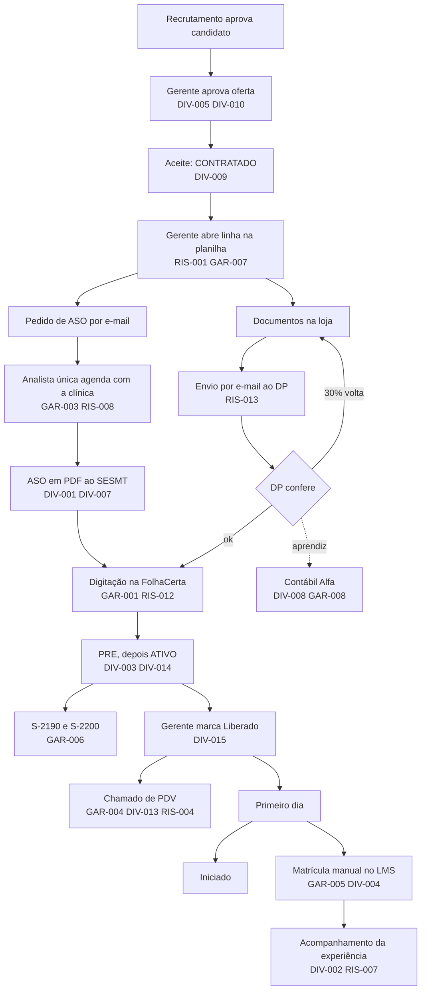

# Diagnóstico do cenário atual: Admissão Única

Drogarias Caliandra S.A. Versão 2, de 04/11/2026, atualizada com `respostas.md`. Os IDs correspondem ao modelo em `.re/modelo/`.

## Atualização após as respostas

As respostas definem o valor correto das principais regras, mas **não mudam os fatos observados**. Sistemas, planilha e documentos continuam divergentes até serem alterados.

| Achado | Decisão | Quem | Status |
|---|---|---|---|
| DIV-001 ASO | 30 dias corridos, sem outra janela nem exceção | Fábio, Marina (Q-004); Sérgio, Cláudia, Marina (Q-007) | Tratado; procedimento aberto (Q-024, Q-025) |
| DIV-002 Experiência | 30+60; mudança exige revisão da política | Marina (Q-005) | Tratado; contratos em curso abertos (Q-027) |
| DIV-003 CRF | CRF ativo antes do início, inclusive RT; protocolo não vale | Beatriz Lobo (Q-006) | Tratado; casos atuais abertos (Q-030) |
| DIV-004 Integração | 5º dia corrido, antes de atender sozinho | Beatriz Lobo (Q-015) | Tratado |
| DIV-005 Oferta | BP de RH sempre; regional acima do piso; gerente só indica | Marina (Q-008) | Tratado; prática atual desconhecida (Q-034) |
| DIV-006 Retenção | 6 meses, inclusive cópias e backups | Paula (Q-013) | Tratado; tabela de backup aberta (Q-043) |
| DIV-009 Números | Oficial: contrato assinado, ASO apto validado e ATIVO (188 na projeção); demais são etapas | Rogério (Q-003) | Tratado; parcelas abertas (Q-022) |
| DIV-010 Piso | Piso da CCT vigente da UF, conforme FolhaCerta | Rogério (Q-008) | Tratado; dono do Recruta+ aberto (Q-035) |
| DIV-016 Abrangência | 184 lojas próprias; CD e escritório fora da primeira fase; franqueadas fora | Helena (Q-001) | Tratado; estágio aberto (Q-016) |

**Parcialmente resolvidos, seguem abertos:** DIV-007 (CID só no SESMT, mas não se sabe o que DP e gerente veem), DIV-008 (aprendiz entra no fluxo único, mas o destino da Contábil Alfa é desconhecido), DIV-015 (ASO e CRF bloqueiam; demais critérios desconhecidos).

**Sem resposta:** Q-009 (contrato e eSocial) e Q-014 (integrações). DIV-012, DIV-013 e a causa de DIV-014 seguem abertos, e RIS-016 torna-se crítico.

**Novidades trazidas pelas respostas:**

- **Pico** de cerca de 320 admissões por mês em novembro e dezembro: cerca de 133 h de redigitação e 96 pastas devolvidas por mês, nos mesmos parâmetros (GAR-009, cálculo).
- **Novos stakeholders:** Beatriz Lobo (Assuntos Regulatórios) e Vera Castro (CFO, orçamento).
- **Novo conflito** DIV-018: o conceito oficial de admissão exige ASO apto validado, mas a RH-012 restringe dados de saúde ao SESMT (RN-013, Q-040).
- **Governança** DIV-017: Helena diz decidir o texto final da RH-012, Marina cita aprovação de Helena e dela, e a política traz também a Encarregada (Q-048).
- **Dados vedados:** gravidez e antecedentes não devem ser perguntados nem guardados na seleção. CID só existe no SESMT. Dado de PCD só para cota.

As respostas "Não sei" viraram perguntas abertas (Q-016 a Q-049, em `.re/perguntas-abertas.md` e `02-negocio.md`), sem preenchimento por suposição.

## 1. Resumo executivo

Este resumo descreve o cenário atual e segue válido após as respostas. A admissão funciona porque as pessoas compensam a falta de integração: há redigitação, planilha paralela, e-mail e pressa na véspera. Quase todas as regras críticas têm mais de uma versão, e nenhum sistema aplica integralmente a Política RH-012, que está em vigor desde 03/2025.

Os três achados mais críticos são:

1. **Dados sensíveis expostos.** A planilha com CPF, resultado de ASO e observações de saúde tem link de edição aberto. Gerentes conseguem ler dados de saúde na FolhaCerta e dados de gestação, deficiência e antecedentes no Recruta+ (RIS-001, RIS-002, DIV-007).
2. **Pessoas podem começar sem cumprir os requisitos.** A validade do ASO é de 30, 60 ou 90 dias conforme a fonte, e a planilha aceita protocolo do CRF, que a política veda. A amostra tem um início antes da emissão do ASO e um RT ativo sem número de CRF (DIV-001, DIV-003, DIV-014).
3. **Colaborador novo vende com o login do gerente.** Isso dura cerca de 3 dias e inclui venda com receita, o que elimina a autoria da operação (RIS-004).

O custo operacional também é visível: cerca de 79 h por mês de redigitação e cerca de 57 pastas devolvidas por mês (cálculo sobre 190 admissões, 25 min e 30%). A empresa também não tem um número único de admissões: em setembro, foram 214, 188 ou 176, conforme a área.

**Limite da evidência:** os dumps e exportações são amostras pequenas, de 4 filiais (11 candidatos, 9 contratos, 10 linhas de planilha, 7 matrículas). As contagens provam que o caso existe, mas não medem frequência. Volumes e tempos vêm de relatos na ata.

## 2. Mapa dos sistemas

| Sistema | Papel | Processos | Entidades | Observação |
|---|---|---|---|---|
| SIS-01 FolhaCerta | Folha e DP; permanece | Contrato, eSocial | colaborador, contrato, exame_admissional, cargo_piso, evento_esocial | Estável, segundo a TI [doc: geral/ata…#1] |
| SIS-02 Recruta+ | Recrutamento; fornecedor externo | Vaga, oferta, aceite | candidato, vaga, oferta, tabela_salarial, candidato_bkp_2022 | Instância dedicada [sql: recrutamais_dump.sql:cabeçalho] |
| SIS-03 Planilha de controle | Controle das lojas | Situação, datas, checklist | Linha por admissão | Drive compartilhado, mantida por Operações [doc: SIS-03/LEIA-ME.md#0] |
| SIS-04 EducaFarma | Treinamento | Trilhas, matrículas | trilha, matrícula | API REST sem uso na matrícula [doc: geral/ata…#1] |
| E-mail | Canal informal | Documentos, ASO, agendamento | Anexos | Sem fonte própria [doc: geral/fluxo-admissao-atual.md#0] |
| Contábil Alfa | Terceiro | Cadastro de aprendiz | Sem fonte | Lote quinzenal [doc: geral/ata…#1] |
| MedTrab | Terceiro | Exame | Sem fonte | Portal com API sem uso [doc: geral/ata…#1] |
| PDV e chamados | TI | Acesso | Sem fonte | Nenhuma exportação recebida |

## 3. Fluxo atual e achados por processo

Fonte do fluxo: `geral/fluxo-admissao-atual.md`, com as marcas de achados acrescentadas neste diagnóstico.

### 3.1 Oferta
- O Recruta+ não tem como registrar a validação do BP de RH: o aprovador aceita só gerente de loja ou gerente regional. Nenhuma das 11 ofertas da amostra registra BP [sql: recrutamais_dump.sql:oferta].
- "Acima do piso" depende da tabela usada. A tabela do Recruta+ está defasada para balconista em SP. Das 4 ofertas de SP com o piso atual de R$ 1.820,00, 3 foram aprovadas pelo gerente de loja e 1 pelo regional.
- Uma oferta com o valor antigo foi cancelada e refeita cerca de uma semana depois, após voltar da folha. A FolhaCerta detecta o erro, mas tarde demais (DIV-010).
- Farmacêuticos na amostra têm aprovação do regional mesmo no piso, regra que não está na política. Vale confirmar se é prática deliberada (Q-008).

### 3.2 Documentos
- O prazo vigente é de 5 dias úteis (DIV-011, tratado).
- A única lista de documentos é a do manual de 2019, sem distinção por modalidade. Ela inclui itens cuja necessidade precisa ser avaliada frente à regra de minimização [doc: geral/politica…#1, 11.1].
- Cerca de 30% das pastas voltam por falta ou ilegibilidade. As fontes não trazem as causas por tipo (Q-010).

### 3.3 Exame admissional
- Pedido e agendamento correm por e-mail e dependem de uma pessoa. Da solicitação ao ASO, a mediana é de 7 dias na amostra (de 5 a 8), coerente com o relato de cerca de uma semana.
- Em 2 de 9 inícios, o ASO tinha mais de 30 dias (45 e 63), em ambos os casos com o início adiado ou em espera. A trigger de 90 dias deixa passar os dois.
- A trigger também não impede ASO emitido depois do início, porque só há limite inferior [sql: folhacerta_dump.sql:fn_valida_contrato].

### 3.4 Contrato e eSocial
- A trigger só gera os eventos quando o contrato vira ATIVO, e o status ATIVO pressupõe contrato assinado e ASO validado. Isso explica a corrida na véspera (GAR-006).
- Um caso da amostra tem S-2190 enviado antes da emissão do ASO, em contrato ATIVO. A trigger deveria impedir essa sequência, e as fontes não explicam como ocorreu (DIV-014, Q-009).
- A trigger de CRF só avalia o cargo FARM. Ela ignora FARM_RT e a coluna `exige_crf`, além de checar número em vez de certidão (DIV-003).
- Um CPF da folha difere em 2 dígitos do mesmo candidato na planilha e no Recruta+. Isso é compatível com erro de redigitação, a confirmar (RIS-012).
- Não há fontes sobre como o contrato é gerado e assinado (Q-009).

### 3.5 Acessos
- O colaborador fica cerca de 3 dias sem login e usa o do gerente, inclusive em venda com receita (RIS-004).
- O manual manda abrir o chamado no primeiro dia e o fluxo, a partir de Liberado. Se o chamado só sai no primeiro dia, o acesso não pode estar pronto no início (DIV-013).
- Não recebemos fontes sobre PDV nem sobre o sistema de chamados.

### 3.6 Treinamentos
- A política exige integração até o 5º dia. Nas 4 conclusões, o prazo foi de 15, 17, 23 e 24 dias; as outras 3 matrículas seguiam em andamento com pelo menos 8 dias. Nenhuma cumpriu a política, e todas as concluídas cumprem os 30 dias do LMS (DIV-004).
- Todas as 7 matrículas da amostra são do curso de integração. Não aparecem outros obrigatórios, como SNGPC, com prazo de 30 dias. Pode ser efeito da exportação (Q-015).
- O LMS não tem trilha de aprendiz nem de RT.

### 3.7 Acompanhamento da experiência
- A planilha termina em Iniciado, embora o checklist preveja conversas com 30 e 60 dias.
- O schema da FolhaCerta não registra prorrogação. Na data do dump, 2 contratos estavam com o fim da experiência vencido, sem registro de decisão (RIS-007). Isso não prova irregularidade; mostra que o dado não permite controlar.

### 3.8 Aprendiz
- A política admite de 14 a 24 anos. A FolhaCerta recusa menores de 18 e não tem o tipo de contrato; por isso, o processo segue pela Contábil Alfa (DIV-008). A amostra contém um aprendiz menor de 18 anos.
- São cerca de 40 por ano, ou 3 por mês em média. O volume é pequeno, mas o risco legal é maior. A planilha aplica carência de 90 dias, sem regra correspondente na FolhaCerta para esse tipo de contrato.

## 4. Matriz de divergências

| ID | Regra | Política RH-012 | Manual 2019 | Planilha | FolhaCerta | Outra fonte |
|---|---|---|---|---|---|---|
| DIV-001 | Validade do ASO | 30 dias corridos (6.2) | "exame feito" | 60 dias | 90 dias, sem limite superior | — |
| DIV-002 | Experiência | 30+60 (4.1) | 45+45 | 45+45 | default 45 | — |
| DIV-003 | CRF | Certidão, inclui RT, veda protocolo (7) | Cópia da carteira | Protocolo por 30 dias | Número, só FARM | — |
| DIV-004 | Integração | 5º dia corrido e antes do balcão (9) | 15 dias | — | — | LMS: 30 dias |
| DIV-005 | Oferta | BP de RH; regional acima do piso (3) | Gerente aprova e assina | — | — | Recruta+: gerente ou regional; fluxo: gerente |
| DIV-006 | Candidatos | 6 meses, não contratados (11.3) | — | — | — | Recruta+: 24 meses, só REPROVADO; backup fora |
| DIV-007 | Saúde | Só SESMT (11.2) | — | Resultado e observações | SELECT para dp_analista e rh_loja | Fluxo: ASO alimenta a digitação do DP |
| DIV-008 | Aprendiz | 14 a 24 anos, 30 h (4.2) | — | Contábil Alfa, 30 h | Mínimo de 18, sem tipo | Fluxo: fora da folha |
| DIV-009 | "Admissão" | — | — | Iniciado: 176 | ATIVO: 188 | Recruta+ CONTRATADO: 214 |
| DIV-010 | Balconista SP | — | — | — | R$ 1.820,00 (03/2026) | Recruta+: R$ 1.750,00 (03/2025) |
| DIV-011 | Documentos (tratado) | 5 dias úteis (2) | 3 dias úteis, revogado | 5 dias úteis | — | Comunicado 07/2024: 5 dias úteis |
| DIV-012 | Identificadores | — | — | CPF com e sem máscara; "147 - Savassi"; cargo livre | CPF de 11 dígitos; 147; BALC | Recruta+: CPF com máscara, LJ-0147, BALCONISTA; LMS: sem CPF, MG-SAV |
| DIV-013 | Chamado de PDV | — | Primeiro dia | Conferir no primeiro dia | — | Fluxo: após Liberado |
| DIV-014 | Início sem ASO | Proibido (6.1) | Proibido | 1 caso | Trigger exige ASO, mas há 1 caso | — |
| DIV-015 | Pode começar | ASO apto, prazo, CRF | Exame feito | Documentos e ASO | ATIVO | Ata: S-2190 é impeditivo |
| DIV-016 | Abrangência | 184 próprias, CD, escritório; exclui 28 | — | — | — | Escopo: 212 lojas |
| DIV-017 | Aprovação da RH-012 | Helena, Marina, Paula | — | — | — | Q-002: Helena; Q-005: Helena e Marina |
| DIV-018 | ASO fora do SESMT | Só SESMT (11.2) | — | Resultado visível | Trigger lê o resultado | Q-003: ASO apto validado integra a admissão concluída |

**Verificados e sem divergência:**

- Jornada: 44 h semanais e 220 h mensais são a mesma carga no cadastro da folha.
- Carência do plano: 90 dias, ou 30 para farmacêutico.
- S-2200: dia 15 do mês seguinte.
- S-2190: véspera do início.
- Pisos de balconista em MG e de farmacêutico em MG e SP.
- Datas de oferta, ASO e início coincidem entre os sistemas na amostra.

## 5. Gargalos

| ID | Gargalo | Medida | Fonte |
|---|---|---|---|
| GAR-001 | Redigitação na FolhaCerta | Cerca de 25 min por admissão; cerca de 79 h por mês (cálculo) | doc: geral/ata…#0 |
| GAR-002 | Devolução de pastas | Cerca de 30%; cerca de 57 por mês (cálculo) | doc: geral/ata…#0 |
| GAR-003 | Agendamento de exame | Cerca de 1 semana; mediana de 7 dias na amostra | doc: geral/ata…#1; planilha |
| GAR-004 | Login do PDV | Cerca de 3 dias | doc: geral/ata…#1 |
| GAR-005 | Matrícula no LMS | 1 a 6 dias após o início na amostra | LMS |
| GAR-006 | S-2190 na véspera | Sem medida nas fontes | doc: geral/ata…#0 |
| GAR-007 | Planilha como painel | Atualização manual, linha a linha | doc: SIS-03/LEIA-ME.md#0 |
| GAR-008 | Lote do aprendiz | Quinzenal; cerca de 40 por ano | doc: geral/ata…#1 |
| GAR-009 | Pico de novembro e dezembro | Cerca de 320 admissões por mês; cerca de 133 h e 96 pastas (cálculo) | entrevista: Q-010 |

Da oferta ao início, a mediana da amostra é de 21 dias (de 7 a 70), incluindo casos de adiamento pela própria loja.

## 6. Riscos

Probabilidade e impacto são avaliação preliminar deste levantamento, para validação pelas áreas.

| ID | Risco | Prob. | Impacto | Severidade | Mitigação sugerida |
|---|---|---|---|---|---|
| RIS-001 | Planilha aberta com dados pessoais | Alta | Alto | Crítica | Restringir o link já, sem esperar o sistema |
| RIS-002 | Gerentes acessam dados sensíveis de candidatos | Alta | Alto | Crítica | Revogar GRANTs, eliminar o backup, reduzir campos |
| RIS-003 | Discriminação (gestação, deficiência, saúde) em decisões de início | Média | Alto | Crítica | Avaliação jurídica imediata; decisão sem esses dados |
| RIS-004 | Login do gerente usado por colaborador novo | Alta | Alto | Crítica | Acesso individual antes do primeiro dia |
| RIS-005 | Farmacêutico ou RT em atividade sem certidão | Média | Alto | Crítica | Verificar casos atuais; bloquear início |
| RIS-006 | Início sem ASO válido sob pressão da loja | Média | Alto | Crítica | Critérios bloqueantes e rito de exceção |
| RIS-007 | Fim de experiência sem controle | Média | Alto | Alta | Registrar decisões e alertas |
| RIS-008 | Dependência de uma analista no SESMT | Média | Médio-alto | Alta | API, substituta, fila visível |
| RIS-009 | Aprendiz fora dos controles | Média | Alto | Alta | Definir fluxo e responsável pelo eSocial |
| RIS-010 | Adiamento não recalcula prazo de evento | Baixa-média | Médio | Média | Validar com o DP |
| RIS-011 | Cobertura de eventos incerta: 2 de 8 contratos com eventos na amostra; S-2220 ausente [hipótese de aplicabilidade] | A verificar | Alto | Média | Conferir com dump completo |
| RIS-012 | CPF incorreto na folha e, portanto, potencialmente nos eventos | Média | Alto | Alta | Eliminar a digitação; validar CPF |
| RIS-013 | Documentos e ASO circulando por e-mail | Alta | Médio | Alta | Repositório autenticado |
| RIS-014 | Lacunas de fonte: PDV, MedTrab, Contábil Alfa, assinatura, prazo, orçamento, APIs de FolhaCerta e Recruta+. Recrutamento e BP de RH não constam entre os presentes da ata. Segue após as respostas | Média | Alto | Alta | Q-014, Q-017 a Q-020; incluir esses atores |
| RIS-015 | Casos em curso fora da regra confirmada: 45 dias, protocolo de CRF, ASO fora da janela | Média | Alto | Alta | Decidir em Q-027 e Q-030 |
| RIS-016 | Perguntas 9 e 14 sem resposta: arquitetura e decisão de compra sem base | Alta | Alto | Crítica | Procurar outros responsáveis, como fornecedores e time do DP |
| RIS-017 | Convivência: CD, escritório, estágio e, até sua onda, aprendizes fora do sistema | Média | Médio | Média | Plano de transição (RF-018, RF-023) |

O enquadramento legal de RIS-002, RIS-003, RIS-005, RIS-006 e RIS-009 é uma hipótese para o Jurídico confirmar; as fontes só comprovam os fatos e as regras internas. RIS-001, RIS-002, RIS-003 e RIS-005 **não devem esperar o novo sistema**.

## 7. Inventário de dados pessoais por sistema

Pedido pela Encarregada de Dados [doc: geral/ata…#1]. Cobre categorias de dados, sem registros. A classificação de "sensível" é uma hipótese para validação.

| Local | Dados pessoais | Potencialmente sensíveis ou especiais | Acesso observado | Retenção observada |
|---|---|---|---|---|
| FolhaCerta: colaborador, contrato | CPF, nome, nascimento, RG, nome da mãe, e-mail pessoal, salário, CRF | — | dp_analista (leitura e escrita); rh_loja (leitura) | Não documentada |
| FolhaCerta: exame_admissional | Data, resultado, CRM | CID de restrição, observação clínica, resultado | dp_analista, rh_loja | Não documentada |
| FolhaCerta: evento_esocial | Matrícula, recibo, datas | — | dp_analista | Não documentada |
| Recruta+: candidato | CPF, nome, e-mail, telefone, nascimento | Gestante, PCD, CID de PCD, antecedentes e observações | gerente_loja (leitura, de qualquer host) | Expurgo de REPROVADO após 24 meses; outros status sem expurgo |
| Recruta+: oferta | Salário, nome do aprovador | — | gerente_loja (leitura e alteração) | Não documentada |
| Recruta+: candidato_bkp_2022 | CPF, nome, e-mail, nascimento | Gestante, CID, antecedentes | gerente_loja, app_relatorios | Sem expurgo; registros com mais de 4 anos |
| Planilha | CPF, nome, datas, loja, gerente, responsável do DP | Resultado de ASO; campo livre com saúde e gestação; dado de menor | Qualquer pessoa com o link pode editar | Não documentada |
| EducaFarma | E-mail, nome, unidade, cursos | — | Sem fonte | Não documentada |
| E-mail | Documentos digitalizados, ASO em PDF | Dados de saúde, dados de filhos | Sem fonte | Não documentada |
| MedTrab, Contábil Alfa, fornecedor do Recruta+ | Terceiros que recebem ou hospedam dados | Saúde; dados de menor | Contratos não recebidos | Não documentada |
| eSocial, PDV, chamados | Sem fonte | — | Sem fonte | Sem fonte |

## 8. Pontos de apoio

| ID | O que preservar | Fonte |
|---|---|---|
| APO-001 | FolhaCerta estável, com validação de piso e geração de eventos | doc: geral/ata…#1 |
| APO-002 | Cálculo do S-2200 igual à política | sql: fn_gera_esocial; doc: politica…#1 |
| APO-003 | Carência do plano coerente entre fontes | doc: politica…#1; LEIA-ME; sql: beneficio_regra |
| APO-004 | EducaFarma com API e trilhas por cargo | doc: geral/ata…#1 |
| APO-005 | Datas coerentes entre sistemas na amostra | planilha, Recruta+, FolhaCerta |
| APO-006 | Checklist do primeiro dia e fluxo mapeado em 09/2026 | doc: SIS-03/LEIA-ME.md#1; fluxo |
| APO-007 | RH-012 como norma mais recente e aprovada pelas áreas-chave | doc: politica…#0 |
| APO-008 | Atualização automática no aceite; histórico de piso por CCT | sql: trg_oferta_aceita; cargo_piso |

## 9. Oportunidades

| ID | Oportunidade | Resolve |
|---|---|---|
| OPO-001 | Cadastro único do aceite à folha | GAR-001, RIS-012 |
| OPO-002 | Painel "Pode começar" para o gerente | GAR-007, DIV-015 |
| OPO-003 | Coleta e pré-conferência de documentos | GAR-002, RIS-013 |
| OPO-004 | Agendamento pela API da MedTrab | GAR-003, RIS-008 |
| OPO-005 | Matrícula automática pelo EducaFarma | GAR-005, DIV-004 |
| OPO-006 | Acesso ao PDV pronto no primeiro dia | GAR-004, RIS-004 |
| OPO-007 | Funil único de admissão | DIV-009 |
| OPO-008 | Saneamento de dados com o inventário | RIS-001, RIS-002, DIV-006, DIV-007 |

Os requisitos derivados destes achados estão em `02-negocio.md`, `03-tecnico.md` e `07-rastreabilidade.md`.

## 10. Perguntas para validar o diagnóstico

As 15 perguntas originais estão em `perguntas.md`; as respostas, em `respostas.md`. A tabela abaixo mostra a distribuição original; Q-006, Q-008 e Q-015 foram respondidas por outras pessoas, conforme `respostas.md`.

| Perfil | Pessoas | Perguntas |
|---|---|---|
| Negócio e PMO | Helena Vasconcelos, BP de RH, Recrutamento | 1, 2, 3, 8 |
| Jurídico e dados | Marina Quintela, Paula Nogueira | 4, 5, 6, 11, 12, 13 |
| Departamento Pessoal | Rogério Tavares | 5, 9, 10, 11 |
| SESMT | Fábio Arantes | 4, 12 |
| Operações de Loja | Sérgio Antunes, Cláudia Reis | 3, 7, 15 |
| TI | Igor Melo | 14 |

## 11. Decisões e limitações deste levantamento

- **Modo Delegado.** Sem interação durante a execução. Respostas recebidas uma vez. Não houve revisão de validação nem baseline; os requisitos estão confirmados ou em hipótese, nenhum validado.
- **Hierarquia.** A RH-012 foi confirmada pelos responsáveis nos conflitos respondidos. As que não foram respondidas seguem abertas.
- **Dados pessoais.** Os registros foram analisados por contagens e pseudônimos temporários. Este documento e o `.re/` não trazem nomes, CPFs ou linhas de dados de colaboradores e candidatos. Os casos individuais foram descritos sem identificação da linha; a área dona os localiza aplicando a regra descrita. CSVs de dados não foram indexados.
- **Motor RAG.** O executável no PATH é uma versão antiga, sem `--sistema`; foi usado o motor incluído na skill. Corrective RAG (atividade `analise`) e Agentic RAG (`elicitacao`) funcionaram com `claude-haiku-5-5`. Cada divergência foi conferida nos arquivos originais, e o registro está em `.re/log-rag.jsonl`. Na Etapa 2, o build do grafo precisou ser refeito por limite de tempo definido na primeira execução; RAPTOR e GraphRAG funcionaram depois disso.
- **Reunião de 28/10/2026.** Prevista na ata, sem registro nas fontes; Helena não soube informar (Q-020).
